# CAN FD Controller Design Specification

> **Purpose:** Design contract for approved architecture, RTL, verification, DFT, and physical-integration requirements. Items marked open or requiring user approval in section 20 are not approved requirements and do not authorize RTL generation.
>
> Replace every angle-bracket placeholder. Mark inapplicable sections **N/A** with a reason. Do not silently omit a required decision. Use **TBD** only with its technical impact and the decision needed recorded in [Assumptions, dependencies, and decisions](#20-assumptions-dependencies-and-decisions).
>
> Requirement terms: **shall** = mandatory and testable; **should** = recommended; **may** = optional. Give every mandatory requirement a stable REQ-<AREA>-<NNN> identifier and a verification method.

## Document map

1. [Purpose, scope, and product context](#1-purpose-scope-and-product-context)
2. [Normative references and precedence](#2-normative-references-and-precedence)
3. [Requirements and traceability](#3-requirements-and-traceability)
4. [Features and configurations](#4-features-and-configurations)
5. [Architecture](#5-architecture)
6. [External interfaces and ports](#6-external-interfaces-and-ports)
7. [Clock, reset, and power](#7-clock-reset-and-power)
8. [Parameters and elaboration configurations](#8-parameters-and-elaboration-configurations)
9. [Data representation and arithmetic](#9-data-representation-and-arithmetic)
10. [Detailed functional behavior](#10-detailed-functional-behavior)
11. [Register and programming model (CSR from workbook)](#11-register-and-programming-model)
12. [Error handling and recovery](#12-error-handling-and-recovery)
13. [Performance, power, and area](#13-performance-power-and-area)
14. [RTL implementation contract](#14-rtl-implementation-contract)
15. [Verification specification](#15-verification-specification)
16. [DFT and testability](#16-dft-and-testability)
17. [Physical design and timing integration](#17-physical-design-and-timing-integration)
18. [Security, safety, and reliability](#18-security-safety-and-reliability)
19. [Requirement-to-verification traceability](#19-requirement-to-verification-traceability)
20. [Assumptions, dependencies, and decisions](#20-assumptions-dependencies-and-decisions)
21. [Glossary](#21-glossary)
22. [References used to shape this template](#22-references-used-to-shape-this-template)

## 1. Purpose, scope, and product context

### 1.1 Purpose and scope

This draft specifies a configurable Classic CAN and ISO CAN FD controller. ISO 11898-1:2024 (REF-007) is the normative protocol target. Optional TTCAN-like functions use the Bosch TTCAN manual and AUTOSAR secondary sources; ISO 11898-4 conformance is not claimed. The design has asynchronous CAN and BUS clock domains, an APB4 register interface, an external message RAM master interface and a DMA request interface. Optional features are parameter-selectable. Optional safety mechanisms provide local fault detection and reaction functions; system safety goals, diagnostic time and FTTI belong to the integrator. This IP makes no ASIL or certification claim. The transceiver and analog functions are outside the IP. Workbook-generated CSR RTL and reset/CDC, CRC, stuffing/destuffing, error-monitoring, bit-timing and TDC RTL leaves are present; the complete `m_canfd_top` hierarchy is still being generated. The user-approved module and port tables authorize RTL generation and lint only. Simulation and protocol-conformance evidence, synthesis and PPA are deferred by DEC-067 and DEC-070.

**Design scope:** Classic and FD frame coding and decoding, bit timing and synchronization, error handling and fault confinement, external Message RAM master, acceptance filters, Rx FIFOs and buffers, Tx buffers, queue and event FIFO, timestamp, timeout counter, DMA requests, partial networking filter, power-down and wake-up, TTCAN level 1 and 2 on Classic frames, a selectable second CAN bus pair (one pair active at a time), interrupts, the APB4 register block generated from the workbook, and optional safety mechanisms. The immediate deliverable is synthesizable RTL plus lint against the user-approved module and port tables. Testbench/simulation, SDC, synthesis and PPA are deferred in this pass.

**Excluded:** the CAN transceiver and any analog function; the message RAM, its ECC logic and the arbiter that shares it (integration, ASM-001); the DMA engine; the AUTOSAR software layers (driver, interface, state manager, network management, transport layer: they only fix hardware needs, section 22); time-triggered operation of FD frames (DEC-009); CAN XL; the licence for the CAN protocol (DEP-004).

### 1.2 Deployment assumptions

| Item | Specification |
|---|---|
| Target SoC / product class | Automotive ECU microcontroller or SoC (body, chassis, gateway) and flight controller or peripheral SoC of a drone |
| Technology / library assumptions | Soft RTL for standard-cell technologies; generic synchronizer RTL or VLSIT_CELL wrappers are permitted. Frequency targets and physical-design inputs are outside this RTL/lint phase |
| Operating modes and workload | Classic CAN up to 1 Mbit/s; CAN FD data phase up to the limit set by the CAN clock and the transceiver (5 Mbit/s typical); frames back to back at 100 % bus load |
| Security / privilege context | No security function; protected registers writable only in configuration mode |
| External dependencies | CAN transceiver (ISO 11898-2 with CAN FD, optionally CiA 601-4 SIC), message RAM with ECC, optional DMA engine, clock and reset controller, AUTOSAR or bare-metal driver |

### 1.3 Feature summary

| Feature ID | Feature | Required / optional | Configuration condition | Requirements |
|---|---|---|---|---|
| FEAT-001 | Classic CAN 2.0A/B data frames (11 and 29 bit) with arbitration, acknowledge, error and overload frames; remote frames as an option | Required (remote frames: optional) | Always present; remote frames with PARA_CANFD_RTR_EN | REQ-FUNC-001, REQ-FUNC-002, REQ-FUNC-004, REQ-FUNC-013, REQ-FUNC-014, REQ-FUNC-016 |
| FEAT-002 | ISO CAN FD frames to ISO 11898-1:2024: FDF, BRS, ESI, up to 64 data bytes, CRC17 and CRC21, stuff count, fixed stuff bits, protocol exception | Optional | PARA_CANFD_FD_EN = 1 | REQ-FUNC-003, REQ-FUNC-005 to REQ-FUNC-009, REQ-FUNC-011, REQ-FUNC-012, REQ-FUNC-015 |
| FEAT-003 | Non-ISO CAN FD (Bosch specification 1.0, 2012) selectable by a control bit | Optional | PARA_CANFD_NISO_EN = 1 | REQ-FUNC-010 |
| FEAT-004 | Bit timing: nominal and data bit time, hard and soft synchronization, edge filtering, transmitter delay compensation | Required; TDC capability is required whenever CAN FD is built, while its use is software-selectable | PARA_CANFD_TDC_EN must be 1 when PARA_CANFD_FD_EN is 1; `cfd_ctrl.tdc_ena` selects run-time use | REQ-BTL-001 to REQ-BTL-005 |
| FEAT-005 | Error detection, fault confinement counters, error states, bus-off with software recovery | Required | Always present | REQ-ERR-001 to REQ-ERR-005 |
| FEAT-006 | Message RAM master interface (external RAM, 32-bit words); the access watchdog is optional | Required (watchdog: optional) | Interface always present; watchdog PARA_CANFD_SAF_WDT_EN | REQ-MSG-001, REQ-MSG-002, REQ-IF-002, REQ-SAFE-002 |
| FEAT-007 | Acceptance filtering: up to 128 standard and 64 extended filter elements of range, dual, mask and classic type | Required | Always present | REQ-MSG-003 |
| FEAT-008 | Two Rx FIFOs and up to 64 dedicated Rx buffers | Required (FIFO 1 and buffers: optional) | PARA_CANFD_RXFIFO_NUM, PARA_CANFD_RXBUF_MAX | REQ-MSG-004, REQ-MSG-005 |
| FEAT-009 | Tx buffers, Tx FIFO and queue with identifier priority, cancellation, Tx event FIFO, trigger transmit | Required (event FIFO and trigger transmit: optional) | PARA_CANFD_TXBUF_MAX, PARA_CANFD_TXEVT_EN, PARA_CANFD_TRTX_EN | REQ-MSG-006 to REQ-MSG-010 |
| FEAT-010 | Hardware timestamp of 16 or 32 bits (CiA 603), external timestamp vector, timeout counter | Optional | PARA_CANFD_TS_EN, PARA_CANFD_TS_W, PARA_CANFD_TS_EXT_EN, PARA_CANFD_TOUT_EN | REQ-TS-001 to REQ-TS-003 |
| FEAT-011 | DMA request and acknowledge interface for the Rx FIFOs and the Tx buffers | Optional | PARA_CANFD_DMA_EN = 1 | REQ-IF-003 |
| FEAT-012 | Sleep and wake-up, clock stop handshake, partial networking wake-up frame filter, transceiver control | Required (partial networking: optional) | PARA_CANFD_PN_EN, PARA_CANFD_PN_NUM | REQ-PN-001, REQ-PN-002, REQ-PWR-001 to REQ-PWR-003 |
| FEAT-013 | TTCAN-like level 1 and level 2 product profile: Classic frames in TT windows; FD frames only in event-driven windows | Optional | PARA_CANFD_TT_EN, PARA_CANFD_TT_L2_EN, PARA_CANFD_TRIG_NUM | REQ-TT-001 to REQ-TT-008, REQ-TT-018 |
| FEAT-014 | Selectable dual CAN bus pair; one pair is active at a time | Optional | PARA_CANFD_RED_EN = 1 | REQ-IF-006, REQ-IF-007 |
| FEAT-015 | APB4 register interface, two interrupt lines with inject, option parameters, two clock domains | Required (inject: optional) | PARA_CANFD_IRQ_INJ_EN | REQ-IF-001, REQ-IF-004, REQ-IF-005, REQ-CLK-001, REQ-CLK-002, REQ-RESET-001, REQ-RESET-002, REQ-PARAM-001, REQ-PARAM-002, REQ-ERR-005 |
| FEAT-016 | Optional safety mechanisms (RAM error input, access watchdog, register parity, write lock, clock monitor, counter compare, frame state compare, end-to-end payload check, Tx key cache parity, trigger cache parity, DMA request watchdog, fault injection and full duplication) | Optional | PARA_CANFD_SAF_LEVEL and per-mechanism PARA_CANFD_SAF_*_EN parameters | REQ-SAFE-001 to REQ-SAFE-012 |

### 1.4 Real-world applications of the features

The applications were proposed from the research files `research/iso_canfd_findings.md` and `research/commercial_canfd_ip_features.md` (Bosch M_CAN, Gaisler GRCANFD, CTU CAN FD, AUTOSAR requirements, PX4 documentation) and confirmed by the user on 2026-11-04 (ASM-005). The application of a drone is partly an inference of the author.

| Feature ID | Real-world application (named system, example product) | What the application needs from the feature | Typical values | Consequence if missing or wrong | Requirements | Source |
|---|---|---|---|---|---|---|
| FEAT-001 | Brushless motor controller (ESC) and GNSS module of a multirotor drone talking DroneCAN to the flight controller; body-control ECU of a car | Frames of 8 data bytes at the full bus rate; remote frames only for legacy nodes | 1 Mbit/s with 8 bytes (drone), 500 kbit/s (car) | A node cannot join the existing CAN 2.0 network | REQ-FUNC-001, REQ-FUNC-002 | User confirmed 2026-11-04 (ASM-005) |
| FEAT-002 | Gateway and driver-assistance ECU of a car (large payloads); Cyphal peripherals of a drone (inference) | Payloads up to 64 bytes and a faster data phase with the same arbitration rules | Data phase 2 to 5 Mbit/s, 64 bytes | Large messages need many frames and the bus load is too high | REQ-FUNC-003, REQ-FUNC-006 | User confirmed 2026-11-04 (ASM-005) |
| FEAT-003 | Older ECUs in a mixed vehicle network that use the Bosch 2012 FD format | Run both frame formats on the same IP for interoperability tests | One control bit, 0 for ISO and 1 for non-ISO, changed only in INIT with CCE; the two formats differ in 2 rules (CRC start value and fixed stuff bit count) | ISO and non-ISO nodes disagree on CRC and stuff count and see only error frames | REQ-FUNC-010 | User confirmed 2026-11-04 (ASM-005) |
| FEAT-004 | Short bus inside the airframe of a drone or a car with a fast data phase and a slow transceiver | Compensation of the transceiver loop delay so that the bit is not seen as an error | 5 Mbit/s data phase, loop delay close to one data bit | Bit errors on every frame at the high data rate | REQ-BTL-001, REQ-BTL-005 | User confirmed 2026-11-04 (ASM-005) |
| FEAT-005 | Safety-relevant actuator node and flight controller that must survive a short or a noisy cable | A faulty node leaves the bus and software controls recovery | Error warning at 96, passive above 127, bus-off above 255; ISO recovery shall not complete before 128 occurrences of 11 consecutive recessive bits. The accepted reset value is 129; values below 128 clamp to 128 and set `cfg_fix` (DEC-074). | A babbling node blocks the bus and the vehicle or drone loses control | REQ-ERR-001, REQ-ERR-003 | Application confirmed 2026-11-04 (ASM-005); recovery condition from REF-007 |
| FEAT-006 | Automotive microcontroller that keeps messages in a protected shared SRAM | The integrator chooses the RAM and its ECC; the controller only reads and writes words | 2 KB to 32 KB of message RAM, 32-bit words | The IP area grows with fixed buffers that the product does not need | REQ-MSG-001, REQ-IF-002 | User confirmed 2026-11-04 (ASM-005) |
| FEAT-007 | Body controller that listens to many identifiers and a flight controller with dozens of sensor nodes | Hardware filtering so that software is not interrupted for frames it does not use | 128 standard and 64 extended filters | Every frame wakes the CPU and the load rises beyond the budget | REQ-MSG-003 | User confirmed 2026-11-04 (ASM-005) |
| FEAT-008 | Flight controller reading IMU, GNSS and ESC telemetry at different rates | Separate FIFOs per class of message and a buffer that always holds the latest value | Two FIFOs of up to 64 messages, up to 64 buffers | Telemetry bursts overwrite control data or are lost | REQ-MSG-004, REQ-MSG-005 | User confirmed 2026-11-04 (ASM-005) |
| FEAT-009 | Motor command messages of a drone that must not wait behind telemetry; AUTOSAR driver with multiplexed transmit | Highest-priority identifier goes first, an old setpoint can be cancelled, the sent frame is confirmed with a timestamp | Up to 32 transmit buffers, event FIFO of up to 32 | A stale command is sent or a command is delayed by telemetry | REQ-MSG-006 to REQ-MSG-010 | User confirmed 2026-11-04 (ASM-005) |
| FEAT-010 | AUTOSAR time synchronization over CAN and sensor fusion on a drone | Arrival and send time of a frame taken by hardware at the sample point of SOF | 32-bit counter, resolution between 1 ns and 1 us | Software timestamps jitter by the interrupt latency and the clocks drift apart | REQ-TS-001 to REQ-TS-003 | User confirmed 2026-11-04 (ASM-005) |
| FEAT-011 | Flight controller with many CAN nodes where the CPU should not copy every frame | The DMA engine empties an Rx FIFO or fills Tx buffers on request | Request when the FIFO holds 8 or more messages | CPU load of interrupts at high bus load | REQ-IF-003 | User confirmed 2026-11-04 (ASM-005) |
| FEAT-012 | Body ECU of a parked car and a battery-powered payload node of a drone | Clock stop with wake-up by the bus; only the frames of the own network wake the node | Sleep current below the module budget; wake-up frame of 8 data bytes with mask | The battery drains or every foreign frame wakes the ECU | REQ-PN-001, REQ-PWR-001 | User confirmed 2026-11-04 (ASM-005) |
| FEAT-013 | Brake-by-wire or steering ECU that needs a fixed transmission schedule (inference); not typical for drones | Messages in fixed time windows of a system matrix with a global time | Cycle of 1 ms to 10 ms, level 1 and level 2 | Message jitter changes the control loop timing | REQ-TT-001 to REQ-TT-008 | User confirmed 2026-11-04 (ASM-005) |
| FEAT-014 | Flight controller with two CAN port pairs connected to alternative network segments | Software selects one pair while the node is in INIT or the bus is idle | 2 port pairs, 1 active at a time | A board or network design that requires simultaneous dual-channel reception or automatic failover is unsupported | REQ-IF-006, REQ-IF-007 | Product behavior from section 6.3; application example is an author assumption in ASM-005 |
| FEAT-015 | SoC with a CPU subsystem on an APB bus and a separate precise CAN clock | Standard bus access, clock-independent bit timing, two interrupt lines for two cores | CAN clock 40 MHz, BUS clock 100 MHz, two interrupt lines | Bit timing depends on the host clock and the software cannot be shared between cores | REQ-IF-001, REQ-IF-004, REQ-CLK-001 | User confirmed 2026-11-04 (ASM-005) |
| FEAT-016 | Safety-related controller use case | Detect and report local controller, message RAM and register faults | Local fault flag and reaction assert within 1 active detecting-domain clock edge; system FTTI is integrator-defined | A fault may corrupt or lose a message without detection | REQ-SAFE-001 to REQ-SAFE-005 | User confirmed 2026-11-08 (DEC-066); no IP ASIL claim

## 2. Normative references and precedence

### 2.1 Normative references

**Reference-package audit (2026-11-07):** The user supplied ISO 11898-1:2024 for this review. It was read for technical requirements, which are paraphrased in `research/iso_11898_1_2024_technical_extract.md`; the source PDF is outside this repository. Bosch CAN FD 1.0 (2012), ISO 11898-4 and APB IHI 0024D are not included, so the non-ISO FD, TTCAN and APB requirements remain source-limited. REF-015 is an informative implementation comparison only. No complete functional RTL or independent protocol-conformance result is present; the CSR block alone is not a protocol implementation.

| Ref ID | Document and revision | Applicable clauses | Authority / notes |
|---|---|---|---|
| REF-001 | Bosch, CAN Specification Version 2.0, September 1991 (source not included in this project folder) | Historical cross-check for Classic CAN | Informative legacy reference only; REF-007 is normative for this design's Classical CAN target |
| REF-002 | Bosch, CAN with Flexible Data-Rate Specification Version 1.0, released 2012-04-17 (source not included in this project folder) | Non-ISO FD frame format and legacy bit timing/TDC | Intended authority for the selectable non-ISO profile only; unverified until its source is reviewed |
| REF-003 | VLSIT RTL Design Rules v2, VLSIT_RTL_Design_Rule.md (spec_template of VLSIT_RTL_Generator_AI_Model) | All applicable rules | Mandatory RTL coding, hierarchy, reset, CDC, and naming baseline |
| REF-004 | IEEE 1800-2017 SystemVerilog | Synthesizable subset | Subject to REF-003 |
| REF-005 | VLSIT CSR Specification workbook of this IP, `CAN_FD_Controller_CSR.xlsx` | Configuration and register definition sheets | Sole authority for the register interface |
| REF-006 | Arm, AMBA APB Protocol Specification, IHI 0024D (source not included in this project folder) | APB4 completer behavior | Intended protocol authority for the register interface; requirements remain unverified until the source is available |
| REF-007 | ISO 11898-1:2024, Road vehicles — Controller area network (CAN) — Part 1: Data link layer and physical coding sublayer, third edition (May 2024); user-supplied source PDF outside this repository | §§6.6, 7.3 and 8.1: Classical CAN and ISO FD framing, CRC/stuffing, error/overload signaling, bit timing/synchronization and fault confinement | Normative source for Classical CAN and ISO FD requirements in this HDS; technical notes are paraphrased in `research/iso_11898_1_2024_technical_extract.md` |
| REF-008 | ISO 11898-4:2004, Time-triggered communication | TTCAN level 1 and 2 | Standard text unavailable; TTCAN product behavior is based on REF-010 and REF-011 secondary sources; no ISO 11898-4 conformance claim |
| REF-009 | Bosch, M_CAN User's Manual Revision 3.3.1 (2023-03-11; [official Bosch PDF](https://www.bosch-semiconductors.com/media/ip_modules/pdf_2/m_can/mcan_users_manual_v331.pdf)) and White Paper WP001 v2.0 | Message RAM, filters, FIFOs, Tx handler, TDC, modes | Reference commercial IP; informative, not copied (rule R-012); not normative protocol authority |
| REF-010 | Bosch, TTCAN IP Module User's Manual Revision 1.6 (2002-11-11) | Time master, trigger memory, system matrix | Reference commercial IP; informative |
| REF-011 | AUTOSAR Classic Platform R25-11 and R23-11: Specifications of CAN Driver, CAN Interface, CAN Transceiver Driver, CAN State Manager, Time Synchronization over CAN, CAN Network Management, CAN Transport Layer; Requirements on CAN and on TTCAN | Hardware needs of the driver | Informative; the documents are for information only and for automotive use (licence in `research/commercial_canfd_ip_features.md` section 7) |
| REF-012 | ISO 26262:2018, Road vehicles - Functional safety, parts 5 and 9 | Hardware metrics and safety analysis | Not available: used from general knowledge, to be checked by the safety manager (ASM-007) |
| REF-013 | Research files of this folder: `research/iso_11898_1_2024_technical_extract.md`, `research/iso_canfd_findings.md`, `research/commercial_canfd_ip_features.md` | Technical summaries and implementation comparisons | Informative project notes; REF-007 governs ISO Classic/FD requirements |
| REF-014 | Arthur Mutter and Florian Hartwich, Robert Bosch GmbH, “Advantages of CAN FD Error Detection Mechanisms Compared to Classical CAN,” iCC 2015, section 1.3 ([official Bosch PDF](https://www.bosch-semiconductors.com/media/ip_modules/pdf_2/papers/icc_2015_mutter_1.pdf)) | CAN FD CRC and dynamic stuff-bit behavior | Manufacturer technical paper; informative corroboration only, not a replacement for ISO 11898-1 or a conformance report |
| REF-015 | Microchip, MCP25XXFD CAN FD Controller Module Family Reference Manual, DS20005678E, Rev. E (2020), §3.4 and Tables 3-1/3-2 ([official PDF](https://ww1.microchip.com/downloads/aemDocuments/documents/OTH/ProductDocuments/ReferenceManuals/MCP25XXFD-CAN-FD-Controller-Module-Family-Reference-Manual-DS20005678E.pdf)) | Example bit-time settings and implementation behavior | Official vendor implementation reference; informative only, not a substitute for REF-007 or the unavailable non-ISO REF-002 |

### 2.2 Source-of-truth and conflict handling

1. REF-007 governs Classical CAN and ISO FD behavior in this design. REF-002 governs only the optional Bosch non-ISO FD profile, whose source is not available; REF-001 is historical context. REF-014 and REF-015 are informative and cannot override either protocol source. ISO requirements are not considered independently verified until an independent protocol regression is run.
2. Approved product requirements and the decisions of section 20 define product-specific behavior.
3. This specification defines the IP contract and shall remain consistent with the protocol and REF-003.
4. REF-003 is the mandatory RTL coding, hierarchy, reset, CDC, and naming baseline. A conflicting requirement is revised; no local RTL exception is created.
5. REF-005 is the only place where registers are specified. This document names registers and fields only by their workbook names.
6. Resolve conflicts through an explicit product decision; do not guess or weaken a requirement.

**Naming rule:** the default naming rule of the skill vlsit-rtl-generator, VLSIT_RTL_Design_Rule.md v2, section 2, path `VLSIT_RTL_Generator_AI_Model/spec_template/VLSIT_RTL_Design_Rule.md`, version v2 (rule R-026). Module names start with `m_canfd_` followed by the function, parameters start with `PARA_CANFD_`, the register prefix is `cfd`.

### 2.3 Target protocol profiles and conformance status

This table identifies intended protocol profiles; it does not declare proven compliance. Partial RTL is present in section 14.2, but the complete top, testbench, protocol-checker results and conformance report are not available. A protocol profile remains unverified until its authoritative source and independent verification evidence are available.

| Target standard | Revision / profile | Intended role | Options | Conformance status / known gaps |
|---|---|---|---|---|
| Classical CAN (REF-007) | ISO 11898-1:2024, CC frame formats | Node (transmitter and receiver) | Remote frames with PARA_CANFD_RTR_EN | Requirements are source-grounded; independent RTL conformance is not demonstrated |
| CAN FD (REF-007) | ISO 11898-1:2024, ISO FD profile | Node | PARA_CANFD_FD_EN; `cfd_ctrl.niso=0` | Requirements are source-grounded; independent RTL conformance and TDC prescaler qualification remain open |
| CAN FD (REF-002) | Bosch CAN FD Specification 1.0 (2012), non-ISO | Node | PARA_CANFD_FD_EN and PARA_CANFD_NISO_EN; `cfd_ctrl.niso=1` | Unverified; Bosch source unavailable |
| TTCAN (REF-008) | TTCAN-like level 1 and 2 product profile based on REF-010 and REF-011 | Node, potential time master | PARA_CANFD_TT_EN, PARA_CANFD_TT_L2_EN | Secondary-source implementation profile; no ISO 11898-4 conformance claim |
| AMBA APB (REF-006) | APB4 | Completer | None | Unverified; converted protocol source and RTL are absent |

Supported CAN selections are Classic-only (`PARA_CANFD_FD_EN=0`), ISO FD, and selectable Bosch non-ISO FD. Classic frames remain supported in both FD-capable builds. CAN XL is excluded from all profiles.

## 3. Requirements and traceability

Every requirement has a permanent ID, one normative behavior, its source, the configurations it applies to and a verification method. The IDs follow the areas FUNC, BTL, ERR, MSG, TS, TT, PN, PWR, IF, CLK, RESET, PARAM, SAFE, RTL, VER and PD. The register requirements are in the workbook (REF-005), not here (rule R-016). Performance and area requirements are PERF and PPA in section 13.

**Baseline gate:** A requirement whose only product-decision source is marked `Open — user approval required` in section 20 is a proposal, not an approved implementation requirement. A requirement dependent on a missing or unavailable normative reference is protocol-unverified. Neither category may be used as an RTL-generation baseline until its decision or source is closed.

| ID | Requirement using shall/should/may | Source | Applies to | Verification method |
|---|---|---|---|---|
| REQ-FUNC-001 | The IP shall transmit and receive Classical CAN (CC) data frames in the base format (11-bit identifier) and extended format (29-bit identifier), with 0 to 8 data bytes, using the frame fields and ordering defined by ISO 11898-1:2024. On reception, CC DLC codes 9 to 15 shall be interpreted as 8 data bytes; CC transmission shall use a DLC code no greater than 8. A receiver shall accept a new SOF beginning in the third intermission bit. | REF-007 §§6.6.7.2, 6.6.10, 6.6.15, Table 5 | All | Simulation, independent protocol checker |
| REQ-FUNC-002 | When PARA_CANFD_RTR_EN is 1 the IP shall transmit a Classical CAN remote frame on request and receive remote frames with acceptance filtering; when it is 0 a received remote frame shall be acknowledged, not stored, and no remote frame shall be transmitted. The FD format has no remote frame. | REF-007 §6.6.10 | CFG-FULL, CFG-MIN | Simulation |
| REQ-FUNC-003 | When PARA_CANFD_FD_EN is 1 the IP shall transmit and receive ISO CAN FD frames with the FDF, res, BRS and ESI fields, a 4-bit DLC and 0 to 64 data bytes. The DLC mapping shall follow REF-007, subject to the TTCAN event-window restriction in REQ-TT-018. When PARA_CANFD_FD_EN is 0, the IP shall not transmit an FD frame and shall detect a received FD frame as a form error; it shall not store that frame. | REF-007 §§6.6.11, 6.6.15; product profile; DEC-072 | CFG-FULL, CFG-MIN | Simulation, independent protocol checker |
| REQ-FUNC-004 | The IP shall perform non-destructive bitwise arbitration on the identifier: a transmitter that sends recessive and samples dominant during the arbitration field shall become a receiver of that frame and shall retransmit its frame when the bus is idle, unless single-shot is selected. | REF-007 §6.6.17.4; REF-002 for non-ISO FD | All | Simulation |
| REQ-FUNC-005 | The IP shall apply dynamic bit stuffing according to the selected frame profile. For CC, dynamic stuffing applies from SOF through the CRC sequence; for FD, it applies from SOF through the data field. Receivers shall destuff the corresponding fields and detect violations. | REF-007 §§6.6.10, 6.6.11, 6.6.13; REF-002 §5 for non-ISO FD | All | Simulation, assertion SVA-001 |
| REQ-FUNC-006 | The IP shall use CRC15 for CC, CRC17 for FD payloads up to and including 16 bytes, and CRC21 for longer FD payloads. The polynomials, including the highest term, are CRC15 `0xC599`, CRC17 `0x3685B`, and CRC21 `0x302899`. The covered bit streams and computation shall follow REF-007: ISO FD includes the stuff-count field and dynamic stuff bits, while fixed stuff bits are excluded. | REF-007 §§6.6.4.4, 6.6.10.5, 6.6.11.5 | All | Simulation against independent known-answer vectors |
| REQ-FUNC-007 | In ISO FD mode the CRC field shall use fixed stuff bits with the polarity and positions defined by REF-007: one before the stuff-count field and the specified periodic bits through the stuff-count and CRC sequence, giving six bits with CRC17 and seven with CRC21. Receivers shall detect a fixed-stuff violation. Fixed stuff bits shall not enter the CRC calculation. Non-ISO FD fixed-stuff behavior remains defined only by REF-002 and is unverified until that source is reviewed. | REF-007 §§6.6.11.5, 6.6.13; REF-002 §5 for non-ISO FD | CFG-FULL | Simulation, independent protocol checker |
| REQ-FUNC-008 | In ISO FD mode the transmitter shall send the number of dynamic stuff bits before the first fixed stuff bit, modulo 8, using the standard's 3-bit Gray code and parity coding. The receiver shall compare its independently calculated value and treat a mismatch as an FD CRC error. | REF-007 §6.6.11.5 | CFG-FULL | Simulation, independent protocol checker |
| REQ-FUNC-009 | The CC CRC register shall initialize to zero. ISO FD CRC17 and CRC21 shall initialize to `0x10000` and `0x100000`, respectively (only the most-significant bit is one). The non-ISO FD initialization value remains subject to REF-002 source review. | REF-007 §6.6.4.4; REF-002 §3.2.3 for non-ISO FD | All | Simulation against independent known-answer vectors |
| REQ-FUNC-010 | When PARA_CANFD_NISO_EN is 1 the control bit selects ISO 11898-1:2024 FD (0) or Bosch CAN FD Specification 1.0 non-ISO FD (1); it shall be changeable only while the configuration is open (INIT and CCE set). With the option off, the IP shall implement ISO FD only. | REF-007; REF-002; Bosch M_CAN User Manual 3.3.1 (CCCR.NISO), informative | CFG-FULL | Simulation |
| REQ-FUNC-011 | In ISO FD mode with recessive BRS, the IP shall use the FD data bit time from the BRS sample point through the first CRC-delimiter sample point, then return to nominal timing; the BRS and CRC-delimiter intervals together preserve one nominal plus one data bit time. Error handling shall restore nominal timing at the profile-defined point. Non-ISO FD timing remains source-limited. | REF-007 §§7.3.1, 7.3.3; REF-002 §8 for non-ISO FD | CFG-FULL | Simulation, assertion |
| REQ-FUNC-012 | In ISO FD mode the transmitted ESI bit shall indicate the node error state at the start of transmission: recessive when error passive and dominant otherwise. Non-ISO FD behavior remains source-limited. | REF-007 §6.6.11; REF-002 §3.1 for non-ISO FD | CFG-FULL | Simulation |
| REQ-FUNC-013 | A receiver shall give a dominant acknowledge to every valid frame in the ACK slot; a transmitter that samples a recessive ACK slot shall detect an acknowledge error and, in active state, send an error frame. In internal or external loopback mode, the transmit-side monitor shall receive a virtual dominant ACK so the self-test can complete without requiring another bus node; this virtual ACK shall not change the physical bus output. In an ISO FD frame (not in a Bosch non-ISO FD frame) two tolerances apply (REF-007 §6.6.11.5, §6.6.11.6): a transmitter that samples a recessive bit in the nominal ACK slot position shall accept it once as a second CRC delimiter bit and take the next bit as the ACK slot, and every node shall accept a dominant phase of up to two bits (the ACK slot and the ACK delimiter position) as one valid ACK, without a form or bit error at the ACK delimiter. A recessive bit in the second ACK slot position, a third dominant bit, or no dominant bit at all remains an acknowledge, form or bit error as before. | REF-007 §§6.6.10–6.6.11, 6.6.21.3.1; DEC-035 | All | Simulation |
| REQ-FUNC-014 | The IP shall generate error frames and overload frames with the formats and inter-frame spacing of REF-007: active/passive error flags, delimiters, intermission, and error-passive suspend transmission. An error delimiter shall complete only after eight consecutive recessive samples; a dominant sample before completion resets the consecutive-recessive count. A dominant sample at the final delimiter bit shall start the required reactive overload one bit-time later. Error and overload signaling shall use nominal timing where required. A receiver shall treat a dominant sample at the final EOF bit as specified by REF-007, including reactive-overload behavior. | REF-007 §§6.6.6, 6.6.7, 6.6.15, 6.6.21; REF-002 for non-ISO FD | All | Simulation, independent protocol checker |
| REQ-FUNC-015 | For an FD frame with recessive `res`, the receiver shall follow the selected protocol-exception mode: `cfd_ctrl.pxd=0` enables protocol-exception handling and `cfd_ctrl.pxd=1` treats the bit as a form error. On a protocol exception, error counters shall remain unchanged, hard synchronization shall be enabled, the node shall transmit recessive bits, and it shall enter bus re-integration using the standard 11-consecutive-recessive-bit idle condition. | REF-007 §§6.6.11.3, 6.6.17.2, 6.6.7.5; REF-005 `cfd_ctrl.pxd` | CFG-FULL | Simulation, independent protocol checker |
| REQ-FUNC-016 | When disabled automatic retransmission (single-shot) is selected, a transmission that loses arbitration or is disturbed by an error shall not be repeated and shall be reported as failed. | REF-007 §6.6.17.3; Bosch TTCAN User Manual 1.6 §2.3.3 | All | Simulation |
| REQ-FUNC-017 | Rx frame FIFO entries and the field shift register shall follow `PARA_CANFD_DATA_MAX`; a longer received frame shall still be checked completely (CRC, stuff count, acknowledge) and only the first `DATA_MAX` bytes stored; CRC21 shall exist whenever FD is built; an oversized Tx DLC shall send the largest DLC code that fits. | Section 10.7.6; DEC-033 | All | Elaboration and protocol verification |
| REQ-FUNC-018 | `ovl_en` controls only the optional LLC-requested overload used to delay reception when the asynchronous Rx frame FIFO is full. When enabled, the IP may start this overload at the first expected intermission bit, with no more than two such overloads; when disabled, it shall not request an overload for this internal condition. Regardless of `ovl_en`, the IP shall generate each required reactive overload: after a dominant bit in either of the first two intermission bits, after a receiver detects dominant at the final EOF bit, and after any node detects dominant at the final error-delimiter or overload-delimiter bit. A reactive overload starts one bit time after its triggering detection. | REF-007 §6.6.21.3.2; DEC-034 | All | Directed simulation and assertion SVA-020 |
| REQ-FUNC-019 | The IP shall not store a frame that it has sent itself, except in `lbk_int` and `lbk_ext` mode, where the sent frame shall pass the filter and be stored like a received frame. A loopback transmission shall complete successfully without an external ACK; it shall not raise an ACK-error event solely because no other node drives the ACK slot. | REF-007 §6.6.17.3; DEC-035 | All | Simulation |
| REQ-BTL-001 | The ISO profile shall use the bit-time model and the adopted minimum ranges in section 10.6.1, including SYNC_SEG = 1 tq, nominal total bit time 8 to 641 tq (1 + 384 + 128 + 128, the field maxima) and FD data total bit time 5 to 385 tq (1 + 128 + 128 + 128). The totals 8 to 80 tq and 5 to 25 tq of §7.3.3 are minimum ranges that an FD node must support; they are not limits of this IP (DEC-105). PHASE_SEG2 shall satisfy `PHASE_SEG2 >= max(SJW, IPT)` and SJW shall satisfy `SJW <= min(PHASE_SEG1, PHASE_SEG2)` for both bit times; IPT shall not exceed 2 tq. The IP shall not clamp PHASE_SEG2 to PHASE_SEG1. | REF-007 §7.3.3, Table 13; product adoption | All | RTL/lint now; timing boundary verification is deferred backlog |
| REQ-BTL-002 | Nominal and FD data timing shall use one common effective prescaler `m` in the range 1 to 32. The separate `nbrp` and `dbrp` fields shall encode the same effective value. Segment values remain separately programmable. The FD data bit rate shall be at least the nominal bit rate as a product requirement. | REF-007 §7.3.3; product policy; DEC-074 | CFG-FULL | RTL/lint; timing simulation is verification backlog |
| REQ-BTL-003 | The bit timing logic shall obey the synchronization rules of REF-007 §7.3.5, including one synchronization between sample points, edge eligibility based on the previous sampled bus state, the specified hard-synchronization cases, SJW-limited resynchronization, and the exception for a transmitter sending dominant. | REF-007 §7.3.5 | All | Simulation, directed edge injection |
| REQ-BTL-004 | When `efbi` is enabled, the optional edge filter shall apply only during bus integration and bus-off recovery. It shall qualify a recessive-to-dominant edge only after the synchronized bus has remained dominant for two consecutive nominal time quanta; the threshold is measured in time quanta, not CAN-clock cycles. The filter shall be inactive during normal frame reception and transmission. | REF-007 §7.3.5.3; REF-009 (informative) | All | Simulation across prescaler values |
| REQ-BTL-005 | Every FD-capable build shall contain transmitter delay compensation (TDC) logic. Software shall be able to enable or disable its use. In the ISO FD profile, when enabled, TDC shall be used only in an FD data phase whose BRS bit is recessive, with prescaler `m` equal to 1 or 2. For each eligible transmitted FD frame, the IP shall measure the recessive-to-dominant edge from FDF to `res`; after measurement start it shall observe synchronized RX recessive before a dominant level can qualify as the echo, preventing a line already stuck dominant from appearing as a short delay. It shall calculate the candidate SSP as measured delay `tdcv` plus `tdco`; and compare the received bit at the SSP against the correspondingly delayed transmitted bit. During the TDCF measurement window, elapsed delay is `tdcv_candidate`; when the product TDCF filter is enabled (`tdcf > tdco`), measurement shall complete at the first tq.min where `tdcv_candidate + tdco >= tdcf` and synchronized RX is dominant. A dominant level that begins before the threshold and remains low through it qualifies; a new falling edge after the threshold is not required. A low pulse that returns recessive before the threshold does not qualify. `tdcf` shall not replace or clamp `tdcv`. The measurement range shall cover at least 95 tq.min, `tdco` shall support 1 to 160 tq.min, and the 9-bit internal sum shall not wrap for the full field range. TDC shall count minimum time quanta tq.min, one `i_clk_can` period (ISO 11898-1 §7.3.2), in every register and internal count, whatever the prescaler `m` of the data phase is (REQ-BTL-012). A measurement shall time out after 127 tq.min without a qualifying receive level; timeout shall preserve the last valid `tdcv` and emit one timeout event for that measurement attempt. The timeout event shall set the dedicated `cfd_tirq_raw.tdc_to` event through CDC-007. The transmitter shall ignore primary-sample-point bit errors while TDC is active, react to an SSP mismatch at the subsequent sample point, and disable bit-error detection for bits whose SSP falls in the following arbitration phase. Non-ISO FD TDC behavior remains source-limited by REF-002. | REF-007 §§7.3.3, 7.3.4; REF-009 §3.1.4.2 (Bosch M_CAN reference behavior for the product filter); product adoption; DEC-074, DEC-077–DEC-084 | ISO FD, CFG-FULL | RTL/lint; timeout boundary verification is backlog |
| REQ-BTL-006 | The primary receiver shall make exactly one bus-level decision per bit at the end of the last quantum of PHASE_SEG1 (`1 + tseg1` quanta after the synchronized start of SYNC_SEG); it shall present that level as `sample_val` with a one-clock `sample` strobe. Triple sampling and majority voting are not part of this revision. `tx_point` shall be a one-clock strobe at the start of SYNC_SEG of the next bit. | REF-007 §7.3.3; product architecture | All | Simulation against the reference model, assertion |
| REQ-BTL-007 | The receive input shall pass a two-flop synchronizer, and the bit-timing logic shall use only the second-stage output. The nominal pin-to-logic latency is `LPARA_CANFD_RX_LAT` = 2 CAN clocks; the transmit register adds one clock. For `brp=1`, after a SOF edge reaches the pin at clock c, the sample point shall occur at c + 2 + `tseg1`, subject to the defined clock-edge convention. The synchronizer reduces metastability propagation probability; it is not a noise or glitch filter and does not guarantee zero metastability. | Section 10.6.2 | All | CDC/MTBF analysis; cycle simulation |
| REQ-BTL-008 | ISO FD bit-rate switching shall follow REQ-FUNC-011 and ISO 11898-1:2024. The non-ISO FD profile shall use its separately specified switching rules; those requirements remain unverified until REF-002 is reviewed. | REF-007 §§7.3.1, 7.3.3; REF-002 §8 for non-ISO FD | CFG-FULL | Simulation, assertion |
| REQ-BTL-009 | The resynchronization shall meet the oscillator-tolerance conditions of the selected profile for the programmed timing. ISO-profile limits shall be evaluated against REF-007 §7.3.6; non-ISO FD limits remain subject to REF-002. | REF-007 §7.3.6; REF-002 §8 for non-ISO FD | All | Simulation against an independently checked timing model |
| REQ-BTL-010 | The bus re-integration logic shall use the 11-recessive-bit condition of the selected profile, hard-synchronize on eligible edges while integrating, and apply the optional two-dominant-quantum edge filter when enabled. | REF-007 §§6.6.7.5, 7.3.5.3, 8.1.5 | All | Simulation |
| REQ-BTL-011 | The RTL shall not claim general physical-layer noise immunity. Valid operation depends on the transceiver and bus meeting the selected timing, propagation-delay, and oscillator-tolerance conditions. The digital `efbi` filter rejects only qualifying short dominant pulses during bus integration/recovery; no active-frame pulse-width rejection is guaranteed by this IP. | REF-007 §§7.3.3–7.3.6; system integration contract | All | System timing and transceiver validation |
| REQ-BTL-012 | Every TDC quantity (`tdcv`, `tdco`, `tdcf`, the 127-count timeout and the 287-entry comparison history) shall be counted in tq.min, one `i_clk_can` period, as ISO 11898-1 §7.3.2 and §7.3.4 define it, and not in quanta of the data-phase prescaler. The BTL shall not export a time-quantum tick to the TDC. Example: with `dbrp=1` (m = 2) a loop delay of 10 clock periods reads `tdcv` = 10, and `tdco` = 5 places the SSP 15 clock periods after the start of the transmitted bit. | ISO 11898-1 §7.3.2, §7.3.4; DEC-104 (replaces DEC-081) | All | Directed simulation (`verification/tb/tb_tdc_unit.sv`), TEST-067 |
| REQ-ERR-001 | The IP shall detect bit, stuff, form, acknowledge and CRC errors, including an ISO FD stuff-count mismatch, and shall apply the error signaling in REQ-FUNC-014. For a CC CRC error, the receiver shall not acknowledge and shall start its error flag at the first EOF bit. For an ISO FD CRC error, it shall not acknowledge and shall start its error flag after three bit-times following the CRC delimiter; dominant bits between the CRC delimiter and that error flag shall not be treated as errors. Other error classes start signaling at the following bit as defined by REF-007. | REF-007 §6.6.21.3.1 | All | TEST-010, TEST-064; error injection |
| REQ-ERR-002 | The IP shall maintain the transmit and receive error counters with the fault-confinement rules of the selected profile: error-passive when either counter is at least 128 and bus-off when TEC is at least 256. The warning threshold is 96 for this product profile. | REF-007 §8.1.4; product warning threshold | All | Simulation, assertion SVA-007 |
| REQ-ERR-003 | On bus-off the IP shall set INIT and stop bus activity. Recovery shall start only after software requests normal operation and shall not complete before 128 occurrences of the 11-consecutive-recessive-bit idle condition. `cfd_bo_cfg.bo_cnt` shall accept effective values 128 to 255, clamp smaller programmed values to 128 and set `cfd_sts.cfg_fix`; its reset value is 129. When recovery completes, both error counters shall be set to zero. | REF-007 §§3.34, 6.6.7.5, 8.1.4.4; REF-005 `cfd_bo_cfg.bo_cnt`; product policy; DEC-074 | All | TEST-012 |
| REQ-ERR-004 | The IP shall provide the error counters, the fault confinement state, the last error code of the arbitration phase and of the data phase, and the flags of a received FD frame, a bit rate switched frame and an error state indicator, readable by software. | Bosch M_CAN User Manual 3.3.1 (PSR, ECR); AUTOSAR SRS CAN SRS_Can_01167, SRS_Can_01170 | All | Simulation |
| REQ-ERR-005 | Scalar timing values outside their individual legal ranges shall be clamped to the nearest legal effective value and set `cfd_sts.cfg_fix`; the CSR write itself shall not raise a bus error. A cross-field timing tuple that violates REQ-BTL-001 to REQ-BTL-005 shall keep INIT asserted and set `cfg_fix` until software corrects the tuple. | DEC-014, DEC-074 | All | RTL/lint; timing simulation is verification backlog |
| REQ-ERR-006 | The fault-confinement counters shall follow ISO 11898-1:2024 §8.1.4, including exceptions 1 and 2, flag-monitoring increments, successful-frame adjustments, and thresholds. TEC shall saturate at 256 and REC at 255; error-passive starts at 128 and bus-off at TEC 256. On successful reception, REC 1 to 127 decrements by one, REC 0 remains zero, and REC above 127 is set to 127 (the product-selected value within the standard's range). | REF-007 §8.1.4; product selection | All | Directed test of every rule (TEST-040) |
| REQ-ERR-007 | The bit monitoring shall detect a bit error when the sent and the read bit differ, except a recessive bit sent in the arbitration field or in the ACK slot, a recessive ACK delimiter read dominant in an ISO FD frame whose ACK slot was read dominant (REQ-FUNC-013), and a node sending a passive error flag; the node shall send nothing on the bus in INIT, bus integration, bus-off, sleep, restricted operation and bus monitoring mode and during the suspend transmission. | REF-007 §§6.6.17, 6.6.21, 8.1.4; section 10.8.1 | All | Simulation, assertion SVA-015 |
| REQ-ERR-008 | A counter in the CAN domain shall count consecutive dominant sample points; when the count exceeds `dom_lim` of `cfd_dom_cfg` (0 off, 1 to 15 raised to 16) the IP shall set `dom_stk` of `cfd_sts` and raise the `dom_to` raw interrupt event; `dom_to` replaces `pexc` in the 32-bit interrupt map, while protocol-exception status remains readable as `pxe` in `cfd_sts` (DEC-062). The flag shall stay until a recessive sample point; the transmit behavior shall not change. | Section 10.8.6; DEC-036; DEC-062 | All | Simulation, assertion SVA-021 |
| REQ-MSG-001 | The IP shall keep all messages and filter elements in an external message RAM reached through the 32-bit message RAM master interface (one request at a time). Sections are configured by start addresses and element counts; software shall configure non-overlapping sections, and the IP does not check section overlap. The full generated word address, including addition carry bits, shall be checked before truncation to `PARA_CANFD_MRAM_AW`; for every multiword Tx, Rx or Tx-event element, the complete configured element span shall be range-checked before its first request. An out-of-range access shall be rejected before asserting `o_mram_req` and shall set the existing `ram_flt` raw event in `cfd_irq_raw`. Tx requests faulting before SOF shall complete as cancellation-before-start; failed Rx stores shall be dropped without partial writes or index advance, with FIFO loss reporting when a FIFO destination is known; a Tx-event write fault shall not undo a completed transmission (DEC-063). | DEC-005; DEC-060; DEC-063; Bosch M_CAN white paper WP001 section 3 | All | Simulation, assertion SVA-003 |
| REQ-MSG-002 | The element formats of section 9 shall hold: Rx elements carry the identifier, the flags, the DLC, the receive timestamp and 8 to 64 data bytes; Tx elements carry the identifier, the flags, the DLC, the message marker and the data; the element size of each section is selected by a register. | DEC-010 | All | Simulation, inspection |
| REQ-MSG-003 | The IP shall filter received frames against up to 128 standard (11-bit) and up to 64 extended (29-bit) filter elements, each a range, a dual identifier, a mask or a classic filter, with the actions accept to Rx FIFO 0 or 1, accept to a dedicated Rx buffer, accept as high priority, or reject; the first matching element in list order shall decide; a frame without a match shall be accepted into FIFO 0, FIFO 1 or rejected as configured; an extended frame shall be masked by the extended identifier AND mask register before filtering. | Bosch M_CAN User Manual 3.3.1 section 2.4; AUTOSAR SRS CAN SRS_Can_01037 | All | Simulation vs reference model |
| REQ-MSG-004 | Each software-visible Rx FIFO (up to PARA_CANFD_RXFIFO_NUM, 0 to 64 elements each) shall store frame elements in external Message RAM and operate in blocking mode (a new message is dropped when full) or overwrite mode (the oldest message is replaced). The controller shall report fill level, get/put indexes, watermark, full and lost status through CSR status and interrupt events. Software reads the element's 32-bit words from the external Message RAM address space, then acknowledges one or more entries by writing the last-consumed get index and its control bit; this advances the FIFO get index. These message-RAM FIFO conditions are distinct from the internal CAN-to-BUS frame-FIFO overrun reported by `cfd_rx_sts.ovr`. | Bosch M_CAN white paper WP001 section 6; DEC-073 | CFG-FULL, CFG-MIN | RTL/lint now; FIFO behavior verification is deferred backlog |
| REQ-MSG-005 | The IP shall store a frame accepted to a dedicated Rx buffer (up to PARA_CANFD_RXBUF_MAX, 0 to 64 buffers) at the buffer selected by the filter element, shall set the new-data flag of the buffer, and a newer message shall overwrite the older one. | Bosch M_CAN User Manual 3.3.1 | CFG-FULL | Simulation |
| REQ-MSG-006 | The IP shall support up to PARA_CANFD_TXBUF_MAX (1 to 32) Tx buffers used as dedicated buffers, a Tx FIFO, a Tx queue, or a supported combination. Software writes each Tx element as 32-bit words in external Message RAM and sets its request through CSR control; the controller reports completion/cancellation and FIFO status through CSR status and interrupt events. The Tx handler scans pending requests and selects the lowest identifier/extended-identifier arbitration key; equal keys select the lower buffer index, except FIFO mode selects the oldest request. The scan/fetch follows the commit rule in 10.12.5. | DEC-069, DEC-073 | All | RTL/lint now; arbitration simulation is verification backlog |
| REQ-MSG-007 | A Tx buffer request shall be cancellable. A cancellation before `m_canfd_txh` commits the frame to its CDC output (`o_tx_frame_valid_bus` is asserted) shall clear the request and report cancellation. Once valid is asserted, the frame record shall remain stable until `i_tx_frame_ready_bus`; cancellation from that commit point onward is late and shall not interrupt an active attempt. On success, the buffer completes normally and, when EFC is set, the Tx event shall use event type 10. On a protocol-error result, a pending late cancel clears the request as cancelled; without cancel, the configured error-retry policy applies. On arbitration loss, BSP reports a dedicated result and waits; TXH cancels the request if late cancellation is pending, otherwise it resubmits the same frame. No arbitration retry starts before TXH makes this decision (DEC-091). | Section 10.12.9; DEC-091; Bosch M_CAN white paper WP001 section 5; AUTOSAR SRS CAN | All | TEST-017, TEST-071 |
| REQ-MSG-008 | When PARA_CANFD_TXEVT_EN is 1 the IP shall write a Tx event element (identifier, flags, message marker of 8 or 16 bits, transmit timestamp, event type) for every successfully transmitted frame that has the event flag set, into the Tx event FIFO of up to 32 elements, with the FIFO status registers of an Rx FIFO. | Bosch M_CAN User Manual 3.3.1 | CFG-FULL | Simulation |
| REQ-MSG-009 | When PARA_CANFD_TRTX_EN is 1, a Tx buffer flagged trigger-transmit shall raise a data-request event when it is the next valid candidate and its data is not confirmed. It shall be sent only after software confirms the data; while waiting for confirmation it is not a candidate and shall not block other eligible buffers. No confirmation timeout is used (DEC-030, DEC-069). | AUTOSAR CAN Driver SWS (CanTriggerTransmitEnable); DEC-030 | CFG-FULL | RTL/lint now; behavior verification is deferred backlog |
| REQ-MSG-010 | Data consistency: the IP shall write all words of a received element and the data of a Tx event before it updates the put index, the new-data flag or the event flag; software shall not modify a Tx buffer while its request is pending; the IP shall read a Tx element completely before the first bit of its frame is transmitted. | AUTOSAR SRS CAN SRS_Can_01059 | All | Simulation, assertion |
| REQ-MSG-011 | The Rx handler shall evaluate the filter elements in list order, one element per message RAM read, and stop at the first match; a base frame shall use only the standard list and an extended frame only the extended list (after the extended identifier AND mask); the types range, dual, classic mask and disabled shall behave as in 10.11.2; without a match the global rule shall decide. | Section 10.11.2 | All | Simulation against the reference model |
| REQ-MSG-012 | In overwrite mode the Rx handler shall replace the oldest element, move the get index and the put index, set the lost flag, and increment a 2-bit generation number in the header of every element it writes, so that software can detect an element that changed while it was read; in blocking mode it shall drop the new message and set the lost flag. | Section 10.11.5; DEC-024 | All | Simulation, assertion SVA-017 |
| REQ-MSG-013 | When a valid frame completes while the CAN-to-BUS Rx frame FIFO is full, the frame shall be dropped before filtering and sticky `ovr` in `cfd_rx_sts` shall be set; a high-priority filter match shall set `hpm` and fill `cfd_hpm_sts`. | DEC-025, DEC-065 | All | RTL/lint now; directed simulation is verification backlog |
| REQ-MSG-014 | The time for the filter walk and the store of one frame shall not exceed `words x (2 + W)` BUS clocks (W wait states of the message RAM), and the peak shall be readable in `flt_peak` of `cfd_rx_sts`. | Section 10.11.3 | All | Simulation, counting |
| REQ-MSG-015 | A Tx buffer shall be a candidate only when its request is set, its header is cached (valid) and, for a trigger-transmit buffer, its data is confirmed; only candidates shall be fetched and sent; the handler shall choose among the candidates the one with the lowest key: with `prio_mode` 0 the 29-bit identifier with the extension bit last, with `prio_mode` 1 the PRIO field of the element, equal keys by the lower buffer number; buffer 0 shall always win when `exp_en` is set; in FIFO mode only the head shall compete and a cancelled buffer shall be skipped; the IP shall never write a buffer whose request is set. | Section 10.12.2, 10.12.3, 10.12.4, 10.12.8; DEC-030, DEC-031 | All | Simulation against the reference model, assertion SVA-018 |
| REQ-MSG-016 | With `PARA_CANFD_TX_PREFETCH` = 1 the handler shall scan and fetch the next winner during the present frame and freeze the choice at the start of EOF; with 0 it shall scan at the start of EOF and finish the fetch before SOF; in both modes the frame shall start no later than the end of the intermission when a candidate exists. | Section 10.12.5; DEC-027 | CFG-FULL | Simulation, assertion SVA-019 |
| REQ-MSG-017 | When the Tx event FIFO is full a frame with EFC set shall still be sent, its event shall be lost and `txe_lst` shall be set. | Section 10.12.4; DEC-028 | CFG-FULL | Simulation |
| REQ-MSG-018 | Every Tx buffer shall have its own retransmission limit from the RTL field of its element (0 global `retry_max` of `cfd_txr_cfg`, 1 none, 2 to 6 one, two, three, seven, fifteen, 7 unlimited) and its own error-retry counter that keeps its value while other buffers are sent; when protocol-error attempts exceed the limit the request shall be cleared and the buffer reported in `cfd_txb_cdone.cdn` and `cfd_txb_fail.fail`; `dar` of `cfd_ctrl` shall have priority. Arbitration loss is not a protocol error and does not consume this error-retry counter: BSP returns an arbitration-loss result, and TXH either cancels the request or resubmits it before another attempt can start. A late cancellation after CDC-output commit overrides retries: on error, clear the request as cancelled, set `cfd_txb_cdone.cdn`, do not set `cfd_txb_fail.fail`, and do not retry (DEC-091). A Message RAM range fault before SOF also clears the request and sets the selected `cfd_txb_cdone.cdn` bit, but shall not set `cfd_txb_fail.fail` or change TEC because no CAN transmission attempt occurred; the matching `cfd_irq_raw.tx_can` event is raised only when `cfd_txb_cie.canc_ie` enables it (DEC-063). | Sections 10.12.6 and 10.12.9; DEC-029; DEC-063; DEC-091 | All | TEST-045, TEST-071 |
| REQ-MSG-019 | A trigger-transmit buffer shall raise its data request when it is requested and not confirmed, shall not block any other dedicated or queue buffer, and shall be sent only after the confirm; a late or missing confirm shall have no other effect (no timeout). | Section 10.12.7; DEC-030 | PARA_CANFD_TRTX_EN = 1 | Simulation |
| REQ-MSG-020 | The numbers of Tx buffers, Rx buffers, Rx FIFO elements and Tx event elements shall be limited by the parameters PARA_CANFD_TXBUF_MAX, PARA_CANFD_RXBUF_MAX, PARA_CANFD_RXF_MAX and PARA_CANFD_TXE_MAX; the logic and the state of buffers above the limit shall not exist. | Section 10.12.1; DEC-032 | All | Elaboration, simulation |
| REQ-MSG-021 | The internal CAN/BUS frame bundle shall contain four 32-bit metadata words followed by `PARA_CANFD_DATA_MAX / 4` payload words. In the Rx direction, words 0–2 carry the received header, frame flags/DLC, and SOF timestamp; word 3 is zero. BUS-only ANMF, filter-index and generation fields are zero in this transfer and are inserted by the Rx handler before Message-RAM storage. In the Tx direction, words 0–1 carry the Tx element headers, words 2–3 are zero, and payload words from the Tx Message-RAM element are repacked starting at internal word 4. All unused payload bytes and words are zero. | DEC-086; sections 9, 10.7.6 | All | RTL inspection; simulation deferred by DEC-067 |
| REQ-MSG-022 | `m_canfd_mram` shall arbitrate the Rx, Tx and optional TTCAN single-word clients using round-robin service. The pointer resets to Rx; after each client completion (external acknowledge, local range rejection, or watchdog termination), the next search begins at the following client and wraps Rx→Tx→TT→Rx. The active request fields remain stable until the client acknowledge. After an external request completes or times out, the shared port is idle for at least one BUS cycle before the next request. | DEC-090; section 10.5; WF-074 | All | RTL inspection; simulation deferred by DEC-067 |
| REQ-TS-001 | When PARA_CANFD_TS_EN is 1 the IP shall provide a free-running timestamp counter of PARA_CANFD_TS_W bits (16 or 32) with a prescaler, clocked by the CAN clock, or, with PARA_CANFD_TS_EXT_EN, an external timestamp vector selected by a control bit. | AUTOSAR CAN Driver SWS 7.11; CiA 603 (not available, ASM-006) | CFG-FULL | Simulation |
| REQ-TS-002 | The IP shall capture the timestamp counter for received and transmitted frames at the SOF bit sample point, store the value in the Rx element and Tx event element, and transfer a received frame's captured value with the completed frame. | Product decision DEC-068 | CFG-FULL | RTL/lint now; simulation is verification backlog |
| REQ-TS-003 | When PARA_CANFD_TOUT_EN is 1 the IP shall provide a 16-bit timeout down-counter, continuous or started by an Rx FIFO or the Tx event FIFO, that raises an interrupt when it reaches zero. | Bosch M_CAN User Manual 3.3.1 section 3.3 | CFG-FULL | Simulation |
| REQ-TT-001 | The IP shall support the TTCAN-like Classic-frame schedule profile: level 1 with PARA_CANFD_TT_EN, level 2 (global time and drift compensation) with PARA_CANFD_TT_L2_EN, and external clock synchronisation of the time master with PARA_CANFD_TT_EXTSYNC_EN. Classic transmissions may use their configured TT windows. FD transmission and reception are restricted by REQ-TT-018. | DEC-009, DEC-037, DEC-072; REF-010 section 5.1 | CFG-TT | RTL/lint now; TTCAN verification backlog |
| REQ-TT-002 | The TT operation mode field shall select event-driven communication (default), TT configuration, strictly time-triggered operation or event-synchronised time-triggered operation; the mode shall be changed only while INIT and CCE are set and is the last step of the setup. | REF-010 section 5.1 | CFG-TT | Simulation |
| REQ-TT-003 | A potential time master shall send the reference message at its Tx_Ref_Trigger with identifier `ref_id`, 3-bit master priority in the low bits, DLC `rdlc`, cycle count, Next_is_Gap and, at level 2, Master_Ref_Mark; a backup master starts after `refo` NTU of idle bus (default master priority x 4), and a master yields to a higher-priority reference message. The adopted byte layout is a product definition from secondary sources, not an ISO 11898-4-verified definition (DEC-064). | REF-010 §§5.1.2, 5.2.2; REF-011; DEC-064 | CFG-TT | RTL/lint now; reference-vector verification backlog |
| REQ-TT-004 | The trigger list of up to PARA_CANFD_TRIG_NUM words (type, message number, cycle code, time mark) shall be copied into a cache of flops in the CAN domain when the node leaves the TT configuration mode and shall be processed in list order for each basic cycle; every configuration error of 10.13.4 shall raise `cfe` and the fatal error. | REF-010 section 5.1.3; DEC-039 | CFG-TT | Simulation against the reference model |
| REQ-TT-005 | The IP shall generate the NTU from NumCfg / DenomCfg (tick count within one tick of the exact value), keep a local time of 16 bits plus a 3-bit fraction, capture Sync_Mark at the sample point of every SOF, copy it to Ref_Mark at a valid reference message, and derive the cycle time (restarted at each valid reference message), the cycle count and, in level 2, the global time. | REF-010 sections 5.1.1, 5.6 | CFG-TT | Simulation against the reference model |
| REQ-TT-006 | A Tx trigger shall make its buffer the only candidate (a merged window: the buffers of its merged triggers); a transmission shall start only inside its Tx_Enable window of `tew` NTU. Each contiguous Tx_Enable window has a 32-bit sequence tag; descriptors, transmitted frames and results retain that tag. Strict time-triggered windows shall not retry a periodic message. A merged window may retry a lost or disturbed message only when the retry SOF starts before that same sequence-tagged window closes. A frame that starts in-window shall finish its active CAN attempt after expiry and shall not retry after that window closes. | REF-010 sections 5.1.2, 5.3; DEC-038, DEC-102/103 | CFG-TT | Leaf RTL implemented; top integration and simulation deferred by DEC-067 |
| REQ-TT-007 | The stop-watch shall capture the local, cycle or global time at a rising edge of `i_tt_swatch_trig` and set `swe`; the time mark shall raise `tmi` when the selected time equals `tmark`; the event pin shall set Next_is_Gap at the start of a reference message and end a gap by its level (with `epe`); `o_tt_sync_mark` shall pulse at each basic cycle start. | REF-010 sections 5.4, 5.5 | CFG-TT | Simulation |
| REQ-TT-008 | The application watchdog shall expire after `appwd_lim × 256` NTU without a service by `kick`, raise `apw`, stop the bus activity and set the fatal error; the 8-bit limit value 0 shall disable it (DEC-094). | REF-010 section 5.1.1; DEC-094 | CFG-TT | RTL/lint now; verification backlog |
| REQ-TT-009 | A Tx buffer marked in `cfd_ttb_per` shall keep its request and be sent at every active Tx trigger that names it; an event buffer shall be sent once per request when it wins in an arbitrating or merged window. A trigger opportunity is served when any associated frame attempt begins SOF inside the tagged Tx_Enable window. If the window expires before any associated attempt starts SOF, drop the opportunity and set the buffer bit in `cfd_ttb_miss`; do not transmit the stale descriptor in a later window. A started frame continues to its terminal CAN result after expiry; if that result is error or arbitration loss, do not retry that trigger. | REF-010 section 5.3.2; DEC-038, DEC-093, DEC-102/103 | CFG-TT | Leaf RTL implemented; top integration and simulation deferred by DEC-067 |
| REQ-TT-010 | At the mark of an Rx trigger the IP shall check the new-data flag of the dedicated Rx buffer that it names and shall set the corresponding bit in `cfd_ttr_miss0/1` when no message arrived since the last matrix cycle. The status is a sticky per-buffer bitmap: repeated misses coalesce until software clears the bit; a new hardware miss wins over a simultaneous W1C clear (DEC-093). | REF-010 section 5.3.1; DEC-093 | CFG-TT | RTL/lint now; verification backlog |
| REQ-TT-011 | The IP shall count active Tx triggers per matrix cycle against `ett` and raise `txu` (S1) or `txo` (S2); maintain `ttel` with the selected product severity mapping. S3 conditions `cfe`, `apw`, `wtr` and CAN bus-off switch off the bus output, enter bus monitoring, set INIT and `tt_fail`, raise `tt_err`, and are not recovered automatically; software restarts after new configuration. This TTCAN-like mapping is a product profile from secondary sources, not an ISO 11898-4 conformance claim (DEC-064). | REF-010 §§5.1.2, 5.2, 5.7; REF-011; DEC-064 | CFG-TT | RTL/lint now; verification backlog |
| REQ-TT-012 | In level 2 the IP shall compute NumAct from the basic cycle length in local and in global time at each reference message, use it inside SDL = 2^(ldsdl + 5), suspend the compensation and raise `gte` outside it or `dis` on a Disc bit, apply the fixed modulo-16-bit phase half-step defined in section 10.13.8 except after a discontinuity, and show `qcs` and `qgtp`. | REF-010 section 5.6; DEC-099 | CFG-TT with PARA_CANFD_TT_L2_EN | Simulation against the reference model |
| REQ-TT-013 | With PARA_CANFD_TT_EXTSYNC_EN the current time master shall apply a new NumCfg on `ecs` and a new global time phase from `cfd_tt_gpre` on `sgt`, and the next reference message shall carry the Disc bit. CDC shall transfer the 16-bit `gt_pre` value atomically with its `sgt` command; TT shall not sample the BUS-domain payload directly. | REF-010 section 5.6; DEC-100 | CFG-TT with PARA_CANFD_TT_EXTSYNC_EN | RTL/lint now; simulation deferred by DEC-067 |
| REQ-TT-014 | In the event-synchronised mode the time master shall start a gap by `nig` or by the event pin, a master in a gap shall end it by `fgp`, the event pin, the time mark (`tmg`) or its Tx_Ref_Trigger_Gap; all transmissions shall stop in a gap; in the strictly time-triggered mode Next_is_Gap shall be ignored. | REF-010 section 5.4 | CFG-TT | Simulation |
| REQ-TT-015 | The 16 TT events shall form the register set `cfd_ttirq_raw`, `_en`, `_inj`, `_sts`; every enabled error-group event shall set `tt_err` and every enabled schedule-group event `tt_mark` of `cfd_irq_raw`. | REF-010 section 5.7; DEC-040 | CFG-TT | Simulation |
| REQ-TT-016 | After the switch to a time-triggered mode a node shall be out of synchronisation, the first reference message shall give synchronising, the second in schedule or in gap by Next_is_Gap; a node that sees no message before the Initial_Watch_Trigger shall raise `iwt` and wait for a reference message; a node that sees another message before the Watch_Trigger shall go to the fatal error. | REF-010 section 5.2 | CFG-TT | Simulation |
| REQ-TT-017 | The IP shall build and parse the TTCAN reference-message data using the selected product layout in section 10.13.5: byte 0 contains Next_is_Gap, reserved and Cycle_Count; level 2 byte 1 contains NTU_Res and Disc_Bit, bytes 2/3 contain Master_Ref_Mark low/high. Use named localparams in m_canfd_tt. This layout is secondary-source-based and not ISO 11898-4 verified (DEC-064). | research/ttcan_findings.md; DEC-064 | CFG-TT | RTL/lint now; reference-vector verification backlog |
| REQ-TT-018 | When PARA_CANFD_TT_EN is 1, `m_canfd_tt` shall identify event-driven and strict TT windows for the frame engine. An FD frame may start only when FD is built and the SOF occurs in an event-driven window; the receiver latches that eligibility for the entire frame and completes protocol handling if the window boundary passes before EOF. An FD SOF detected in a strict TT window is a form error and the frame is not stored. The Tx handler may start an FD frame only in an event-driven window. A frame already on the bus is never preempted by a window transition; a TT trigger that cannot start inside its configured Tx_Enable window follows the existing missed-trigger behavior. This is a product-profile rule, not ISO 11898-4 conformance. | DEC-009, DEC-064, DEC-072; section 10.13.11 | CFG-TT with PARA_CANFD_FD_EN = 1 | RTL/lint now; TEST-065 verification backlog |
| REQ-TT-019 | A potential time master shall submit each reference frame directly from `m_canfd_tt` to the dedicated reference-frame input of `m_canfd_bsp` in CLK-CAN, bypassing `m_canfd_txh` and the BUS-domain Tx-frame CDC. BSP shall retain source ownership and return TT-owned terminal results directly to TT; ordinary buffer Tx results continue through CDC-013 to TXH (DEC-096). | DEC-096; sections 10.13.5 and 14.2.5.2 | CFG-TT | TT and BSP leaf paths implemented; top integration pending; TEST-072 verification deferred by DEC-067 |
| REQ-TT-020 | A trigger-cache range or uncorrectable-ECC read error shall invalidate the entire partial cache, keep TT scheduling inactive and raise only the existing Message-RAM fault event; it shall not set `tt_fail`, `cfe` or INIT. Corrected-ECC data shall be accepted and cache loading shall continue (DEC-097). | DEC-097; sections 10.13.5 and 14.2.6 | CFG-TT | TT/CDC leaf behavior implemented; top integration pending; TEST-073 verification deferred by DEC-067 |
| REQ-TT-021 | At a time-master `Tx_Ref_Trigger`, `m_canfd_tt` shall make one same-cycle reference-frame attempt only when BSP ready and transmit permission are available. If BSP is busy or permission is unavailable at that trigger mark, TT shall not assert frame-valid, shall drop the reference attempt, and shall raise the existing `txu` miss event. The attempt shall not be queued or sent late; the next reference attempt is at the next scheduled trigger. This reference miss has no Tx-buffer index and shall not set `cfd_ttb_miss` (DEC-098). | DEC-098; sections 10.13.5, 14.2.5.2 and 14.2.6 | CFG-TT | TT/BSP leaf behavior implemented; top integration pending; TEST-074 verification deferred by DEC-067 |
| REQ-PN-001 | When PARA_CANFD_PN_EN is 1 the IP shall compare every received frame during the sleep state with PARA_CANFD_PN_NUM wake-up frame filters (identifier with mask, DLC, data masks) and shall raise the wake-up request on a match; the data masks shall be changeable at run time. | AUTOSAR CAN Driver SWS (CanPartialNetwork, Can_SetCanPnFrameDataMask); AUTOSAR CAN Transceiver Driver SWS | CFG-FULL | Simulation |
| REQ-PN-002 | A dominant bit on the bus during the sleep state shall raise the wake-up request when partial networking is not enabled. | Bosch M_CAN white paper WP001 section 9 | All | Simulation |
| REQ-PN-003 | The wake-up frame filter shall be bit-serial and work on the destuffed bits of Classical CAN frames without storing the frame: the identifier through the mask, the format, the DLC when enabled and the data through the data mask; a filter that asks for more data bytes than the frame carries shall not match; the wake-up shall be decided at the CRC delimiter and only for a frame without a CRC or stuff error; an FD frame shall be ignored until the bus is idle without an error; the data and mask registers shall change only between frames. | REF-007 §§6.6.10, 6.6.15; ISO 11898-6 (not available); section 10.15.6; ASM-019 | CFG-FULL | Simulation against the reference model |
| REQ-PWR-001 | On a clock stop request the IP shall complete the pending transmissions, wait for the bus idle, set INIT and acknowledge with the clock stop acknowledge; register writes to INIT shall have no effect until the request is withdrawn. | Bosch M_CAN white paper WP001 section 9 | All | Simulation |
| REQ-PWR-002 | The wake-up request shall be driven from the CAN clock domain and shall stay asserted until software acknowledges it; the output shall be safe to use without a running BUS clock. | DEC-015 | All | Simulation, CDC analysis |
| REQ-PWR-003 | The IP shall drive the transceiver enable output high in normal mode and low in standby, controlled by a register and by the power state, and shall take the wake-up input of the transceiver as a wake-up source. | AUTOSAR CAN Transceiver Driver SWS | All | Simulation |
| REQ-PWR-004 | A sleep request shall be refused with `slp_blk` when a Tx request is pending or a time-triggered mode is active; otherwise the controller shall finish the frame on the bus, wait for the bus idle, set INIT, drive `o_trcv_en` low and show the state sleep; a wake event during the entry shall not be lost. | Section 10.15.3; DEC-045 | All | Simulation, assertion SVA-027 |
| REQ-PWR-005 | The wake-up sources transceiver (`i_trcv_wake`), bus activity (a dominant level of at least `wup_len` x 8 CAN clock periods with `wake_bus`) and wake-up frame (10.15.6) shall set `o_wake_req` and the matching flag of `cfd_wksrc`; the frame that wakes the node shall not be stored. | Section 10.15.5; DEC-046 | All | Simulation |
| REQ-PWR-006 | After `wake_ack` the controller shall wait `trcv_dly` x 64 CAN clock periods after `o_trcv_en` rose, then the INIT clear, then 11 consecutive recessive bits before it takes part in the communication; the configuration and the message RAM contents shall be kept through the sleep. | Section 10.15.7; DEC-046 | All | Simulation |
| REQ-PWR-007 | From INIT until the end of the bus integration after a wake-up `o_can_tx` and `o_can_tx_b` shall be recessive: a sleeping or restarting node shall never drive the bus. | Section 10.15.3 | All | Simulation, assertion SVA-026 |
| REQ-PWR-008 | After `i_clk_stop_req` the IP shall raise `o_clk_stop_ack` when the BUS domain is idle and `o_clkc_stop_ack` when the CAN domain is idle, INIT is set, `wake_bus` = 0 and `pn_on` = 0; both shall fall after `i_clk_stop_req` falls; `o_clkc_stop_ack` shall hold its value while `i_clk_can` is stopped. | Section 10.15.4; DEC-047 | All | Simulation, assertion SVA-028 |
| REQ-IF-001 | The register interface shall be an AMBA APB4 completer; a transfer shall complete with PREADY after the wait states of the generated register block; an access to a reserved offset shall read as zero and be ignored, a partial or unaligned write shall give PSLVERR (details in section 11.4). | REF-006 (APB4); REF-005 | All | Simulation, protocol checker |
| REQ-IF-002 | The message RAM master interface shall hold o_mram_req, the write flag, the address, the write data and the byte enables stable until i_mram_ack is sampled; the read data shall be valid with the acknowledge; no combinational path shall run from i_mram_ack to any output; a request shall be issued only after the previous acknowledge. | DEC-005 | All | Simulation, assertion SVA-003 |
| REQ-IF-003 | When PARA_CANFD_DMA_EN is 1 each DMA request output shall rise when its service condition holds (Rx FIFO fill level at or above the watermark, or a free Tx buffer) and shall stay high until the matching acknowledge pulse; after the acknowledge it shall fall for at least one BUS clock before it may rise again. | DEC-005 | CFG-FULL | Simulation, assertion SVA-008 |
| REQ-IF-004 | The IP shall provide two interrupt lines (level, active high); every interrupt flag shall be maskable by an enable bit and assignable to one line, and shall be set by the event, by software injection (when PARA_CANFD_IRQ_INJ_EN is 1) and cleared by writing one. | Bosch M_CAN User Manual 3.3.1 section 1.4; REF-005 | All | Simulation |
| REQ-IF-005 | The output o_can_tx shall be driven recessive during reset, in INIT, and while the node does not transmit; the input i_can_rx shall be synchronized to the CAN clock before use. | REF-007 §6.6.17; section 7.2 | All | Simulation, assertion SVA-002 |
| REQ-IF-006 | When PARA_CANFD_RED_EN is 1 a second pair of bus pins shall be provided; the active pair shall be selected by a register and shall change only in INIT or while the bus is idle; the inactive transmit output shall stay recessive and the inactive receive input shall be ignored. The feature selects one pair and does not implement simultaneous dual-channel reception or automatic failover. | Gaisler GRCANFD (dual-bus support); PX4 CAN documentation | CFG-FULL | Simulation |
| REQ-IF-007 | The IP shall not use the transceiver pins asynchronously: o_trcv_en shall be a register output in the CAN clock domain. | DEC-006 | All | Inspection, simulation |
| REQ-IF-008 | With PARA_CANFD_DMA_EN = 1 each enabled Rx request shall rise in single service when fill is nonzero and in burst service when fill reaches watermark `wm` (0 disables); acknowledge drops the request. The DMA snapshots get index and fill when request rises, then re-arms only after get index changes or fill decreases, proving service completion even when simultaneous arrivals keep fill constant. Tx-event DMA follows the same rule. | Section 10.14.3; DEC-041/042/044 | CFG-FULL | Simulation against the reference model, assertion SVA-025; TEST-082 |
| REQ-IF-009 | The Tx request shall rise while the Tx FIFO part has a free buffer and the request is enabled, one request standing for one message; after an acknowledge it shall rise again only when the request bit that the DMA engine set has made its buffer used. | Section 10.14.2, 10.14.3 | CFG-FULL | Simulation |
| REQ-IF-010 | An acknowledge while the request is low, and a request that was dropped by a soft reset, shall be ignored; the re-arm state shall be cleared by the soft reset; the requests shall be register outputs; with PARA_CANFD_DMA_HS = 1 the acknowledge shall be a level handled in four phases. | Section 10.14.3; DEC-043 | CFG-FULL | Simulation, assertion SVA-025 |
| REQ-IF-011 | In the burst service one counter per FIFO shall run while 0 < fill < `wm`, from the arrival of the oldest unserved message, and restart after a service; when it reaches `dma_to` (steps of 64 BUS clocks, 0 = off) the request shall rise with the flush flag; the normal burst request shall win when the level reaches `wm` first. | Section 10.14.4; DEC-042 | CFG-FULL | Simulation against the reference model |
| REQ-IF-012 | With PARA_CANFD_TXEVT_EN = 1 and PARA_CANFD_DMA_EN = 1 the Tx event FIFO shall have the request `o_dma_req_txe` and the acknowledge `i_dma_ack_txe` with the same single, burst, flush and re-arm rules as an Rx FIFO. | Section 10.14.1; DEC-044 | CFG-FULL | Simulation |
| REQ-CLK-001 | The IP shall use two asynchronous clock domains, CLK-CAN (i_clk_can: bit timing, protocol, TT) and CLK-BUS (i_clk_bus: APB, message RAM master, DMA, interrupts); there shall be no other clock and no clock gating inside the IP. | DEC-006 | All | Inspection, CDC lint |
| REQ-CLK-002 | Every crossing between the domains shall use one of the structures of section 7.2; the configuration shall change only while INIT = 1, so the configuration registers are quasi-static for the CAN domain. | DEC-011 | All | CDC lint, simulation, assertion SVA-006 |
| REQ-RESET-001 | Each domain shall have an active-low reset with asynchronous assertion and release synchronized to its clock; after the reset INIT shall be 1, o_can_tx recessive, all counters zero, all handlers idle and all VALID-like outputs inactive. | REF-003 | All | Reset test, assertion SVA-004 |
| REQ-RESET-002 | The SoC shall assert both domain resets together; their deassertion may differ by up to four cycles of the slower clock. Each domain shall synchronize local deassertion and exchange a ready indication with the other domain. All CDC traffic and CAN operation shall remain blocked until both synchronized ready indications are true; `o_can_tx` stays recessive and `o_trcv_en` stays low. BUS-local APB accesses may complete after the BUS reset releases, while any CAN-side effect remains pending until CDC-ready. | User answer 2026-11-07; DEC-059 | All | Reset-skew simulation (TEST-029), CDC/RDC analysis, assertions |
| REQ-RESET-003 | A software reset of the message handling side shall be started by `soft_rst` of `cfd_srst`; it shall reset the Rx and Tx handlers, the FIFOs, the flags, the DMA logic, the timestamp and timeout counters and keep the configuration registers, the protocol engine, the error counters and the bus pins; it shall wait until the crossing between the domains is idle; `o_can_tx` and the error counters shall not change and a frame on the bus shall not be disturbed. | User answer 2026-11-05; section 10.10 | All | Simulation, assertion SVA-016 |
| REQ-PARAM-001 | Each option parameter shall remove the logic of its feature when set to 0: the registers of a disabled feature stay in the register map but have no effect (the generated register block cannot remove them) and the option flags of cfd_feat0 and cfd_feat1 show the absence, its ports shall be unused outputs tied low and inputs ignored, and no bit of its state shall remain. | DEC-012 | All | Elaboration check, synthesis report |
| REQ-PARAM-002 | An illegal combination (for example PARA_CANFD_TT_L2_EN = 1 with PARA_CANFD_TT_EN = 0, PARA_CANFD_TS_W other than 16 or 32, PARA_CANFD_TXBUF_MAX outside 1 to 32) shall be rejected at elaboration with $error inside a generate-if. | REF-003 PAR-04 | All | Elaboration check |
| REQ-PERF-001 | The Rx path shall process frames in arrival order while the asynchronous Rx frame FIFO has capacity and BUS-side message-RAM service is available. A full FIFO drops the next completed frame and sets `ovr`; no loss-free sustained-throughput guarantee is made for unspecified clocks, RAM wait states or arbitration. | DEC-065 | All | RTL/lint now; throughput measurement is verification/PPA backlog |
| REQ-PERF-002 | For a valid in-range Tx request, the latency from the request write to SOF on an idle bus shall not exceed the limit of section 13 (PERF-003) in BUS and CAN clock cycles plus the message RAM read time. A request rejected for an out-of-range Tx element is canceled before SOF under DEC-063 and is excluded from this latency bound. | Section 13 PERF-003; DEC-063 | All | Simulation |
| REQ-SAFE-001 | With PARA_CANFD_SAF_RAM_EN = 1 the IP shall evaluate the message RAM error inputs: an uncorrectable error shall set the flag `ram_unc` and raise the safety error output and the interrupt and, with the default stop reaction of `cfd_saf_rct`, set INIT and stop the bus activity; a corrected error shall set the flag `ram_cor` only (default reaction: report). | Bosch M_CAN User Manual 3.3.1 (BEU, BEC); section 18 | CFG-SAFE | Fault injection simulation |
| REQ-SAFE-002 | With PARA_CANFD_SAF_WDT_EN = 1 and `wdt_en` = 1 a watchdog counter on the message RAM master interface shall set the flag `ram_wdt` when no acknowledge arrives within `limit` BUS clocks and shall stop the counting while no access is pending. | Bosch M_CAN white paper WP001 section 8 | CFG-SAFE | Simulation |
| REQ-SAFE-003 | Registers that change the protocol configuration shall be writable only while INIT and CCE are both 1; with PARA_CANFD_SAF_REG_EN = 1 every configuration register shall carry a parity bit checked on every use when `par_chk_en` = 1, and an error shall set `reg_par`; with PARA_CANFD_SAF_LOCK_EN = 1 a write after `lock_en` shall need the key and a refused write shall set `lk_viol`. | Bosch M_CAN User Manual 3.3.1 (protected write); section 18 | All | Simulation |
| REQ-SAFE-004 | Every safety mechanism of section 18.3 shall have its own parameter PARA_CANFD_SAF_xx_EN (xx = the mechanism name) (0 or 1, default 0); PARA_CANFD_SAF_LEVEL (0 none, 1 basic, 2 full) shall only select a preset that is OR-ed with the single parameters (18.3.1); a mechanism that is not built shall leave no logic, no register effect and no output activity; an explicit single parameter whose required feature is missing shall stop the elaboration; the delivered default is level 0, CFG-SAFE is level 2; PARA_CANFD_SAF_AUTO_MASK shall choose per mechanism whether its run-time enable is 1 from the reset (default 0, software enables). | DEC-016, DEC-049, DEC-051, DEC-054 | CFG-SAFE | Elaboration check, inspection |
| REQ-SAFE-005 | A detected fault shall set its local fault flag and local reaction no later than the next active clock edge in the clock domain that detects it. Cross-domain reporting and system-level diagnostic time/FTTI are outside this IP guarantee. With PARA_CANFD_SAF_INJ_EN = 1, `i_saf_inj` may force each built flag for software diagnostic checks. No ASIL or certification claim is made. | DEC-066 | CFG-SAFE | RTL/lint now; fault-injection simulation is verification backlog |
| REQ-SAFE-006 | For each flag, `cfd_saf_rct` selects stop (1) or report-only (0). For stop reactions affecting CAN transmission, INIT shall set and `o_can_tx`/`o_can_tx_b` shall become recessive within one CLK-CAN edge after the event reaches the CAN domain; local detection response is governed by REQ-SAFE-005. Report-only sets the flag, `o_saf_err` and interrupt without stopping the controller. Reset reactions remain as specified in section 18.3.2. | DEC-050, DEC-066 | CFG-SAFE | RTL/lint now; simulation/assertions are verification backlog |
| REQ-SAFE-007 | With PARA_CANFD_SAF_CNT_EN = 1 and `cnt_chk_en` = 1 the bit-timing and error-counter mirror registers shall be compared with the primary state every CAN clock and a difference shall set `cnt_cmp`. The current error-counter mirror uses the primary next-state logic and shall not be credited with detecting faults in that logic. Any FMEDA credit beyond stored-state mismatch detection requires separately reviewed independent next-state logic. With PARA_CANFD_SAF_FSM_EN = 1 and `fsm_chk_en` = 1 the duplicate frame state shall be compared in the same way and a difference shall set `st_cmp`. | Section 18.3 (SM-06, SM-07) | CFG-SAFE | Fault injection simulation and dependent-failure analysis |
| REQ-SAFE-008 | With PARA_CANFD_SAF_TXC_EN = 1 the key cache of the Tx handler shall carry a parity bit per entry checked at every scan, a failing entry shall not take part in the arbitration and shall set `txc_par`; with PARA_CANFD_SAF_TRG_EN = 1 (needs PARA_CANFD_TT_EN) every trigger cache word shall carry a parity bit checked when the trigger is read and a failure shall set `trg_par` and, with the stop reaction, leave the time-triggered operation. | Section 18.3 (SM-12, SM-13) | CFG-SAFE with TT | Fault injection simulation |
| REQ-SAFE-009 | With PARA_CANFD_SAF_DMA_EN = 1 (needs PARA_CANFD_DMA_EN) a DMA request that stays high without an acknowledge for more than `dma_lim` x 256 BUS clocks shall set `dma_wdt` and shall not be dropped. | Section 18.3 (SM-14) | CFG-SAFE with DMA | Simulation |
| REQ-SAFE-010 | With PARA_CANFD_SAF_DUP_EN = 1 and `dup_chk_en` = 1 a second copy of the CAN protocol core (bit timing, frame engine, stuffing, CRC, error management) shall receive the inputs of the main core delayed by two CAN clocks and the outputs of the main core shall be delayed by two CAN clocks before the compare, so that the two copies are never in the same state in the same clock; a difference shall set `dup_cmp`; the compare shall be masked for three CAN clocks after the reset release and after every clear of INIT; the duplicate shall share no flop with the main core; the option is independent of the preset levels. | Section 18.3.4; DEC-055; DFA-001 | CFG-SAFE with DUP | Fault injection simulation |
| REQ-SAFE-011 | A mechanism whose bit is set in PARA_CANFD_SAF_AUTO_MASK shall have its run-time enable at 1 from the reset release, `cfd_saf_auto` shall show the mask, and `auto_off` = 1 (written in INIT with CCE) shall clear every automatic enable so that the enable bits of `cfd_saf_ctrl` decide alone; with the mask 0 every enable shall start at 0. | Section 18.3.3; DEC-054 | CFG-SAFE | Simulation, assertion SVA-029 |
| REQ-SAFE-012 | With PARA_CANFD_SAF_SAN_EN = 1 and `san_chk_en` = 1 the IP shall set `san_err` when: (a) the time mark of a trigger read is smaller than that of the previous trigger of the same cycle or its index is not below the number of triggers (the list is sorted by time mark, 10.13); (b) a DMA acknowledge arrives without a request, or a request falls with neither an acknowledge nor a flush; (c) the count of APB write transfers differs from the count of write strobes at the register block (compared after every transfer, two bits). A check of a feature that is not built shall not exist. | Section 18.3 (SM-16); section 10.13, 10.14 | CFG-SAFE | Fault injection simulation |
| REQ-RTL-001 | All RTL shall comply with the VLSIT RTL Design Rules v2 (REF-003), except the register block that APB-CSR-Generator creates, which is delivered as generated. | REF-003 | All | Rule checker, lint, inspection |
| REQ-RTL-002 | Every output of the IP shall be a register output (REQ-IF-005 and REQ-IF-007 are examples); no input shall reach an output through combinational logic. | REF-003 | All | Inspection, structural path analysis |
| REQ-VER-001 | The verification environment (SystemVerilog testbench, CAN bus model with a transceiver delay, reference model of the frame coding, scoreboard, protocol checker, message RAM and DMA models) shall reside outside the synthesis file set and every random run shall record its seed. | DEC-017 | All | Inspection, regression |
| REQ-VER-002 | The verification shall cover the configurations CFG-FULL, CFG-MIN, CFG-TT, CFG-SAFE and the parameter extremes of section 8. | DEC-017 | All | Regression |
| REQ-PD-001 | The IP shall ship an SDC with the two clocks as separate asynchronous clock groups and the exceptions of section 17.1.3; the CDC structures shall use library synchronizer cells (VLSIT_CELL). | REF-003 | All | SDC and CDC check |

## 4. Features and configurations

| Configuration ID | Enabled features | Disabled features | Interfaces / widths | Intended use | Verification target |
|---|---|---|---|---|---|
| CFG-FULL | FEAT-001 to FEAT-012, FEAT-014 and FEAT-015 (FD, non-ISO, TDC, timestamp, timeout, DMA, partial networking, trigger transmit, event FIFO, selectable second bus pair, interrupt injection) | TTCAN (FEAT-013) and safety mechanisms (FEAT-016) remain disabled unless their parameters are enabled | PARA_CANFD_MRAM_AW 14, TS_W 32, 2 Rx FIFOs, 32 Tx buffers | Automotive ECU and drone flight controller | TEST-001 to TEST-033 |
| CFG-MIN | PARA_CANFD_FD_EN 0, NISO_EN 0, RTR_EN 0, TDC_EN 0, TXEVT_EN 0, TRTX_EN 0, TS_EN 0, TOUT_EN 0, DMA_EN 0, PN_EN 0, RED_EN 0, IRQ_INJ_EN 0, RXFIFO_NUM 1, RXBUF_MAX 0, TXBUF_MAX 4, MRAM_AW 10, RXHOLD_DEPTH 2, DATA_MAX 8 | Smallest Classic CAN node | No m_canfd_tdc, m_canfd_ts, m_canfd_dma, m_canfd_pn, m_canfd_tt, m_canfd_safe | Elaboration and lint |
| CFG-TT | CFG-FULL with PARA_CANFD_TT_EN and PARA_CANFD_TT_L2_EN = 1, PARA_CANFD_TRIG_NUM 32 | Safety mechanisms | Trigger memory section in the message RAM; TT trigger pins used | Time-triggered ECU (inference) | TEST-023, TEST-024 |
| CFG-SAFE | The defaults and PARA_CANFD_SAF_LEVEL 2, PARA_CANFD_TT_EN 1, PARA_CANFD_DMA_EN 1 | FEAT-016 with every mechanism of level 2 | All modules including m_canfd_safe and the duplicate counters and frame state | Elaboration, lint, safety simulation with injection |
| CFG-SAFE-L1 | The defaults and PARA_CANFD_SAF_LEVEL 1 | The basic mechanisms: RAM, WDT, REG, LOCK, INJ | m_canfd_safe without the compare logic | Elaboration, lint, safety simulation |
| CFG-SAFE-DUP | CFG-SAFE and PARA_CANFD_SAF_DUP_EN 1 | Level 2 plus the duplicated CAN protocol core | All modules plus the second copy of the core | Elaboration, lint, safety simulation |

For each optional feature the parameter decides: with the value 0 the logic and the state are absent, its registers stay in the map but have no effect and the option flags of the CSR show the absence (REQ-PARAM-001), the outputs of the feature are tied low and its inputs are ignored. Illegal combinations (section 8) stop the elaboration with an error (REQ-PARAM-002).

## 5. Architecture

### 5.1 Overview and block responsibilities

The IP is split by clock domain. The CAN domain (i_clk_can) holds bit timing, frame state, stuffing, CRC, error management, transmitter delay compensation, the TTCAN-like entity and power state. The BUS domain (i_clk_bus) holds the register block, Rx and Tx handlers, message RAM master, DMA request logic and interrupts. Completed Rx frames cross from CAN to BUS through a parameterized dual-clock FIFO with Gray-pointer CDC and inferred memory; a full FIFO drops the just-completed frame and sets the existing overrun status. Tx frames cross through a handshaken transfer register. Configuration is copied while INIT is set (DEC-011). The message RAM is external; its ECC and arbiter belong to the integrator. The generated register block is the only register implementation.

| Block | Responsibility | Inputs / outputs | Clock/reset domain | State or storage |
|---|---|---|---|---|
| m_vlsit_csr_canfd | APB4 completer and register storage generated from the workbook | APB; register fields to and from all blocks | CLK-BUS / RST-BUS | Registers of REF-005 |
| m_canfd_wprot | APB field-mask filter: gate protected configuration fields with INIT+CCE and the optional safety key lock; pass approved runtime controls in mixed words | APB; current mixed-word values; INIT, CCE, lock state | CLK-BUS / RST-BUS | Full protected write suppressed; mixed-word protected fields restored from current CSR state; lock violation event |
| m_canfd_cdc | Configuration/status snapshots, inferred asynchronous Rx frame FIFO, ordered TTCAN Tx-trigger FIFO (CDC-016), Tx frame transfer, atomic timestamped Tx-result handshake (CDC-013), TTCAN trigger-RAM request/response (CDC-014), accumulated TTCAN miss bitmaps (CDC-015), separate 32-bit main-event and 16-bit TTCAN-event vectors, pulse/level synchronizers; frame payload starts at word 4 in both directions (DEC-086) | Configuration, status, four-word-metadata frame bundles, ordered Tx-trigger descriptors, Tx result bundle, TT RAM request/response bundles, TT miss masks, event vectors, FIFO-empty indication | Both | Rx/trigger FIFO memory and Gray pointers; Tx transfer/result, TT RAM and TT miss registers; synchronizer chains; all crossings wait for both domains ready |
| m_canfd_tt_miss | BUS-domain merge of CDC and TXH-local TTCAN miss-set masks into sticky CSR values; pauses CDC acceptance during APB access and retains local pulses | CDC masks/valid, TXH local Tx-miss pulse, APB access-active, current CSR miss fields; full next values and hardware-load enables | CLK-BUS / RST-BUS | Local Tx-miss pending bitmap |
| m_canfd_btl | Bit time generation, sample points, hard and soft synchronization, bit rate switching, edge filter | i_can_rx synchronized, configuration | CLK-CAN / RST-CAN | Time quantum and segment counters |
| m_canfd_tdc | Transmitter delay measurement and secondary sample point | Transmit and receive edges | CLK-CAN / RST-CAN | Delay counter |
| m_canfd_bsp | Frame state machine: arbitration, control, data, CRC, ACK, EOF, error and overload frames, protocol exception | TXH frames through CDC and direct TTCAN reference frames | CLK-CAN / RST-CAN | State, field counters, shift registers, active frame owner |
| m_canfd_stuf | Dynamic stuffing and destuffing, fixed stuff bits, stuff count | Serial bits | CLK-CAN / RST-CAN | Run counter, stuff counter |
| m_canfd_crc | CRC15, CRC17 and CRC21 in parallel | Serial bits | CLK-CAN / RST-CAN | Three shift registers |
| m_canfd_eml | TEC/REC updates, warning/passive/bus-off state, bus-off recovery and last error codes | Role-qualified error events, recovery events | CLK-CAN / RST-CAN | TEC, REC, recovery count/done, LEC/DLEC, `cfg_fix`, optional safety mismatch |
| m_canfd_rxh | Read complete frames from the CDC FIFO, acceptance filtering, Rx FIFOs and buffers, message storage into RAM | Received frame, RAM interface | CLK-BUS / RST-BUS | Filter state, FIFO indexes and message-store state |
| m_canfd_flt | Filter element evaluation (range, dual, mask, classic) in list order | Identifier, filter elements from the RAM | CLK-BUS / RST-BUS | Filter index |
| m_canfd_txh | Tx request handling, priority scan, fetch of the Tx element, cancellation, Tx event | Tx requests, RAM interface, transmit transfer register | CLK-BUS / RST-BUS | Pending and cancel flags, selected buffer |
| m_canfd_mram | Message RAM master port: one request at a time, access watchdog, ECC error capture | Requests of rxh, txh, tt; RAM pins | CLK-BUS / RST-BUS | Request and data registers, watchdog counter |
| m_canfd_ts | Timestamp counter with prescaler or external vector, capture, timeout counter | SOF sample point, external vector | CLK-CAN (counter), CLK-BUS (timeout) | Counter, capture registers |
| m_canfd_dma | DMA request and acknowledge logic | FIFO status, acknowledge | CLK-BUS / RST-BUS | Request flags |
| m_canfd_irq | Interrupt flags, enable, line selection, injection | Events of all blocks | CLK-BUS / RST-BUS | Flags |
| m_canfd_pn | Partial networking wake-up frame filter | Received frame fields during sleep | CLK-CAN / RST-CAN | Match state |
| m_canfd_tt | TTCAN frame synchronization entity, time marks, cycle and global time, triggers | Reference-frame handshake with BSP; trigger memory via RAM | CLK-CAN / RST-CAN | Cycle time, cycle count, time counters, trigger cache |
| m_canfd_pwr | Power state (init, normal, sleep), clock stop handshake, wake-up request, bus pair selection, transceiver outputs | Request, wake inputs, bus pins | CLK-CAN / RST-CAN | Power state |
| m_canfd_safe | Safety mechanisms: RAM error evaluation, register parity check, lockstep compare, clock monitor, counter compare, payload check, fault injection | Error inputs, compare signals | Both | Safety flags, signature registers |
| m_canfd_rst | Per-domain reset synchronizers, two-domain readiness handshake and BUS-side software-reset drain/pulse controller | i_rst_n_can, i_rst_n_bus, cfd_srst, Rx-FIFO empty, Tx-handshake idle | Both / CLK-BUS | Local and peer-ready state; BUS reset-pulse state; CDC disabled until both domains report ready |

### 5.2 Block diagram

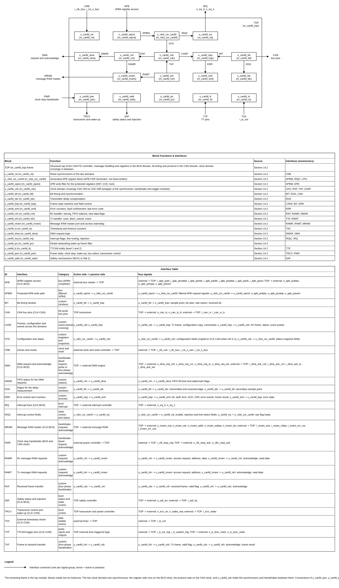

*Figure 5-1. Block diagram of m_canfd_top: BUS domain on the left, CAN domain on the right, clock domain crossings in the middle. Source: `figures/canfd_block_diagram.drawio` (draw.io, VLSIT library, drawn by `vlsit_spec_diagram.py`). The frame is the top module, the blocks are its instances, each connector is one interface with its mnemonic, and the two tables under the diagram in the source file describe the blocks and the interfaces.*

### 5.3 Transaction and dataflow

**Transmit.** Software writes a Tx element into the message RAM and sets the request bit of its buffer. The Tx handler (BUS domain) selects the pending buffer with the lowest identifier, reads its words through the message RAM master into the transmit transfer register, and sends the record to the CAN domain. When the bus is idle, the frame state machine arbitrates and transmits through the stuffing and CRC blocks. It returns a timestamped, one-hot terminal result over CDC. On arbitration loss, BSP drops its local copy and reports the loss; TXH either cancels or resends its retained record. No retry starts before TXH makes that decision. Success and protocol-error outcomes follow the configured completion and retry rules.

**Receive.** The frame state machine assembles the identifier, flags, length, data and SOF timestamp in CAN-domain frame storage. After CRC and ACK processing complete, a valid frame is written as one entry to the asynchronous Rx frame FIFO. The BUS-domain Rx handler reads complete entries from this FIFO, evaluates the filter elements from message RAM, writes the Rx element into the selected FIFO or buffer, updates the put index or new-data flag after the last data word (REQ-MSG-010), and raises the related status and DMA request.

**Configuration.** Software opens the configuration (INIT and CCE set), writes the protected registers, then clears INIT; the CAN domain copies the configuration after it has seen the synchronized INIT flag (REQ-CLK-002).

### 5.4 Invariants

- INV-001: o_can_tx is recessive in reset, in INIT, in sleep and while the node does not transmit.
- INV-002: the configuration seen by the CAN domain does not change while INIT = 0.
- INV-003: at most one message RAM request is outstanding, and its request, address, data and byte enables are stable until the acknowledge.
- INV-004: an Rx element is complete in the RAM before its put index, new-data flag or interrupt flag is visible.
- INV-005: a Tx buffer with a pending request is not modified by the IP and its element is read completely before the first frame bit.
- INV-006: the transmit error counter above 255 implies INIT = 1 until software clears it.
- INV-007: with TTCAN in a time-triggered mode, no frame starts outside its Tx_Enable window.
- INV-008: the fault confinement state and the error counters are consistent (REQ-ERR-002).

## 6. External interfaces and ports

### 6.1 Interface inventory

| Interface ID | Type and revision | Role | Direction at IP boundary | Clock domain | Required / optional | Configurations |
|---|---|---|---|---|---|---|
| IF-001 | AMBA APB4 (REF-006) | Completer (register access of the CPU subsystem) | Input and output | CLK-BUS | Required | All |
| IF-002 | Generic message RAM master (request and acknowledge, 32-bit words) | Master (the IP reads and writes the message RAM) | Output requests, input response | CLK-BUS | Required | All |
| IF-003 | DMA request and acknowledge (level request, pulse acknowledge) | Requester | Output requests, input acknowledge | CLK-BUS | Optional (PARA_CANFD_DMA_EN) | CFG-FULL, CFG-TT, CFG-SAFE |
| IF-004 | CAN bus pins (digital, to a transceiver of ISO 11898-2) | Node | Output transmit, input receive | CLK-CAN (receive input asynchronous) | Required | All |
| IF-005 | Selectable second CAN bus pair | Node selects one physical bus pair at a time | Output transmit, input receive | CLK-CAN (receive input asynchronous) | Optional (PARA_CANFD_RED_EN) | CFG-FULL, CFG-TT, CFG-SAFE |
| IF-006 | Transceiver control and wake-up | Controller of the transceiver | Output enable, input wake-up | CLK-CAN (wake-up input asynchronous) | Required | All |
| IF-007 | Interrupt lines (level, active high) | Source | Output | CLK-BUS | Required | All |
| IF-008 | Clock stop handshake (BUS clock and CAN clock) and wake-up request | Requester of the power controller | Input request, output acknowledges and wake-up | CLK-BUS (acknowledge), CLK-CAN (wake-up) | Required | All |
| IF-009 | External timestamp vector and TTCAN trigger pins | Sink and source of time information | Input vector and triggers, output marks | CLK-CAN (triggers asynchronous) | Optional (PARA_CANFD_TS_EXT_EN, PARA_CANFD_TT_EN) | CFG-TT (triggers), CFG-FULL (vector, optional) |
| IF-010 | Safety status and fault injection | Source and sink | Output error, input injection, message RAM error inputs | CLK-BUS | Optional (PARA_CANFD_SAF_LEVEL) | CFG-SAFE |

### 6.2 Complete port list

The port list is static for one elaboration: the ports of a disabled feature stay present, outputs are tied low (recessive for the bus outputs) and inputs are ignored (REQ-PARAM-001). The width of `o_mram_addr` is `PARA_CANFD_MRAM_AW` (section 8). There is no test port (DFT is not required, section 16). The register block is the generated APB-CSR-Generator module, whose own ports to the design are in section 11.3.

| Port | Direction | Width | Meaning (function) | Clock domain | Signal type | Reset / idle value | Timing / sampling | Configurations |
|---|---|---|---|---|---|---|---|---|
| i_clk_can | Input | 1 | Clock of the CAN domain: bit timing, protocol engine, TTCAN, timestamp counter | CLK-CAN | clock | Not applicable (clock) | Rising edge | All |
| i_clk_bus | Input | 1 | Clock of the BUS domain: APB, message RAM master, DMA, interrupts | CLK-BUS | clock | Not applicable (clock) | Rising edge | All |
| i_rst_n_can | Input | 1 | Active-low reset of the CAN domain | Asynchronous (synchronized inside) | reset | Not applicable (reset input) | Asynchronous assertion, release synchronized to i_clk_can | All |
| i_rst_n_bus | Input | 1 | Active-low reset of the BUS domain | Asynchronous (synchronized inside) | reset | Not applicable (reset input) | Asynchronous assertion, release synchronized to i_clk_bus | All |
| i_apb_psel | Input | 1 | APB select of the completer | CLK-BUS | level | Not applicable (input) | Sampled at the rising edge of i_clk_bus (REF-006) | All |
| i_apb_penable | Input | 1 | APB enable of the access phase | CLK-BUS | level | Not applicable (input) | Sampled at the rising edge of i_clk_bus (REF-006) | All |
| i_apb_pwrite | Input | 1 | APB direction: 1 write, 0 read | CLK-BUS | data (valid with i_apb_psel) | Not applicable (input) | Sampled at the rising edge of i_clk_bus (REF-006) | All |
| i_apb_paddr | Input | 16 | APB byte address of the register | CLK-BUS | data (valid with i_apb_psel) | Not applicable (input) | Sampled at the rising edge of i_clk_bus (REF-006) | All |
| i_apb_pwdata | Input | 32 | APB write data | CLK-BUS | data (valid with i_apb_psel and i_apb_pwrite) | Not applicable (input) | Sampled at the rising edge of i_clk_bus (REF-006) | All |
| i_apb_pstrb | Input | 4 | APB write byte strobes; all ones is the only accepted value | CLK-BUS | data (valid with i_apb_psel and i_apb_pwrite) | Not applicable (input) | Sampled at the rising edge of i_clk_bus (REF-006) | All |
| i_apb_pprot | Input | 3 | APB protection type (bit 1 non-secure) | CLK-BUS | data (valid with i_apb_psel) | Not applicable (input) | Sampled at the rising edge of i_clk_bus (REF-006) | All |
| o_apb_prdata | Output | 32 | APB read data | CLK-BUS | data (valid with o_apb_pready in a read access) | 0 | Changes at the rising edge of i_clk_bus | All |
| o_apb_pready | Output | 1 | APB ready: the access phase completes when it is high | CLK-BUS | level | 0 | Register output | All |
| o_apb_pslverr | Output | 1 | APB error response (details in section 11.4) | CLK-BUS | level (valid with o_apb_pready) | 0 | Register output | All |
| o_mram_req | Output | 1 | Message RAM request; stays high with a stable address until i_mram_ack | CLK-BUS | level | 0 | Register output | All |
| o_mram_we | Output | 1 | Message RAM access direction: 1 write, 0 read | CLK-BUS | data (valid with o_mram_req) | 0 | Stable until i_mram_ack | All |
| o_mram_addr | Output | PARA_CANFD_MRAM_AW | Message RAM word address (PARA_CANFD_MRAM_AW bits, up to 14: 16 K words) | CLK-BUS | data (valid with o_mram_req) | 0 | Stable until i_mram_ack | All |
| o_mram_wdata | Output | 32 | Message RAM write data | CLK-BUS | data (valid with o_mram_req and o_mram_we) | 0 | Stable until i_mram_ack | All |
| o_mram_be | Output | 4 | Message RAM byte enables of a write (all ones in this IP) | CLK-BUS | data (valid with o_mram_req and o_mram_we) | 0 | Stable until i_mram_ack | All |
| i_mram_ack | Input | 1 | Message RAM acknowledge: the access completes; for a read the read data is valid | CLK-BUS | pulse (1 cycle per access) | Not applicable (input) | Sampled at the rising edge; no combinational path to an output | All |
| i_mram_rdata | Input | 32 | Message RAM read data | CLK-BUS | data (valid with i_mram_ack) | Not applicable (input) | Sampled with i_mram_ack | All |
| i_mram_err_cor | Input | 1 | The message RAM corrected an error in the data of this access (ECC) | CLK-BUS | level (valid with i_mram_ack) | Not applicable (input) | Sampled with i_mram_ack; ignored when PARA_CANFD_SAF_RAM_EN is 0 | CFG-SAFE |
| i_mram_err_unc | Input | 1 | The message RAM found an uncorrectable error in the data of this access | CLK-BUS | level (valid with i_mram_ack) | Not applicable (input) | Sampled with i_mram_ack; ignored when PARA_CANFD_SAF_RAM_EN is 0 | CFG-SAFE |
| o_dma_req_rx0 | Output | 1 | DMA request: Rx FIFO 0 holds at least the watermark number of messages | CLK-BUS | level (held until the matching acknowledge) | 0 | Register output | CFG-FULL, CFG-TT, CFG-SAFE |
| o_dma_req_rx1 | Output | 1 | DMA request: Rx FIFO 1 holds at least the watermark number of messages | CLK-BUS | level (held until the matching acknowledge) | 0 | Register output | CFG-FULL, CFG-TT, CFG-SAFE |
| o_dma_req_tx | Output | 1 | DMA request: a Tx buffer is free for a new message | CLK-BUS | level (held until the matching acknowledge) | 0 | Register output | CFG-FULL, CFG-TT, CFG-SAFE |
| o_dma_req_txe | Output | 1 | DMA request: the Tx event FIFO holds at least one event (single) or the watermark (burst), or the flush timeout expired (PARA_CANFD_TXEVT_EN = 1) | CLK-BUS | level (held until the matching acknowledge) | 0 | Register output | CFG-FULL, CFG-TT, CFG-SAFE |
| i_dma_ack_rx0 | Input | 1 | DMA acknowledge of o_dma_req_rx0 | CLK-BUS | pulse (1 cycle) or level (PARA_CANFD_DMA_HS = 1) | Not applicable (input) | Sampled at the rising edge of i_clk_bus | CFG-FULL, CFG-TT, CFG-SAFE |
| i_dma_ack_rx1 | Input | 1 | DMA acknowledge of o_dma_req_rx1 | CLK-BUS | pulse (1 cycle) or level (PARA_CANFD_DMA_HS = 1) | Not applicable (input) | Sampled at the rising edge of i_clk_bus | CFG-FULL, CFG-TT, CFG-SAFE |
| i_dma_ack_tx | Input | 1 | DMA acknowledge of o_dma_req_tx | CLK-BUS | pulse (1 cycle) or level (PARA_CANFD_DMA_HS = 1) | Not applicable (input) | Sampled at the rising edge of i_clk_bus | CFG-FULL, CFG-TT, CFG-SAFE |
| i_dma_ack_txe | Input | 1 | DMA acknowledge of o_dma_req_txe | CLK-BUS | pulse (1 cycle) or level (PARA_CANFD_DMA_HS = 1) | Not applicable (input) | Sampled at the rising edge of i_clk_bus | CFG-FULL, CFG-TT, CFG-SAFE |
| o_can_tx | Output | 1 | CAN transmit data of the selected bus pair: 0 dominant, 1 recessive | CLK-CAN | level | 1 (recessive) | `m_canfd_pwr` selects the primary pair or drives recessive when the secondary pair is selected | All |
| i_can_rx | Input | 1 | CAN receive data of the primary bus pair: 0 dominant, 1 recessive | Asynchronous (synchronized inside) | level | Not applicable (input) | `m_canfd_pwr` selects the active receive pin; BTL synchronizes the selected value before sampling | All |
| o_can_tx_b | Output | 1 | CAN transmit data of the secondary bus pair; recessive while that pair is not selected or PARA_CANFD_RED_EN=0 | CLK-CAN | level | 1 (recessive) | `m_canfd_pwr` selects the secondary output only when enabled and selected | CFG-FULL, CFG-TT, CFG-SAFE |
| i_can_rx_b | Input | 1 | CAN receive data of the secondary bus pair | Asynchronous (synchronized inside) | level | Not applicable (input) | Selected only when PARA_CANFD_RED_EN=1 and the secondary pair is active; BTL synchronizes the selected value | CFG-FULL, CFG-TT, CFG-SAFE |
| o_trcv_en | Output | 1 | Transceiver enable: 1 normal mode, 0 standby | CLK-CAN | level | 0 (standby) | Register output | All |
| i_trcv_wake | Input | 1 | Wake-up indication of the transceiver (high when a wake-up pattern was seen) | Asynchronous (synchronized inside) | level | Not applicable (input) | Two-stage synchronizer | All |
| o_irq_0 | Output | 1 | Interrupt line 0, level, active high | CLK-BUS | level | 0 | Register output | All |
| o_irq_1 | Output | 1 | Interrupt line 1, level, active high | CLK-BUS | level | 0 | Register output | All |
| i_clk_stop_req | Input | 1 | Clock stop request of the power controller | CLK-BUS | level | Not applicable (input) | Held until o_clk_stop_ack | All |
| o_clk_stop_ack | Output | 1 | Clock stop acknowledge: the IP is in INIT and idle, the BUS clock may be stopped | CLK-BUS | level | 0 | Register output | All |
| o_clkc_stop_ack | Output | 1 | CAN clock stop acknowledge: the CAN domain is idle and no clock-dependent wake-up source is in use (wake_bus = 0 and pn_on = 0), so i_clk_can may be stopped; it falls when i_clk_stop_req falls | CLK-CAN | level (held while the clock is stopped) | 0 | Register output; its value is held while i_clk_can is stopped | All |
| o_wake_req | Output | 1 | Wake-up request: wake-up frame, transceiver wake-up or bus activity during sleep | CLK-CAN | level (held until software acknowledges) | 0 | Register output; needs i_clk_can (section 7.4) | All |
| i_ts_ext | Input | 32 | External timestamp vector (low PARA_CANFD_TS_W bits used) | CLK-CAN (synchronous source assumed, ASM-004) | data (stable between two sample points of SOF) | Not applicable (input) | Sampled at the sample point of SOF | CFG-FULL (option) |
| i_tt_evt_trig | Input | 1 | TTCAN event trigger input: a high level when a reference message starts sets Next_is_Gap, a low level ends a gap (`epe` of `cfd_tt_gap`, section 10.13.7) | Asynchronous (synchronized inside) | level (valid when epe is set) | Not applicable (input) | Two-stage synchronizer; the level is sampled at the start of the reference message and in a gap | CFG-TT |
| i_tt_swatch_trig | Input | 1 | TTCAN stop-watch trigger input; its rising edge captures the time | Asynchronous (synchronized inside) | pulse (at least 2 CAN clocks) | Not applicable (input) | Two-stage synchronizer, edge detect | CFG-TT |
| o_tt_time_mark | Output | 1 | TTCAN time mark reached (the cycle time equals the time mark register) | CLK-CAN | pulse (1 cycle) | 0 | Register output | CFG-TT |
| o_tt_sync_mark | Output | 1 | TTCAN start of a basic cycle (reference message received or sent) | CLK-CAN | pulse (1 cycle) | 0 | Register output | CFG-TT |
| o_saf_err | Output | 1 | Safety error: a safety flag of section 18 is set; held until software clears the flags | CLK-BUS | level | 0 | Register output | CFG-SAFE |
| i_saf_inj | Input | 1 | Fault injection enable: with it high the safety flags can be forced by the injection register | Asynchronous (static, synchronized inside) | static | Not applicable (input) | Static during operation; changes only in INIT | CFG-SAFE |

### 6.3 Protocol behavior

**APB4 (REF-006).** Completer; PSEL and PENABLE as in the standard; the wait states and the error response are those of the generated register block (section 11.4).

**Message RAM master.** One request at a time: o_mram_req, o_mram_we, o_mram_addr, o_mram_wdata and o_mram_be rise together and stay stable until i_mram_ack is sampled high; after the acknowledge the request falls for at least one cycle. The RAM may insert any number of wait cycles. A read returns i_mram_rdata with i_mram_ack. The IP accepts one word per request; the RAM and the arbiter in front of it are outside the IP (ASM-001).

**DMA.** The request is a level that rises when the service condition holds and stays until the acknowledge pulse; the DMA engine moves the data through the APB interface or directly to the RAM; the acknowledge means one transfer is done (REQ-IF-003).

**CAN bus pins.** o_can_tx and i_can_rx follow the dominant-0 and recessive-1 convention of ISO 11898-2. The IP does not drive the bus when o_trcv_en is low.

| Case | Legal behavior | Illegal / unsupported case | IP response | Requirement IDs |
|---|---|---|---|---|
| APB access | Aligned 32-bit access with all strobes set | Partial strobe, unaligned address, non-secure access when protection is on | PSLVERR, no register change (section 11.4) | REQ-IF-001 |
| Message RAM request | Request held until acknowledge; one outstanding request | No acknowledge within the programmed time (safety on) | Watchdog flag and interrupt, request released, INIT set when the access was a Tx fetch (REQ-SAFE-002) | REQ-IF-002, REQ-SAFE-002 |
| Message RAM sections | Each access address inside configured RAM; software configures non-overlapping sections | Overlapping section or out-of-range access | Overlap is a software configuration error and is not checked by the IP; a multiword element span is checked before its first request. Out-of-range access is rejected before `o_mram_req`, sets `ram_flt`, and follows the terminal Tx/Rx disposition in DEC-063 | REQ-MSG-001, DEC-060, DEC-063 |
| DMA request | Request until acknowledge, then low at least one cycle | Acknowledge without a request | Ignored | REQ-IF-003 |
| Receive bit stream | Frames of the enabled formats | FD frame while PARA_CANFD_FD_EN is 0 or FD operation is not enabled | Treat as a form error and do not store it (REQ-FUNC-003). For an enabled FD frame with recessive `res`, apply `cfd_ctrl.pxd` (REQ-FUNC-015, DEC-008). | REQ-FUNC-003, REQ-FUNC-015 |
| Selectable dual CAN pair | One pair active | Switch while a frame is on the bus | The selection change is delayed until the bus is idle; this is not automatic failover or simultaneous redundant reception | REQ-IF-006 |
| Clock stop request | Held until acknowledge | Withdrawal before the acknowledge | The IP leaves the stop sequence and returns to its previous state without losing a message | REQ-PWR-001 |

### 6.4 Interrupts and events

Every flag has the four register forms of rule R-040 (raw status, enable, injection when PARA_CANFD_IRQ_INJ_EN is 1, masked status) and a line select bit (REQ-IF-004). The 32 flags below are listed by group (the DMA request status has no interrupt flag; the former protocol exception flag was replaced by the stuck-dominant flag, the protocol exception stays visible as `pxe` of `cfd_sts`); all are set in the BUS domain, events from the CAN domain cross by CDC-007 or CDC-004.

| Signal/event | Polarity | Assert condition | Clear/deassert condition | Mask/priority | Crossing | Reset state |
|---|---|---|---|---|---|---|
| Rx FIFO 0 and 1: new message, watermark, full, message lost | Active high flag; o_irq_0 and o_irq_1 level high | New message written; fill level at or above the watermark; fill level equals the size; a message dropped or overwritten | Write 1 to the flag | Enable bit, line select bit; no priority, software reads the status | CDC-005 then BUS domain | 0 |
| Rx buffer: new data | Active high flag; o_irq_0 and o_irq_1 level high | A dedicated buffer received and stored a message | Write 1 to the flag; a range-fault drop does not set this flag or overwrite old data (DEC-063) | Enable bit, line select bit; no priority, software reads the status | CDC-005 then BUS domain | 0 |
| Tx: complete, cancelled, FIFO empty | Active high flag; o_irq_0 and o_irq_1 level high | A buffer was sent; a cancellation finished, including an automatic cancel-before-start on Message RAM range fault (the per-buffer `cfd_txb_cie.canc_ie` controls `tx_can`); no pending request | Write 1 to the flag | Enable bit, line select bit; no priority, software reads the status | CDC-004 | 0 |
| Tx event FIFO: new, watermark, full, lost | Active high flag; o_irq_0 and o_irq_1 level high | As for the Rx FIFOs; an event element rejected for range fault is also reported lost | Write 1 to the flag | Enable bit, line select bit; no priority, software reads the status | BUS domain | 0 |
| Error warning, error passive, bus-off | Active high flag; o_irq_0 and o_irq_1 level high | Counter or state change of the fault confinement | Write 1 to the flag | Enable bit, line select bit; no priority, software reads the status | CDC-007 | 0 |
| Protocol error: arbitration phase, data phase | Active high flag; o_irq_0 and o_irq_1 level high | Last error code written for a bit, stuff, form, ACK or CRC error | Write 1 to the flag | Enable bit, line select bit; no priority, software reads the status | CDC-007 | 0 |
| Message RAM access failure (`ram_flt`) | Active high raw event; routed to o_irq_0/o_irq_1 when enabled | Access watchdog expired, access to an unprepared element, or an out-of-range generated word address rejected before `o_mram_req` (REQ-SAFE-002, DEC-060); the associated operation completes as specified in DEC-063 | Write 1 to `cfd_irq_raw.ram_flt` | `cfd_irq_en.ram_flt`, masked status, line select; no priority | BUS domain | 0 |
| Timestamp wrap, timeout | Active high flag; o_irq_0 and o_irq_1 level high | The counter wrapped; the timeout counter reached zero | Write 1 to the flag | Enable bit, line select bit; no priority, software reads the status | CDC-007, BUS domain | 0 |
| TDC measurement timeout | Active high sticky flag; routed to the selected `o_irq_0` or `o_irq_1` | No qualifying receive edge by the 127th tq.min boundary | Write 1 to `cfd_tirq_raw.tdc_to` | `cfd_tirq_en.tdc_to` enables it; `tdc_to_line` selects the output | CDC-007 | 0 |
| Wake-up | Active high flag; o_irq_0 and o_irq_1 level high | o_wake_req set | Software acknowledge | Enable bit, line select bit; no priority, software reads the status | CDC-009 | 0 |
| TTCAN events: time mark and error (two flags; the error flag covers lost synchronization, application watchdog and severe error S3, the detail is in cfd_tt_sts) | Active high flag; o_irq_0 and o_irq_1 level high | See REQ-TT-007 and REQ-TT-008 | Write 1 to the flag | Enable bit, line select bit; no priority, software reads the status | CDC-007 | 0 |
| Safety: corrected error, uncorrectable error, other fault (three flags; the detail is in cfd_saf_sts) | Active high flag; o_irq_0 and o_irq_1 level high | A mechanism of section 18 detected a fault | Write 1 to the flag | Enable bit, line select bit; no priority, software reads the status | CDC-007, BUS domain | 0 |
| Bus stuck dominant | Active high status; raw interrupt event `dom_to` | The bus stayed dominant for more than `dom_lim` bit times (10.8.6) | `dom_stk` clears at first recessive sample; interrupt event clears by W1C | Enable and line select; `pexc` is replaced by `dom_to`, while protocol-exception status remains available as `pxe` in `cfd_sts` (DEC-062) | CDC-007 | 0 |
| High priority message | Active high flag; o_irq_0 and o_irq_1 level high | A message accepted by a filter element with a high priority action was stored (detail in `cfd_hpm_sts`) | Write 1 to the flag | Enable bit, line select bit; no priority, software reads the status | BUS domain | 0 |

## 7. Clock, reset, and power

### 7.1 Clock domains

| Domain | Clock port | Edge | Frequency range | Source | Relationship to other clocks | Gating policy |
|---|---|---|---|---|---|---|
| CLK-CAN | i_clk_can | Rising | Frequency selected by the SoC; protocol timing is programmed in time quanta | Low-jitter oscillator or PLL of the SoC (ASM-002) | Asynchronous to CLK-BUS | No gating inside; the SoC may stop it only after o_clk_stop_ack and only without partial networking (section 7.4) |
| CLK-BUS | i_clk_bus | Rising | Frequency selected by the SoC; no minimum ratio to CLK-CAN is specified | System bus clock of the SoC | Asynchronous to CLK-CAN | The SoC may stop it after o_clk_stop_ack; the finite Rx FIFO can overflow during a service stall |

### 7.2 CDC and RDC

The level and event synchronizers use the selected two-stage structure. `PARA_CANFD_CELL_TYPE=0` selects two discrete DFF stages; `PARA_CANFD_CELL_TYPE=1` selects the VLSIT 2-FF synchronizer cell. `VLSIT_SYNTHESIS` selects the technology-cell implementation in the shared wrappers. The CAN-to-BUS transient Rx FIFO is an explicit exception: it always instantiates `m_vlsit_afifo_top` with `PARA_AFIFO_CELL_TYPE=1`, independent of `PARA_CANFD_CELL_TYPE`; bypass is prohibited. `m_canfd_rst` uses two `m_vlsit_rst_sync` instances with `PARA_RST_SYNC_TYPE=2`. A data bundle is registered in its source domain, held stable until handshake completion, and captured after the synchronized request. Before any CDC request, event, or data handshake operates, the CAN and BUS domains exchange synchronized ready indications after local reset release. A domain whose clock has not run since reset remains not-ready. The readiness handshake does not monitor a clock that stops after initialization; the SoC must stop new traffic and use the clock-stop request/acknowledge contract before stopping either clock. APB accesses are local to CLK-BUS and may complete after BUS reset release; their CAN-side effects wait for CDC-ready.

| Crossing ID | From → to | Signals | Structure | Reset handling | Constraints / verification |
|---|---|---|---|---|---|
| CDC-001 | Pin → CLK-CAN | i_can_rx, i_can_rx_b | Two-flop synchronizer, then edge detect for the bit timing | Reset to recessive (1) by RST-CAN | No SDC exception on the pin path other than the input delay; simulation with a random edge position |
| CDC-002 | Pin → CLK-CAN | i_trcv_wake | Two-flop synchronizer | Reset to 0 | As CDC-001 |
| CDC-003 | CLK-BUS → CLK-CAN | Configuration registers (bit timing, modes, filters of partial networking, TT configuration) | Quasi-static copy: INIT level crosses by a two-flop synchronizer; the CAN domain copies the bundle on the synchronized rising and falling INIT flags; the registers change only while INIT is 1 (REQ-CLK-002) | The copy stays at its reset value until INIT has been seen | set_max_delay between the register and the copy flop (EXC-002); formal check that the bundle is stable when INIT is 0 |
| CDC-004 | CLK-CAN → CLK-BUS | Status snapshot: error counters, fault confinement state, last error code, TT time, protocol flags | Four-phase request and acknowledge with a stable bundle; two-flop synchronizers on both control levels | Both sides idle after reset | set_max_delay on the bundle (EXC-003); latency about 3 CLK-BUS plus 3 CLK-CAN cycles; simulation and CDC tool |
| CDC-005 | CLK-CAN -> CLK-BUS | Completed received frame (identifier, flags, DLC, data up to 64 bytes, SOF timestamp); four metadata words then payload at word 4 | Shared `m_vlsit_afifo_top`, width `32 x (4 + DATA_MAX/4)` and depth `PARA_CANFD_RXHOLD_DEPTH` (power of two, at least 2); `PARA_AFIFO_CELL_TYPE=1`; Gray-pointer synchronizers and inferred array storage | Both pointer sets reset with their local domain; FIFO traffic is gated by CDC-ready | Full at frame completion: drop the whole frame before filtering and set sticky `ovr` in `cfd_rx_sts`; no partial entry or FIFO index update (DEC-065, DEC-075, DEC-086) |
| CDC-006 | CLK-BUS → CLK-CAN | Frame to transmit (identifier, flags, DLC, data up to 64 bytes); words 0–1 are Tx headers, words 2–3 zero, payload starts at word 4; ordinary TT trigger tag `{valid, buffer_index[5:0], window_seq[31:0]}` | Four-phase handshake with one transfer register; width `32 x (4 + DATA_MAX/4) + 39` | Free after reset | EXC-003; SVA-004; DEC-086/103 |
| CDC-007 | CLK-CAN → CLK-BUS | Main 32-bit interrupt/event vector, separate 16-bit TTCAN detailed-event vector, and dedicated one-bit TDC timeout event | Three `m_vlsit_event_sync` instances: the main vector drives the 32-bit `cfd_irq_*` bank; the TTCAN vector drives the 16 `cfd_ttirq_*` causes; the TDC event drives `cfd_tirq_raw.tdc_to`. Each bit has a request/acknowledge toggle handshake, two-stage synchronizers, source pending state and a one-cycle destination pulse. Events arriving while pending coalesce; a pulse coincident with acknowledgement is captured as the next event (DEC-076/078). | All vectors reset to 0 and are gated by CDC-ready | The pulse width rule of section 6.2; CDC tool |
| CDC-008 | CLK-BUS → CLK-CAN | Pulse commands use `m_vlsit_event_sync`; TTCAN `sgt` transfers `{gt_pre[15:0]}` with its command through a stable-data handshake; `ecs` remains a pulse command | Pulse events use request/acknowledge toggle handshake as CDC-007. SGT captures the preset on the command edge, holds the payload through a four-phase handshake and produces the CAN command only with the captured payload. | Both mechanisms reset idle and are gated by CDC-ready | SGT payload max-delay and CDC/RDC checks; TEST-075 deferred by DEC-067 |
| CDC-009 | CLK-CAN → CLK-BUS | Wake-up status level | Two-flop level synchronizer; the source level stays high until the acknowledge crosses back by CDC-008 | Reset to 0 | CDC tool |
| CDC-010 | Pin → CLK-CAN | i_tt_evt_trig, i_tt_swatch_trig | Independent two-flop synchronizers; rising-edge detect only for the stopwatch trigger, while the event trigger remains a synchronized level | Reset to 0 | As CDC-001 |
| CDC-011 | Pin → CLK-BUS | i_saf_inj | Two-flop synchronizer (static input) | Reset to 0 | The input is static during operation (ASM-008: changes only in INIT) |
| CDC-012 | CLK-BUS → CLK-CAN | Wake-up frame filter registers (cfd_pnf_*) that may change at run time (REQ-PN-001) | Four-phase handshake of the filter bundle on each software write; the CAN domain keeps the old filter until the new bundle is complete | The copy stays at the reset value | EXC-003; TEST-022 |
| CDC-013 | CLK-CAN → CLK-BUS | Tx result: timestamp, one-hot terminal outcome, trigger-valid/index, trigger-SOF-started and trigger-window-expired | `m_canfd_sync_hsk` four-phase handshake with a 45-bit record `{timestamp[31:0], success, cancel, error, arb_lost, trigger_valid, trigger_index[5:0], trigger_started, trigger_expired}`; a no-SOF expiry uses all-zero terminal qualifiers with `trigger_valid=1`, `trigger_started=0`, `trigger_expired=1` | Both endpoints reset idle; gated by CDC-ready | CDC/RDC check; TEST-071/078/080; DEC-091/103 |
| CDC-014 | CLK-CAN → CLK-BUS → CLK-CAN | TTCAN trigger-cache read request `{word address}` and corresponding Message-RAM response `{read data, range/ECC error}`; one request outstanding | Two `m_canfd_sync_hsk` four-phase bundled-data handshakes: CAN-to-BUS request, then BUS-to-CAN response. The request address and response bundle remain stable through their respective handshakes. The BUS endpoint holds the TT client request until `m_canfd_mram` acknowledges it. | Both endpoints reset idle; no request before both domains are CDC-ready; cache load occurs only while leaving TT configuration mode | EXC-003 bundle max-delay constraints; CDC/RDC check; TEST-072; DEC-095 |
| CDC-015 | CLK-CAN → CLK-BUS | TTCAN Tx-buffer miss mask `o_ttb_miss_set_can[PARA_CANFD_TXBUF_MAX-1:0]` and Rx-trigger miss mask `o_ttr_miss_set_can[63:0]` | CAN domain OR-accumulates distinct pending bits, then transfers `{Rx miss mask, Tx miss mask}` through one `m_canfd_sync_hsk` four-phase bundle. BUS-domain `m_canfd_tt_miss` holds destination acceptance while APB is active, then merges each mask with the current CSR value before asserting its hardware-load enable; repeated misses for the same sticky bit coalesce. | Pending masks clear on reset/readiness loss; a mask in transfer remains stable; CDC is gated by both-domain readiness | EXC-003 bundle max-delay; CDC/RDC check; APB/W1C overlap ordering; TEST-076 deferred by DEC-067 |
| CDC-016 | CLK-CAN → CLK-BUS | Ordered ordinary Tx-trigger descriptors `{window_seq[31:0], merged, buffer_index[5:0]}` from `m_canfd_tt` to `m_canfd_txh` | `m_vlsit_afifo_top` asynchronous FIFO, width 39 bits, depth is the next power of two at or above `PARA_CANFD_TRIG_NUM` (minimum 2); `m_canfd_tt` pulses a descriptor only when FIFO ready; if full, it drops that scheduled opportunity and sets the corresponding `cfd_ttb_miss` bit. BUS consumes in arrival order. The trigger tag follows the selected Tx frame through CDC-006. BSP returns SOF-started and same-window-expired status through CDC-013. TXH sets miss only when no SOF started, completes an in-window started attempt, and blocks retry once that window expires (DEC-102/103). | Both pointer sets reset locally; all accesses gated by CDC-ready; full suppresses write and returns ready low | Gray-pointer CDC/RDC review; bundle constraints; TEST-077–080 deferred by DEC-067 |
| CDC-017 | CLK-CAN → CLK-BUS | Current 32-bit TTCAN Tx-window sequence | Stable-data `m_canfd_sync_hsk` handshake; CAN holds the latest sequence until accepted, and BUS compares sequence tags using modulo-2^32 ordering with fewer than 2^31 outstanding window advances | Both endpoints reset idle; gated by CDC-ready; sequence validity stays low until first snapshot arrives | EXC-003 bundle max-delay; CDC/RDC check; stale-descriptor tests TEST-079/080 |
| RDC-001 | RST-BUS → CLK-CAN logic and RST-CAN → CLK-BUS logic | Reset skew between the domains | Both resets assert together; release skew up to four cycles of the slower clock is supported by a two-way synchronized readiness handshake; no crossing acts before both sides are ready | Each domain resets its own flops; readiness clears on reset | Reset-domain analysis, skew simulation and CDC assertions (TEST-029) |

### 7.3 Reset domains and sequencing

| Reset ID | Port | Polarity / assertion | Sync or async | Scope | Deassertion | Reset value |
|---|---|---|---|---|---|---|
| RST-CAN | i_rst_n_can | Active-low | Async assertion / synchronized release by m_canfd_rst | All flops of the CAN domain | Synchronous to i_clk_can through two flops | INIT-equivalent idle state; o_can_tx recessive; counters zero |
| RST-BUS | i_rst_n_bus | Active-low | Async assertion / synchronized release by m_canfd_rst | All flops of the BUS domain including the register block | Synchronous to i_clk_bus through two flops | Register reset values of the workbook; INIT = 1; handlers idle |

Reset sources: the SoC reset controller; the protocol engine is restarted by INIT, and a software reset of the message handling side exists that does not disturb the bus (section 10.10, DEC-022). Both resets are asserted together; a reset in the middle of a frame abandons it without error signaling, so the bus sees a truncated frame that other nodes treat as an error (ASM-003). Each local reset synchronizer releases independently. Each domain then synchronizes the peer-ready indication; CDC transfers and CAN operation remain blocked until both domains report ready. Release skew up to four cycles of the slower clock is supported. During this wait, the CAN protocol engine stays in its reset/INIT-equivalent idle state, `o_can_tx` is recessive and `o_trcv_en` is low; BUS-local APB accesses can complete, and their CAN-side effects wait until CDC-ready. The message RAM content is not reset; element validity is given by the indexes and the flags, never by the RAM data. Warm and partial resets are not supported. Interrupts and status are cleared by the reset.

### 7.4 Power intent (if applicable)

The IP has no power domain, isolation or retention of its own: it is a single always-on synchronous design (UPF is the SoC owner's). Low power is by clock stop and by sleep (the behavior is in section 10.15). **Sleep:** software sets the sleep request, the IP finishes the current frame, sets INIT, drives o_trcv_en low and shows the sleep state. **Clock stop:** with i_clk_stop_req high the IP completes the pending transmissions, waits for the bus idle, sets INIT and raises o_clk_stop_ack in the BUS domain; the SoC may then stop i_clk_bus; it may stop i_clk_can too only when partial networking is off, because the wake-up frame filter and the bus activity detector need the CAN clock (DEC-015). **Wake-up:** a dominant bit (when partial networking is off), a matching wake-up frame (when on) or i_trcv_wake raises o_wake_req in the CAN domain; the request stays until software acknowledges it; a SoC that stopped the CAN clock must observe the transceiver wake-up itself (ASM-009). **Restart:** o_clk_stop_ack falls after i_clk_stop_req falls; software then clears INIT and the bus integration starts again.

## 8. Parameters and elaboration configurations

Parameters follow the rules of REF-003 (`parameter logic [31:0]` with a name that starts with `PARA_CANFD_`, with the three comment lines, derived `LPARA_CANFD_` values after them). The defaults describe the delivered default configuration, which is CFG-FULL with the safety level 0 (REQ-SAFE-004). Derived values: `LPARA_CANFD_SAF_AUTO` = PARA_CANFD_SAF_AUTO_MASK; `LPARA_CANFD_SAF_xx` (xx = the mechanism name) = the single parameter PARA_CANFD_SAF_xx_EN OR the mechanism is in the preset of the level (18.3.1): RAM, WDT, REG, LOCK, INJ from level 1; CLK, CNT, FSM, E2E, TXC, SAN from level 2; TRG from level 2 when PARA_CANFD_TT_EN is 1; DMA from level 2 when PARA_CANFD_DMA_EN is 1; DUP from no level; `LPARA_CANFD_TS_W_EFF` = PARA_CANFD_TS_W when PARA_CANFD_TS_EN is 1, else 0; `LPARA_CANFD_RXW` = 4 metadata words plus `PARA_CANFD_DATA_MAX / 4` payload words (all allowed `DATA_MAX` values are divisible by four).

| Parameter | Purpose | Default | Legal values / range | Dependencies / invalid combinations | Effect |
|---|---|---|---|---|---|
| PARA_CANFD_FD_EN | Select CAN FD frames | 1 | 0, 1 | None | With 0 the ISO and non-ISO FD logic (CRC17, CRC21, fixed stuff bits, stuff count, BRS, TDC, 64-byte buffers) is removed; an FD frame is a form error |
| PARA_CANFD_NISO_EN | Select the non-ISO FD format | 1 | 0, 1 | Requires PARA_CANFD_FD_EN = 1 when 1 | Adds the non-ISO CRC and stuff rules selectable by a control bit |
| PARA_CANFD_RTR_EN | Select remote frames | 1 | 0, 1 | None | Adds remote frame transmit and receive |
| PARA_CANFD_TDC_EN | Build transmitter delay compensation logic | 1 | 0, 1 | Must equal PARA_CANFD_FD_EN: required in every FD-capable build and absent in a Classic-only build | Adds the delay counter and secondary sample point; `cfd_ctrl.tdc_ena` controls run-time use |
| PARA_CANFD_TXEVT_EN | Select the Tx event FIFO | 1 | 0, 1 | None | Adds the Tx event writer; the Tx event flags are not available when 0 |
| PARA_CANFD_TRTX_EN | Select trigger transmit | 1 | 0, 1 | None | Adds the data-request event and confirm command |
| PARA_CANFD_TS_EN | Select the hardware timestamp | 1 | 0, 1 | None | Adds the counter and the capture; the timestamp words read as zero when 0 |
| PARA_CANFD_TS_W | Timestamp width | 32 | 16, 32 | Used only when PARA_CANFD_TS_EN = 1 | Counter and capture width; the upper half of the timestamp word reads as zero when 16 |
| PARA_CANFD_TS_EXT_EN | Select the external timestamp vector | 0 | 0, 1 | Requires PARA_CANFD_TS_EN = 1 when 1 | Adds the selection of i_ts_ext as time source |
| PARA_CANFD_TOUT_EN | Select the timeout counter | 1 | 0, 1 | None | Adds the 16-bit timeout counter |
| PARA_CANFD_DMA_EN | Select the DMA request logic | 1 | 0, 1 | None | Adds the three request outputs and acknowledge inputs |
| PARA_CANFD_DMA_HS | Select the DMA acknowledge type (DEC-043) | 0 | 0 pulse, 1 four-phase level | Used only when PARA_CANFD_DMA_EN = 1 | The acknowledge is a one-clock pulse or a level with four phases (10.14.3); `cfd_feat0.dma_hs` shows it |
| PARA_CANFD_PN_EN | Select partial networking | 1 | 0, 1 | None | Adds the wake-up frame filter |
| PARA_CANFD_PN_NUM | Number of wake-up frame filters | 4 | 1 to 8 | Used only when PARA_CANFD_PN_EN = 1 | Filter registers and comparators |
| PARA_CANFD_TT_EN | Select TTCAN level 1 | 0 | 0, 1 | None | Adds m_canfd_tt, the trigger memory access and the trigger pins |
| PARA_CANFD_TT_L2_EN | Select TTCAN level 2 (global time, drift compensation) | 0 | 0, 1 | Requires PARA_CANFD_TT_EN = 1 when 1 | Adds the global time, the local offset, the drift compensation and the divider (10.13.8) |
| PARA_CANFD_TT_EXTSYNC_EN | Select external clock synchronisation of the time master | 0 | 0, 1 | Requires PARA_CANFD_TT_L2_EN = 1 when 1 | Adds `ecs`, `sgt` and `cfd_tt_gpre` and the Disc bit generation (10.13.8) |
| PARA_CANFD_TRIG_NUM | Number of triggers (time marks), the size of the trigger cache | 16 | 1 to 64 | Used only when PARA_CANFD_TT_EN = 1 | Number of 33-bit cache words in the CAN domain (DEC-039) |
| PARA_CANFD_RED_EN | Build the secondary CAN bus-pair selector (historical parameter name; one pair active at a time) | 1 | 0, 1 | None | Adds the second pair of pins and the selector; no automatic failover or simultaneous redundant reception |
| PARA_CANFD_IRQ_INJ_EN | Select interrupt injection | 1 | 0, 1 | None | Adds the injection registers of the interrupt flags |
| PARA_CANFD_MRAM_AW | Message RAM word address width | 14 | 8 to 14 | The RAM size is 2 to the power of this value words | Width of o_mram_addr and of the section address registers |
| PARA_CANFD_RXFIFO_NUM | Number of Rx FIFOs | 2 | 1, 2 | None | FIFO 1 logic and registers are removed when 1 |
| PARA_CANFD_RXBUF_MAX | Maximum number of dedicated Rx buffers | 64 | 0 to 64 | None | Size of the new-data flag array and of the filter action; with 0 the buffer action does not exist |
| PARA_CANFD_TXBUF_MAX | Maximum number of Tx buffers | 32 | 1 to 32 | None | Size of the request, cancel and status arrays |
| PARA_CANFD_RXHOLD_DEPTH | Number of complete received frames buffered across CAN/BUS clocks | 2 | Power of two, at least 2 | None | Absorbs finite BUS-side service stalls; if full when a frame completes, the frame is dropped before filtering and sticky `ovr` is set (DEC-065) |
| PARA_CANFD_TX_PREFETCH | Select the Tx commit mode (DEC-027) | 1 | 0, 1 | None | With 1 a second Tx transfer register and the prefetch logic are added and the winner is fetched during the frame; with 0 the winner is scanned and fetched in the intermission (10.12.5) |
| PARA_CANFD_RXF_MAX | Maximum number of elements of one Rx FIFO | 64 | 2 to 64 | Used only when PARA_CANFD_RXFIFO_NUM is at least 1 | Width of the FIFO indexes and fill levels; the section register `num` is limited to it |
| PARA_CANFD_TXE_MAX | Maximum number of Tx event elements | 32 | 1 to 32 | Used only when PARA_CANFD_TXEVT_EN = 1 | Width of the event FIFO indexes; the section register `num` is limited to it |
| PARA_CANFD_DATA_MAX | Maximum number of data bytes per stored or transmitted frame (DEC-033) | 64 | 8, 12, 16, 20, 24, 32, 48, 64 | Not above 8 when PARA_CANFD_FD_EN = 0 | Width of the transfer registers and of the field shift register; the CRC21 unit stays with FD (10.7.6) |
| PARA_CANFD_CELL_TYPE | Synchronizer structure for level and event crossings | 0 | 0 two discrete DFF stages, 1 VLSIT 2-FF synchronizer cell; synthesis cell mapping is selected by `VLSIT_SYNTHESIS` | None | `m_canfd_sync_bit` and `m_vlsit_event_sync`; does not control the common async FIFO, which uses `PARA_AFIFO_CELL_TYPE=1` (DEC-075) |
| PARA_CANFD_SAF_LEVEL | Safety level preset (DEC-049) | 0 | 0 none, 1 basic, 2 full | Above 2 is illegal | Sets a default OR-ed with the single parameters: level 1 = RAM, WDT, REG, LOCK, INJ; level 2 = level 1 plus CLK, CNT, FSM, E2E, TXC, TRG (if TT_EN), DMA (if DMA_EN), SAN; DUP is in no preset |
| PARA_CANFD_SAF_RAM_EN | Safety: message RAM error evaluation (SM-01) | 0 | 0, 1 | Effective when 1 or when level is at least 1 | Adds the flags `ram_cor`, `ram_unc`, the address capture and the reaction |
| PARA_CANFD_SAF_WDT_EN | Safety: message RAM access watchdog (SM-02) | 0 | 0, 1 | Effective when 1 or when level is at least 1 | Adds one counter of 16 bits and the flag `ram_wdt` |
| PARA_CANFD_SAF_REG_EN | Safety: parity of every configuration register (SM-03) | 0 | 0, 1 | Effective when 1 or when level is at least 1 | Adds one parity flop per register and checkers |
| PARA_CANFD_SAF_LOCK_EN | Safety: key-protected configuration write (SM-04) | 0 | 0, 1 | Effective when 1 or when level is at least 1 | Adds the key compare, the lock state and the flag `lk_viol` |
| PARA_CANFD_SAF_CLK_EN | Safety: clock monitor (SM-05) | 0 | 0, 1 | Effective when 1 or when level is 2 | Adds the clock activity counters of both domains |
| PARA_CANFD_SAF_CNT_EN | Safety: compare primary bit-timing/error-counter state with mirrors (SM-06; no independent next-state coverage claim) | 0 | 0, 1 | Effective when 1 or when level is 2 | Mirrors the counter state and compares each clock |
| PARA_CANFD_SAF_FSM_EN | Safety: compare of the frame state (SM-07) | 0 | 0, 1 | Effective when 1 or when level is 2 | Duplicates the frame state register of m_canfd_bsp with a compare |
| PARA_CANFD_SAF_E2E_EN | Safety: end-to-end payload check of the internal data path (SM-08) | 0 | 0, 1 | Effective when 1 or when level is 2 | Adds a signature unit on each side of the transfer registers |
| PARA_CANFD_SAF_TXC_EN | Safety: parity of the Tx key cache (SM-12) | 0 | 0, 1 | Effective when 1 or when level is 2 | Adds one parity flop per key cache entry |
| PARA_CANFD_SAF_TRG_EN | Safety: parity of the TTCAN trigger cache (SM-13) | 0 | 0, 1 | Needs PARA_CANFD_TT_EN = 1 (a single 1 without it is illegal); the preset skips it without TT | Adds one parity flop per trigger cache word |
| PARA_CANFD_SAF_DMA_EN | Safety: DMA request watchdog (SM-14) | 0 | 0, 1 | Needs PARA_CANFD_DMA_EN = 1 (a single 1 without it is illegal); the preset skips it without DMA | Adds one counter of 15 bits per request group |
| PARA_CANFD_SAF_INJ_EN | Safety: fault injection registers and input (SM-11) | 0 | 0, 1 | Effective when 1 or when level is at least 1 | Adds the force logic of every built flag |
| PARA_CANFD_SAF_DUP_EN | Safety: full duplication of the CAN protocol core with output compare (SM-15) | 0 | 0, 1 | Never part of a preset | About 3.5 thousand flops (assumed) and a compare of the core outputs |
| PARA_CANFD_SAF_SAN_EN | Safety: lightweight sanity checks of the trigger sequence, the DMA handshake and the register write count (SM-16) | 0 | 0, 1 | Effective when 1 or when level is 2 | About 60 flops (assumed): two small counters and a few comparators |
| PARA_CANFD_SAF_AUTO_MASK | Safety: automatic enable at reset, one bit per mechanism in the order RAM, WDT, REG, LOCK, CLK, CNT, FSM, E2E, TXC, TRG, DMA, INJ, DUP, SAN (bit 0 to 13) (DEC-054) | 0 | 0 to 16383 | A bit of a mechanism that is not built is illegal | A set bit makes the run-time enable of that mechanism 1 from the reset; the value is shown in `cfd_saf_auto` and `auto_off` of `cfd_saf_ctrl` switches all of them off |

**Illegal combinations (REQ-PARAM-002):** PARA_CANFD_NISO_EN with PARA_CANFD_FD_EN = 0; PARA_CANFD_TDC_EN not equal to PARA_CANFD_FD_EN; PARA_CANFD_TS_EXT_EN with PARA_CANFD_TS_EN = 0; PARA_CANFD_TT_L2_EN with PARA_CANFD_TT_EN = 0; PARA_CANFD_TT_EXTSYNC_EN with PARA_CANFD_TT_L2_EN = 0; PARA_CANFD_TS_W not 16 or 32; PARA_CANFD_PN_NUM outside 1 to 8; PARA_CANFD_TRIG_NUM outside 1 to 64 with TT; PARA_CANFD_MRAM_AW outside 8 to 14; PARA_CANFD_TXBUF_MAX outside 1 to 32; PARA_CANFD_RXBUF_MAX above 64; PARA_CANFD_RXF_MAX outside 2 to 64; PARA_CANFD_DMA_HS other than 0 or 1; PARA_CANFD_DATA_MAX not one of the eight values or above 8 without PARA_CANFD_FD_EN; PARA_CANFD_TXE_MAX outside 1 to 32; PARA_CANFD_SAF_LEVEL above 2; PARA_CANFD_SAF_TRG_EN = 1 without PARA_CANFD_TT_EN; PARA_CANFD_SAF_DMA_EN = 1 without PARA_CANFD_DMA_EN; PARA_CANFD_SAF_AUTO_MASK above 16383 or with a bit of a mechanism that is not built; any option parameter other than the mask other than 0 or 1. Each stops the elaboration with `$error` in a generate-if of the top.

| Configuration | Parameter overrides | Features/interfaces | Expected hierarchy | Elaboration/lint/synthesis target |
|---|---|---|---|---|
| CFG-FULL (delivered default) | The defaults of the table above | FEAT-001 to FEAT-012, FEAT-014 and FEAT-015; TTCAN (FEAT-013) and safety (FEAT-016) are disabled unless enabled by their parameters | All modules of section 14.2 except m_canfd_tt | Elaboration, lint, synthesis of the area reference (section 13) |
| CFG-MIN | PARA_CANFD_FD_EN 0, NISO_EN 0, RTR_EN 0, TDC_EN 0, TXEVT_EN 0, TRTX_EN 0, TS_EN 0, TOUT_EN 0, DMA_EN 0, PN_EN 0, RED_EN 0, IRQ_INJ_EN 0, RXFIFO_NUM 1, RXBUF_MAX 0, TXBUF_MAX 4, MRAM_AW 10, RXHOLD_DEPTH 2, DATA_MAX 8 | Smallest Classic CAN node | No m_canfd_tdc, m_canfd_ts, m_canfd_dma, m_canfd_pn, m_canfd_tt, m_canfd_safe | Elaboration and lint |
| CFG-TT | The defaults and PARA_CANFD_TT_EN 1, PARA_CANFD_TT_L2_EN 1, PARA_CANFD_TRIG_NUM 32 | FEAT-013 added | All modules including m_canfd_tt | Elaboration, lint, TT simulation |
| CFG-SAFE | The defaults and PARA_CANFD_SAF_LEVEL 2 | FEAT-016 with all mechanisms | All modules including m_canfd_safe and the duplicated state | Elaboration, lint, safety simulation with injection |

The delivered default of the safety parameters is 0 because safety logic adds area and should be built only when the integration requires it; CFG-SAFE enables the selected safety-mechanism level-2 set for feature evaluation, not for an ASIL claim (section 18).

## 9. Data representation and arithmetic

Bit 0 is the least significant bit. A frame is sent most significant bit first inside every field. The data bytes of a frame are numbered from byte 0 (sent first); in the message RAM data byte 0 is bits 7:0 of the first data word (little-endian words). The identifier of a base frame is stored left-aligned in a 29-bit field (bits 28:18) so that the numeric comparison of the 29-bit value gives the CAN priority; the priority key is the 29-bit identifier with the extension bit as the least significant tie-breaker (a base frame wins against an extended frame with the same base identifier, as specified by REF-007 §6.6.17.4). Numbers in registers are unsigned.

**Element formats (REQ-MSG-002).** The element formats are the design contract between the IP and the software driver; the offsets and sizes of the sections are in the workbook.

| Quantity | Width | Encoding / range | Extension / truncation | Overflow / invalid behavior |
|---|---|---|---|---|
| Rx element word 0 | 32 | [31] ESI, [30] XTD (1 extended), [29] RTR, [28:0] identifier (base identifier left-aligned in [28:18]) | Base identifier bits [17:0] are zero | None |
| Rx element word 1 | 32 | [31] ANMF (accepted without match), [30:24] filter index, [23:22] generation (incremented at every write of the element, DEC-024), [21] FDF, [20] BRS, [19:16] DLC, other bits zero | DLC as received (9 to 15 stay as received for FD) | Filter index zero when ANMF is 1 |
| Rx element word 2 | 32 | Receive timestamp, zero-extended to 32 bits when PARA_CANFD_TS_W is 16, zero when PARA_CANFD_TS_EN is 0 | Zero extension | Wraps; the wrap flag is an interrupt |
| Rx element data | 8 to 64 bytes | Data bytes 0 to n-1, then zero fill up to the configured element data size; the element has 3 + (size / 4) words | Zero fill of unused bytes | A frame longer than the element data size is stored cut to that size (the DLC keeps the received value) |
| Tx element word 0 | 32 | [31] ESI (the value is sent only by an error-passive node, REQ-FUNC-009), [30] XTD, [29] RTR, [28:0] identifier | As Rx word 0 | None |
| Tx element word 1 | 32 | [31:27] PRIO (fixed priority, 0 highest), [26:24] RTL (retransmission limit code), [23] event flag (EFC), [22] trigger transmit flag, [21] FDF, [20] BRS, [19:16] DLC, [15:0] message marker (the low 8 bits when the marker is 8 bits wide) | Unused bits zero | FDF with PARA_CANFD_FD_EN = 0 is sent as a Classic frame; BRS without FDF is ignored; DLC above 8 in a Classic frame sends 8 bytes |
| Tx element data | 0 to 64 bytes | From word 2; read at most the payload capacity of the configured element and `PARA_CANFD_DATA_MAX` | If truncated, send the largest DLC that fits; do not read into the next element | None |
| Tx event element | 3 words | Word 0 as Tx word 0; word 1: [23:22] event type (01 sent, 10 sent in spite of the cancellation), [21] FDF, [20] BRS, [19:16] original software-written DLC, [15:0] message marker; word 2: transmit timestamp | As Rx word 2 | Event records the original DLC when transmitted DLC is clamped |
| Standard filter element | 32 | [31:29] action (0 disabled, 1 FIFO 0, 2 FIFO 1, 3 reject, 4 FIFO 0 high priority, 5 FIFO 1 high priority, 6 Rx buffer), [28:27] type (0 range, 1 dual, 2 mask, 3 disabled), [26:16] second identifier or mask, [10:0] first identifier; for action 6 the low 6 bits of the second identifier select the buffer | Bits [15:11] are zero | An element with action 0 or type 3 never matches; a range with the first identifier above the second never matches |
| Extended filter element | 64 | Word 0: [31:29] action (as above), [28:0] first identifier; word 1: [31:30] type, [28:0] second identifier or mask | Bit 29 of word 1 is zero | As the standard filter element |

**Internal CAN/BUS frame bundle (REQ-MSG-021, DEC-086).** This transfer record is distinct from the software-visible Message-RAM elements. It uses four metadata words so that payload always starts at word 4 in both CDC directions.

| Direction | Word 0 | Word 1 | Word 2 | Word 3 | Words 4 onward |
|---|---|---|---|---|---|
| CAN → BUS (Rx) | Rx element word 0 | Rx frame flags and DLC; ANMF, filter index and generation fields are zero until `m_canfd_rxh` determines them | SOF timestamp, zero when timestamps are disabled | Zero | Received payload bytes, zero-filled to `PARA_CANFD_DATA_MAX` |
| BUS → CAN (Tx) | Tx element word 0 | Tx element word 1 | Zero | Zero | Tx element payload, repacked from Message-RAM word 2 |

For example, with `PARA_CANFD_DATA_MAX=64`, the bundle has 20 words: four metadata words and sixteen payload words. The Rx handler writes internal words 4–19 to Message-RAM element words 3–18 after inserting its filter result and generation fields into the Rx header. The Tx handler reads Message-RAM words 2 onward and places them at internal words 4 onward. This keeps one payload offset at the CDC boundary; the additional reserved word costs 32 bits per queued frame and avoids direction-dependent payload indexing inside the shared transfer record.
| Nominal bit-time CSR fields | `nbrp` 9 bits, `nprop` 9 bits, `nphs1` 7 bits, `nphs2` 7 bits | `cfd_nbt`: common prescaler m=1..32; `nprop`=1..384 tq; `nphs1`=1..128 tq; `nphs2`=2..128 tq | Prescaler and segment counts use value-minus-one encoding | Scalar out-of-range values clamp and set `cfg_fix`; cross-field violations keep INIT asserted |
| FD data bit-time CSR fields | `dbrp` 5 bits, `dprop` 8 bits, `dphs1` 7 bits, `dphs2` 7 bits; `dsjw` is in `cfd_nbt2` | `cfd_dbt`: common prescaler m=1..32; `dprop`=0..128 tq; `dphs1`=1..128 tq; `dphs2`=2..128 tq | `dprop` is direct; other counts use value-minus-one encoding | `dbrp` must equal the effective `nbrp` prescaler; no PHASE_SEG2-to-PHASE_SEG1 clamp |
| Resynchronization jump widths | `nsjw` and `dsjw`, 7 bits each in `cfd_nbt2` | Each encodes 1..128 tq as value-minus-one | `nsjw` applies to nominal timing; `dsjw` applies to FD data timing | Each must not exceed the smaller phase segment in its timing phase |
| Transmitter delay compensation | `tdcv`, `tdcf`: 7 bits each; `tdco`: 8 bits; internal SSP sum: 9 bits | `tdcv` reports 0..127 tq.min; `tdcf` accepts 0..127 tq.min; `tdco` supports 1..160 tq.min | `tdco`, `tdcf` and measured delay are direct values | The configured offset and internal sum cover the adopted tq.min range; see section 10.6.1 |
| Bus-off recovery count | 8-bit `cfd_bo_cfg.bo_cnt` | 128..255 occurrences; reset value 129 | Direct count | Values below 128 clamp to 128 and set `cfg_fix` |
| Error counters | 8 (REC) and 9 (TEC) bits | REC 0 to 127 and the passive flag; TEC 0 to 256 (bus-off above 255) | None | Saturate at the maximum |
| DLC code | 4 | 0 to 8 give 0 to 8 bytes; 9 to 15 give 12, 16, 20, 24, 32, 48, 64 bytes in FD frames and 8 bytes in Classic frames | None | None |
| Timestamp | 16 or 32 | Unsigned count of timestamp ticks; the tick is the CAN clock divided by a prescaler of 1 to 16 | See Rx word 2 | Wraps |
| Timeout counter | 16 | Counts down in BUS clocks divided by the timeout prescaler; zero raises the flag | None | Stops at zero |
| CRC | 15, 17, 21 | Remainder of the polynomial division; sent most significant bit first | None | None |
| Stuff count (ISO FD) | 3 Gray bits + parity | Dynamic stuff-bit count before the first fixed stuff bit, modulo 8; Gray code plus parity as defined by REF-007 | None | A mismatch is an FD CRC error |

Reserved register fields read as zero and are ignored on write. Scalar timing fields outside their stated limits are clamped to the nearest legal effective value and set `cfg_fix`. An illegal cross-field timing tuple is not repaired: INIT remains asserted and `cfg_fix` stays set until software writes a legal tuple. Other configuration-field behavior is defined by the corresponding register requirement; DEC-014 does not imply an unstated clamp rule. Don't-care values are not used in this contract.

## 10. Detailed functional behavior

### 10.1 Modes and state transitions

| Mode/state | Entry condition | Behavior | Exit condition | Outputs / side effects |
|---|---|---|---|---|
| RESET | Reset of both domains | All state at reset value; outputs idle; INIT = 1 | Both local reset releases synchronized and the two-way ready handshake complete | o_can_tx recessive, o_trcv_en low |
| INIT | Reset exit, bus-off, clock stop, sleep, an uncorrectable safety error, or software sets INIT | Protocol engine stopped; configuration writable with CCE = 1; the message RAM is accessible by software | Software clears INIT | o_can_tx recessive |
| INTEGRATING | INIT cleared | Waits for 11 consecutive recessive bits (bus idle) | 11 recessive bits seen | No transmission |
| NORMAL | Bus idle detected | Transmit and receive; acknowledge | INIT set, restricted mode selected, or bus-off | Frames on the bus |
| RESTRICTED | Selected by a control bit | Receive only with the ACK transmitted; no transmission; stay recessive after errors | Mode bit cleared | Used when a transmission is not allowed |
| MONITOR | Selected by a control bit | Receive only without any dominant bit, even for the ACK and the error flag | Mode bit cleared | Used for analysis |
| LOOPBACK | Selected by a control bit (test) | The transmit path is looped to the receive path inside the IP (internal) or the bus is used for ACK (external) | Mode bit cleared | Used for self-test |
| SLEEP | Sleep request completed | Transceiver standby; CAN clock runs for PN or bus activity detection | Wake-up request acknowledged | o_wake_req on a wake-up |
| ERROR ACTIVE / WARNING / PASSIVE / BUS-OFF | Error counter thresholds of REQ-ERR-002 | Error flag type and suspend transmission change with the state; bus-off forces INIT | Counters fall; bus-off recovery | Status flags and interrupts |
| TT MODES | TT operation mode register | Event-driven (default), configuration, strictly time-triggered, event-synchronised time-triggered | Mode register changed in INIT and CCE | TT outputs |

### 10.2 Operations

| Operation ID | Inputs / preconditions | Processing semantics | Result / completion | Latency / ordering |
|---|---|---|---|---|
| OP-001 | Transmit request of a buffer, bus idle | Select the pending buffer of the lowest priority key, read its element in words from the RAM into the transfer register, hand it to the CAN domain, wait for the bus idle, send SOF and the frame, arbitrate; on loss of arbitration become a receiver and send again later unless single-shot | Request flag cleared, Tx event written, flags set; a lost or failed frame stays pending | Fetch finishes before SOF; one frame at a time; the next scan starts at the end of the interframe space |
| OP-002 | A valid frame is received while INIT = 0 | Assemble and validate the full frame; send ACK as required; enqueue it in the CAN-to-BUS Rx frame FIFO; filter and store it in the BUS domain | Stored, filtered or rejected frame; status and DMA updated | If the FIFO is full at frame completion, drop before filtering and set `ovr` (DEC-065) |
| OP-003 | A cancellation is requested for a buffer | The buffer request is cleared if the frame has not started; otherwise the frame ends normally and the event shows it was sent | Cancelled flag or Tx event | Acts at the next scan point |
| OP-004 | Software writes the get index of an Rx FIFO | The get index moves, the fill level falls, the full and lost flags are re-evaluated | Space for the next message | One write per acknowledge |
| OP-005 | An FD frame is sent or received | Switch to the data bit time after the BRS bit, apply the CRC17 or CRC21 and the fixed stuff bits, measure the transmitter delay and use the secondary sample point, switch back after the CRC delimiter | Frame completed with ESI, BRS and FDF flags | The switch points are bit exact (REQ-FUNC-011) |
| OP-006 | An error condition is detected | Apply the profile-specific error-flag timing, update counters and last-error status, then handle the delimiter and inter-frame space; process required reactive overload conditions | Counters, state, flags updated | CC CRC error: first EOF bit; ISO FD CRC error: after the standard delay following CRC delimiter |
| OP-007 | Bus-off | Set INIT and stop; after software requests restart, count the configured number of occurrences of eleven consecutive recessive bits, with an effective minimum of 128; reset both counters after recovery. `bo_cnt` reset value is 129. | Node back on the bus | REF-007 §8.1.4.4; DEC-074 |
| OP-008 | Sleep or clock stop request | Finish the frame, set INIT, drive the transceiver standby, acknowledge; wake on the conditions of REQ-PN-002 or REQ-PN-001 | o_clk_stop_ack, o_wake_req | No frame is lost; one request at a time |
| OP-009 | Frame during sleep with partial networking | Compare identifier, DLC and data with each wake-up filter without storing the frame; a match raises the wake-up request; a frame with an error does not wake the node | o_wake_req | During the frame |
| OP-010 | TTCAN operating, trigger cache loaded | Run the NTU and the cycle time, synchronize on the reference message, activate the triggers in list order by cycle code and time mark, open the Tx_Enable window, send periodic and event messages, check the Rx triggers, count the Tx triggers per matrix cycle, keep the error level, and (level 2) correct NumAct | Time-triggered transmissions, miss flags, sync state, interrupts | Fixed by the system matrix (10.13) |
| OP-011 | DMA request | Hold the request while the condition holds, drop it for one cycle after the acknowledge, evaluate again | Requests per service condition | One request per FIFO and one for the Tx buffers |
| OP-012 | SOF sample point | Capture the timestamp counter for Tx/Rx at the SOF sample point; transfer the captured Rx value with its frame and store it in the Rx/Tx event element | Timestamp in the element | Exact sample-point capture selected by DEC-068 |
| OP-013 | Bus selection register written | Wait for the bus idle, change the selection, keep the unselected output recessive | Selected bus active | At most one frame time |
| OP-014 | A safety mechanism detects a fault | Set the local flag and local reaction no later than the next active edge in the detecting domain; propagate cross-domain status through the defined CDC; apply the configured stop/report reaction | Local status, `o_saf_err`, interrupt, and possibly INIT | Local response is one detecting-domain clock; system diagnostic time and FTTI are integrator-defined (DEC-066) |
| OP-015 | INIT = 1 and CCE = 1 | Software writes the configuration registers; clearing INIT lets the CAN domain copy the configuration and start the bus integration | New configuration active | Writes are ignored while INIT = 0 or CCE = 0 (REQ-SAFE-003) |
| OP-016 | A buffer flagged trigger transmit is next | Raise the data request event, wait for confirm, then send; do not block other buffers | Frame sent after confirm | DEC-030 |
| OP-017 | A frame with the event flag was sent | Write the Tx event element and advance the put index | Event FIFO updated | After the end of the frame |
| OP-018 | An interrupt event or a software injection | Set the raw flag, mask by the enable, route to the selected line; software clears by writing 1 | o_irq_0 or o_irq_1 | One BUS clock after the flag |
| OP-019 | Any bus level change at i_can_rx, INIT = 0 or the bus integration | Synchronize the input, detect the recessive to dominant edge, hard-synchronize or resynchronize by the rules of 10.6.4, count time quanta, produce the sample point and the transmit point, switch the bit time at the BRS bit and the CRC delimiter | `sample`, `sample_val`, `tx_point` strobes for m_canfd_bsp | The sample point is `2 + tseg1` CAN clocks after the pin edge of SOF at `brp` 1 (10.6.2); one sample per bit |
| OP-020 | A bit is sampled, a frame field ends or the bus shows an illegal level | Monitor the own bit, check stuffing, form, CRC and acknowledge; on an error apply profile-specific signaling, update counters and last-error status; keep o_can_tx recessive where the node must not transmit | Error event, counters, state, flag on the bus | Other errors: following bit; CC CRC: first EOF bit; ISO FD CRC: after three bit-times following CRC delimiter (10.8) |
| OP-021 | Software writes `soft_rst` of `cfd_srst` | Wait until no transfer between the clock domains is in progress, then return the Rx handler, Tx handler, message RAM master, DMA logic, interrupt flags, timestamp and timeout counters to the reset state; keep the configuration registers, the protocol engine, the error counters and the bus pins | `soft_rst` cleared, `srst_busy` low | At most the duration of one frame transfer through the crossing plus 8 BUS clocks; the bus is not disturbed |

### 10.3 Cycle-level behavior

**Waveform plan (rule R-024).** The list below covers every operation of 10.2, the success and the error case of every interface and the special cases. The first 18 waveforms were agreed with the user on 2026-11-04 (28 in the end, see below); the user also asked the author to add the 10 most important further waveforms (WF-019 to WF-028), which are marked in the last column. Each figure is the WaveDrom rendering of the source file beside it in `figures/`.

| Waveform ID | Function / operation | Scenario (success / error / corner) | Signals shown | Figure | Confirmed by user |
|---|---|---|---|---|---|
| WF-001 | OP-001 Transmit of a Classic base-format data frame with 2 data bytes | Success | o_can_tx, i_can_rx, bit time marks, ACK slot, tx state | figures/wf_001.svg | 2026-11-04 |
| WF-002 | OP-002 Receive of a Classic frame with acknowledge and store | Success | i_can_rx, o_can_tx (ACK), o_mram_req, o_irq_0 | figures/wf_002.svg | 2026-11-04 |
| WF-003 | OP-001 Arbitration loss and retransmission | Corner | o_can_tx, i_can_rx, arbitration state | figures/wf_003.svg | 2026-11-04 |
| WF-004 | OP-005 CAN FD frame with bit rate switch | Success | o_can_tx, nominal and data bit time, BRS, CRC delimiter | figures/wf_004.svg | 2026-11-04 |
| WF-005 | OP-005 CRC field of an ISO FD frame (fixed stuff bits and stuff count) | Success | o_can_tx, stuff count, fixed stuff bits | figures/wf_005.svg | 2026-11-04 |
| WF-006 | OP-005 Transmitter delay measurement and secondary sample point | Success | o_can_tx, i_can_rx with loop delay, SSP | figures/wf_006.svg | 2026-11-04 |
| WF-007 | OP-006 Bit error and active error frame | Error | o_can_tx, i_can_rx, error counters | figures/wf_007.svg | 2026-11-04 |
| WF-008 | OP-006 Error passive and bus-off entry | Error | TEC, state, INIT, o_can_tx | figures/wf_008.svg | 2026-11-04 |
| WF-009 | OP-007 Bus-off recovery with effective minimum count 128 and reset value 129 | Corner | INIT, recovery counter, i_can_rx | figures/wf_009.svg | DEC-074 |
| WF-010 | OP-002 Message RAM write of an Rx element and put index update | Success | o_mram_req, o_mram_addr, i_mram_ack, put index, new-data flag | figures/wf_010.svg | 2026-11-04 |
| WF-011 | OP-001 and OP-016 Message RAM read of a Tx element, priority selection and trigger transmit data request | Success | Tx request, o_mram_req, i_mram_ack, selected buffer | figures/wf_011.svg | 2026-11-04 |
| WF-012 | OP-015 APB configuration write and status read | Success | i_apb_psel, i_apb_penable, o_apb_pready, o_apb_pslverr | figures/wf_012.svg | 2026-11-04 |
| WF-013 | OP-002 Received frame crossing from CLK-CAN to CLK-BUS | Success | request, acknowledge, valid flag, data stable | figures/wf_013.svg | 2026-11-04 |
| WF-014 | OP-015 Configuration change with INIT and CCE and copy to CLK-CAN | Success | INIT, CCE, synchronized INIT, copy strobe | figures/wf_014.svg | 2026-11-04 |
| WF-015 | OP-011 DMA transfer of an Rx FIFO | Success | fill level, o_dma_req_rx0, i_dma_ack_rx0 | figures/wf_015.svg | 2026-11-04 |
| WF-016 | OP-018 Interrupt flag set, inject, enable, line select and clear | Success | flag, enable, inject, o_irq_0, o_irq_1 | figures/wf_016.svg | 2026-11-04 |
| WF-017 | OP-008 and OP-009 Clock stop handshake, sleep and wake-up by a partial networking frame | Corner | i_clk_stop_req, o_clk_stop_ack, o_wake_req, i_trcv_wake | figures/wf_017.svg | 2026-11-04 |
| WF-018 | OP-010 TTCAN reference message, basic cycle and time mark | Success | cycle time, o_tt_sync_mark, o_tt_time_mark, o_can_tx | figures/wf_018.svg | 2026-11-04 |
| WF-019 | OP-006 Stuff error: six equal bits | Error | i_can_rx, stuff counter, error flag | figures/wf_019.svg | 2026-11-04 (author proposal inside the user's answer) |
| WF-020 | OP-005 Selection of CRC15, CRC17 and CRC21 by frame type and length | Corner | frame type, DLC, selected CRC, CRC bits | figures/wf_020.svg | 2026-11-04 (author proposal inside the user's answer) |
| WF-021 | OP-001 Resynchronization by a late and an early edge | Corner | i_can_rx edge, segments, sample point shift | figures/wf_021.svg | 2026-11-04 (author proposal inside the user's answer) |
| WF-022 | OP-002 Filter evaluation in list order with the first match | Success | identifier, filter index, action, o_mram_req | figures/wf_022.svg | 2026-11-04 (author proposal inside the user's answer) |
| WF-023 | OP-003 and OP-017 Transmit priority, cancellation of a request and the Tx event | Corner | request flags, selected buffer, cancel, event | figures/wf_023.svg | 2026-11-04 (author proposal inside the user's answer) |
| WF-024 | OP-004 Rx FIFO full in blocking and in overwrite mode | Corner | put index, get index, fill level, message lost | figures/wf_024.svg | 2026-11-04 (author proposal inside the user's answer) |
| WF-025 | OP-006 Overload frame and suspend transmission of an error-passive node | Corner | o_can_tx, intermission, suspend | figures/wf_025.svg | 2026-11-04 (author proposal inside the user's answer) |
| WF-026 | OP-013 Select the secondary bus pair | Corner | bus select, o_can_tx, o_can_tx_b, bus idle | figures/wf_026.svg | 2026-11-04 (author proposal inside the user's answer) |
| WF-027 | OP-014 Uncorrectable message RAM error with the safety flag | Error | i_mram_err_unc, INIT, o_saf_err, o_irq_0 | figures/wf_027.svg | 2026-11-04 (author proposal inside the user's answer) |
| WF-028 | OP-012 Timestamp capture at SOF sample point | Success | SOF, sample point, capture, timestamp counter | figures/wf_028.svg | DEC-068 |
| WF-029 | OP-019 Bit time segments, sample point and transmit point | Success | i_can_rx, rx_s, segment, tq index, sample point, tx point | figures/wf_029.svg | 2026-11-05 (user request: detailed analysis of the bit sampling) |
| WF-030 | OP-019 Hard synchronization on the SOF edge from bus idle | Success | i_can_rx, rx_s, segment, sync event | figures/wf_030.svg | 2026-11-05 (user request: detailed analysis of the bit sampling) |
| WF-031 | OP-019 Resynchronization of a late edge larger than SJW | Corner | i_can_rx, segment, tq index, sync event, sample point | figures/wf_031.svg | 2026-11-05 (user request: detailed analysis of the bit sampling) |
| WF-032 | OP-019 Resynchronization of an early edge larger than SJW | Corner | i_can_rx, segment, tq index, sync event, sample point | figures/wf_032.svg | 2026-11-05 (user request: detailed analysis of the bit sampling) |
| WF-033 | OP-019 Resynchronization of an edge not larger than SJW | Corner | i_can_rx, segment, sync event, sample point | figures/wf_033.svg | 2026-11-05 (user request: detailed analysis of the bit sampling) |
| WF-034 | OP-019 A node that sends dominant does not resynchronize (rule 4) | Corner | i_can_rx, segment and sync event of both nodes | figures/wf_034.svg | 2026-11-05 (user request: detailed analysis of the bit sampling) |
| WF-035 | OP-019 Synchronization rules 1 and 2 with a glitch edge | Corner | i_can_rx, rx_s, segment, sync event | figures/wf_035.svg | 2026-11-05 (user request: detailed analysis of the bit sampling) |
| WF-036 | OP-005 Bit rate switch at the BRS bit and back at the CRC delimiter | Success | i_can_rx, segment, bit time in use, sample point, tx point | figures/wf_036.svg | 2026-11-05 (user request: detailed analysis of the bit sampling) |
| WF-037 | OP-005 Secondary sample point with a loop delay longer than the data bit | Corner | o_can_tx, i_can_rx, secondary sample point, compare | figures/wf_037.svg | 2026-11-05 (user request: detailed analysis of the bit sampling) |
| WF-038 | OP-019 Hard synchronization at the FDF to res edge | Corner | i_can_rx, segment, sync event | figures/wf_038.svg | 2026-11-05 (user request: detailed analysis of the bit sampling) |
| WF-039 | OP-019 Edge-filter illustration at brp=1; not verification evidence | Corner | i_can_rx, rx_s, segment, sync event | figures/wf_039.svg | DEC-067 backlog |
| WF-040 | OP-020 Bit monitoring of the transmitter and its exceptions | Error | o_can_tx, i_can_rx, field, monitor result | figures/wf_040.svg | 2026-11-05 (user request: detailed analysis of the bit sampling) |
| WF-041 | Legacy illustration; superseded because it applies one CRC-error timing rule to both profiles | Error | See WF-071 | figures/wf_041.svg (historical; do not use for requirements) | Superseded by WF-071 |
| WF-042 | OP-020 Error counters and the change to error passive | Error | event, TEC, REC, ep, flag type | figures/wf_042.svg | 2026-11-05 (user request: detailed analysis of the bit sampling) |
| WF-043 | OP-021 Software reset of the message handling side while a frame is on the bus | Corner | soft_rst, srst_busy, frame on the bus, o_can_tx, handler state, Tx request, Rx FIFO fill | figures/wf_043.svg | 2026-11-05 (user decision: soft reset that does not disturb the bus) |
| WF-044 | OP-002 Acceptance filter walk in list order with RAM wait states | Success | rx_valid, o_mram_req, i_mram_ack, filter index, match, action | figures/wf_044.svg | 2026-11-05 (user request: analysis of RX, filter and FIFO) |
| WF-045 | OP-004 Overwrite mode: an element is overwritten while software reads it | Corner | software reads, hardware writes, generation, lost flag, get index | figures/wf_045.svg | 2026-11-05 (user request: analysis of RX, filter and FIFO) |
| WF-046 | OP-002 Rx frame FIFO full: drop completed frame before filtering and set overrun | Error | Frame completion, FIFO full, filter, ovr | figures/wf_046.svg | DEC-065 |
| WF-047 | OP-001 Transmit commit point in the prefetch mode and in the re-scan mode | Corner | frame on the bus, scan and fetch, freeze, request | figures/wf_047.svg | 2026-11-06 (user request: deeper analysis of the transmit path) |
| WF-048 | OP-001 Retransmission limit and the failed buffer | Error | attempt, result, retry counter, request, cancellation, fail | figures/wf_048.svg | 2026-11-06 (user request: deeper analysis of the transmit path) |
| WF-049 | OP-016 Trigger transmit buffer: only valid data is sent | Corner | trigger buffer state, request, data request, software write, confirm, other buffer, trigger buffer | figures/wf_049.svg | 2026-11-06 (user request: deeper analysis of the transmit path) |
| WF-050 | OP-001 Priority configurations: by identifier, fixed priority, express buffer | Corner | the order of three requested buffers in four configurations | figures/wf_050.svg | 2026-11-06 (user request: configurable Tx priority) |
| WF-051 | OP-020 Bus stuck dominant: flag and interrupt after the limit | Error | i_can_rx, dominant counter, dom_stk, dom_to, o_irq_0, o_can_tx | figures/wf_051.svg | 2026-11-06 (user request: stuck-dominant detection) |
| WF-052 | OP-020 LLC overload request when the asynchronous Rx frame FIFO has no free entry | Corner | frame fields, FIFO full, o_can_tx, ovr in both modes | figures/wf_052.svg | 2026-11-06 |
| WF-053 | OP-010 System matrix of four basic cycles and cycle codes | Success | cycle count, reference message, Tx triggers A, D, E | figures/wf_053.svg | 2026-11-06 (user request: deeper analysis of TTCAN) |
| WF-054 | OP-010 Merged arbitrating window with a retransmission inside the window | Corner | bus, window, merged and single trigger, Y request and done | figures/wf_054.svg | 2026-11-06 (user request: deeper analysis of TTCAN) |
| WF-055 | OP-010 Tx_Enable window missed because the bus is busy | Error | bus, trigger, Tx_Enable window, miss flag, txu | figures/wf_055.svg | 2026-11-06 (user request: deeper analysis of TTCAN) |
| WF-056 | OP-010 Time master failure and takeover by the backup master | Error | reference message, backup timer, master state | figures/wf_056.svg | 2026-11-06 (user request: deeper analysis of TTCAN) |
| WF-057 | OP-010 Gap in the event-synchronised mode and its end | Corner | bus, nig, Next_is_Gap, sync state, event | figures/wf_057.svg | 2026-11-06 (user request: deeper analysis of TTCAN) |
| WF-058 | OP-010 Level 2 drift compensation of a slave 300 ppm fast | Corner | NumAct, cycle length error, qcs, gte | figures/wf_058.svg | 2026-11-06 (user request: deeper analysis of TTCAN) |
| WF-059 | OP-011 Rx DMA request for one message and the re-arm rule | Success | fill level, request, acknowledge, ack_go, naive request | figures/wf_059.svg | 2026-11-07 (user request: deeper analysis of the DMA interface) |
| WF-060 | OP-011 Rx DMA burst of four messages | Success | fill level, request, DMA reads, ack_go, acknowledge | figures/wf_060.svg | 2026-11-07 (user request: deeper analysis of the DMA interface) |
| WF-061 | OP-011 Tx DMA request while buffers are free | Corner | used buffers, request, element write, request bit, acknowledge | figures/wf_061.svg | 2026-11-07 (user request: deeper analysis of the DMA interface) |
| WF-062 | OP-011 Burst service with the flush timeout | Corner | fill level, flush timer, request, rx0_fl, ack_go, acknowledge | figures/wf_062.svg | 2026-11-07 (user request: burst with a flush timer) |
| WF-063 | OP-011 Four-phase DMA handshake | Corner | request, acknowledge level, ack_go, fill level, re-arm | figures/wf_063.svg | 2026-11-07 (user request: four-phase option) |
| WF-064 | OP-011 Tx event DMA burst of two events | Success | event fill level, request, reads, ack_go, acknowledge | figures/wf_064.svg | 2026-11-07 (user request: Tx event DMA request) |
| WF-065 | OP-008 Sleep entry and the refusal with a pending Tx request | Corner | bus, sleep_req, power state, Tx request, init, o_trcv_en, slp_blk | figures/wf_065.svg | 2026-11-07 (user request: deeper analysis of power and partial networking) |
| WF-066 | OP-009 Wake-up frame match decided at the CRC delimiter | Success | field, i_can_rx, match, CRC ok, o_wake_req | figures/wf_066.svg | 2026-11-07 (user request: deeper analysis of power and partial networking) |
| WF-067 | OP-008 Wake-up and restart with the transceiver delay and the bus integration | Success | o_wake_req, wake_ack, o_trcv_en, trcv_dly, init, integration | figures/wf_067.svg | 2026-11-07 (user request: deeper analysis of power and partial networking) |
| WF-068 | OP-009 Frames that do not wake the node | Error | identifier mismatch, error, FD frame, match, o_wake_req | figures/wf_068.svg | 2026-11-07 (user request: deeper analysis of power and partial networking) |
| WF-069 | OP-008 Clock stop of both clocks and the restart by the transceiver wake-up | Corner | clock stop request, init, both acknowledges, i_clk_can, i_trcv_wake | figures/wf_069.svg | 2026-11-07 (user request: clock stop handshake of the CAN clock) |
| WF-070 | OP-014 Fault reaction chosen per flag: report only and stop | Error | fault events, safety flags, o_saf_err, init, o_can_tx | figures/wf_070.svg | 2026-11-07 (user request: safety analysis with options) |
| WF-071 | OP-020 CRC-error signaling in Classical CAN and ISO CAN FD | Error | field, CRC error, ACK, o_can_tx, bus sample, error flag | figures/wf_071.svg; source: figures/wf_071.json | ISO 11898-1:2024 §§6.6.21.3.1, 6.6.10.5, 6.6.11.5 |
| WF-072 | OP-010 FD eligibility across TTCAN event-driven and strict TT windows | Corner | window kind, FD SOF/EOF, Classic frame, TT trigger, missed trigger | figures/wf_072.svg; source: figures/wf_072.json | DEC-072, REQ-TT-018 |
| WF-073 | OP-005 TDC counts tq.min at dbrp=1 (m = 2) | Corner | i_clk_can, i_cfd_dbt_dbrp, tdc_measure_start, o_can_tx, i_rx_sync, tdc count, o_tx_point, SSP compare | figures/wf_073.svg; source: figures/wf_073.json | DEC-104 |
| DEC-105 | Decision | Question: may the total bit time exceed the minimum ranges 8..80 tq (nominal) and 5..25 tq (data) of ISO 11898-1 §7.3.3? Option A: cap the totals at those values; Option B: allow the totals that the CSR field maxima give, 641 and 385 tq. Answer: B (review 2026-11-11). §7.3.3 states 8..80 and 5..25 as "at least" ranges and lets a node exceed them, and DEC-023 adopts the Table 13 segment ranges; with the cap of A, `nprop` above about 76 and `dprop` above about 21 could never be used, and the tuple was rejected with `cfg_fix`. `m_canfd_btl` now checks 8..641 and 5..385; the other rules (equal prescalers, data rate not below nominal, PHASE_SEG2 and SJW relations, total at least 8 and 5) are unchanged. The CSR field widths are kept: `nbrp[8:5]` and `dprop` codes above 128 are never legal and are reported by `cfg_fix`. Example: `nprop` code 383 with `nphs1` and `nphs2` code 127 is a legal 641-tq nominal bit. | Review finding F6; REQ-BTL-001; TEST-084 |
| DEC-106 | Decision | Question: keep the RTL-and-lint-only scope of DEC-067, or start simulation now? Answer: start now (review 2026-11-11, finding F7). A regression in `verification/` runs the unit tests and a frame co-simulation of `m_canfd_bsp` against an independent encoder written from the standard (stuffing, CRC, stuff count, fixed stuff bits, field layout). DEC-067 stays only for the items it names (oscillator-tolerance oracle, edge-filter correction, WF-039). The first run found five defects that lint could not find, all fixed: the transmit stuffing ignored the SOF bit, so an identifier with four leading zeros had no stuff bit; a receiving node drove its own stale identifier and stuff bits on the bus; the receiver skipped the data field of every frame with data because it used the length before it was latched; the CRC bit index restarted after each fixed stuff bit, so no ISO FD frame could be sent or checked; and an extended Classic frame lost its r0 bit. Example: the extended Classic frame with identifier 0x17555ACA and no data is now received with a dominant ACK in the right bit. | Review finding F7; TEST-085; section 15.1 |
| DEC-107 | Decision | Question: how far is `m_canfd_top` reworked in this pass? Option A: rule fixes only; Option B: rule fixes and the full integration of every child port. Answer: B was chosen (designer 2026-11-11), with the original top saved first and the specification edited in place. Result: the rule fixes are done without changing one connection (873 producer-consumer pairs before and after, `tools/check_top_equiv.py`); the wires carry the name of their signal (`w_<signal>`), an output port that mirrored a wire is connected to the child directly (no assign, HIE-02), and a child output that nobody reads is left unconnected. 17 connections were added where the producer has the same name as the input apart from the prefix and the domain suffix and the domains are known and equal (for example `u_bsp.o_tx_result_valid` to `u_cdc.i_tx_result_valid_can`). The other 525 inputs have no same-name producer: 335 are CSR inputs, 190 are inputs of the functional modules. They are not tied to invented values (R-005); each stays a named placeholder net `w_open_NNNN` and is listed in `research/top_integration_open_items_2026-11-11.md` with name-similarity hints. Section 11.3 fixes the module that drives each CSR register but not the signal layout of the snapshots, so the remaining families need the designer: the CSR status inputs from the CDC snapshot vectors, the hardware-load pairs of `cfd_irq_raw`, the constants of `cfd_feat0`, `cfd_feat1`, `cfd_ver`, `cfd_saf_bld` and `cfd_saf_auto` from the parameters, and the module controls that come from CSR fields under another name. Example: `u_dma.i_burst` has no producer; the CSR has `o_cfd_dma_cfg_rx0_burst`, `rx1_burst`, `tx_burst` and `txe_burst`, so a decision on which bit feeds which channel is needed. | Review of the top; TEST-086; section 14.2.6 | Open: 525 inputs |
| DEC-108 | Decision | Question: how are the reset, clock and build-constant families of the top connected? Answers (designer 2026-11-11): (1) every child module takes the synchronized reset of `u_rst` (`o_rst_n_can` for CLK-CAN modules, `o_rst_n_bus` for CLK-BUS modules and for the CSR APB and register reset); `u_rst` itself keeps the raw `i_rst_n_can` / `i_rst_n_bus`; (2) the CSR clocks `i_clk_apb` and `i_clk_reg` take `i_clk_bus` (section 11.1); `i_protect_en` = 0 and `i_slverr_en` = 1 (DEC-018); (3) the build constants of `cfd_feat0`, `cfd_feat1`, `cfd_ver`, `cfd_saf_bld` and `cfd_saf_auto` come from the parameters; the safety bits come from `u_safe.o_saf_build_mask_bus` and `o_saf_auto_mask_bus` (effective values after the level preset, DEC-054 bit order RAM, WDT, REG, LOCK, CLK, CNT, FSM, E2E, TXC, TRG, DMA, INJ, DUP, SAN); `rxf1_en` = (PARA_CANFD_RXFIFO_NUM > 1), `ts_w32` = (PARA_CANFD_TS_W = 32); `cfd_ver.ip_ver` = 16'h0001 (the designer answered 32'h0001_0000; the field is 16 bits wide, so the version 1.0 is taken as 16'h0001, to be confirmed). `cfd_feat0.data_max` (3-bit code of PARA_CANFD_DATA_MAX) stays open: the code table is not in the specification. Result: 94 consumer ports changed, 0 other pair changed (`tools/check_top_equiv.py` with the three override files `tools/top_tierA_connections.txt`, `tools/top_conn_reset.txt`, `tools/top_conn_csr_const.txt`); open placeholder nets 525 to 473. | Section 11.1; DEC-018; DEC-054; DEC-107; TEST-086 | Decided (ip_ver value and data_max code to confirm) |
| DEC-109 | Decision | Question: which bit of an interrupt vector of `m_canfd_irq` belongs to which CSR field? Answer (designer 2026-11-11): bit i of the vector is bit i of the CSR register, in the bit order of the generated register block (`cfd_irq_raw`, `cfd_irq_en`, `cfd_irq_inj`, `cfd_irq_line` 32 bits; `cfd_ttirq_raw`, `_en`, `_inj` 16 bits; `cfd_tirq_*` the one bit `tdc_to`, and `tdc_to_line` of `cfd_tirq_en` for the line choice). The vectors are built by a concatenation of the CSR field ports in the instance connection (no assign, HIE-02). The hardware write-back (`i_hw_wdata_*`, `i_hw_we_*` of the raw registers) and the status (`cfd_irq_sts`, `cfd_ttirq_sts`, `cfd_tirq_sts`) come from the same bit of `o_irq_raw_hw_data`, `o_irq_raw_hw_we`, `o_irq_sts` and their TT and TDC forms. `u_irq.i_irq_line0_en` and `i_irq_line1_en` come from `cfd_irq_gen`. The table is not typed by hand: `tools/make_irq_overrides.py` reads the bit of each field from the generated register block and writes `tools/top_conn_irq.txt` (163 connections). Result: 160 consumer ports changed, no other pair changed (`tools/check_top_equiv.py`); open placeholder nets 473 to 313 (306 inputs, 129 of them on the CSR, listed in the open-items report). `u_irq.i_srst_req_bus` and `i_tt_event_bus` are module controls and stay open. | Section 11.3; DEC-108; TEST-086 | Decided |
| DEC-110 | Decision | Questions and answers (designer 2026-11-11), all the recommended options: (1) `cfd_ctrl.init` is not in the cfg bundle: the bundle snapshot is taken one CAN clock after the synchronized INIT changes, so a copy of the bit would delay the stop of `m_canfd_bsp` by one clock; `u_bsp.i_cfd_ctrl_init` takes `u_cdc.o_init_can` like `u_pwr` and `u_tt`, and `u_cdc.i_init_bus` and `u_wprot.i_init` take `u_csr.o_cfd_ctrl_init`. The former direct connection of the unsynchronized BUS register to `u_bsp` was a CDC defect (REQ-CLK-002). (2) The safety stop reaction "set INIT" (REQ-SAFE-001, REQ-SAFE-006) gets a hardware-set path: `cfd_ctrl.init` becomes `rwi` in the workbook and `u_safe.o_init_set_bus` drives its hardware load; the CAN side sees it through the INIT crossing, so the time "within one CLK-CAN edge after the event reaches the CAN domain" of REQ-SAFE-006 becomes the crossing latency plus that edge (to be restated in the requirement). (3) BUS-domain interrupt causes enter `m_canfd_irq` through the new port `i_event_local_bus`, OR-ed with the crossed vector. (4) The TT summary bits of `m_canfd_irq` were at bit 5 and 6 and are now bit 26 (`tt_err`) and bit 25 (`tt_mark`), the CSR positions (REQ-TT-015); test `irq_event_map` of the regression. (5) The cfg bundle holds every CSR field that a CAN-domain module reads; the status bundle (sts) the fields listed in the proposal; the CMD word gets the new `cfd_ctrl` fields `restart_req` and `clk_stop_req`; the PNF bundle is 193 bits per filter times `PARA_CANFD_PN_NUM` and `cfd_pn_cfg.pnf_upd` (new field) is its valid pulse. Items 2 and 5 need the workbook change and the regenerated register block; the bit tables are in `research/top_cdc_bundle_proposal_2026-11-11.md`. Status: items 1, 3, 4 applied in RTL (m_canfd_irq; top wiring still to do); items 2 and 5 pending. Applied 2026-11-11 after the first pass: the workbook `CAN_FD_Controller_CSR.xlsx` (copy before the change in the temp folder) has `cfd_ctrl.init` as `rwi`, the new fields `cfd_ctrl.clk_stop_req` [18] and `restart_req` [17] (`rw`, software-held level; the CMD word carries each rising edge as one pulse because no hardware-clear source exists) and `cfd_pn_cfg.pnf_upd` [2] (`rwi`); the register block was generated again (772 ports, 107bcf23...); `tools/workbook_cdc_fields.py` makes the change again from the old workbook. The top now drives `u_bsp.i_cfd_ctrl_init` from `u_cdc.o_init_can`, `u_cdc.i_init_bus` and `u_wprot.i_init` from the register, and the INIT hardware load from `u_safe.o_init_set_bus` (tools/top_conn_init.txt). **Hardware set and clear (designer 2026-11-11, option B with one enable per source):** `m_canfd_safe` gets the inputs `i_init_bo_event_bus` (bit 18, `bus_off`, of the crossed event vector) and `i_init_bo_en_bus` (new field `cfd_ctrl.init_bo_en` [19], `rw`, reset 1) and `o_init_set_bus` is the OR of the stop reactions (each already has its own enable in `cfd_saf_rct`) and the enabled bus-off event; `m_canfd_cdc` gets `o_pnf_done_bus`, one pulse when the PNF bundle has crossed (a held request is not taken twice), which clears `cfd_pn_cfg.pnf_upd`. Test `init_pnf` of the regression. The CSR register block was generated again (773 ports). **Open:** (a) the HDS and the field text say that a clock stop also loads INIT, but `m_canfd_pwr` needs INIT = 1 as a precondition of the clock-stop acknowledge and has no output that requests INIT, so there is no clock-stop source and no enable bit for it; the text of `cfd_ctrl.init` and section 11.3 must be corrected or a source defined; (b) the three class `?` TT fields (`gt_pre`, `tmark`, `sws`) go into the cfg bundle as static fields (designer answer), `u_tt.i_tt_en` takes `PARA_CANFD_TT_EN` and `i_swatch_en`, `i_matrix_cycles_last` stay open; (c) the bundles are not yet wired: cfg 293 bits, CMD 8 bits, STS and PNF in `research/top_cdc_bundle_proposal_2026-11-11.md`. | Section 7.2; REQ-SAFE-006; REQ-TT-015; DEC-109 | Decided; partly applied |
| DEC-111 | Decision | The CDC bundles of `m_canfd_cdc` are wired in the top (designer 2026-11-11, DEC-110 answers; bit tables in `research/top_cdc_bundle_proposal_2026-11-11.md`, generated by `tools/make_cdc_overrides.py` into `tools/top_conn_cdc.txt` and `tools/top_cdc_localparams.txt`). **cfg** (BUS to CAN, `LPARA_CANFD_CFG_W` = 295): every CSR field that a CAN-domain module reads and that changes only while INIT = 1, in the order of the table (first row = bit 0), with `cfd_ctrl.init` excluded; `tt_gpre.gt_pre`, `tt_tmark.tmark`, `tt_clk.sws`, `tt_gap.epe` and `tt_gap.tmg` are static by the designer's answer or because they act as levels; `u_tt.i_tt_en` = `PARA_CANFD_TT_EN`. **cmd** (BUS to CAN, 6 bits, `PARA_CANFD_CMD_W` = 6): `sleep_req`, `clk_stop_req`, `restart_req`, `tt_wd.kick`, `tt_gap.nig`, `tt_gap.fgp`; the word crosses as one pulse per rising edge. **sts** (CAN to BUS, 122 bits): the status fields that have a producer in a CAN module (tdcv, the `cfd_sts` flags, `ecnt` tec and rec, `lec`, `wksrc.wuf_idx`, the TT status and times); valid and ready are tied to 1 because the snapshot is refreshed continuously (CDC-004). **pnf** (BUS to CAN, 193 x `PARA_CANFD_PN_NUM` bits): the ten filter arrays group after group (on, xtd, id, idm, dlc_en, dlc, d0, d1, dm0, dm1); `u_cdc.i_pnf_valid_bus` is `cfd_pn_cfg.pnf_upd`. The widths reach `u_cdc` by instance parameters. Result: no producer-consumer pair changed apart from the 372 consumer ports of the override files; lint without width warnings; open placeholder nets 232 (102 on the CSR). **Open and not invented:** (1) STS inputs with no producer: `sts.red_act`, `sts.cfg_fix` (two candidates, `u_btl` and `u_eml`, and it is an event), `ecnt.rp`, `tt_sts.master_st`, `tt_gap.in_gap`, and `sts.act` (2 bits in the CSR, `u_bsp.o_sts_act` has 1); (2) `u_tt.i_swatch_en`, `i_matrix_cycles_last`; (3) the commands `sleep_req`, `restart_req`, `wd_kick`, `gap_nig` and `gap_fgp` arrive as a one-clock pulse; `m_canfd_pwr` accepts `sleep_req` only in the state NORMAL with no pending Tx and `u_tt` evaluates the gap commands only in some states, so a pulse that arrives in another state is lost and software must repeat it (`slp_blk` shows a refused sleep); a held-level crossing like SGT (CDC-007 with return clear) would remove this and needs a design decision; (4) the clock-stop source of INIT (DEC-110). | DEC-109; DEC-110; TEST-086 | Decided; applied with the open points |
| DEC-112 | Decision | Questions and answers (designer 2026-11-11), the recommended options: (1) the fields `cfd_ctrl.clk_stop_req` and `restart_req` of DEC-110 are removed: the clock stop request is the pin `i_clk_stop_req` (IF-008), and the restart after bus-off is software clearing INIT (REQ-ERR-003, OP-007); `m_canfd_eml` takes the INIT level and restarts on its falling edge, `cfg_fix` of the leaf is kept from a restart with `bo_cnt` below 128 until the next INIT. (2) Clock stop follows REQ-PWR-001: the pin crosses to CLK-CAN as a level in `m_canfd_cdc`; `m_canfd_pwr` gives `o_init_set_clk` once when the request meets an idle controller with nothing pending; the pulse crosses to BUS and `m_canfd_safe` loads INIT when the new enable `cfd_ctrl.init_stp_en` [20] is set (`init_bo_en` [19] does the same for bus-off); the acknowledge returns to the pin `o_clk_stop_ack` by a level synchronizer, `o_clkc_stop_ack` stays direct; `m_canfd_wprot` input `i_init_hold_bus` keeps INIT at 1 in a write to `cfd_ctrl` while the request is held. (3) The commands `sleep_req`, `wd_kick`, `ecs`, `gap_nig`, `gap_fgp` (CMD word of 5 bits) cross as levels (the leaves were written for levels and a pulse is lost in a state that does not accept it); each consumer gives a done pulse, the 6-bit word crosses CAN to BUS (bit 0 wake acknowledge, which clears `wake_ack` and `sleep_req`, 1 kick, 2 nig, 3 fgp, 4 sgt, 5 ecs) and is the `hw_we` of the CSR bit with `hw_wdata` 0; the done pulse of a command comes at its rising edge so a new write makes a new command; `m_canfd_pwr` leaves RESTART only when `sleep_req` is low. (4) The wake-up source flags of `cfd_wksrc` mirror the sticky levels of `m_canfd_pwr` through the status bundle (`hw_we` = 1); `cfd_sts.cfg_fix` is the OR of the flags of `u_btl` and `u_eml` in the new leaf `m_canfd_cfgfix`. **Changes to DEC-111:** the cfg bundle is 279 bits, the cmd word 5 bits, the sts bundle 127 bits (it carries `cfg_fix` and the four wake-up flags); `u_tt.i_gt_pre` comes with the SGT command through the preset path of `u_cdc` (`o_tt_gpre_can`), not from the cfg bundle, because the preset must be the value of the command (the designer's answer of 'static' for the three TT fields applies to `tmark` and `sws`). Regression tests `irq_event_map`, `init_pnf`, `pwr_eml_dec112`. The hardware-load pairs and statuses that match by name are wired (`tools/make_hw_overrides.py` writes `tools/top_conn_hw.txt`: `u_txh` pairs, `u_rxh` acknowledge clears and `hp_vld`, timestamp and timeout counters, DMA status from `u_dma.o_req_status` and `o_flush` (choice of `o_req_status` for the `_req` fields to be confirmed), `u_tt_miss` maps, software reset through `u_rst`, the 14 safety flags in the CSR bit order, to be checked against section 14.2.6); open placeholder nets 133; then the name-equivalent module interfaces were wired (`tools/top_conn_misc.txt`: readiness from `u_rst`, message RAM request and response paths, time stamp events, DMA indices, watermarks and flush timeout, TT miss maps, write-protection lock, key and CCE), leaving 69; then `tools/make_misc_overrides.py` (`tools/top_conn_misc2.txt`) wired the six mixed words of `u_wprot` (CSR bits in position), the BUS-side controls of `u_safe`, the DMA enables, burst flags and acknowledges (top pins) and the timeout controls of `u_ts`, and the CAN-side safety controls (13 run enables, auto-off, 14 reactions) and the two `ts_cfg` fields cross as levels in the CMD word (now 33 bits) and the cfg bundle (285 bits); open placeholder nets 44; a further batch of unambiguous connections (Rx frame words of `u_rxh`, TT trigger FIFO, wake request, `ccm`, `red_act`, `ecnt.rp`, `bus_off`, constants) left 23, and the earlier wiring of `u_tt_miss.i_ttb_miss_set_bus` to `u_txh` was corrected to `u_cdc.o_ttb_miss_set_bus` (the `u_txh` set is the local one); the analysis and proposals of the 23 inputs are in `research/top_hard_inputs_proposals_2026-11-11.md` (found: no producer for `u_cdc.i_event_can`, so the bus-off INIT request and every interrupt cause of the CAN domain are not wired; `cfd_wake.wup_len` is read by no module). `u_ts.i_ts_enable` takes `PARA_CANFD_TS_EN` (to be confirmed) and `u_dma.i_burst[2]` (Tx, no burst field) is tied to 0. **Open:** the commands `u_tt` evaluates only in its mode are cleared at the rising edge anyway; `cfd_rxb_nd0/1.newd` cannot be wired because the CSR has one `hw_we` for the 32-bit field while `u_rxh` gives a set mask (it needs a `hw_we`/`hw_wdata` pair that merges with the current value, as `u_txh` does); the leaf tests `tt_cmd_done`, `wprot_init_hold` and `cdc_cmd_stop` of the regression are written (19 of 19 PASS; with the done-pulse edge term of `m_canfd_tt` and the INIT hold of `m_canfd_wprot` removed the two tests fail). | DEC-110; DEC-111; REQ-PWR-001; REQ-ERR-003 | Decided; applied with the open points |
| DEC-113 | Decision | The designer asked for proposals 1 to 5 of `research/top_hard_inputs_proposals_2026-11-11.md` to be done (2026-11-11). (1) Interrupt causes: `m_canfd_bsp` gives `o_evt_err_arb` and `o_evt_err_dat` (one pulse per error in its phase), `m_canfd_eml` gives `o_evt_err_wrn`, `o_evt_err_psv`, `o_evt_bus_off` (edge of the level); the CAN vector `u_cdc.i_event_can` carries dom_to 30, ts_wrap 22, per_dat 20, per_arb 19, bus_off 18, err_psv 17, err_wrn 16; the BUS vector `u_irq.i_event_local_bus` carries hpm, saf_oth, wake, tout, ram_flt (message RAM), txe_*, tx_can, tx_done and rx0/rx1; before this step `u_cdc.o_event_bus[18]` had no producer, so the bus-off INIT request of DEC-110 was dead. `saf_cor` and `saf_unc` are not split (`u_safe` gives one pulse, used for `saf_oth`); `tx_emp` and `rxb_new` have no producer; `ram_flt` takes the message RAM only (the Rx and Tx handler fault pulses feed the fault address). (2) Wake-up: new leaf `m_canfd_wake` (CAN domain; two-flop synchronizers on the bus pin and on `i_trcv_wake`; a bus event after `cfd_wake.wup_len` dominant CAN clocks when `wake_bus` is set, one event per dominant run; a transceiver event on the rising edge of the pin); **the unit of `wup_len` is an assumption (CAN clock periods)**; `u_pwr.i_tx_pending` = `u_cdc.o_tx_frame_valid_can`, `i_tt_active` = new `u_tt.o_tt_active_can` (mode not 0 and no fatal failure). (3) TT: the ports `i_swatch_en` and `i_event_sync_en` are removed (the stop watch is on when `tt_clk.sws` is not 0, the event-synchronised mode is `tt_mode` = 3); new outputs `o_tt_active_can` and `o_tt_in_gap_can` (status `cfd_tt_gap.in_gap`); `cfd_tt_sts.master_st` has no producer (the role needs the TT rules, left open); `i_rx_new_data_can` left open. (4) Safety: `u_cdc` gets the CDC-008 crossing `i_fault_event_can` to `o_fault_event_can_bus` (14 pulses) and `o_rx_overflow_bus`; BUS detectors that exist are connected (`ram_cor`, `ram_unc`, `ram_wdt` from `m_canfd_mram`, `lk_viol` from `m_canfd_wprot`), the other flags (`reg_par`, `clk_err`, `cnt_cmp`, `st_cmp`, `e2e_err`, `txc_par`, `trg_par`, `dma_wdt`, `dup_cmp`, `san_err`) have no detector in any leaf and read 0: **the build parameters of those mechanisms exist but the mechanism is not implemented**; new leaf `m_canfd_faddr` keeps the low 16 bits of the latest fault address (message RAM first, then Rx, then Tx handler). (5) CSR: `cfd_feat0.data_max` code 0 to 7 in the order 8, 12, 16, 20, 24, 32, 48, 64 bytes (**to be confirmed**); `cfd_sts.act` is 2 bits (0 synchronizing, 1 idle, 2 receiving, 3 transmitting) from `m_canfd_bsp.o_sts_act`; `m_canfd_rxh` gives a `hw_we`/`hw_wdata` pair for `rxb_nd0/1` (current value OR the new bits); `cfd_rx_sts.ovr` is set by `o_rx_overflow_bus`. Tests `wake_faddr`, `bsp_events_arb`, `bsp_events_dat` (activity code 0, 1, 2, 3 and the error pulse in the phase given by `i_data_phase`, with an ACK error as the cause) and `rxh_nd_pair` (the merge of the hardware load pair; the set mask is forced on the internal register, the store path of a frame is not exercised) and the existing set (23 tests). Follow-up the same day: `u_cdc.i_tx_res_trig_started/expired_can` take `u_bsp.o_tx_result_trigger_started/expired`; `u_cdc` gets the BUS-to-CAN event crossing `i_rxb_set_bus` to `o_rxb_set_can` (64 Rx buffer new-data pulses from `u_rxh.o_cfd_rxb_nd1_set` and `nd0_set`) that feeds `u_tt.i_rx_new_data_can` (test `cdc_cmd_stop` covers it and the fault crossing). **Open placeholder net 1: `u_csr.i_cfd_tt_sts_master_st`** (0 slave or master off, 1 current master, 2 backup master): `u_tt` has no role state; it needs the rule of the TT profile for when a potential master counts as current (it sent the reference message of the running cycle) or as backup (it waits for the reference trigger offset `refo`); not invented. | DEC-109; DEC-111; DEC-112; research/top_hard_inputs_proposals_2026-11-11.md | Decided; applied with the open points |
| DEC-114 | Decision | Slang on the whole top (`slang --top m_canfd_top -f rtl/filelist.f`, log `lint/lint_top_slang_20261111.log`: 0 errors, 0 warnings) and its warning `empty-output-connection` showed four connections that were wrong in the top since its first version (the designer asked for the slang run, 2026-11-11). (1) The register block took the APB pins directly and the filtered request of `m_canfd_wprot` was not used, so the write protection did nothing: `u_csr.i_apb_*` now come from `u_wprot.o_apb_*`. (2) The Tx handler took the Tx result from `m_canfd_bsp` (CAN domain) without a crossing while the result crossing CDC-013 of `u_cdc` was not connected: `u_txh.i_tx_result_*` now come from `u_cdc.o_tx_result_*_bus`. (3) The bit-timing leaf took the primary receive pin; the pin of the selected bus pair (`u_pwr.o_can_rx`) is now used, so the redundant bus select reaches the receiver. (4) The CAN-side safety input `u_safe.i_fault_event_can` was driven by its own output (a loop): it now takes the detectors of the CAN domain, `u_eml.o_saf_fault` for `cnt_cmp` (bit 5), `u_tt.o_evt_ram_flt_can` for `ram_unc` (bit 1) and `u_cdc.o_tt_ram_err_cor_can` for `ram_cor` (bit 0); **the mapping of the two trigger RAM events to ram_unc and ram_cor is an assumption**. Still unconnected and not implemented: `u_safe.o_init_set_can` (REQ-SAFE-006 needs a stop input in `u_bsp`), `cfd_pn_cfg.pn_err_ign` (no consumer; ASM-019), `cfd_tt_cfg.refo`, `eecs`, `l2_sel` (no input in `m_canfd_tt`), `cfd_mram_wdt.dma_lim`, `cfd_saf_clk.win_len`, `cfd_saf_clk2.*` (no consumer). | DEC-107; DEC-113 | Applied; the unimplemented items are open |
| DEC-115 | Decision | Question: how is the whole IP tested with several nodes on one bus (designer 2026-11-11)? Proposal written in section 15.5 before any testbench is built: three `m_canfd_top` nodes, each with an APB driver, a message RAM model, its own clocks (CAN clock offsets of +0.3 %, 0 and -0.3 %), an interrupt monitor and a node scoreboard; a CAN bus model with the wired AND, a delay per node, an error and ACK injector with a scripted virtual node, a bit monitor and the golden bits of the reference model; three tests SYS-C (Classic, 20 scenarios), SYS-F (ISO FD, 16 scenarios) and SYS-N (non-ISO, 10 scenarios), each with arbitration of identifiers, loss of arbitration, automatic retransmission, errors, single shot, error states, bus-off and the basic operations of the register interface. Block diagram: `figures/sys_tb_block_diagram.drawio`. Status: awaiting the designer's approval of the scenarios and of the six points SYS-Q-01 to SYS-Q-06. | Section 15.5; REQ-FUNC-001 to REQ-FUNC-019; REQ-ERR-001 to REQ-ERR-003 | Proposed |
| DEC-116 | Decision | The first run of the system smoke test (`verification/sys/tb_sys_smoke.sv`, one Classic frame from node 0 to nodes 1 and 2) found that no node stored the frame. Cause: in `m_canfd_rxh` the action of a frame that matches no filter was built as `{1'b0, GFC.ANFS}` and `{1'b0, GFC.ANFE}`, so code 0 gave action 0 (element disabled, the frame was dropped) and code 1 gave action 1 (FIFO 0). The CSR defines code 0 as Rx FIFO 0, code 1 as Rx FIFO 1 and codes 2 and 3 as reject. Fix: function `f_anf_action` maps code 0 to action 1 (FIFO 0), code 1 to action 2 (FIFO 1) and codes 2 and 3 to action 3 (reject); it is used at the four places that decide the action when no filter is configured or none matches. Result: the smoke test passes with 22 checks and 0 errors, and the unit regression passes 23 of 23. The same run showed that the bus monitor `verification/sys/can_bus.sv` counted the dominant level at time zero, before reset, as a frame; it now ignores edges in the first microsecond. This is a testbench change only. | `rtl/m_canfd_rxh.sv`; `verification/sys/can_bus.sv`; DEC-115 | Done |
| DEC-117 | Decision | The first multi-node test `verification/sys/tb_sys_arb.sv` (SYS-C-04, SYS-C-05, SYS-C-06: arbitration of two and of three nodes, loss and automatic retransmission) found that `m_canfd_rxh` stored every received frame twice in the Rx FIFO. Cause: the state POP raises the pop pulse and returns to IDLE; in the clock of the pulse the Rx buffer still shows valid, so IDLE took the same frame again (the smoke test showed fill = 2 for one frame, but it popped only once). Fix: the new signal `w_rx_frame_take` is valid and ready and no pop pulse running; it replaces the plain valid test in IDLE (both the normal take and the drain during a soft reset). Result: each frame is stored once; `tb_sys_arb` passes with 360 checks and 0 errors, the smoke test with 22 and the unit regression with 23 of 23. Test method: the contenders request while a blocker frame is on the bus, so that they start in the same SOF; the test checks that the tx pins of both fall within 100 ns of each other. The test uses the same CAN clock for the three nodes (macros `CAN_HALF_N0` to `CAN_HALF_N2` of `sys_env.svh`). With the default offsets of +0.3 % and -0.3 % the node phases drift apart by about 78 ns (0.6 tq) over the ten recessive bits after a frame, the node that starts first wins the bus without an arbitration, and the late node becomes a receiver; this is correct behavior, not a defect. The case of a start in the third intermission bit and a run with the clock offsets are not covered yet. | `rtl/m_canfd_rxh.sv`; `verification/sys/tb_sys_arb.sv`; `verification/sys/sys_env.svh`; SYS-C-04 to SYS-C-06; DEC-115, DEC-116 | Done |
| DEC-118 | Decision | The FD system test `verification/sys/tb_sys_fd.sv` (SYS-C-03 and SYS-F-01 to SYS-F-03: extended identifiers, remote frames, FD frames of DLC 0 to 15 with and without bit rate switch at 2 and 5 Mbit/s) passed at 2 Mbit/s and at 5 Mbit/s without TDC at the first run. With TDC on at 5 Mbit/s it found three defects, all fixed. (1) The TDC history stored `w_can_tx`, the pin register, at the transmit point; that register takes the new bit one clock after the point, so every bit was stored with the value of the previous bit and a bit error was raised at every change of level. `m_canfd_bsp` has the new output `o_can_tx_nxt` (the value that the point loads into the pin register) and the top connects it to `i_tx_bit` of `m_canfd_tdc`. The unit test of the TDC did not show it because it changes the bit in the clock of the point. (2) `o_tdc_frame_active` and `o_tdc_measure_start` did not test the transmitter role, so the TDC of a receiving node compared its own recessive pin with the frame of another node and destroyed the frame with an error flag; both now require `reg_tx_role`. (3) `o_tdc_frame_active` covered only DATA, FIX_PRE, SBC, FIX and CRC; the ESI and DLC bits of the data phase were checked at the primary sample point, which fails as soon as the echo is late (loop delay of the node 75 ns plus the bus); ESI and DLC are added. Results: 2 Mbit/s 1171 checks and 0 errors; 5 Mbit/s with TDC, `tdco` = 6 and a bus delay of 20 ns per direction (`tdcv` = 6) 1020 checks and 0 errors, the smallest edge gap of every BRS frame equals the data bit (500 ns and 200 ns) and every frame without BRS keeps the nominal rate. A larger loop delay (40 ns and more per direction) still failed; the causes are in DEC-119 (TBD-012). The test also needed a valid data bit timing: at 5 Mbit/s the data SJW must not exceed the data phase-segment 2 (the node driver now writes `dsjw` = 2 tq). | `rtl/m_canfd_bsp.sv`; `rtl/m_canfd_top.sv`; `verification/sys/tb_sys_fd.sv`; `verification/sys/tb_sys_fd5.sv`; `verification/sys/can_node.sv`; SYS-C-03, SYS-F-01 to SYS-F-03; DEC-117; TBD-012 | Done, TBD-012 open |
| DEC-119 | Decision | Follow-up of DEC-118 and TBD-012: `tb_sys_fd5` failed at a bus delay of 40 ns per direction (loop about 155 ns, data bit 200 ns). Traces of the BTL of N0 and N1 found three causes, each hidden by the one before. (1) The hard synchronization at the FDF-to-res edge (`i_hs_edl`) was also done by the transmitter on the echo of its own edge. The echo is late by the loop delay, so the res bit of N0 lasted 2150 ns instead of 2000 ns and all its later bits, the data phase included, left 150 ns late; the receivers synchronize on the arriving edge and keep the grid of the unshifted frame, so their samples fell on the start of the bits, ESI was read as 1 and the frame was destroyed with a form error at the next stuff bit. `m_canfd_btl` now skips this hard synchronization when the node transmits the dominant res bit (`w_hs_own`); the soft resynchronization already had the same rule (`i_tx_dom`). (2) With the grid correct, the transmitter read its own echo at the primary sample point (160 ns) for destuffing and CRC, and the echo of the previous bit was still there: a stuff error in its own receive path. While the TDC is active the transmitter now uses its own transmitted bit for these checks (`w_tx_own_bit` in `m_canfd_bsp`); the monitoring of the bus is not lost, because the TDC compares the echo with the transmitted bit at the secondary sample point in the same fields and a difference is a bit error. Outside the TDC fields (delimiters, ACK, EOF) the primary sample point is used as before. (3) The CRC delimiter belongs to the data phase but was outside the TDC window: its recessive bit was compared at the primary sample point with the echo of the last CRC bit and raised a bit error; `ENUM_ST_CRC_DEL` is added to `o_tdc_frame_active`. The secondary sample point of the delimiter itself falls after the switch to the ACK state and is not compared; this is a small loss of coverage. Result: `tb_sys_fd5` passes with 1020 checks and 0 errors at 40, 60 and 80 ns per direction (loop 155 to 235 ns, the last two longer than the primary sample point); smoke, arbitration and 2 Mbit/s tests unchanged; unit regression 23 of 23. Checked against ISO 11898-1:2024 (REF-007, 2026-11-12): (1) 7.3.5.1 b) says that an edge with a positive phase error shall not cause synchronization in a node that sends a dominant bit, and the rules of 7.3.5.1 apply to hard synchronization and to resynchronization alike; rule c) lists the hard synchronization at the FDF-to-res edge without a separate exception, so b) decides. The test in `m_canfd_btl` is therefore limited to an edge in Phase_Seg1 (positive phase error, `w_seg` = SEG_1) of a node that sends the dominant res bit; an edge in Sync_Seg or after the sample point still synchronizes. Rule d) (a node that transmits the data phase of an FD frame does not synchronize) was already built (`o_no_resync`). (2) 7.3.4 says that the sample point of the CRC delimiter is still part of the data phase, that the SSP sequence stops at the transmitter's sample point of the CRC delimiter, and that bit error detection is disabled for the bits whose SSP would fall in the following arbitration phase: the TDC window with the CRC delimiter and the missing comparison for the SSP of the delimiter itself follow the standard (the optional continuation of the SSP sequence, Figure 36, is not built). The same clause says that the transmitter ignores bit errors at the sample point while TDC is used and compares at the SSP, and that a transmitter reacts to an SSP error at the following sample point. (3) 6.6.21.2 c) lets only receivers detect PCRC and FCRC errors, and defines the CRC sequence as the result of the CRC calculation of the transmitter; a transmitter has no CRC check on its echo, so the transmitted bit for the CRC is the standard's own definition. (6.6.21.4.2 also says that the transmitter calculates the CRC from the transmitted bits, but that clause is in 6.6.21.4, behavior with error signalling disabled, which applies to XL frames only; it is not used as evidence.) For the stuff check, 6.6.21.2 b) defines the stuff error on the sixth equal bit level and 6.6.21.2 says that a disturbed transmitted stuff bit gives the transmitter both a bit error and a stuff error; with the transmitted bit in the destuffer a disturbance is reported only as the bit error of the SSP; the reaction (error flag, TEC + 8) is the same, only the last-error code can differ (bit error instead of stuff error); the standard does not say which of the two a transmitter reports. The synchronization rule of 7.3.5.1 b) after the CRC delimiter was then checked in the RTL and is not met when the loop delay is longer than the primary sample point: see TBD-013. | `rtl/m_canfd_btl.sv`; `rtl/m_canfd_bsp.sv`; `verification/sys/tb_sys_fd5.sv`; DEC-118; TBD-012; REF-007 7.3.4, 7.3.5.1, 6.6.21 | Done, ISO checked |
| DEC-120 | Decision | Fix of TBD-013 (designer's approval 2026-11-12, the proposal of the TBD). `m_canfd_bsp` has the new output `o_prev_sample_rec`: high in the state CRC_DEL of a node that transmits an ISO FD frame with BRS and `cfd_ctrl.tdc_ena` set (the conditions under which the TDC is used). `m_canfd_btl` has the new input `i_prev_sample_rec` and loads `reg_sample_q <= w_rx_sync || i_prev_sample_rec` at the sample point, so that the CRC delimiter that the transmitter sent counts as a recessive sample whatever its late echo shows, and the next recessive-to-dominant edge (the ACK slot) is a synchronization edge as ISO 11898-1:2024 7.3.5.1 b) asks; the top connects the two. The unit tests of the BTL tie the new input to 0. Trace of N0 as transmitter at 80 ns per direction, after the change: the ACK edge is a synchronization edge in all frames of N0 (4 frames that failed before and 3 that passed, phase error 18 tq, the last frame is without BRS and unchanged). Tests: unit regression 23 of 23; `tb_sys_smoke` 22 checks, `tb_sys_arb` 360, `tb_sys_fd` 1171, `tb_sys_fd5` 1020, all with 0 errors. The alternative of the standard (synchronize on the first edge seen later by the transmitter delay plus one tq) is not built. | `rtl/m_canfd_btl.sv`; `rtl/m_canfd_bsp.sv`; `rtl/m_canfd_top.sv`; `verification/tb/tb_btl_edge.sv`; `verification/tb/tb_btl_range.sv`; TBD-013; DEC-119 | Done |
| WF-074 | OP-006 Simultaneous Message-RAM clients and round-robin word grants | Corner | Rx/Tx/TT request, grant, address, RAM request/acknowledge | figures/wf_074.svg; source: figures/wf_074.json | DEC-090 |
| WF-075 | OP-001 Late cancellation: successful attempt and arbitration-loss decision | Corner | Tx request, CDC frame handshake, arbitration loss, atomic timestamp/result handshake, TXH cancel/reoffer decision, retry count, request clear, cdone/fail, Tx event | figures/wf_075.svg; interactive viewer: figures/wf_075.html; source: figures/wf_075.json | DEC-091, DEC-092; designer approved 2026-11-09 |
| WF-076 | OP-010 Direct TTCAN reference-frame path and owner-routed completion | Success | TT frame valid/ready, BSP acceptance, SOF, terminal result, direct TT result, ordinary CDC-013 path | figures/wf_076.svg; source: figures/wf_076.json | DEC-096; designer approved 2026-11-10 |
| WF-077 | OP-010 Trigger-cache read error invalidates partial schedule | Error | Trigger read request/ack, cache index, access/ECC error, cache-valid, TT-active, RAM fault | figures/wf_077.svg; source: figures/wf_077.json | DEC-097; designer approved 2026-11-10 |
| WF-078 | OP-010 Reference trigger missed while BSP is busy | Error | Reference trigger mark, BSP ready, one-cycle frame attempt, busy interval, `txu`, next scheduled trigger | figures/wf_078.svg; source: figures/wf_078.json | DEC-098; designer approved 2026-11-10 |
| WF-079 | OP-010 Tx_Enable expires during an active frame | Corner | Tx_Enable, trigger descriptor, SOF, active frame, window expiry, terminal result, retry SOF, `cfd_ttb_miss` | figures/wf_079.svg; source: figures/wf_079.json | DEC-102; designer approved 2026-11-10 |
| WF-080 | OP-011 DMA waits for observed service status before re-arming | Corner | DMA request, acknowledge, APB ack_go, FIFO get index, fill level, request re-arm | figures/wf_080.svg; source: figures/wf_080.json | DEC-041; designer approved 2026-11-10 |

WF-029 to WF-042 were added on 2026-11-05 at the request of the user to explain bit sampling and error monitoring. WF-029 to WF-039 are produced by the reference model of 10.6. WF-040 and WF-042 are drawn from the rules of 10.8. WF-041 is retained as a historical file only; WF-071 is the corrected ISO-grounded CRC-error comparison.

**Notes of the waveforms** (the figure shows the title and one line; the explanation is here):

- WF-001: One cell is one frame field of the CAN domain; the bus pins are in the CAN domain, the request and the flags in the BUS domain. The ACK slot of the transmitter is recessive; the receiver drives it dominant.
- WF-002: The ACK slot is driven dominant by this node (o_can_tx low). After the end of the frame the frame crosses to the BUS domain, is filtered, written word by word into the message RAM, and the put index and the interrupt flag follow the last word (INV-004).
- WF-003: One cell is one bit. This node sends a recessive identifier bit at column 5 while the bus is dominant: it loses, becomes a receiver, keeps o_can_tx recessive and keeps its request set; it sends the frame again after the winner has finished.
- WF-004: One cell is one field; the data phase fields are shorter in time. The controller switches to the data bit time after the sample point of the BRS bit and back after the sample point of the CRC delimiter (REQ-FUNC-011).
- WF-005: One cell is a group of bits. ISO FD uses the fixed-stuff positions and counts defined in REF-007 §6.6.11.5; the stuff count is the dynamic stuff-bit count modulo 8, encoded as three Gray bits plus parity.
- WF-006: One cell is one minimum time quantum; a data bit lasts 4 cells. The loop delay is 2 cells; the offset is 1 cell, so the secondary sample point is 3 cells after the start of each transmitted bit. The delay is measured between the transmitted and the received edge after FDF (REQ-BTL-005).
- WF-007: One cell is one bit. At column 4 this node sends a recessive bit but reads dominant: a bit error. The error flag of 6 dominant bits starts at the next bit; the transmit error counter rises by 8 (REQ-ERR-001, REQ-FUNC-014).
- WF-008: One cell is one transmit error. The values are the transmit error counter after each error (+8 each); the cells in between are not drawn.
- WF-009: The controller never recovers without a software restart request. It counts the configured number of sequences of 11 consecutive recessive bits, with an effective minimum of 128; reset value 129 adds one occurrence. Values below 128 clamp to 128 and set `cfg_fix` (DEC-074).
- WF-010: BUS clock. Five words are written; the put index and the interrupt flag change only after the last word is acknowledged (INV-004). After each acknowledge o_mram_req falls for one cycle.
- WF-011: BUS clock. Buffers 0 and 2 are pending (identifiers 0x200 and 0x100). The scan finds buffer 2 (lower identifier), reads its four words and toggles the transfer to the CAN domain (CDC-006). A trigger-transmit buffer would first raise its data request here (OP-016).
- WF-012: BUS clock. One wait state: PREADY is low in the first access cycle and high in the second (section 11.4). The write clears init; the read returns init_ack in bit 2.
- WF-013: Four-phase handshake of CDC-005; the cells are events, not clock cycles: CLK-CAN and CLK-BUS are unrelated. The data stays stable from the request until the acknowledge came back.
- WF-014: Software writes cfd_nbt while init and cce are 1, clears cce and then init. The init level reaches the CAN domain through two flops; the CAN domain copies the configuration when it sees init low, then starts the bus integration (CDC-003, REQ-CLK-002).
- WF-015: BUS clock, watermark 8. The request stays high until the acknowledge pulse and falls for at least one cycle before it may rise again (REQ-IF-003). The DMA engine reads the message and acknowledges it in the FIFO (get index moves), so the fill level falls below the watermark.
- WF-016: BUS clock. The raw flag is set by the event and cleared by writing 1; the status is the raw flag ANDed with the enable; the output follows with one cycle delay. A rising edge of the injection bit sets the raw flag without an event.
- WF-017: The request is held until the acknowledge. The controller finishes the frame, sets init and acknowledges; the BUS clock may then be stopped. In sleep a received frame that matches a wake-up filter raises o_wake_req in the CAN domain; software acknowledges and restarts. A transceiver wake-up (i_trcv_wake) acts the same way.
- WF-018: One cell is one slot of the system matrix (not to scale). The reference message starts each basic cycle; messages A and B are sent only inside their Tx_Enable windows; the time mark of 500 raises the TT time-mark event.
- WF-019: One cell is one bit. After the five equal recessive bits (columns 1 to 5) the next bit must be a stuff bit of the opposite level; it is recessive again, so the receiver detects a stuff error at the sample point of column 6 and sends an error flag (REQ-FUNC-005, REQ-ERR-001).
- WF-020: One cell is one frame. Classic frames use CRC15; FD frames with up to 16 data bytes use CRC17; FD frames with more than 16 bytes use CRC21. The number of fixed stuff bits of an ISO frame is 6 for CRC17 and 7 for CRC21 (ISO-013).
- WF-021: One cell is one time quantum; the bit has 6 quanta (SYNC 1, segment 1 of 3, segment 2 of 2), SJW is 1. The first edge is late by one quantum: segment 1 is lengthened by 1 (3+). The next edge is early by one quantum: segment 2 is shortened by 1 and the counter restarts (REQ-BTL-003).
- WF-022: BUS clock cells; one filter element is evaluated per cell. Element 2 (mask type) matches the identifier 0x123, so evaluation stops and element 3 is never used. The action stores the frame in Rx FIFO 0.
- WF-023: BUS clock cells. Buffers 0 (identifier 0x200) and 2 (identifier 0x100) are requested; buffer 2 wins and starts. The cancellation of buffer 0 finishes before its frame starts; buffer 2 is sent and its event is stored with the timestamp (REQ-MSG-006 to REQ-MSG-008).
- WF-024: FIFO size 2, three messages arrive at columns 1, 3 and 5. In blocking mode the third message is dropped and the lost flag is set; in overwrite mode the oldest message is replaced, the get index moves and the lost flag is set (REQ-MSG-004).
- WF-025: One cell is one field or group of bits. A dominant bit in the intermission starts an overload frame; an error-passive transmitter then waits 8 bit times (suspend transmission) after the intermission before it starts its own frame (REQ-FUNC-014).
- WF-026: Software writes bus_sel at column 2 while a frame is on the primary bus; the change waits for bus idle. The next frame uses the selected secondary pair; the unselected output stays recessive. This is selection only, not automatic failover (REQ-IF-006).
- WF-027: BUS clock cells. The RAM reports an uncorrectable error with the acknowledge of a read. The controller sets the flag, stops (init = 1, o_can_tx recessive), raises o_saf_err and the interrupt; software clears the flag and then init (REQ-SAFE-001, SM-01).
- WF-028: The timestamp capture register takes its value at the SOF bit sample point. The captured receive value travels with the completed frame and is stored by the BUS-side Rx handler (DEC-068).
- WF-029: Bit time of 10 time quanta: SYNC_SEG 1, PROP_SEG + PHASE_SEG1 6, PHASE_SEG2 3, SJW 2. The pin edge of SOF at clock 20 reaches rx_s two clocks later (two-flop synchronizer) and hard-synchronizes the counter: that clock is SYNC_SEG. The sample point is the end of the last SEG1 quantum; the transmit point is the start of SYNC_SEG of the next bit.
- WF-030: Before SOF the free-running counter has an arbitrary phase. The recessive to dominant edge of SOF during bus idle restarts the bit time: the clock of the edge becomes SYNC_SEG and the counter continues from tq 1 (REF-007 §7.3.5.1(c)).
- WF-031: The third bit starts 4 quanta late (e = +4 > SJW = 2): PHASE_SEG1 is lengthened by SJW = 2, so the sample point of that bit moves 2 quanta later and the cell is 12 quanta long (REF-007 §7.3.5.4). The following edge has e = +2 and acts as a hard synchronization.
- WF-032: The third bit starts 4 quanta early (e = -4 < -SJW): PHASE_SEG2 is shortened by SJW = 2, the cell is 8 quanta long and the transmit point comes 2 quanta earlier. The next edge has e = -2 and hard-synchronizes.
- WF-033: The edge is 1 quantum late (e = +1 <= SJW): the effect is the same as a hard synchronization: the bit time restarts with SYNC_SEG at the edge and the sample point keeps its distance (1 + 6 quanta) from the edge.
- WF-034: The edge arrives 4 quanta late because of the loop delay of the transmitting node itself. The transmitting node ignores it (rule 4): its bit time is not lengthened. A pure receiver sees the same edge as a phase error and lengthens PHASE_SEG1.
- WF-035: A one-clock dominant glitch inside the recessive bit is a recessive to dominant edge after a recessive sample: it resynchronizes once (rule 2). A second edge before the next sample point is ignored (rule 1), and a dominant to recessive edge never synchronizes (rule 4).
- WF-036: Nominal bit 10 quanta, data bit 4 quanta. The controller switches immediately after the sample point of the recessive BRS bit: that bit lasts 1 + 6 nominal quanta plus PHASE_SEG2 of the data configuration (8 quanta); the CRC delimiter lasts SYNC + SEG1 in data quanta plus PHASE_SEG2 in nominal quanta (6 quanta). Together they last one nominal plus one data bit (REF-007 §§7.3.1, 7.3.3).
- WF-037: Data bit 4 quanta, loop delay 6 quanta (longer than a bit), offset 2: the delay is measured at the edge from FDF to res (clock 8 to 14). The transmitted bit is compared with the received bit at the secondary sample point, 8 quanta after the start of the transmitted bit, i.e. after the end of that bit; the received value at the normal sample point is ignored by the transmitter (REF-007 §7.3.4).
- WF-038: In an FD frame the receiver hard-synchronizes at the edge from the FDF bit (recessive) to the res bit (dominant), even with a phase error, so that the data phase that follows starts from a fresh alignment (REF-007 §7.3.5.1(c)). The same edge starts the delay measurement of the transmitter.
- WF-039: The current figure illustrates only the brp=1 model case. Edge-filter model correction and multi-prescaler checks are deferred to verification backlog DEC-067; this pass makes no filter-verification claim.
- WF-040: Four independent cases, two bits each (the bit before and the monitored bit). A recessive bit sent in the arbitration field and read dominant is a loss of arbitration, not an error; a recessive bit sent in the control field and read dominant is a bit error; a recessive bit in the ACK slot read dominant is the acknowledge; a dominant bit sent in the data field and read recessive is a bit error (REF-007 §6.6.17.4).
- WF-041: Historical figure superseded by WF-071. It incorrectly applies a single CRC-error flag timing to both CC and ISO FD.
- WF-071: The CC lane shows no dominant ACK and starts the receiver error flag at the first EOF bit. The FD lane shows the three-bit-time delay after the CRC delimiter; a dominant bus sample during that interval is ignored for error detection. The drawing is schematic; field widths are not to scale (REF-007 §6.6.21.3.1).
- WF-042: Events, not bits. Counter changes and state transitions follow REF-007 §8.1.4. When either counter exceeds 127, the node becomes error passive; the causing error still uses an active flag. An error-passive transmitter applies the defined suspend-transmission interval.
- WF-043: Software reset command during a frame on the bus. The command waits until the crossing between the domains is idle (srst_busy high), then the handlers, FIFOs and flags are reset; the frame on the bus continues to its end with o_can_tx unchanged, the error counters do not change, and its result is not reported to the reset handlers. The first frame received after the reset is stored normally.
- WF-044: BUS clock. The received frame (base format, identifier 0x402) waits in the transfer register. One filter element is read per access; an access costs 2 + 1 clocks (request, acknowledge, one idle clock, REQ-IF-002). The range and the dual element do not match, the mask element matches: the walk stops and the action is taken; later elements are not read. A standard list of 128 elements costs up to 128 x 3 = 384 clocks. The same frame in blocking or overwrite mode is stored next (WF-010).
- WF-045: FIFO full in overwrite mode: the new message replaces the oldest element, at the get index. Software has read word 1 (generation 1) and the first data word; the hardware writes the new element and the generation counter in word 1 changes to 2. Software reads word 1 again at the end, sees the changed generation and discards what it read (DEC-024). The lost flag is set by the overwrite.
- WF-046: With `PARA_CANFD_RXHOLD_DEPTH = 2`, frames F1 and F2 fill the asynchronous Rx frame FIFO while BUS-side RAM service is stalled. If F3 completes while FIFO full is asserted, F3 is dropped before filtering and sticky `ovr` is set. Increasing FIFO depth absorbs a longer finite stall but does not guarantee loss-free sustained throughput.
- WF-047: One cell is a field of the bus (not to scale). Prefetch mode (PARA_CANFD_TX_PREFETCH = 1): the winner among the other pending buffers is scanned and fetched while the present frame is still on the bus; the choice is frozen at the start of EOF, a request that arrives later waits for the frame after. Re-scan mode (0): the scan starts at EOF and the fetch ends before the SOF, so a request that arrives until EOF still competes, but the three intermission bits must cover scan, fetch and crossing (section 10.12.5).
- WF-048: The element of the buffer has RTL = 3, which allows 2 retransmissions. Every failed attempt (error or lost arbitration) leaves the request set; the third failure exceeds the limit: the request is cleared, the cancellation flag and the fail flag of the buffer are set and no more attempts are made. The counter belongs to the buffer and keeps its value while other buffers are sent between the attempts. RTL = 0 uses the global retry_max, RTL = 1 is a single shot, RTL = 7 is unlimited.
- WF-049: The trigger-transmit buffer (TRTX = 1) is requested at column 0 with its header only; the handler caches the header and raises the data request. The buffer is not a candidate, so the other buffer is sent at column 2 and nothing blocks it. Software writes the data and sets the confirm at column 3; from column 4 the buffer is valid and a candidate; it is sent when it wins (column 6). A late confirm only makes the buffer a candidate later; there is no timeout and no missed slot (DEC-030).
- WF-050: Three buffers are requested together: A (identifier 0x100, PRIO 5), B (identifier 0x200, PRIO 1) and C = buffer 0 (identifier 0x7FF, PRIO 9). By identifier the order is A, B, C. With the fixed priority of the PRIO field it is B, A, C. With the express function buffer 0 (C) is first in both modes: C, A, B and C, B, A (section 10.12.3).
- WF-051: One cell is one sample point. The bus goes dominant at column 2 and the counter counts the consecutive dominant sample points; when the count exceeds dom_lim (8 in this drawing, 32 by default) the flag dom_stk rises and the event dom_to is set and reaches the interrupt line one cycle later. The flag falls at the first recessive sample point; the event stays until software clears it. The node does not change its transmit behavior: o_can_tx is not touched by the detector (DEC-036).
- WF-052: The Rx frame FIFO is full. With `ovl_en = 1`, the IP may request a permitted LLC overload to give the BUS handler time to drain the FIFO; with `ovl_en = 0`, no LLC overload is requested and a later completed frame is dropped with `ovr` (WF-046). Required reactive overloads remain independent of `ovl_en`.
- WF-053: Each pair of columns is one basic cycle: the first column is the reference message, the second the time windows. Message A has the cycle code 0 (every cycle), message D the code 000001c with c = 1 (cycles 1 and 3), message E the code 00001cc with cc = 2 (cycle 2 only). The cycle count comes from the reference message (a time slave takes the received count, a time master counts up to the last basic cycle `ccm`). The model checks that the codes of one period partition the 64 cycles.
- WF-054: The window starts at a Tx_Trigger_Merged of this node (column 2) and ends at the following Tx_Trigger_Single (column 9). Our message Y and another node's message X start together, X has the lower identifier and wins; Y lost the arbitration, stays pending and is sent again at column 5 because it is still inside the window and the Tx_Enable window of the merged trigger allowed the start. With a single arbitrating window the retransmission would wait for the next trigger of Y. The request of an event message stays set until the transmission succeeds (REF-010 5.3.2.2).
- WF-055: The trigger of message B becomes active at column 3, but the previous message still occupies the bus. A transmission may only start inside the Tx_Enable window (columns 3 to 4, TEW = 2 NTU); the window ends at column 5 before the bus is free, so the message is not sent in this time window. The missing transmission is counted (the Tx_Underflow of the error level and the miss flag of the buffer). The message is not sent late: the next chance is its trigger in the next basic cycle (strictly time-triggered operation never repeats a message).
- WF-056: The current time master (priority 0) fails after column 0. The expected start of the next basic cycle passes with an idle bus (column 3). The backup master with master priority 1 waits Init_Ref_Offset = MPr x factor NTU (here the columns 3 to 6) and sends its own reference message; a backup with a lower priority has a longer offset and sees the reference message first, so it does not send. The new reference message has the identifier of master priority 1; the nodes keep their synchronization state. If the offsets were not ordered by priority with the maximum clock drift taken into account, two backup masters could start together and arbitrate (the lower identifier wins).
- WF-057: The time master sets Next_is_Gap (software bit nig or the level of the event pin when epe is set) before the reference message of the last basic cycle. At the end of that cycle the gap starts: all transmissions stop and the bus stays idle (the nodes are in the state in gap and use the gap variants of the reference and watch triggers). The gap ends when the master restarts the schedule: by the bit fgp, by the low level of the event pin, by the time mark of tmg, or at its Tx_Ref_Trigger_Gap if the event did not come in time. The next reference message starts a normal basic cycle.
- WF-058: One cell is one basic cycle (10000 NTU of the master). At each reference message the slave compares the length of the basic cycle in its local NTU with the length in the global time of the master and corrects NumAct inside the limit SDL = 2^(ldSDL + 5). The cycle length error falls from 3 NTU to about 0.02 NTU in the second cycle and stays there; NumAct changes by less than the limit SDL of 512. A deviation above SDL, or a reference message with the Disc bit, suspends the compensation and raises gte or dis. Values computed by the model of this specification.
- WF-059: BUS clock. A message arrives at column 1 and the request rises at column 2. The DMA engine reads the element from Message RAM and writes the acknowledge index with ack_go at column 6; acknowledge at column 7 drops the request. The request stays low until the hardware advances gidx or fill decreases from the request-time snapshot. WF-080 shows the simultaneous-arrival case where fill remains constant.
- WF-060: The watermark is the burst size: request rises when fill reaches 4 and remains until the DMA engine moves the messages and acknowledges. The request stays low until gidx advances or fill decreases from its snapshot; a level still at or above the watermark may raise a new request afterward.
- WF-061: The request rises while the Tx FIFO part has a free buffer. The DMA engine writes one element into the buffer at the put index, sets its request bit in cfd_txb_req and pulses the acknowledge (columns 5 to 6). The request bit makes the buffer used two clocks later (column 8) and the request rises again for the second buffer; when both buffers are used the request stays low until a transmission frees one. The put index is derived from the request bits, so the DMA engine reads cfd_txf_sts.pidx once and counts.
- WF-062: Burst service with watermark 4 and a timeout (shortened to 8 clocks for the drawing; the register counts 64 BUS clocks per step). One message arrives at column 1 and is below the watermark; the timer runs from its arrival and the flush request rises at column 9 with the flag rx0_fl set, so the DMA engine reads the fill level (1) and moves one message; after the acknowledge at column 15 the timer restarts and the request stays low. Without the timeout (dma_to = 0) the message would wait for three more messages.
- WF-063: The acknowledge is a level. The IP drops the request after seeing acknowledge high; the engine drops acknowledge after seeing request low. The IP re-arms only after acknowledge is low and the request-time status snapshot changes. Pulse mode does not require the acknowledge-low phase.
- WF-064: The Tx event FIFO holds the events of the frames that were sent with EFC set. With watermark 2 and the burst service the request o_dma_req_txe rises when the second event is stored (column 4). The engine reads the two event elements (3 words each) from the event section, writes ack_idx and ack_go to cfd_txe_ack and pulses the acknowledge (column 12); the request stays low until the level is updated. A single event below the watermark is served by the flush timeout like in WF-062.
- WF-065: Software writes sleep_req at column 2 while a frame is on the bus. The controller finishes the frame, waits for the end of the intermission and the bus idle (column 6), checks that no Tx request is pending, sets INIT, drives o_trcv_en low and shows the state sleep (column 7). The second case at the right (columns 10 to 15): with a Tx request pending the sleep is refused, slp_blk of cfd_wksrc is set and the controller stays in NORMAL; software cancels the request and asks again (DEC-045).
- WF-066: In sleep the controller listens and sends nothing (no acknowledge). The frame passes through the bit-serial filter: the identifier is compared with the filter identifier through the mask (columns 1 to 2), then the DLC and the data bytes with their masks; a mismatch in any field turns the match flag off. The CRC is computed on the destuffed bits; at the CRC delimiter (column 10) a still-valid match with a correct CRC sets o_wake_req. A frame with a CRC or stuff error, an FD frame or a frame that does not match does not wake the node (WF-068).
- WF-067: The wake-up request o_wake_req stays high until software acknowledges it (wake_ack, column 3); the SoC power controller has restarted the BUS clock and the software runs. Software sets trcv_on, the controller raises o_trcv_en and waits the transceiver start-up time trcv_dly (columns 3 to 5); software clears init at column 5; the bus integration waits for 11 recessive bits (columns 5 to 16) before the node takes part in the communication; the frame that woke the node was not stored.
- WF-068: Three cases. First: the identifier differs (column 1), the match flag falls and stays low until the next SOF; the CRC delimiter gives no wake request. Second (not drawn): a frame with a CRC or stuff error clears the match and is ignored; with pn_err_ign the error counters do not change in sleep. Third: a recessive FDF bit shows an FD frame: the filter stops until the bus is idle again and the frame is neither a match nor an error (FD passive, ASM-019). In all cases the node sends nothing.
- WF-069: The power controller raises i_clk_stop_req (column 1). The IP finishes the frame, sets INIT (column 4) and raises o_clk_stop_ack for the BUS domain (column 5) and, because wake_bus and pn_on are 0, o_clkc_stop_ack for the CAN domain (column 6); the SoC stops both clocks (column 7). The acknowledges keep their value in the stopped clock. The SoC watches i_trcv_wake itself; when it rises (column 11) the SoC restarts the clocks (column 12) and lowers the request (column 13); the acknowledges fall one clock later. With wake_bus or pn_on set the CAN acknowledge would stay low and the CAN clock must keep running.
- WF-070: Case 1 (columns 2 to 3): the RAM corrects an error; with r_ram_cor = 0 only the flag ram_cor and o_saf_err rise, INIT stays 0 and the frame goes on. Case 2 (columns 8 to 9): the counter compare differs; with r_cnt_cmp = 1 (the reset value) the flag cnt_cmp rises, INIT is set and o_can_tx is recessive from column 9 (stop). Software clears cnt_cmp (column 12) and, after it cleared the flag ram_cor, o_saf_err falls; INIT is cleared at column 13 and the node restarts with the bus integration (REQ-SAFE-006, OP-014).

Active edge: rising edge of i_clk_bus for the BUS-domain signals and of i_clk_can for the CAN-domain signals; the waveforms of the bus pins show the bit time marks of the CAN clock. The cycle table below gives the first ten events of a transmit as an example of the timing; all further timing is in the waveforms.

| Cycle / event | Input condition | State/action | Output condition |
|---|---|---|---|
| t0 | Software sets the Tx request of buffer n | The request flag is set in the BUS domain | None |
| t0 + 1 BUS clock | Request flag set | The Tx handler starts the priority scan of all pending buffers (one buffer per cycle, up to 32 cycles) | None |
| t0 + 2 to 33 BUS clocks | Scan finished | The buffer with the lowest priority key is selected | o_mram_req for word 0 of the element |
| After each i_mram_ack | Acknowledge | The word is stored in the transfer register; the next word is requested | o_mram_req for the next word |
| Last word acknowledged | All words read | The transfer request toggles to the CAN domain (CDC-006) | None |
| About 3 CLK-CAN clocks later | Synchronized request | The CAN domain takes the frame and acknowledges; it waits for the bus idle | None |
| Bus idle (after the interframe space) | Frame ready and INIT = 0 | SOF is started at the next bit boundary | o_can_tx dominant |
| SOF + bit times | Arbitration and control fields | Fields are sent through the stuffing and CRC blocks | o_can_tx per bit |
| ACK slot | i_can_rx dominant in the ACK slot | Frame successful; the status toggles to the BUS domain (CDC-004) | o_can_tx recessive |
| End of frame | Status received | The request is cleared, the event element is written if asked, the flags are set | Interrupt flag, o_irq_0 or o_irq_1 when enabled |

### 10.4 Arbitration, buffering, and throughput

**Tx arbitration** (internal): all pending buffers compete by the lowest identifier/extended-identifier key; equal keys select the lower buffer index, except FIFO mode selects the oldest request (DEC-069). The scan and fetch follow 10.12.5; a new high-priority request may pre-empt a waiting lower one until the commit point, never during a frame. **Rx arbitration:** frames are stored in arrival order and the first matching filter element decides. **Buffering:** each Rx FIFO holds up to 64 elements in external RAM, the Tx event FIFO up to 32, and the CAN-to-BUS frame FIFO holds `PARA_CANFD_RXHOLD_DEPTH` complete frames. A full external Rx FIFO follows its blocking/overwrite policy; a full CDC frame FIFO drops a newly completed frame before filtering and sets `ovr` (DEC-065). **Throughput:** sustainable loss-free rate depends on both clock rates, RAM arbitration and wait states; the finite frame FIFO only absorbs bursts. No no-loss stream guarantee or clock-ratio target is specified. **Latency:** visible put-index latency depends on FIFO synchronization and BUS-side filtering/RAM service; no fixed cycle bound applies during service stalls.

### 10.5 Memories and storage

| Storage ID | Kind | Depth × width | Ports | Read latency | Write mask | Reset/init | ECC/parity | Implementation |
|---|---|---|---|---|---|---|---|---|
| MEM-001 | Message RAM (outside the IP) | 2^PARA_CANFD_MRAM_AW × 32 | One request port (IF-002) | The RAM decides (ack) | Whole word (byte enables all ones) | Not reset; validity by indexes and flags | ECC of the integrator; error inputs i_mram_err_cor and i_mram_err_unc | Macro or inferred RAM of the SoC (ASM-001) |
| MEM-002 | Asynchronous Rx frame FIFO | PARA_CANFD_RXHOLD_DEPTH x LPARA_CANFD_RXW x 32 | CAN-domain write, BUS-domain read | FIFO read after non-empty | No | Pointers reset locally with coordinated reset; payload not reset | None in this pass | Inferred memory array with Gray-pointer CDC; synthesis mapping is not claimed |
| MEM-003 | Transfer register Tx | LPARA_CANFD_RXW × 32 (same size) | Write BUS domain, read CAN domain | 1 CAN clock | No | Valid flag reset to 0 | Signature when SAF_E2E | Flops, payload resetless with a valid flag |
| MEM-004 | Bit shift register and CRC registers | 64 bytes + 21 bits | CAN domain | 0 | No | Reset by the frame start | Not applicable | Flops |
| MEM-005 | Trigger cache (TT, 33 bits per word with parity) | Up to PARA_CANFD_TRIG_NUM × 33 | Write BUS domain through the RAM, read CAN domain | 1 CAN clock | No | Reset to 0 | Not applicable | Flops, loaded in the TT configuration mode |

The IP never reads a RAM word that it has not written or that software has not prepared, except the filter elements and Tx elements, whose validity is the software's duty. A collision of a software write and a hardware access is avoided because the RAM has one port and the arbiter of the integrator orders the accesses; the software shall not write a Rx element or a Tx event element, and shall not write a Tx element while its request is pending (REQ-MSG-010). Before truncating the full generated word address to the interface width, the IP checks for high address bits or addition carry. For a multiword message element, it checks the complete configured span before issuing the first request; an out-of-range span is rejected without asserting `o_mram_req` and sets `ram_flt` in `cfd_irq_raw` (DEC-060, DEC-063). The enclosing Tx, Rx, filter or Tx-event operation follows the terminal dispositions in DEC-063.

**Internal client arbitration (`m_canfd_mram`, DEC-090).** The single external Message-RAM port services three internal clients: Rx (index 0), Tx (index 1), and TTCAN trigger-list access (index 2, when built). Each client issues one word request with address, direction and write data held until its acknowledge. When the port is free, arbitration scans from a round-robin pointer and grants the first pending client. The pointer resets to Rx and advances to the client after each acknowledged word; it wraps from TT to Rx. After each word acknowledge, `o_mram_req` is low for at least one BUS cycle before the next grant. The selected client's response is returned only to that client. When only one client is pending it is granted immediately; continuous traffic from one client cannot starve another continuously pending client.

**Example 1.** Rx, Tx and TT requests are all high at reset release. Rx receives the first grant. After its RAM acknowledge and the required request-low cycle, Tx is granted; after its acknowledge and idle cycle, TT is granted; the next grant returns to Rx if all three remain pending. The client address and write fields remain unchanged during every wait state.

### 10.6 Bit timing and sampling design (m_canfd_btl, m_canfd_tdc)

This subsection describes the unit that decides, for every bit, when the bus level is read and when the next bit is sent. It is timing-critical: an error of one time quantum in the sample point can make the node read the wrong bit or lose synchronization. REF-007 is the normative source for Classical CAN and ISO FD timing. The selectable non-ISO profile remains source-limited under REF-002. REF-015 is an informative vendor comparison. The cycle-accurate model `model/can_bit_timing_model.py` produces WF-029 to WF-039 and checks its own behavior; this does not verify RTL or protocol conformance.

#### 10.6.1 Bit time, time quantum and configuration ranges

ISO 11898-1:2024 §7.3.3 defines the bit time as SYNC_SEG, PROP_SEG, PHASE_SEG1 and PHASE_SEG2, with integer time-quanta values. The sample point is at the end of PHASE_SEG1. This HDS adopts the Table 13 segment ranges and the total-bit-time ranges as product requirements; the upper bounds of the totals follow the CSR field maxima (641 and 385 tq), because §7.3.3 states the totals 8..80 and 5..25 tq as minimum ranges. It uses one effective prescaler `m` for nominal and FD data timing; separate CSR fields are retained for integration convenience and must encode the same value. TDC uses the full adopted SSP-offset range. The workbook `CAN_FD_Controller_CSR.xlsx`, sheet `CSR`, is the CSR source of truth:

| Register / field | Bit allocation | Stored encoding | Legal effective range |
|---|---|---|---|
| `cfd_nbt.nbrp` | `[8:0]` | `m - 1` | Common prescaler `m = 1..32`; codes above 31 clamp to 31 and set `cfg_fix`; bits `[8:5]` exist for software compatibility with a 9-bit NBRP and are never part of a legal value |
| `cfd_nbt.nprop` | `[17:9]` | Segment length minus one | Nominal PROP_SEG = 1..384 tq |
| `cfd_nbt.nphs1` | `[24:18]` | Segment length minus one | Nominal PHASE_SEG1 = 1..128 tq |
| `cfd_nbt.nphs2` | `[31:25]` | Segment length minus one | Nominal PHASE_SEG2 = 2..128 tq; code 0 clamps to code 1 |
| `cfd_nbt2.nsjw` | `[6:0]` | Jump width minus one | Nominal SJW = 1..128 tq |
| `cfd_nbt2.dsjw` | `[13:7]` | Jump width minus one | FD data SJW = 1..128 tq |
| `cfd_dbt.dbrp` | `[4:0]` | `m - 1` | Common prescaler `m = 1..32`; effective value shall equal `nbrp` |
| `cfd_dbt.dprop` | `[12:5]` | Direct segment length | FD data PROP_SEG = 0..128 tq; codes above 128 clamp to 128 and set `cfg_fix` |
| `cfd_dbt.dphs1` | `[19:13]` | Segment length minus one | FD data PHASE_SEG1 = 1..128 tq |
| `cfd_dbt.dphs2` | `[26:20]` | Segment length minus one | FD data PHASE_SEG2 = 2..128 tq; code 0 clamps to code 1 |
| `cfd_tdc.tdco` | `[7:0]` | Direct offset | 1..160 tq.min |
| `cfd_tdc.tdcf` | `[14:8]` | Direct filter threshold | 0..127 tq.min |
| `cfd_tdc.tdcv` | `[21:15]` | Direct measured value, read-only | 0..127 tq.min; the supported measurement range covers at least 95 tq.min |

`SYNC_SEG` is fixed at 1 tq. Nominal total bit time is `1 + nprop_eff + nphs1_eff + nphs2_eff` and shall be 8..641 tq. FD data total bit time is `1 + dprop + dphs1_eff + dphs2_eff` and shall be 5..385 tq. These upper bounds are exactly the sums of the CSR field maxima, so every value of `nprop`, `nphs1`, `nphs2`, `dprop`, `dphs1` and `dphs2` within its documented range can be used on its own; ISO 11898-1 §7.3.3 requires only the minimum totals 8..80 and 5..25 tq (DEC-105). The effective data rate shall be no lower than the nominal rate. For each phase, IPT shall not exceed 2 tq, PHASE_SEG2 shall be at least `max(SJW, IPT)`, and SJW shall not exceed `min(PHASE_SEG1, PHASE_SEG2)`. The standard does **not** require PHASE_SEG2 to be greater than or equal to PHASE_SEG1. The candidate SSP is `tdcv + tdco`; the optional product TDCF filter window does not alter this sum. When enabled (`tdcf > tdco`), measurement completes once candidate SSP reaches `tdcf` while synchronized RX is dominant. An earlier dominant pulse that returns recessive is ignored; a dominant level that persists through the threshold qualifies at that threshold, so no new falling edge is required. This follows the measurement-stop condition in the Bosch M_CAN reference manual and is a product choice, not an ISO-mandated TDCF implementation. The field maxima produce a 9-bit sum of 287 tq.min without arithmetic wrap; the adopted profile shall support at least 255 tq.min. TDC counts tq.min, one `i_clk_can` period, so it needs no time-quantum event from the BTL (DEC-104). Example: at `dbrp=1` (m = 2) the count still advances every CAN clock (WF-073). Sources: REF-007 §7.3.3, Table 13 and §7.3.4; REF-009 §3.1.4.2 (Bosch M_CAN reference behavior for the product filter); project-authored clause notes are in `research/iso_11898_1_2024_technical_extract.md`.

Before software clears INIT, the controller validates the effective timing tuple. `m_canfd_pwr` issues `i_cfg_check` to `m_canfd_btl`; on the next CAN clock, BTL registers `o_timing_cfg_valid` and pulses `o_cfg_fix_event` when a scalar value was clamped or the tuple is illegal. The power controller holds INIT until the check completes and only accepts the clear request when `o_timing_cfg_valid` is high. Out-of-range scalar fields use their nearest legal effective value and set `cfd_sts.cfg_fix`. A tuple with unequal nominal/data prescalers, invalid SJW/phase relationships, an out-of-range total bit time, or data rate below nominal is rejected: INIT remains asserted and `cfg_fix` remains set until software corrects the fields. No cross-field value is silently adjusted, and PHASE_SEG2 is never clamped to PHASE_SEG1 (DEC-061, DEC-074).

**Worked examples** (an illustration of the arithmetic, not a recommendation): CAN clock 80 MHz.

| Case | Setting | Result |
|---|---|---|
| Nominal 500 kbit/s | `brp` 4 (time quantum 50 ns), 40 quanta: SYNC 1, PROP_SEG 23, PHASE_SEG1 8, PHASE_SEG2 8, SJW 4 (`tseg1` = 31) | Bit 2 us, sample point 32/40 = 80 %, PROP_SEG 1150 ns |
| Data 2 Mbit/s | `brp` 2 (25 ns), 20 quanta: SYNC 1, PROP_SEG 7, PHASE_SEG1 6, PHASE_SEG2 6, SJW 3 (`tseg1` = 13) | Bit 500 ns, sample point 14/20 = 70 % |
| Data 5 Mbit/s | `brp` 1 (12.5 ns), 16 quanta: SYNC 1, PROP_SEG 3, PHASE_SEG1 5, PHASE_SEG2 7, SJW 2 (`tseg1` = 8) | Bit 200 ns, sample point 9/16 = 56 %; the loop delay of a transceiver is of the order of the bit, so the TDC of 10.6.9 is needed |

#### 10.6.2 Input path and latency

`i_can_rx` is asynchronous. It passes two flops (`rx_s1`, `rx_s2`) and the logic works on `rx_cur`, the output of the second flop, and on `rx_prev`, its value one clock earlier (CDC-001). Consequences that the design fixes:

- A change at the pin is seen by the logic **two CAN clocks** later (`LPARA_CANFD_RX_LAT` = 2). The model confirms this: the sample point of a bit whose SOF edge was at the pin at clock 20 comes at clock 20 + 2 + `tseg1` (self test 3).
- The output register `o_can_tx` adds one more clock between the transmit point and the pin. The two latencies are part of the loop delay that PROP_SEG must cover: `PROP_SEG * tq >= 2 * (t_bus + t_driver + t_comparator) + 3 * T_clk`. In the 500 kbit/s example: 2 x (200 ns + 250 ns) + 3 x 12.5 ns = 937.5 ns is below 1150 ns.
- The synchronizer needs the CAN clock to run: a stopped CAN clock hides the bus (section 7.4).
- The two-flop chain reduces the probability that metastability propagates into the protocol logic; it cannot make that probability mathematically zero. The first stage shall have no functional fanout, and the second stage is the only receive level used by the bit-timing logic. Select synchronizer-capable cells where the library provides them and close CDC/MTBF analysis for the actual CAN clock. The two flops do **not** remove electrical noise or reject a short pulse: a pulse sampled by the first stage can emerge from the second stage two clocks later.

The receive path has three distinct jobs; they must not be conflated:

| Mechanism | What it contributes | What it does not guarantee |
|---|---|---|
| Two-flop input synchronizer | Reduces metastability propagation risk at the asynchronous `i_can_rx` crossing and establishes a fixed nominal two-clock digital latency. | Does not debounce, filter analog noise, or guarantee that a short pulse is removed. A pulse can be captured depending on its phase and width relative to `i_clk_can`. |
| One sample at the configured sample point | Makes the bit decision after the configured propagation and phase segments; dynamic resynchronization keeps that point aligned to eligible bus edges. | Does not vote across multiple samples. A disturbance that changes the synchronized level at the sample point can change the bit decision. |
| Optional `efbi` edge filter | During bus integration/recovery only, rejects a dominant pulse that does not remain present for two nominal time quanta before it can qualify the integration edge. | Is not an active-frame noise filter and does not guarantee rejection of all glitches or bursts. |
| CAN transceiver and board | Provide the physical differential receiver, thresholds, termination and EMC behavior. | Are outside this RTL IP; their pulse immunity and propagation delay must be specified and validated at system level. |
| FD transmitter delay compensation (TDC) | Moves the transmitting node's own bit-error comparison to a secondary point when the data-phase loop delay is long. | Does not change the receiver's primary sample point and does not suppress line noise. |

At the receiver, a recessive-to-dominant transition may be a valid synchronization edge only under the eligibility and frame-state rules in 10.6.4. A noise pulse can therefore have two effects: if it overlaps the one sample point it can alter the sampled bit; if it forms an eligible edge between sample points it can cause one permitted hard/soft synchronization. The one-sync-per-bit rule and SJW bound limit timing correction; they are not glitch rejection. The transceiver and bus timing must keep the synchronized waveform stable at the sample point and keep propagation/oscillator error within the configured segment and SJW budget.

#### 10.6.3 State of the unit

| Register | Width | Reset | Meaning |
|---|---|---|---|
| `rx_s1`, `rx_s2` | 1 | 1 | Two-flop synchronizer (recessive) |
| `rx_cur`, `rx_prev` | 1 | 1 | The synchronized level in this clock and in the previous clock |
| `div` | 9 | 0 | CAN clocks counted inside a time quantum; `tick` when `div = brp - 1` |
| `t` | 10 | 0 | Time quantum index inside the cell, 0 is SYNC_SEG |
| `len1`, `len2` | 10, 8 | `tseg1`, `tseg2` | Length of PHASE_SEG1 side (`tseg1` plus the lengthening) and of PHASE_SEG2 (`tseg2` minus the shortening) of this cell |
| `ph` | 1 | nominal | Bit time in use: nominal or data |
| `smp_q` | 1 | 1 | The value read at the previous sample point |
| `synced` | 1 | 0 | A synchronization was done since the last sample point (rule 1) |
| `dom_run` | 2 | 0 | Consecutive dominant quanta (edge filter) |

#### 10.6.4 The cycle behavior (normative)

One pass per CAN clock. The model implements exactly this order.

```text
rx_cur <- rx_s2 ; rx_prev <- rx_cur ; rx_s2 <- rx_s1 ; rx_s1 <- i_can_rx      // two flops
edge = rx_cur == 0 && rx_prev == 1 && smp_q == 1 && !synced                   // rule 1, rule 2, recessive to dominant only
seg  = (t == 0) ? SYNC : (t <= len1) ? SEG1 : SEG2
if edge and not no_resync (transmitter in the data phase, rule 5):
    if hard_sync_en or hs_edl:                  restart                          // rule 3
    elif seg == SEG1:  if tx_dom: ignore (rule 4)                                // e = t, positive
                       elif t <= sjw: restart
                       else: len1 += sjw ; synced = 1
    elif seg == SEG2:  e = len1 + len2 + 1 - t                                   // |e|, negative
                       if e <= sjw: restart
                       else: len2 -= sjw ; synced = 1
    else (seg == SYNC): synced = 1                                               // e = 0
restart: t = 0 (brp > 1) or 1 (brp = 1) ; div = 1 mod brp ; len1 = tseg1 ; len2 = tseg2 ; synced = 1
         // the clock of the edge is the first clock of SYNC_SEG
otherwise per clock: tick = (div == brp - 1)
    if tick:
        if t == len1:   sample = 1 ; sample_val = rx_cur ; smp_q = rx_cur ; synced = 0   // sample point
        if t == len1 + len2:  t = 0 ; len1 = tseg1(ph) ; len2 = tseg2(ph) ; tx_point = 1 // end of the cell
        else t = t + 1
        div = 0
    else div = div + 1
bit rate switch (field candidate is held by m_canfd_bsp through the sample tick):
    if candidate is BRS and sample_val is recessive: ph = D
    if candidate is CRC delimiter: ph = N
    after a switch: len2 = tseg2(ph) ; div = 0
```

The frame sequencer marks the BRS or CRC-delimiter bit as a rate-switch candidate before its sample tick and holds that mark through the tick. BTL performs the switch on the same time-quantum event that emits `sample`, using the sampled bus value to qualify the BRS case. This keeps the registered sample output and the phase update aligned without a combinational path from the frame engine back into the bit-time counters (REQ-BTL-008).

The decision table of the synchronization controller:

| Edge position | Phase error e | Condition | Action | Effect on the sample point and the bit |
|---|---|---|---|---|
| Idle, suspend, intermission bits 2 and 3, bus integration | not defined | `hard_sync_en` | Hard synchronization: the edge clock becomes SYNC_SEG | The sample point is `1 + tseg1` quanta after the edge (WF-030) |
| Edge from FDF to res in an FD frame | not defined | `hs_edl` | Hard synchronization | Fresh alignment before the data phase (WF-038) |
| SYNC_SEG | 0 | none | No action, `synced` = 1 | None |
| PHASE_SEG1 or PROP_SEG | +1 ... +tseg1 | node sends dominant (`tx_dom`) | Ignored (rule 4) | None (WF-034) |
| same | e <= sjw | otherwise | Restart (acts as a hard synchronization) | The previous bit was e quanta longer (WF-033) |
| same | e > sjw | otherwise | `len1` += sjw | PHASE_SEG1 lengthened by SJW: the sample point moves SJW quanta later (WF-031) |
| PHASE_SEG2 | -1 ... -len2 | e magnitude <= sjw | Restart | The previous bit was shorter by that magnitude (WF-033) |
| same | magnitude > sjw | otherwise | `len2` -= sjw | PHASE_SEG2 shortened by SJW: the next transmit point comes SJW quanta earlier (WF-032) |
| any | any | transmitter in the data phase (`no_resync`) | Ignored (rule 5) | None (the data phase starts after the BRS bit; the hard synchronization at the FDF to res edge happens before it) |

The synchronization rules of ISO 11898-1:2024 §7.3.5 and their implementation:

| Rule | Text (own words) | Implementation | Waveform |
|---|---|---|---|
| 1 | One synchronization between two sample points | `synced` set at a synchronization, cleared at the sample point | WF-035 |
| 2 | An edge synchronizes only when the value at the previous sample point differs from the value after the edge | `smp_q` is part of `edge` | WF-035 |
| 3 | Hard synchronization on a recessive to dominant edge during bus idle, suspend transmission and intermission bits 2 and 3; also at the FDF to res edge of an FD frame | `hard_sync_en` from m_canfd_bsp in these states, `hs_edl` from the field counter | WF-030, WF-038 |
| 4 | All other recessive to dominant edges resynchronize, except that a node sending a dominant bit does not resynchronize on a positive phase error | `tx_dom` blocks the SEG1 branch | WF-034 |
| 5 | A transmitter does not resynchronize in the data phase | `no_resync` | WF-034 note |

#### 10.6.5 Sample point, transmit point and what the other blocks see

Let `tq = m / f_CAN`, where `m` is the effective prescaler. For an unadjusted bit, `Tbit = (1 + tseg1 + tseg2) * tq`; the configured sample point is `Tsp = (1 + tseg1) * tq` after the start of SYNC_SEG, and its nominal fraction is `(1 + tseg1) / (1 + tseg1 + tseg2)`. `tseg1` is `PROP_SEG + PHASE_SEG1`. Hard synchronization aligns the counter to an eligible edge; soft resynchronization may extend the current PHASE_SEG1 or shorten PHASE_SEG2 by at most SJW, moving the sample point within the protocol limit. Use the separate nominal or FD data configuration active for that phase; do not assume a fixed sample-point percentage.

`sample` is a one-clock pulse; `sample_val` is valid in the same clock. m_canfd_bsp takes exactly one primary receive sample per bit: it advances field counters, destuffing and CRC state from that decision. There is no three-sample majority vote in this revision. For `brp=1`, a pin SOF edge at clock c reaches the logic through the two-flop synchronizer and the sample point occurs at c + 2 + `tseg1`, per REQ-BTL-007. `tx_point` is a one-clock pulse at the next SYNC_SEG; m_canfd_bsp presents the next transmit bit in that clock and `o_can_tx` is loaded in the next clock (the extra clock is in the loop delay, 10.6.2). A hard synchronization restarts the cell without a `tx_point`: while a node receives, its own acknowledge bit starts at the next cell start after the restart, which is the time the other nodes expect.

#### 10.6.6 Bit rate switching

ISO FD switches bit timing only when the BRS bit is recessive (REF-007 §§7.3.1, 7.3.3); the non-ISO profile remains source-limited.

#### 10.6.7 Edge filtering and bus integration

After INIT is cleared, bus integration waits for 11 consecutive recessive bits sampled at the sample points before the node takes part in communication; a sampled dominant bit restarts the count. Bus-off recovery uses the corresponding recovery condition. During these integration periods, eligible recessive-to-dominant edges hard-synchronize the bit-time counter. If `efbi` is set, the integration edge filter accepts a dominant level only after it has persisted for two consecutive **nominal time quanta**; a shorter pulse is ignored for this integration-edge decision. This filter is not enabled during ordinary frame reception or transmission, and must not be described as general CAN-bus noise immunity.

**Verification backlog (DEC-067):**

#### 10.6.8 Transmit-side loop timing

The transmitter reads its own bit at the sample point to detect bit errors (10.8). The bit it sent at `tx_point` reaches the bus after the output register, the driver and the line, comes back through the comparator and the two input flops, and must be in place before the sample point: this is the condition PROP_SEG covers (10.6.2). In the data phase this delay can exceed the bit time; the secondary sample point replaces the sample point for the bit monitoring.

#### 10.6.9 Transmitter delay compensation (m_canfd_tdc)

TDC logic is present in every FD-capable build. It is used only when `cfd_ctrl.tdc_ena` is set, in an ISO FD data phase whose BRS bit is recessive. When active, the prescaler `m` is 1 or 2. Non-ISO FD behavior remains source-limited by REF-002. BSP asserts `i_tdc_frame_active` only for an ISO FD data phase with recessive BRS, TDC enabled, and `m=1/2` (DEC-082). BSP asserts `i_tdc_measure_start` at the transmitted FDF-to-`res` transition only for a frame that is eligible for TDC (ISO FD, recessive BRS, TDC enabled, `m=1/2`); this allows the transmitter's planned BRS value to qualify measurement before the data phase begins. TDC uses `i_sample`, `i_rx_sync`, `i_tx_point`, and `i_tx_bit` from the BTL/frame boundary; the complete interface is in section 14.2.3. An SSP mismatch is reported by `o_tdc_bit_err` at the next primary sample point. Design:

1. **Measurement.** For each eligible transmitted ISO FD frame, the unit starts a counter when `o_can_tx` sends the dominant `res` bit at the FDF-to-`res` recessive-to-dominant edge and measures the delay until the corresponding dominant edge is observed at `rx_cur`. It must observe synchronized RX recessive after start before a dominant level can qualify; this prevents an already-dominant line from being measured as a short echo delay. One count is one tq.min, one `i_clk_can` period, independent of the prescaler: at `dbrp=1` (m = 2) a data-phase time quantum is two counts (WF-073). The mechanism shall measure at least 95 tq.min; the value is visible in `cfd_tdc.tdcv`.
   The counter terminates the attempt after 127 tq.min if no qualifying edge has been sampled. A qualifying edge sampled on the 127th tq.min boundary completes the measurement and suppresses timeout. Otherwise, the attempt emits one `tdc_timeout` event, keeps the last successfully measured `tdcv` value, and does not emit repeated timeout pulses until a new measurement attempt starts. The event is synchronized into the BUS domain and recorded in `cfd_tirq_raw.tdc_to`.
2. **Position and filter.** `SSP_candidate = tdcv + tdco`, measured from the start of the transmitted data bit. During a measurement attempt, `tdcv_candidate` is the elapsed tq.min count since `i_tdc_measure_start`; the candidate SSP used by TDCF is `tdcv_candidate + tdco`. `tdco` is a software-programmed offset from 1 through 160 tq.min. This IP adopts the full Table 13 offset range; the §7.3.4 allowance to limit an FD-only, non-XL node to 63 tq is not used. The 9-bit SSP sum represents the full field-combination range 0..287 tq.min without wrap; the adopted profile shall support at least 255 tq.min. When `tdcf > tdco`, enable the TDCF filter: complete measurement at the first tq.min where `tdcv_candidate + tdco >= tdcf` and synchronized RX is dominant. An earlier dominant pulse that returns recessive before the threshold is ignored; a dominant level that persists through the threshold qualifies at the threshold, without requiring a new falling edge. Otherwise, the filter is disabled. `tdcf` is a minimum SSP-position window; it does not replace or clamp the measured `tdcv` value. This product interpretation follows the measurement-stop condition in REF-009 §3.1.4.2; it is not an ISO-mandated filter implementation.
3. **Compare and transmit-bit history.** The transmit-point strobe and selected transmit bit are delayed by `tdcv + tdco` tq.min, then the delayed bit is compared with synchronized RX at the SSP. Store `{i_tx_point && i_tdc_frame_active, i_tx_bit}` in a 287-entry tq.min shift history. Shift it on every `i_clk_can` edge; a transmit point enters entry 0 on its own clock. On `i_tdc_measure_start`, clear the history so delayed points from a previous frame cannot be compared in the new frame. Only points tagged during the qualified data-phase window can trigger a comparison. At the SSP, the tap at `tdcv + tdco - 1` (using the pre-edge history) identifies the bit whose start was that many completed tq.min earlier. The full history covers 287 tq.min, equivalent to at most 58 data-bit slots at the minimum 5-tq bit time (WF-037). Primary-sample-point bit errors are ignored while TDC is active.
4. **Reaction.** An SSP mismatch is a bit error; the transmitter reacts at the subsequent sample point. Bit-error detection is disabled for bits whose SSP falls in the following arbitration phase, as required by REF-007 §7.3.4.
   If a TDC measurement times out during a transmitted frame, that frame stops using the secondary sample point and uses the normal sample point for subsequent bit-error checks. The retained `tdcv` is status only for that frame and is not used to calculate its SSP; a later frame may use TDC after a successful new measurement (DEC-079).
5. **Outside the FD data phase with recessive BRS**, the normal sample point is used. The standard requires that software can enable or disable TDC use; this control is `cfd_ctrl.tdc_ena`.
6. **Non-ISO FD.** Keep any legacy behavior separate; it is not ISO-verified until REF-002 is available.

#### 10.6.10 Oscillator tolerance and the design check

ISO 11898-1:2024 §7.3.6 defines oscillator-frequency tolerance using separate bounds for Classical CAN and FD timing. The Classical CAN conditions are formulae (3) and (4); FD requires all conditions (3) to (7), including the nominal/data timing relationship. The configured SJW must also not exceed the smaller phase segment. These requirements depend on the configured bit-time segments, SJW, time quantum and, for FD, the relationship between nominal and data timing.

The formula limits and sampling results previously recorded here came from the Bosch non-ISO FD profile and its project model; they are not evidence for ISO tolerance. Independent formula calculation and boundary testing remain verification backlog DEC-067. No ISO oscillator-tolerance conformance claim is made in this pass (ASM-002).

#### 10.6.11 Logic diagram

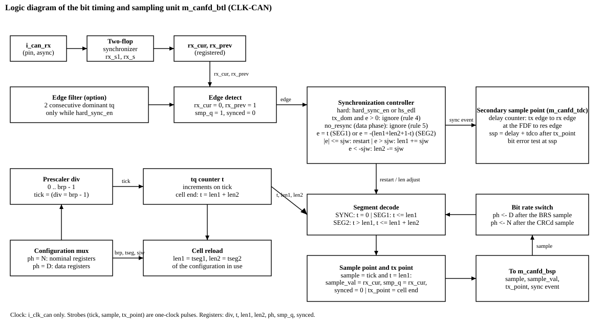

*Figure: logic of m_canfd_btl. Source: `model/can_logic_diagrams.py`.*

#### 10.6.12 Verification of the bit timing

The model `model/can_bit_timing_model.py` provides a `selftest` action with 12 model-level checks for free-running bit length, sample-point placement, adversarial sampling, synchronization rules, BRS/CRC-delimiter lengths and data-phase length. These checks validate the reference model only. The initial `m_canfd_btl` RTL leaf has been generated and passes the rule check; Verilator lint reports 0 errors and 9 warnings from the shared synchronizer simulation model. The planned RTL-to-model cycle comparison is TEST-036 and has not been run. The model does not cover the prescaler with `brp` above 1 during resynchronization, sub-quantum edge position or a clock-accurate TDC loop (WF-037 is a calculation only).

### 10.7 Frame engine design (m_canfd_bsp, m_canfd_stuf, m_canfd_crc)

#### 10.7.1 What the engine does

At every `sample` strobe the engine takes one bit and advances; at every `tx_point` strobe it presents the next bit to send. It has one field sequencer that is used for both directions, so the transmitter and the receiver work in the same states and the receiver of a frame follows the transmitter exactly. Field lengths and encoding follow REF-007 for Classical CAN and ISO FD; the Bosch non-ISO profile is governed by REF-002.

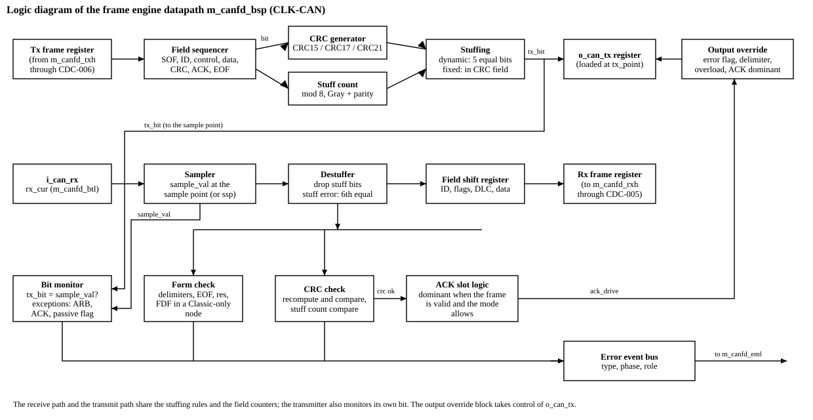

*Figure: datapath of m_canfd_bsp. Source: `model/can_logic_diagrams.py`.*

#### 10.7.2 Field order

| Format | Fields in order (number of bits) |
|---|---|
| Classic base | SOF 1, ID[10:0] 11, RTR 1, IDE 1 (dominant), r0 1 (dominant), DLC 4, data 0–8 bytes, CRC sequence 15, CRC delimiter 1, ACK slot 1, ACK delimiter 1, EOF 7 |
| Classic extended | SOF 1, ID-A[10:0] 11, SRR 1 (recessive), IDE 1 (recessive), ID-B[17:0] 18, RTR 1, r1 1 (dominant), r0 1 (dominant), DLC 4, data 0–8 bytes, CRC sequence 15, CRC delimiter 1, ACK slot 1, ACK delimiter 1, EOF 7 |
| CAN FD base | SOF 1, ID[10:0] 11, RRS 1 (dominant), IDE 1 (dominant), FDF 1 (recessive), res 1 (dominant), BRS 1, ESI 1, DLC 4, data 0–64 bytes, SBC 4 (ISO), FCRC 17 or 21 (ISO), CRC delimiter 1, ACK slot 1, ACK delimiter 1, EOF 7 |
| CAN FD extended | SOF 1, ID-A[10:0] 11, SRR 1 (recessive), IDE 1 (recessive), ID-B[17:0] 18, RRS 1 (dominant), FDF 1 (recessive), res 1 (dominant), BRS 1, ESI 1, DLC 4, data 0–64 bytes, SBC 4 (ISO), FCRC 17 or 21 (ISO), CRC delimiter 1, ACK slot 1, ACK delimiter 1, EOF 7 |

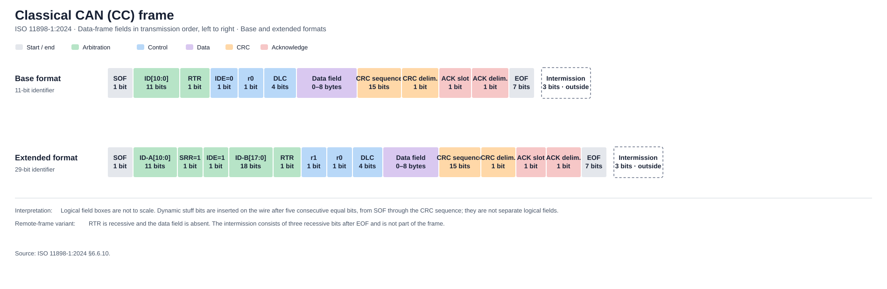

*Figure: Classic CAN base and extended data-frame layouts. The dashed intermission box is outside the frame.*

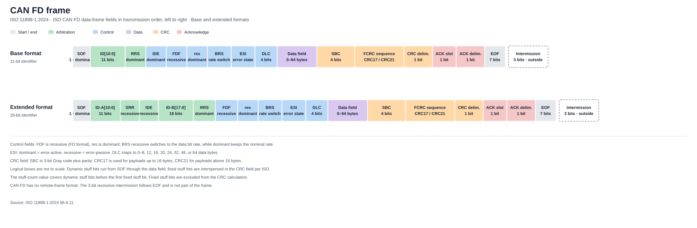

*Figure: ISO CAN FD base and extended data-frame layouts. The dashed intermission box is outside the frame.*

For both formats, intermission is three recessive bits after EOF and is not part of the frame. Classic remote frames use a recessive RTR and omit the data field; CAN FD does not support remote frames. Boxes show logical fields and are not to scale. Dynamic stuff bits are inserted on the wire but are not separate logical fields; ISO FD additionally uses fixed stuff bits in its CRC field.

**CRC stream contract.** The input is mode-dependent: Classical CAN uses the destuffed stream through the data field; ISO FD includes the stuff-count field and the dynamic stuff bits required by ISO 11898-1:2024. Fixed stuff bits inserted in the CRC field are excluded from CRC calculation. The Bosch technical paper (REF-014) is informative corroboration only. ISO behavior is grounded by REF-007 §§6.6.4.4, 6.6.11.5 and 6.6.13; non-ISO FD remains source-limited. A base frame wins against an extended frame with the same base identifier because SRR is recessive and RTR is dominant (REF-007 §6.6.17.4).

#### 10.7.3 Stuffing and destuffing (m_canfd_stuf)

- **Dynamic stuffing:** after five consecutive equal bits the transmitter inserts one bit of the opposite value; applies from SOF to the end of the CRC sequence in Classic frames and from SOF to the end of the data field in FD frames. The receiver removes the stuff bit and flags a **stuff error** on the sixth equal bit.
- **Fixed stuffing in the FD CRC field:** ISO FD places the stuff-count field before the CRC sequence and inserts fixed stuff bits at positions specified by REF-007. Fixed bits are checked and removed by the receiver, but are not included in CRC calculation or dynamic stuff count. The three-bit Gray-coded count plus parity represents the number of dynamic stuff bits before the first fixed stuff bit, modulo eight (REQ-FUNC-008, REQ-FUNC-007). Non-ISO FD placement and counting remain source-limited.
- The field shift register and field counters operate on destuffed bits. The CRC update path is separate: transmit CRC updates must account for each transmitted dynamic stuff bit in FD mode; receive CRC updates must account for the sampled dynamic stuff bits before destuff removal. Classic CRC updates use the destuffed stream. Fixed stuff bits in the FD CRC field are removed from the receive stream and never update the CRC. A single post-destuffer CRC input for all modes is prohibited because it drops required FD stuff-bit contributions.

The frame sequencer supplies dynamic-region enables and fixed-slot strobes to `m_canfd_stuf`; the stuffer does not duplicate field counters. A fixed-slot strobe and `i_dyn_stuf_en` are mutually exclusive. For ISO FD, the RTL uses reflected binary Gray encoding and an even-parity bit calculated as XOR of the three Gray bits. This exact coding is cross-checked against the CTU open-core implementation (informative evidence, not protocol authority). DEC-067 defers independent protocol verification, so this RTL pass makes no conformance claim.

**Examples**

1. If the transmitter has sent five dominant dynamic bits, the next `i_tx_point` emits recessive as a dynamic stuff bit. `o_tx_logical_adv` is 0, so the BSP holds its current field bit. A receiver removes that recessive sample and pulses `o_rx_dyn_stuff`.
2. At an ISO FD fixed-stuff slot after a recessive wire bit, the transmitter emits dominant. A receiver that samples recessive at the same slot pulses `o_rx_stuff_err`; the fixed bit is not delivered as a field bit.
3. Five dynamic stuff bits before the ISO FD stuff-count field give binary count `3'b101`, Gray `3'b111`, and even-parity code `4'b1111`. Fixed stuff bits do not change the count.

#### 10.7.4 CRC (m_canfd_crc)

Three CRC registers operate concurrently: CRC15 (polynomial 0xC599) for Classical CAN, CRC17 (0x3685B) for ISO FD frames up to 16 data bytes, and CRC21 (0x302899) for longer ISO FD payloads (REQ-FUNC-006). The active register is selected from frame format and DLC. Classical CRC updates use the destuffed stream; ISO FD CRC updates include the specified stuff-count field and dynamic stuff bits. CRC15 initializes to zero; ISO FD CRC17 and CRC21 initialize to 0x10000 and 0x100000, respectively. Receivers compare the received CRC sequence and FD stuff count. Fixed CRC-field stuff bits are not CRC input. These protocol facts are source-grounded by REF-007; independent known-answer vectors remain a verification task. Non-ISO FD CRC details remain source-limited.

#### 10.7.5 State graph of the frame engine

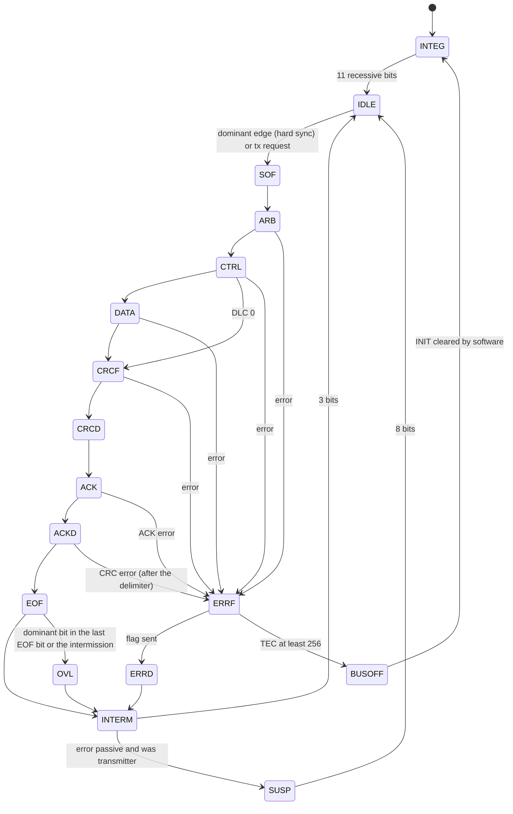

In SOF to EOF the engine is the transmitter when it won the arbitration and the receiver otherwise; a transmitter that loses arbitration continues in the same states as a receiver (WF-003). The states that allow a hard synchronization are INTEG, IDLE, SUSP and the second and third bits of INTERM (`hard_sync_en`).

#### 10.7.6 Payload size parameter (PARA_CANFD_DATA_MAX, DEC-033)

The user decided on 2026-11-06 to add the parameter `PARA_CANFD_DATA_MAX` with the values 8, 12, 16, 20, 24, 32, 48 and 64 (data bytes). It limits the widths of everything that holds a whole frame:

| Item | Without the parameter | With the parameter |
|---|---|---|
| Rx frame FIFO (CDC-005) | `PARA_CANFD_RXHOLD_DEPTH` x `LPARA_CANFD_RXW` x 32 bits | `PARA_CANFD_RXHOLD_DEPTH` x (`4 + DATA_MAX / 4`) x 32 bits |
| Tx transfer register(s) (CDC-006) | 1 or 2 x 64 data bytes | 1 or 2 x `DATA_MAX` data bytes |
| Field shift register of the frame engine | 64 bytes | `DATA_MAX` bytes |
| CRC21 unit | Present with FD | Not reduced: a receiver must check frames longer than `DATA_MAX`, so the CRC21 unit exists whenever `PARA_CANFD_FD_EN` = 1 (see below) |
| Element size registers (`cfd_esz`) | 8 to 64 bytes | Values above `DATA_MAX` are clamped (DEC-014) |

**A frame longer than `DATA_MAX`.** The node must still take part correctly in the bus: it receives the whole frame, computes the CRC over all bytes, checks the stuff count, sends the acknowledge and the error flags as any node, but stores only the first `DATA_MAX` bytes (the same rule as an element that is smaller than the frame, 10.11). The rule of the IP: **the CRC21 unit is present whenever `PARA_CANFD_FD_EN` = 1**; the shift register that stores data has `DATA_MAX` bytes and the bytes beyond it are shifted through the CRC only. With `PARA_CANFD_FD_EN` = 0 the node is Classic-only and a longer frame is a form error. A transmit element whose DLC exceeds `DATA_MAX` or its configured element capacity sends the largest DLC code that fits (clamp, DEC-014), reads no data from the next element, and keeps its original software-written DLC in the Tx event.

The register `cfd_feat0.data_max` tells software the value of the build. The derived local parameter of the internal frame-transfer width is `LPARA_CANFD_RXW` = 4 metadata words plus `PARA_CANFD_DATA_MAX / 4` payload words (REQ-MSG-021). The metadata-word meanings and repacking rules are defined in section 9.

#### 10.7.7 Overload frame policy (`ovl_en`, DEC-034)

ISO 11898-1:2024 distinguishes optional LLC-requested overloads from required reactive overloads. The user decision on 2026-11-06 assigns `ovl_en` only to the internal-buffer-delay request:

| `ovl_en` of `cfd_ctrl` | Behavior when the Rx frame FIFO has no free entry at frame completion |
|---|---|
| 0 (default) | The IP does not request an LLC overload for an internal condition. If a frame completes while the asynchronous Rx frame FIFO is full, it is dropped before filtering and sets `ovr` of `cfd_rx_sts` (WF-046). Required reactive overloads remain enabled. |
| 1 | The IP may request an LLC overload at the first bit of the expected intermission to give the BUS handler time to drain the FIFO; at most two consecutive LLC-requested overloads are sent. Required reactive overloads remain enabled. |

Regardless of `ovl_en`, the IP shall emit a reactive overload one bit-time after detecting dominant in either of the first two intermission bits, at the receiver's final EOF bit, or at the final error/overload-delimiter bit. It applies the standard's error counting to overload signaling. WF-052 shows the internal-buffer case; TEST-048 covers all reactive triggers. The cost of `ovl_en` is one frame-engine state and a handshake with the Rx handoff.

#### 10.7.8 Own frames: no self-reception (DEC-035)

A node does not store the frames that it sends itself: the transmitter is the source, and the Tx event reports the transmission (REF-007 §6.6.17.3). The exception is the loopback modes of `cfd_ctrl`: with `lbk_int` or `lbk_ext` the transmitted frame is looped to the receiver, passes the filter and is stored like a received frame, so that software can test the whole path. After a lost arbitration the node is a receiver of the frame of the winner and stores it normally (WF-003).

### 10.8 Error monitoring and fault confinement (m_canfd_bsp, m_canfd_eml)

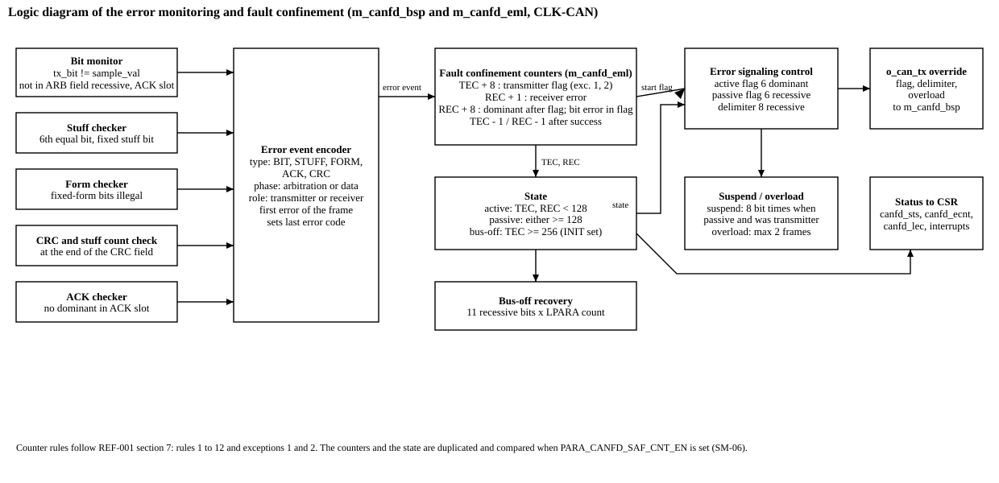

*Figure: error detection and fault confinement. Source: `model/can_logic_diagrams.py`.*

#### 10.8.1 Detection

| Error | Detected by | Condition (REF-007 §§6.6.17, 6.6.21; REF-002 for non-ISO FD) | Exceptions | Flag starts |
|---|---|---|---|---|
| Bit error | Bit monitor (the transmitter reads its own bit; also a node that sends an error flag) | The monitored value differs from the sent value at the sample point; in the data phase of an FD frame with the TDC at the secondary sample point | A recessive bit sent in the arbitration field and read dominant is the loss of arbitration, not an error; a recessive bit sent in the ACK slot and read dominant is the acknowledge; a node sending a passive error flag that reads dominant has no bit error | At the next bit (WF-040) |
| Stuff error | Destuffer | The sixth consecutive bit of the same value in a field that is dynamically stuffed (a stuff-count mismatch is an FCRC error, not a stuff error) | None | At the next bit (WF-019) |
| Form error | Form checker | A fixed-form bit has an illegal value: CRC delimiter, ACK delimiter, EOF; in an ISO FD CRC field a fixed stuff bit equal to its predecessor (REF-007 §6.6.13.3.1, §6.6.21.2 d); in an FD frame a recessive res bit when protocol-exception handling is disabled; FDF in a node that has FD disabled | For a receiver, a dominant sample at the final EOF bit does not invalidate the received frame; it triggers reactive overload behavior (REF-007 §§6.6.15.2, 6.6.21.3.2) | At the next bit, except the specified final-EOF behavior |
| CRC error | CRC check | The calculated CRC differs from the received one; an ISO FD stuff-count mismatch is treated as an FD CRC error | None | CC: no ACK; error flag starts at first EOF bit. ISO FD: no ACK; error flag starts after three bit-times following the CRC delimiter; dominant bus bits in the interval are ignored (WF-071) |
| Acknowledge error | ACK checker | The transmitter reads no dominant bit in the ACK slot | A transmitter in error passive state is treated by exception 1 of 10.8.3 | At the next bit |

**What the node must not send** ("do not transmit"): the node sends nothing on the bus (`o_can_tx` recessive) in these cases, all verified by SVA-015: INIT, bus integration, bus-off, sleep, restricted operation mode and bus monitoring mode (the latter drives no dominant bit at all, not even the ACK or an error flag), a transmitter that lost arbitration (until the next frame), an error-passive node during the suspend transmission, a node whose Tx buffers have no request, a TTCAN node outside its Tx_Enable window, and a node whose configuration is locked or being copied. A node in the error passive state sends only passive flags; a bus-off node has no influence on the bus (REF-007 §8.1.4).

#### 10.8.2 Error signaling

An error-active node sends an active error flag of six dominant bits; an error-passive node sends a passive error flag of six recessive bits; both are followed by the error delimiter. CRC-error timing is profile-specific: a CC receiver starts at the first EOF bit; an ISO FD receiver starts after three bit-times following the CRC delimiter and ignores dominant samples in that interval (WF-071). Reactive overloads are required after a dominant bit in either of the first two intermission bits, after a receiver detects dominant at the last EOF bit, and after any node detects dominant at the final error- or overload-delimiter bit; each reactive overload starts one bit time after detection. An LLC-requested overload for internal receiver delay is optional, starts only at the first expected intermission bit, and is limited to two consecutive requests. `ovl_en` controls only this optional LLC-requested case, not reactive overloads (REQ-FUNC-018). An error-passive transmitter waits its suspend-transmission interval after intermission. See REF-007 §§6.6.21.3.1–.3.2.

#### 10.8.3 Fault confinement counters (REF-007 §8.1.4; REF-002 for non-ISO FD)

| Rule | Event | Update |
|---|---|---|
| 1 | A receiver detects an error, except a bit error while it sends an active error flag or overload flag | REC + 1 |
| 2 | A receiver reads a dominant bit as the first bit after sending an error flag | REC + 8 |
| 3 | A transmitter detects a transmission error and sends an error flag | TEC + 8, except for exceptions 1 and 2 |
| Exception 1 | The transmitter is error passive, detects an acknowledge error, and reads no dominant bit while sending its passive error flag | TEC unchanged |
| Exception 2 | A transmitter detects a stuff error before arbitration is decided; it sent the expected recessive stuff bit and monitored dominant | TEC unchanged |
| 4 | A transmitter detects a bit error while sending an active error flag or an overload flag | TEC + 8 |
| 5 | A receiver detects a bit error while sending an active error flag or an overload flag | REC + 8 |
| 6 | After the 14th consecutive dominant bit counted from the start of an active flag, or the 8th after a passive flag, and after each further sequence of eight consecutive dominant bits | TEC + 8 (transmitter), REC + 8 (receiver) |
| 7 | Successful transmission (acknowledged and no error until the end of the EOF) | TEC - 1 unless it is 0 |
| 8 | Successful reception (no error up to the ACK slot and the ACK sent) | REC - 1 when between 1 and 127; 0 stays 0; above 127 it is set to a value between 119 and 127 (the IP sets 127) |
| 9 | TEC or REC is at least 128 | Error passive; the error that caused entry still gets an active flag |
| 10 | TEC is at least 256 | Bus-off |
| 11 | Error passive and both counters are at most 127 | Error active |
| 12 | Bus-off: after a restart request and 128 occurrences of the 11-recessive-bit idle condition, the node may leave bus-off | Error active, both counters 0. This IP requires at least 128 occurrences; `cfd_bo_cfg.bo_cnt` reset value 129 adds one occurrence. Values below 128 clamp to 128 and set `cfg_fix` |

Design of the counters (`m_canfd_eml`): `m_canfd_bsp` supplies one-clock event pulses qualified by role and exceptions 1 and 2. A transmit error generates one generic +8 event unless an exception applies. For a passive-transmitter ACK error, the event is deferred until the passive flag is observed; TEC is unchanged only if no dominant bit is read during that flag. Dedicated events represent bit errors while sending active flags, the first post-error-flag dominant sample, and each required dominant sequence. Simultaneous increments are applied in the table order. A successful transmission decrements TEC unless it is zero. A successful reception decrements REC from 1 to 127, leaves zero unchanged, and sets REC above 127 to the product-selected value 127. TEC saturates at 256; REC saturates at 255. Error-passive asserts at 128 and bus-off at TEC 256. Warning, passive and bus-off outputs are derived from the updated counters. The first error pulse of a frame captures the supplied code into the arbitration-phase `o_lec` or data-phase `o_dlec`; later errors in that frame do not replace it. `i_restart_req` starts recovery only while bus-off; each `i_evt_idle11` increments the recovery count, and the effective `bo_cnt` minimum is 128. A corrected low value raises `o_cfg_fix_event`; the final configured occurrence clears both counters and pulses `o_recovery_done`. With `PARA_CANFD_SAF_CNT_EN=1`, separate TEC/REC mirror registers are compared with the primary counters every cycle (SM-06); this is counter-state comparison, not independent fault-tolerant counter logic. TEST-040 and WF-042 define the required directed evidence; no simulation result is claimed by this RTL/lint update.

#### 10.8.4 Simultaneous errors and priority

The first error of a frame sets the error flag and the last error code (arbitration phase or data phase, `cfd_lec`); a second error in the same frame increments the counters per the rules above but does not change the code. A stuff error in the arbitration field of the transmitter with the exception 2 does not change TEC. A CRC error and another error in the same frame: the other error starts the flag earlier and the CRC error is not additionally signaled (REF-007 §6.6.21.3.1).

#### 10.8.5 Monitoring by the transmitter in the data phase

In the data phase the bit monitor reads at the secondary sample point (10.6.9) and a mismatch is a bit error that the node reacts to at the next sample point. A receiver never monitors its own bit; it only reads. The ESI bit that the node sends is the inverse of its error-active state (REQ-FUNC-009).

#### 10.8.6 Stuck-dominant detection (`cfd_dom_cfg`, DEC-036)

A short circuit of the CAN wires or a failed transceiver keeps the bus dominant. The standard error counters react only slowly: every eight consecutive dominant bits after a flag add 8 to the counter (rule 6 of 10.8.3), so reaching bus-off takes many milliseconds. The user decided on 2026-11-06 to add a faster **indication** (not a change of the transmit behavior):

1. A counter in the CAN domain counts the consecutive sample points at which the bus is dominant (it counts bit times, the nominal bit time and the data bit time alike); a recessive sample point clears it.
2. When the count exceeds `dom_lim` of `cfd_dom_cfg` (reset value 32; 0 = off; 1 to 15 are raised to 16, because a legal frame can carry up to 14 consecutive dominant bits: an active error flag of 6 bits followed by the superposed flags of the other nodes and the delimiter wait, REF-007 §8.1.4) the flag `dom_stk` of `cfd_sts` is set and the interrupt event `dom_to` is raised once (through CDC-007).
3. `dom_stk` stays high until a recessive sample point; the event stays set until software clears it (w1c). The counter re-arms after a recessive bit.
4. The IP does not stop transmitting because of this flag: the error counters and bus-off keep their normal function. Software or the safety logic decides whether to select the secondary bus pair (`bus_sel` of `cfd_ctrl`, FEAT-014); this selection does not implement automatic failover.

The detector is an addition to the protocol of the standard and is also a safety measure for FM-02 of section 18 (a wrong bit time or a stuck line). WF-051 shows it. It was added as the interrupt `dom_to` in place of the former protocol exception interrupt `pexc`, because all 32 interrupt bits were in use; the protocol exception stays visible as the status bit `pxe` of `cfd_sts`.

### 10.9 Verification evidence of this part

| Item | File | How to run |
|---|---|---|
| Reference model of the bit timing | `model/can_bit_timing_model.py` | `python can_bit_timing_model.py selftest` |
| Waveforms WF-029 to WF-042 | `model/can_bit_timing_waves.py` | `python can_bit_timing_waves.py OUT_DIR`, then `vlsit_waveform_svg.py render` |
| Logic diagrams | `model/can_logic_diagrams.py` | `python can_logic_diagrams.py OUT_DIR` |

WF-029 to WF-039 are produced by the reference model, so they show exactly what the model computes; WF-040 to WF-042 are built from the ISO-grounded tables of 10.8 (REF-007 §§6.6.21, 8.1.4) and show events, not bits.

### 10.10 Software reset of the message handling side (m_canfd_rst, DEC-022)

The BUS-side reset FSM in `m_canfd_rst` resets message-handling state without disturbing a frame on the CAN bus. It is separate from the two external asynchronous reset inputs: this software reset never resets the CAN protocol domain, the CDC pointer state, the CSR configuration, or the physical CAN pins.

**Command.** Software writes `soft_rst` of `cfd_srst`. The bit is cleared by hardware when the reset is finished; `srst_busy` is high meanwhile.

**What is reset** (BUS clock domain, a synchronous reset pulse of one clock to the listed blocks): the Rx handler and the filter state (FIFO get and put indexes and fill levels, new-data flags), the Tx handler (all request, cancel and done flags, the selected buffer), the Tx event FIFO indexes, the message RAM master (a pending request is abandoned after its acknowledge), the DMA request logic, the interrupt raw flags, the timestamp capture registers, the timeout counter, the safety flags of the BUS side.

**What is not reset:** the configuration registers (they keep their values, so no reprogramming is needed), the protocol engine and everything in the CAN domain (bit timing, frame engine, error counters, fault confinement state, TTCAN state), the bus pins (`o_can_tx`, `o_trcv_en`), the INIT state, the power state, the safety configuration. A frame that is being transmitted or received is not disturbed.

**Sequence (no disturbance of the bus).**
1. `soft_rst` is accepted; `srst_busy` goes high. New Tx work and Rx storage are blocked.
2. While busy, `m_canfd_rxh` drains and discards completed Rx frames, sets `ovr`, and reports FIFO empty. `m_canfd_txh` stops selecting new requests and completes any frame already accepted by the CAN-domain handshake.
3. `m_canfd_rst` waits for the Rx frame FIFO to be empty, `m_canfd_rxh` to report `o_idle_bus=1`, the Tx frame/result CDC handshakes to be idle, and `m_canfd_txh` to report `o_idle_bus=1`. The top combines the Rx FIFO-empty and Rx-handler-idle indications at `i_rx_fifo_empty_bus`, and combines Tx CDC-idle and Tx-handler-idle at `i_tx_hsk_idle_bus`. It then asserts `o_soft_rst_pulse_bus` for exactly one CLK-BUS cycle while keeping `srst_busy` high.
4. The pulse resets only the BUS-side handler state listed above. `o_soft_rst_done_bus` causes the CSR to clear `soft_rst`; the busy flag falls after the pulse. New work may then be accepted. The CAN-domain frame currently on the wire completes normally; frames discarded during the drain are not stored.
5. The time from the command to the end is at most the time to drain the bounded Rx frame FIFO plus one in-flight Tx frame and 8 BUS clocks (PERF).

**Why not a reset of the CAN domain.** A reset of the protocol engine in the middle of a frame abandons the frame, the bus sees a truncated frame and an error frame (ASM-003). The soft reset therefore never reaches the CAN domain; to restart the protocol engine, software sets INIT.

**Interaction.** With `soft_rst` and INIT set together, the soft reset runs first. During a bus-off the soft reset is allowed (it does not start the recovery). The DMA request outputs fall during the reset; an acknowledge of a request that was dropped is ignored.

**Concrete example.** If `m_canfd_rxh` has acknowledged a filter-word read but is still writing the selected Rx element, the frame FIFO can already be empty. `o_idle_bus` remains low until the handler finishes the current RAM operation and reaches IDLE. Likewise, a Tx result that has reached the BUS domain but has not yet been consumed keeps `m_canfd_txh.o_idle_bus` low. The reset pulse is not issued until both conditions and the corresponding FIFO/CDC-idle conditions are true.

**Verification.** TEST-041 and SVA-016: `o_can_tx` and the error counters do not change in any clock between the command and the end; a frame on the bus before and during the reset arrives complete at the other nodes; after the reset all handler states equal their reset values (WF-043).

### 10.11 Receive path, acceptance filter and FIFO design (m_canfd_rxh, m_canfd_flt)

This subsection is the design of everything that happens to a frame after the frame engine has received it correctly, up to the moment software can read it. The behavior is the author's design (the CAN standards do not define a message RAM or a filter); the references for usual practice are the Bosch M_CAN manual (REF-009) and the CTU CAN FD core, and nothing was copied from them. `model/can_rx_model.py` has 15 model-level self-test checks; these do not establish RTL correctness. RTL implementation has started in `rtl/m_canfd_rxh.sv`; it is not integrated or functionally verified, and the requirements below remain the design target.

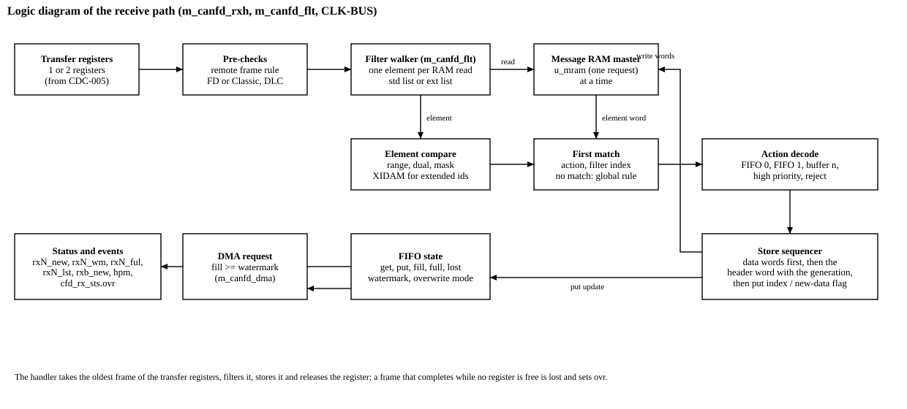

*Figure: logic of the receive path. Source: `model/can_rx_waves.py`.*

#### 10.11.1 Steps of one received frame

1. **Frame complete.** m_canfd_bsp validates the full frame and sends ACK as required. At completion, it enqueues the frame in the transient asynchronous CAN-to-BUS FIFO (CDC-005, WF-013). This FIFO is only a clock-crossing buffer; it is not the software-visible Rx FIFO. If it is full, the whole frame is dropped before filtering and sticky `ovr` in `cfd_rx_sts` is set (WF-046). A frame with an error never reaches the handler.
2. **Pre-checks.** A remote frame is rejected without reading the filter list when `rrfs` (base) or `rrfe` (extended) of `cfd_gfc` is set, and it is not stored at all when `PARA_CANFD_RTR_EN` is 0 (it is still acknowledged on the bus).
3. **Filter walk.** (The user decided on 2026-11-05 that the filter runs after the frame has ended, not during the reception: DEC-026.) The handler reads the standard filter list (base frames) or the extended filter list (extended frames) one element after the other from the message RAM and compares the identifier with each element in list order (10.11.2). The first matching element decides; a disabled element, an element of type 3 and an element with the action 0 never match. The identifier of an extended frame is first ANDed with `cfd_xidam`.
4. **Action.** A match gives the action of the element: store in Rx FIFO 0 or 1, store in the dedicated Rx buffer whose number is in the low bits of the second identifier field, high priority (as the FIFO actions with the event of 10.11.4), or reject. Without a match the global rule applies: `anfs` and `anfe` of `cfd_gfc` choose FIFO 0, FIFO 1 or reject. A frame that was accepted by the global rule is stored with the flag ANMF = 1 and filter index 0.
5. **Store.** The handler writes the data words, then the time stamp, then the header words of the element into the message RAM (so a reader that sees the new header sees complete data, REQ-MSG-010), then updates the put index (FIFO) or sets the new-data flag (buffer), then raises the events (`rxN_new`, `rxN_wm`, `rxN_ful`, `rxN_lst`, `rxb_new`, `hpm`) and the DMA request.
6. **Release.** The handler advances the asynchronous frame FIFO read pointer and takes the next queued frame.

#### 10.11.2 Filter element evaluation

| Type | Standard element | Extended element | Match condition |
|---|---|---|---|
| 0 range | `id1 <= identifier <= id2` | same on 29 bits | Inclusive range; an element with `id1 > id2` never matches |
| 1 dual | `identifier = id1 or identifier = id2` | same | Two identifiers in one element |
| 2 classic mask | `(identifier AND id2) = (id1 AND id2)`, `id2` is the mask | same | A 1 in the mask means the bit must match |
| 3 disabled | never | never | Used to keep a list position |

A base frame is compared on 11 bits with the standard list only; an extended frame is compared on 29 bits with the extended list only (after `cfd_xidam`). The list order is the priority; the first match wins (the model checks this). The two lists are separate, so a base identifier never matches an extended element.

#### 10.11.3 Receive-path service estimate (informative)

One message-RAM word costs `2 + W` BUS clocks, where `W` is the RAM wait-state count (request, acknowledge, and the required request-low cycle; REQ-IF-002). A worst-case filter walk can read 128 words; storing the largest element uses 20 words. At W = 3 this is 740 BUS clocks per frame under the stated single-client assumptions. These counts estimate service demand only; they do not define a minimum BUS frequency or a minimum BUS/CAN clock ratio.

| Item | Words | Clocks at W = 3 |
|---|---:|---:|
| Filter walk, worst case | 128 | 640 |
| Store of the largest element | 20 | 100 |
| Total per frame | 148 | 740 |

The asynchronous Rx frame FIFO absorbs a finite number of completed frames. If BUS-side filtering and RAM service remain slower than the incoming frame rate long enough to fill it, the next completed frame is dropped before filtering and `ovr` is set. No loss-free sustained-throughput guarantee is specified without clock rates, RAM arbitration and wait-state limits (DEC-065). `flt_peak` reports the measured filter peak in a running system.

#### 10.11.4 High priority messages

A filter element with the action 4 or 5 stores the message like FIFO 0 or 1 and in addition sets the event `hpm` and fills `cfd_hpm_sts` (filter index, FIFO, element index, valid flag). The purpose is a short path for a message that software must serve before the older ones in the FIFO (for example a flight-control setpoint among telemetry, FEAT-007 and FEAT-008). Without this event the high priority action would have no observable effect. Added on 2026-11-05 as an author proposal (DEC-025).

#### 10.11.5 The FIFO

| Item | Design |
|---|---|
| Storage | A section of the external 32-bit Message RAM; element size set by the CSR configuration; `num` elements. Software accesses payload/header words through the system's Message RAM address space, not through a CSR data window. |
| Indexes and status | Get index (software side), put index (hardware side), fill level; `full` when the fill level equals `num`. The CSR status and interrupt events report new message, watermark, full and lost conditions. |
| Blocking mode (`ovw` = 0) | A message that arrives at a full FIFO is dropped and `rxN_lst` is set; the older messages are kept |
| Overwrite mode (`ovw` = 1) | A message that arrives at a full FIFO replaces the oldest element (at the get index), the get index and the put index move on and `rxN_lst` is set |
| Watermark | `rxN_wm` and the DMA request rise when the fill level reaches `wm` (0 disables) |
| Acknowledge | After reading one or more entries from Message RAM, software writes the index of the last entry consumed to `ack_idx` and sets `ack_go`; every entry up to that index is freed, allowing software to move the read position to a later FIFO entry. An index outside the current fill level frees nothing (the model checks the arithmetic). |
| Index width | 6 bits (FIFO size up to 64) |

**Overwrite hazard and its guard.** In overwrite mode the hardware writes the oldest element, which is the one that software may be reading right now. Software would then read a mixture of two messages. The element therefore carries a 2-bit generation number in bits 23 and 22 of its header word 1 (section 9); the hardware increments it each time it writes the element. Software reads word 1 first and again after the data; a different generation means the element was overwritten and the data read must be discarded (WF-045). The guard needs no lock between the two sides. The alternative of stopping the hardware while software reads was not chosen because it would turn the overwrite mode into a blocking mode (DEC-024, proposed).

**Transmit FIFO software access.** Software writes the complete Tx element as 32-bit words in the configured external Message RAM section, then sets the request bit through CSR. The controller reads and snapshots the complete element before beginning transmission. Tx completion, cancellation, FIFO availability and event-FIFO conditions are exposed through CSR status and the associated interrupt events; the asynchronous Rx frame FIFO is not used as Tx storage.

**Dedicated Rx buffers.** A buffer is written like a FIFO element; the new-data flag of the buffer is set after the header word; a newer message overwrites an unread one and sets the flag again (no lost flag for a buffer). Software clears the flag by writing 1 after it has read the buffer. Software that wants no overwrite reads the generation number as above.

#### 10.11.6 Losses and their reporting

| Loss | Where | Reported by |
|---|---|---|
| FIFO full in blocking mode | After the filter, before the store | `rxN_lst` of the FIFO that the filter named |
| FIFO full in overwrite mode | The oldest message is replaced | `rxN_lst` |
| Handoff overrun (asynchronous Rx frame FIFO full) | Before the filter | Sticky `ovr` of `cfd_rx_sts`; the complete frame is dropped and not counted in a message-RAM FIFO |
| Rx buffer overwritten | After the filter | Nothing (the flag stays set); by design |
| Filter result reject | After the filter | Nothing; by design |
| Message RAM range fault during filter lookup | Before the invalid filter-word request | Drop the frame and set `ram_flt`; no destination is known, so do not set a FIFO lost event (DEC-063) |
| Message RAM range fault while storing | Before the first store request | `ram_flt`; drop the frame without partial writes or put-index advance; set the selected FIFO's `rxN_lst` when a FIFO destination is known; for a dedicated buffer, preserve old contents and do not set new-data (DEC-063, INV-004) |
| Message RAM access watchdog expires while storing | During the store | Existing watchdog/safety reaction; the element is not completed and the put index is not moved (INV-004, REQ-SAFE-002) |

A range fault in the receive-storage path is a local message-handling failure after protocol reception. It drops the frame locally and does not generate a CAN error flag or modify TEC/REC. The generic `ram_flt` event identifies the fault; the selected FIFO loss event identifies a dropped FIFO message when the destination is known (DEC-063).

#### 10.11.7 Reset and mode behavior

A software reset (10.10) clears the indexes, the fill levels, the new-data flags and the events of the receive path and keeps the filter lists in the RAM and the section registers. INIT stops the reception: a frame in the transfer register is still handled. In bus monitoring and restricted operation mode the receive path works normally (the acknowledge is the only difference).

#### 10.11.8 Verification

TEST-042 drives the model and the RTL with the same random frames, filter lists (all types and actions, lists of 0, 1, 127, 128 elements for base and 0, 1, 63, 64 for extended), FIFO sizes 1 to 64, both modes and random RAM wait states, and compares action, filter index, element content, indexes and flags. TEST-043 checks the budget: it counts the clocks of the walk and the store and compares them with the formula of 10.11.3 and with `flt_peak`. SVA-017 checks that the put index and the new-data flag change only after the last word of the element was acknowledged, and that the generation number changes with every write. WF-044 to WF-046 show the filter walk, the overwrite guard and the handoff overrun.

### 10.12 Transmit path design (m_canfd_txh)

This subsection explains how the transmit buffers are built and how a frame goes from a buffer to the bus. The structure is the author's design, inspired by the usual practice of message-RAM controllers (REF-009), and nothing was copied. `model/can_tx_model.py` has 17 model-level self-test checks; these do not establish RTL correctness. RTL implementation has started in `rtl/m_canfd_txh.sv`, but neither approved commit mode in 10.12.5 is complete and the module is not integrated or functionally verified. All requirements below remain the design target. The user's decisions of 2026-11-06 are built in: only valid buffers are sent, the priority is configurable (identifier, fixed priority set by software, an express buffer), the retransmission limit is per buffer, and the number of buffers is a parameter.

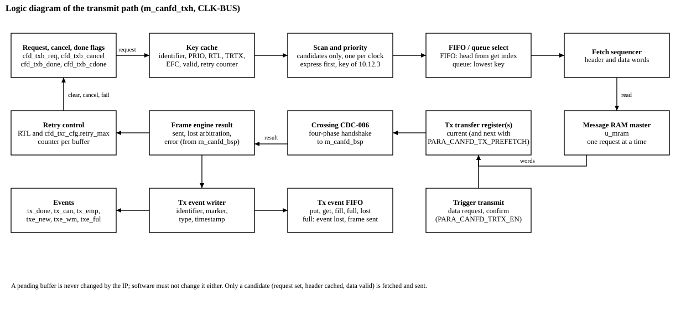

*Figure: logic of the transmit path. Source: `model/can_tx_waves.py`.*

#### 10.12.1 Structure of the Tx buffers

The Tx buffers live in the message RAM, in one section that starts at `start` of `cfd_txb_cfg`. All buffers have the same size: a Tx element of 2 header words and the data words of the size chosen by `txb_dsz` of `cfd_esz` (8, 12, 16, 20, 24, 32, 48 or 64 bytes, so an element has 4 to 18 words). Buffer number n is at the word address `start + n x element size`. The number of buffers is a parameter: `PARA_CANFD_TXBUF_MAX` (1 to 32); the number of Tx event elements is limited by `PARA_CANFD_TXE_MAX` (1 to 32), the number of Rx buffers by `PARA_CANFD_RXBUF_MAX` (0 to 64) and the size of each Rx FIFO by `PARA_CANFD_RXF_MAX` (2 to 64, which fixes the width of the indexes); the section registers choose the numbers at run time inside these limits.

| Part | Buffer numbers | How software uses it |
|---|---|---|
| Dedicated buffers | 0 to `ded_num` - 1 | One buffer per message. Software writes the element and sets the request bit of that buffer. Buffer 0 is the express buffer (10.12.4) |
| FIFO or queue buffers | `ded_num` to `ded_num` + `fifo_num` - 1 | A ring of buffers for a stream. `qmode` = 0: FIFO, sent in the order of the buffers; `qmode` = 1: queue, sent by priority |

`ded_num` + `fifo_num` is at most `txbuf_max` (the parameter). The Tx element:

| Word | Bits | Meaning |
|---|---|---|
| 0 | [31] ESI, [30] XTD, [29] RTR, [28:0] identifier | Identifier (base identifier left-aligned in bits 28 to 18); ESI is sent only by an error-passive node |
| 1 | [31:27] PRIO, [26:24] RTL, [23] EFC, [22] TRTX, [21] FDF, [20] BRS, [19:16] DLC, [15:0] message marker | PRIO: fixed priority (0 is the highest); RTL: retransmission limit code (10.12.6); EFC: write a Tx event; TRTX: trigger-transmit buffer (10.12.7); FDF and BRS: the FD format and the bit rate switch; the marker comes back in the Tx event |
| 2 to 17 | data | Data bytes, byte 0 in bits 7:0 of word 2; only the words that the DLC needs are read |

**Worked example.** `start` = 0x0400, `ded_num` = 4, `fifo_num` = 4, 8-byte elements (4 words each): the dedicated buffers are at 0x0400, 0x0404, 0x0408 and 0x040C, the FIFO or queue buffers at 0x0410, 0x0414, 0x0418 and 0x041C; the section holds 32 words. Software sends a message from dedicated buffer 2 by writing four words at 0x0408 and then setting bit 2 of `cfd_txb_req` (the request bit is `rwi`: hardware clears it when the frame is sent or cancelled).

**The registers of the Tx path:** `cfd_txb_cfg` (section and split), `cfd_esz.txb_dsz`, `cfd_txb_req`, `cfd_txb_cancel`, `cfd_txb_done`, `cfd_txb_cdone`, `cfd_txb_fail`, `cfd_txb_ie`, `cfd_txb_cie`, `cfd_txf_sts`, `cfd_txe_cfg`, `cfd_txe_sts`, `cfd_txe_ack`, `cfd_txb_trtx`, `cfd_txb_dreq`, `cfd_txr_cfg` (global default of the retransmission limit) and `cfd_txp_cfg` (priority mode and express buffer).

#### 10.12.2 The key cache: how a buffer becomes valid

The scan must compare the priority of up to 32 buffers every time a frame ends. Reading 32 headers from the message RAM for each scan would cost up to 32 x 2 x (2 + W) clocks, too many for the intermission. The design therefore keeps a **key cache** in the handler: one entry per buffer with the identifier, the extension bit, PRIO, RTL, TRTX, EFC and a valid flag.

1. Software writes the element and sets the request bit.
2. Before reading header word 0, the handler computes the buffer base and checks the complete configured element span using widened arithmetic. If the span is out of range, it rejects the RAM request, sets `ram_flt`, clears the request, invalidates the cache entry, sets the selected `cfd_txb_cdone.cdn` bit, and raises `cfd_irq_raw.tx_can` only if the buffer's `cfd_txb_cie.canc_ie` bit is set. The buffer is not transmitted and no retry/TEC state changes. Otherwise, the handler reads header words 0 and 1 into the cache entry (2 words, `2 x (2 + W)` clocks); then the entry is **valid**. A buffer whose request is set but whose entry is not yet valid is not a candidate.
3. Software must not change the element while the request bit is set; the IP does not read the cache entry back from the RAM, so a change would not be noticed (it is a software error, REQ-MSG-010).
4. When the frame is sent, cancelled or failed, the request bit is cleared and the entry becomes invalid; the next request reads it again.

A buffer is a **candidate** only when: the request bit is set, the cache entry is valid, and, for a trigger-transmit buffer, the data is confirmed (10.12.7). Only candidates are fetched and sent ("only data from valid buffers", the user's rule). Cost: about 32 x 45 flops for the cache; it is part of `PARA_CANFD_TXBUF_MAX` and disappears with a small value.

#### 10.12.3 Priority: three configurations

The key of a candidate decides; the numerically lowest key wins; equal keys give the lower buffer number. `prio_mode` of `cfd_txp_cfg` chooses what the key is (the model checks every row):

| Configuration | Key (in order of significance) | Use |
|---|---|---|
| Priority by identifier (`prio_mode` = 0, default) | express flag, then the 29-bit identifier with the extension bit last | The CAN arbitration order: the frame that would win on the bus is sent first; a base frame beats an extended frame with the same base identifier |
| Fixed priority set by software (`prio_mode` = 1) | express flag, then the 5-bit PRIO field of the element (0 highest), the identifier is ignored | A message class has a priority that software fixes, independent of its identifier (for example all motor commands above all telemetry) |
| Express buffer (`exp_en` of `cfd_txp_cfg`, default 1) | express flag = buffer 0 always first | One buffer that always has the highest priority, for urgent frames (an emergency stop). Works with both modes; it needs `ded_num` >= 1 |

In the FIFO part of `qmode` = 0 only the head competes, with its own key; the order inside the FIFO is the order of the buffers. In queue mode every queue buffer competes with its own key. The dedicated buffers always compete with their own keys.

#### 10.12.4 The express buffer

Buffer 0 is the express buffer when `exp_en` = 1 (reset value 1: the default behavior is that one buffer is always first). Its request beats any other candidate, whatever the identifier or PRIO. The express buffer may also take over a choice that was already made: the normal choice is frozen at the start of EOF (10.12.5), the express buffer can still win until the **start of the first intermission bit**, because only its own fetch must then fit into the three intermission bits (budget in 10.12.5). A request of the express buffer that comes later waits for the next frame. Software that does not want the function clears `exp_en` and buffer 0 is an ordinary dedicated buffer.

#### 10.12.5 From the request to the bus

1. **Request and cache** (10.12.2).
2. **Scan.** At the commit point (below) the handler goes through the candidates, one buffer per BUS clock (at most 32 clocks), and applies the key of 10.12.3.
3. **Fetch.** The configured element span has already been validated before the first header-cache request (10.12.2). The handler reads the header and the data words that the DLC needs into a Tx transfer register; every generated address is still checked before issue. A defensive range fault before SOF completes the buffer as cancelled-before-start (sets the selected `cfd_txb_cdone.cdn` bit, raises `cfd_irq_raw.tx_can` only when enabled in `cfd_txb_cie.canc_ie`, and sets `cfd_irq_raw.ram_flt`), sends no frame, and does not consume a retry attempt or change TEC.
4. **Hand-over.** The register goes to the CAN domain through the four-phase handshake (CDC-006).
5. **Transmission.** The frame engine waits for the bus idle, sends the frame and arbitrates (WF-001, WF-003). The result comes back: sent, lost arbitration or error.
6. **Result.** Sent: the request bit is cleared, the bit in `cfd_txb_done` is set, the Tx event is written when EFC is set (a full event FIFO loses the event and sets `txe_lst`, the frame is sent anyway, DEC-028); a Tx-event address range fault also leaves the frame completion intact, sets `ram_flt`, and reports the lost event with `txe_lst` (DEC-063). The interrupt flags follow. Lost arbitration or CAN protocol error: the request stays set, the buffer competes again, and its retry counter counts (10.12.6). A Message RAM range fault before SOF is a cancellation, not a transmission retry.

The **commit point** is chosen by `PARA_CANFD_TX_PREFETCH` (DEC-027):

| `PARA_CANFD_TX_PREFETCH` | What happens | Cost | Late request |
|---|---|---|---|
| 1 (default) | While a frame is on the bus the handler scans the other candidates, fetches the winner into a second Tx transfer register and freezes the choice at the start of EOF. If the present frame fails, its own buffer competes again with the prefetched one | A second transfer register (up to 18 words of flops) | A request after the freeze waits for the frame after (WF-047); the express buffer can still take over until the start of INT 1 |
| 0 | The scan starts at the start of EOF, the fetch must end before SOF | No second register | A request until the start of EOF can still win; the time `n_buf + words x (2 + W) + 12` clocks must fit in the three intermission bits |

The budget of the re-scan mode: with 32 buffers, 18 words and W = 3 the need is 134 BUS clocks; at 1 Mbit/s the three bits are 300 clocks at 100 MHz (margin 166), 150 at 50 MHz (margin 16), 75 at 25 MHz (not enough). The express fetch alone needs 102 clocks: it fits at 50 MHz (margin 48) and not at 25 MHz (margin -27); in that case `exp_en` should be 0 or the BUS clock raised. The model computes these numbers.

#### 10.12.6 Retransmission limit per buffer (DEC-029)

Besides the global bit `dar` of `cfd_ctrl` (single shot for all buffers, highest priority), every buffer has its own limit in the 3-bit field RTL of its element. The handler keeps **one 8-bit counter per buffer** so that it can represent the full 8-bit `retry_max` CSR value while retaining independent retry history when attempts of different buffers interleave. Encodings 1–6 need at most four bits; code 0 can use the full 0–255 global limit.

| RTL | Retransmissions allowed after the first attempt |
|---|---|
| 0 | The global value `retry_max` of `cfd_txr_cfg` (0 there means unlimited, the CAN rule) |
| 1 | None (single shot) |
| 2, 3, 4, 5, 6 | 1, 2, 3, 7, 15 |
| 7 | Unlimited |

A failed attempt is an error or a lost arbitration. When the failed attempts of a buffer exceed its limit, the request is cleared, the buffer is reported in `cfd_txb_cdone` and in `cfd_txb_fail`, and `tx_can` is raised if enabled in `cfd_txb_cie` (WF-048). The purpose is the drone case of a stale setpoint that must not be repeated forever on a disturbed bus (FEAT-009).

#### 10.12.7 Trigger transmit: only valid data is sent (TBD-005 resolved)

A buffer with TRTX = 1 is a buffer whose data software produces just in time (for example an AUTOSAR driver that is asked for the data at the moment of the transmission). The user decided on 2026-11-06 that **only a valid buffer is sent** (DEC-030). The rule:

1. Software writes the identifier and the header (TRTX = 1) and sets the request bit. The handler caches the header; the buffer is **not a candidate** and the handler raises the bit of the buffer in `cfd_txb_dreq` (data request).
2. The unconfirmed buffer does not block the other dedicated and queue buffers (it is simply not a candidate). In FIFO mode a head that waits for its data blocks the FIFO behind it, because the FIFO keeps its order; the dedicated buffers are not blocked.
3. Software writes the data and sets the confirm bit of the buffer in `cfd_txb_trtx` (`rwi`: hardware clears it when taken). The data request bit falls and the buffer is a candidate.
4. From then on the buffer behaves like any buffer (priority, retry limit, event).

There is no timeout and no "missed slot": a confirm that comes late only makes the buffer a candidate later; one that never comes leaves the request pending and the data request bit visible, and software may cancel the buffer. An ordinary buffer (TRTX = 0) has the data confirmed by definition when the request bit is set, so the rule "the data was written before the request" is the software's duty for it.

#### 10.12.8 FIFO and queue

| Mode | Candidate | Order | Cancel |
|---|---|---|---|
| FIFO (`qmode` = 0) | The head: the first buffer from the get index that has a request | The order of the buffer numbers (the model: 0x300, 0x100, 0x200, 0x050 leave in the order of the buffers) | A cancelled buffer is skipped: the get index moves over buffers without a request |
| Queue (`qmode` = 1) | Every buffer of the queue part that is a candidate | By the key of 10.12.3 | The request is cleared |

The FIFO state in `cfd_txf_sts` (free level, get and put index, full) tells software where to write the next message.

#### 10.12.9 Cancellation and the Tx event

A cancellation before `m_canfd_txh` enters its send-commit state clears the request, invalidates the cache entry and sets the bit in `cfd_txb_cdone`. In the send-commit state, `o_tx_frame_valid_bus` is asserted and the frame record must remain stable until `i_tx_frame_ready_bus`; a cancellation from this point onward is late and cannot withdraw or interrupt the active attempt. On success, the buffer completes normally and, when EFC is set, the Tx event reports event type 10. A protocol-error result with late cancellation clears the request as cancelled, sets `cfd_txb_cdone.cdn`, does not set `cfd_txb_fail.fail`, and suppresses error retry. On arbitration loss, BSP clears its local Tx-valid state and sends an atomic arbitration-loss result through CDC-013. TXH either clears the request as cancelled or reoffers the same retained frame through the Tx CDC handshake. BSP cannot retry autonomously, so no new attempt starts before TXH makes this decision. Arbitration loss does not consume the protocol-error retry counter. This adds CDC decision latency on each arbitration loss. The current bus frame still completes and updates fault-confinement state according to its actual outcome. The Tx event element is written only when EFC is set; a full event FIFO loses the event without undoing a successful frame (DEC-028, DEC-091).

#### 10.12.10 Conditions in which nothing is sent

INIT, bus integration, bus-off, sleep, restricted operation mode, bus monitoring mode, outside the Tx_Enable window of a time-triggered operation, during the suspend transmission of an error-passive node and when no candidate exists (10.8.1). The buffers keep their requests and are sent when the condition ends.

#### 10.12.11 Verification

TEST-044 drives the model and the RTL with the same random requests, cancellations, buffer splits, identifiers, PRIO values, both priority modes, the express function, trigger-transmit confirms and frame results and compares the buffer chosen, the flags and the events. TEST-045 checks the per-buffer retry limits with interleaved attempts. TEST-046 checks the commit point in both modes with early, freeze and late requests and with the express buffer. SVA-018 checks that a pending buffer is never written by the IP, that only a candidate is fetched and that a request is cleared only by a result or a cancellation; SVA-019 checks that no frame starts later than the intermission when a frozen candidate exists. WF-047 to WF-050 show the commit point, the retry limit, the trigger-transmit flow and the priority configurations.

### 10.13 TTCAN design (m_canfd_tt)

This subsection defines the TTCAN-like product profile. ISO 11898-4 is unavailable; behavior is based on REF-010 and REF-011 secondary sources, and this IP makes no ISO 11898-4 conformance claim. The profile supports Classical CAN frames. The frame-format interaction with CAN FD is specified in section 10.13.11.

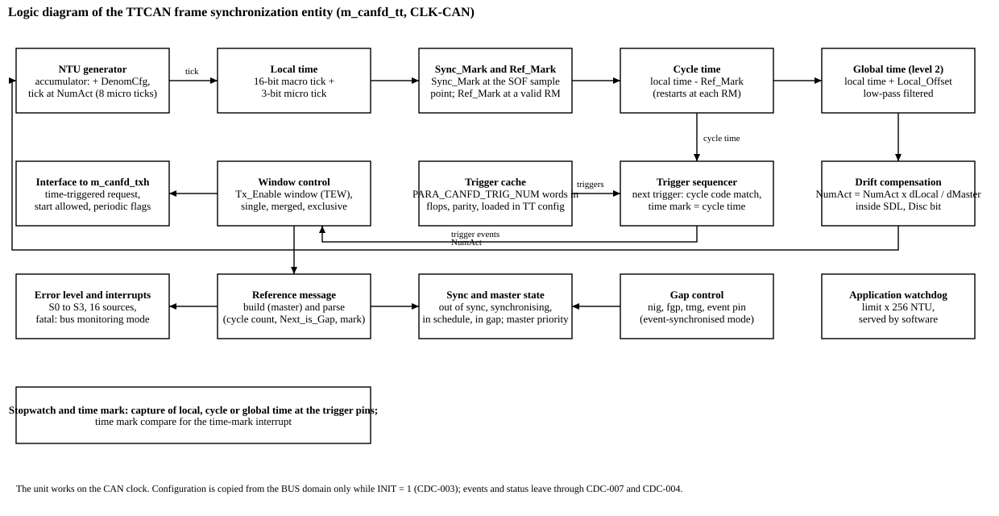

*Figure: logic of m_canfd_tt. Source: `model/can_tt_waves.py`.*

#### 10.13.1 What time-triggered communication is, and the decisions

In event-driven CAN a node sends when it has a message and arbitration decides. In TTCAN all nodes follow a common schedule, the **system matrix**: time is cut into **basic cycles**, each basic cycle starts with a **reference message** sent by the **time master**, and inside it every message has its **time window** in which it may be sent. The bus load and the jitter of every message are then known in advance (a steer-by-wire or brake function that needs a fixed transmission schedule, section 1.4, FEAT-013).

The user decided on 2026-11-06: (1) the scope of level 2 is chosen by parameters, (2) periodic, event and merged arbitrating windows are all supported, (3) the trigger list is kept in flops of the CAN domain, (4) the TT interrupts form a register set of their own with two summary flags in the main interrupt set (DEC-037 to DEC-040).

| Option | Parameter | Content |
|---|---|---|
| Level 1 | `PARA_CANFD_TT_EN` = 1, `PARA_CANFD_TT_L2_EN` = 0 | NTU is a configured multiple of the CAN clock (normally the bit time); cycle time; no global time |
| Level 2 | `PARA_CANFD_TT_L2_EN` = 1 | Global time, local offset, drift compensation of NumAct inside the limit SDL, Disc bit, global time wrap |
| External clock synchronisation | `PARA_CANFD_TT_EXTSYNC_EN` = 1 (needs level 2) | The current time master changes the TUR numerator and the global time phase during operation (`ecs`, `sgt`, `cfd_tt_gpre`) |

#### 10.13.2 Time bases

**Network time unit (NTU).** The NTU is the unit of all TT times. It is the ratio TUR = NumCfg / DenomCfg CAN clock periods (NumCfg = 0x10000 plus `numcfg` of `cfd_tt_turn`, DenomCfg = `denom` of `cfd_tt_turd`). In level 1 the NTU is normally the nominal bit time; in level 2 it is a fraction of a physical second. The NTU generator is an accumulator: every CAN clock it adds `8 x DenomCfg`; when the sum reaches NumAct it subtracts NumAct and gives a **micro tick**; eight micro ticks are one NTU (**macro tick**). The model checks that over 2 million clocks the number of ticks equals the exact value within one tick for the four ratios of the Bosch examples. The restrictions are NumCfg >= 4 x DenomCfg in level 1 and >= 8 x DenomCfg in level 2 (for the 3-bit fraction); the largest suitable numbers give the best accuracy.

*Example:* CAN clock 80 MHz and NTU = 1 us (80 clocks): `numcfg` = 0xFFE0 (NumCfg 0x1FFE0 = 131040), `denom` = 0x0666 (1638), 131040 / 1638 = 80 exactly.

**Local time** is a 16-bit macro tick counter with a 3-bit micro tick fraction (not readable). **Sync_Mark:** at the sample point of every SOF bit (the frame synchronization event) the local time is copied into Sync_Mark. **Ref_Mark:** when a valid reference message is sent or received, Sync_Mark is copied into Ref_Mark. **Cycle time = local time - Ref_Mark**; it restarts at each valid reference message, so it is never below the length of the reference message in NTU, except at the start. **Global time** (level 2 only) = local time + Local_Offset, where Local_Offset is the difference between the Master_Ref_Mark of the received reference message and the own Ref_Mark; it is low-pass filtered except after a discontinuity. A potential master that never saw another master has Local_Offset 0 and its local time is the global time.

#### 10.13.3 System matrix and windows

| Window | Trigger | Meaning |
|---|---|---|
| Exclusive | Tx_Trigger_Single | One message of one node; a periodic message in a fixed place |
| Arbitrating | Tx_Trigger_Single | An event message may be sent; several nodes may try and arbitrate; no retransmission in the same window |
| Merged arbitrating | Tx_Trigger_Merged ... Tx_Trigger_Single | One window assigned to several messages of this node; the highest priority pending one is sent; a message that loses or is disturbed may be sent again inside the window (WF-054); the last trigger of the window must be a Tx_Trigger_Single |
| Free | none | Not used by the schedule; the bus idles |

A **Tx_Enable window** of `tew` NTU opens at the time mark of a Tx trigger. A transmission may start only inside it; if it cannot (the previous message overlaps), the message is not sent in this time window at all (WF-055). The **length of a basic cycle** is the time mark of the Tx_Ref_Trigger plus 1 NTU plus 1 CAN bit time. A **matrix cycle** is the basic cycles 0 to `ccm`; the cycle count comes from the reference message (a master counts, a slave takes the received count). The **cycle code** of a trigger (7 bits) says in which basic cycles it is active, and the same message can be sent at different rates:

| Cycle code | Active when |
|---|---|
| 000000c | Every cycle |
| 000001c | Every second cycle, count mod 2 = c |
| 00001cc | Every fourth, count mod 4 = cc |
| 0001ccc | Every eighth, count mod 8 = ccc |
| 001cccc | Every sixteenth, count mod 16 = cccc |
| 01ccccc | Every thirty-second, count mod 32 = ccccc |
| 1cccccc | Every sixty-fourth, count mod 64 = cccccc |

The model checks the decoding and that for each period the codes of all phases partition the 64 cycles (WF-053). `ett` of `cfd_tt_mtx` is the number of Tx triggers that must become active in one matrix cycle: count every Tx trigger once for each cycle in which its cycle code makes it active.

The matrix length is `ccm + 1` and must be a power of two from 1 through 64. TT validates this
value before it activates the loaded trigger cache; an illegal matrix length sets `cfe` and
the fatal TT error level, leaving the schedule inactive.

#### 10.13.4 Trigger memory

The trigger list is written by software into the trigger section of the message RAM (`cfd_trig_cfg`) as 32-bit elements and **copied into a cache of flops in the CAN domain when the node leaves the TT configuration mode** (DEC-039/095; the user preferred a deterministic access over a smaller area; the size follows `PARA_CANFD_TRIG_NUM`, up to 64 words, with a parity bit per word for the safety option SM-13). Cache loading reads one word at a time through CDC-014; the load index advances only after the Message-RAM response returns without range/ECC error. The trigger cache is not used until the complete configured list has loaded and passed validation. The element:

| Bits | Field | Meaning |
|---|---|---|
| [31:29] | Type | 0 Tx_Ref_Trigger, 1 Tx_Ref_Trigger_Gap, 2 Tx_Trigger_Single, 3 Tx_Trigger_Merged, 4 Watch_Trigger, 5 Watch_Trigger_Gap, 6 Rx_Trigger, 7 EndOfList (illegal) |
| [28:23] | Message number | Tx trigger: the Tx buffer (0 to 31); Rx trigger: the dedicated Rx buffer (0 to 63); ignored for the reference, watch and EndOfList types |
| [22:16] | Cycle code | As in the table of 10.13.3 (used by Tx and Rx triggers) |
| [15:0] | Time mark | The cycle time at which the trigger becomes active |

The list is sorted by time mark; the trigger with the lowest mark is first. At each reference message the sequencer starts at the first element, finds the first trigger whose cycle code matches the cycle count, waits until the cycle time reaches its mark, activates it, and goes on to the next matching trigger. **Configuration errors** (error level 3, interrupt `cfe`, the model checks each): a matching trigger with a time mark below the cycle time; a Tx_Trigger_Merged not followed by a Tx_Trigger_Single or Tx_Trigger_Merged; a Tx_Ref_Trigger or Tx_Ref_Trigger_Gap in a node that is not a potential master; an Rx_Trigger inside the Tx_Enable window of a matching Tx trigger or between a merged trigger and the next; an Rx_Trigger placed near the Tx_Ref_Trigger so that the offset reverses their order; an EndOfList trigger reached; a trigger earlier than the end of the reference message (never active). No two triggers may be active at the same cycle time and cycle count; triggers of different cycles may share a mark. Triggers behind the Watch_Trigger never become active; unused words after it are EndOfList. A typical master list: Tx and Rx triggers, then Tx_Ref_Trigger, then Watch_Trigger (for the event-synchronised mode also Tx_Ref_Trigger_Gap and Watch_Trigger_Gap); a slave list is the same without the reference triggers.

**Trigger-cache RAM failure (DEC-097).** A range or uncorrectable-ECC error while loading any
trigger word invalidates the partial cache. TT scheduling stays inactive and the existing
Message-RAM fault path reports the failing access. The policy does not set `tt_fail`, `cfe` or INIT.
Corrected-ECC data is accepted. For example, an error at cache word 3 prevents earlier cached
words from being used as a partial schedule.

#### 10.13.5 The messages

**Reference message.** A time master sends at Tx_Ref_Trigger using identifier `ref_id` with the 3 low `tm_prio` bits, DLC `rdlc` (at least 1 in level 1 and 4 in level 2), cycle count, Next_is_Gap and, at level 2, Master_Ref_Mark. The adopted product layout is from secondary sources, not ISO-verified: byte 0 is Next_is_Gap at bit 7, reserved bit 6, Cycle_Count bits 5:0; level 2 byte 1 is NTU_Res bits 7:1 and Disc_Bit bit 0, bytes 2 and 3 are Master_Ref_Mark low/high; remaining bytes are zero (DEC-064). For this RTL profile, the 3-bit microtick phase is left-aligned in NTU_Res bits 7:5 and bits 4:1 are zero. Disc_Bit is asserted in the next master reference message after an accepted `sgt` command, then cleared after that reference transmission succeeds. `Master_Ref_Mark` is the current global-time value when the direct reference frame is built. On receive, `m_canfd_bsp.o_sof_sample_can` captures Sync_Mark; when the completed frame is validated as a reference, cycle time restarts from the captured SOF mark rather than the end of frame. This field placement remains a secondary-source product choice, not an ISO 11898-4 claim. Example: a level-1 reference with cycle count 5, Next_is_Gap=1 and `rdlc=1` sends byte 0 = 8'h85. A higher-priority master wins simultaneous arbitration; a backup master starts after `refo` NTU of idle bus.

**Periodic messages** (exclusive windows): the buffer is marked in `cfd_ttb_per`; its request stays set; the message is sent at every active Tx trigger that points to it, without a new request; the data must be valid before the time-triggered operation starts and software updates it in time with the cycle time. There is no retransmission in the strictly time-triggered mode (a failed periodic message waits for its next trigger). **Event messages** (arbitrating and merged windows): software requests the buffer as in section 10.12; the trigger of the window makes it a candidate; it is sent once when it wins; if it lost or was disturbed it may retry in a merged window only if the retry SOF begins before that same window expires. A frame that began SOF in-window continues to its terminal CAN result after expiry, but that trigger cannot retry the attempt after expiry (DEC-102). The request stays set until success or the normal cancellation/failure rule applies. The valid-buffer rule of 10.12 applies to both kinds. **Example 1.** Let Tx_Enable be open from NTU 20 through NTU 27. A triggered frame starts SOF at NTU 26 and reaches its terminal error result at NTU 31. The frame engine continues the attempt after NTU 27; TXH does not offer a retry for that trigger, and no `cfd_ttb_miss` is set because SOF began in-window (WF-079). **Rx triggers** check periodic reception: at the mark the unit looks at the new-data flag of the dedicated Rx buffer that the trigger names; if no message arrived since the last matrix cycle, the bit in `cfd_ttr_miss0` or `cfd_ttr_miss1` is set (DEC-093). The bit remains set until software clears it; multiple misses while it is set coalesce, and a simultaneous new miss wins over W1C clear. A missed Tx trigger sets the bit in `cfd_ttb_miss`.

**Integration with the Tx handler (CDC-016).** For ordinary `Tx_Trigger_Single` and
`Tx_Trigger_Merged` messages, TT sends `{merged, buffer_index}` through an ordered asynchronous
FIFO to TXH. The FIFO depth is the next power of two at or above `PARA_CANFD_TRIG_NUM` (minimum
2). If full at a trigger mark, TT drops that opportunity and sets the corresponding sticky
`cfd_ttb_miss` bit. BUS consumes admitted descriptors in schedule order; each descriptor retains
its single/merged type. A trigger is served once its SOF starts while the CAN-domain Tx_Enable
permission is active. Window expiry blocks new starts only: an already-started frame runs to its
terminal CAN result even when EOF is later. Expiry alone does not start a retry; any retry must be
authorized by the existing trigger-class rules and must still start before the applicable window
closes (DEC-102).

**Direct reference-message path (DEC-096/098).** A potential time master builds the reference
frame record in `m_canfd_tt` and offers it to the dedicated `m_canfd_bsp` input in CLK-CAN at the
scheduled Tx_Ref_Trigger. It bypasses TXH and the BUS-to-CAN Tx-frame CDC. This is a one-cycle
attempt, not a held-valid queue: TT checks the same-cycle BSP ready/permission indication and
asserts valid only when BSP can accept the frame on that trigger. If BSP is busy or permission is
low, TT drops the attempt at that mark and raises the existing `txu` miss event. It does not retry
late or set a Tx-buffer miss bit; the next attempt is at the next scheduled reference trigger.
BSP records whether an accepted frame belongs to TT or TXH and routes its terminal result to the
same owner. A successful reference frame returns a TT-owned success result; it does not complete a
TXH buffer or create a Tx-event FIFO entry. Arbitration loss is returned to TT as a distinct result.


#### 10.13.6 Start-up, synchronization state and time masters

At the switch from the TT configuration mode to a time-triggered mode every node starts with cycle time 0 at the beginning of its list, the state **out of synchronisation** and no transmission enabled except the reference message. The first received (or sent) reference message gives **synchronising**, the second gives **in schedule** or **in gap** by Next_is_Gap (`sync_state` in the model); then all Tx and Rx triggers are enabled.

| Case | Behavior |
|---|---|
| Time slave, no message before the Watch_Trigger | The watch trigger is ignored until a message was seen; at the Initial_Watch_Trigger (the maximum of the cycle time) the interrupt `iwt` is raised, the unit freezes and waits for the first reference message |
| Time slave or master sees any message but the reference message before the Watch_Trigger | Fatal error (level 3): `wtr`, the bus output is switched off, the node enters the bus monitoring mode (it can still receive but cannot acknowledge); only a new configuration leaves it |
| Potential master after the configuration | Sends the reference message at its Tx_Ref_Trigger; the node with the highest master priority in the network becomes the **current time master**; the others are **backup masters** (`master_st`) |
| Master stops (WF-056) | A backup master starts its reference message after `refo` NTU of idle bus (default `tm_prio` x 4), so that the order of the backups follows the priorities even with the largest drift; a backup that sees the reference message of another master does not send |

#### 10.13.7 Gap control (event-synchronised mode)

In the mode `tt_mode` = 3 the time master may interrupt the schedule by a **gap**: no transmissions, the bus idle, until the next reference message. A gap starts after a basic cycle whose reference message had Next_is_Gap = 1; the master sets it by software (`nig` of `cfd_tt_gap`) or by hardware: with `epe` set, a high level at `i_tt_evt_trig` when the reference message starts sets Next_is_Gap (WF-057). A master in a gap ends it by `fgp`, by a low level at `i_tt_evt_trig`, by the time mark when `tmg` is set, or at its Tx_Ref_Trigger_Gap if the event did not come; a gap cannot interrupt a basic cycle. In the state in gap the nodes use the gap variants of the reference and watch triggers. In the mode `tt_mode` = 2 Next_is_Gap and the event pin are ignored. (The earlier text of this specification said that a rising edge of `i_tt_evt_trig` starts the cycle; the level semantics of REF-010 replace it.)

#### 10.13.8 Level 2: global time and drift compensation

At each reference message a time-receiving node compares the length of the last basic cycle in its local NTU (`d_local`, difference of two Ref_Marks) with its length in the master's global time (`d_master`, difference of two Master_Ref_Marks) and computes **NumAct_new = NumAct x d_local / d_master**. If |NumAct_new - NumCfg| is within the synchronisation deviation limit SDL = 2^(ldsdl + 5) the new value is used; otherwise the compensation is suspended and `gte` is raised; a Disc bit in the reference message also suspends it and raises `dis`. `qcs` of `cfd_tt_clk` shows an active compensation. The model computes a slave whose clock is 300 ppm fast: the cycle length error falls from 3 NTU to about 0.02 NTU in the second cycle (WF-058). The phase filter computes the signed modulo-16-bit error `error = target_offset - offset`. It then uses the exact RTL half-step `step = arithmetic_shift_right(error, 1) + error[0]`; this rounds odd values toward positive infinity (for example, +5 becomes +3 and -5 becomes -2). The updated offset wraps modulo 2^16. The first valid reference or a Disc reference aligns directly to the master mark. This half-step is fixed RTL behavior, not a CSR setting (DEC-099); `qgtp` reports phase-valid status. Global time wrap (0xFFFF to 0) raises `gtw`. The NumAct division is performed by a sequential divider once per basic cycle. **External clock synchronisation** (option): the current time master adjusts its clock speed (write `numcfg`, then `ecs`) and the global time phase (write `cfd_tt_gpre`, then `sgt`); CDC captures `gt_pre` with the SGT command, then TT applies both together and sets Disc for the next reference message (DEC-100).

#### 10.13.9 Stop-watch and time mark

`sws` of `cfd_tt_clk` chooses local, cycle or global time as the stop-watch source; with `sws` not 0 and `swe` clear, the next rising edge of `i_tt_swatch_trig` (CDC-010) copies that time into `cfd_tt_swt` and sets `swe`; software clears `swe` to arm the next capture. The time mark `tmark` is compared with the source `tm_src`; when equal `tmi` is raised and the pin `o_tt_time_mark` pulses; `o_tt_sync_mark` pulses at the start of each basic cycle.

#### 10.13.10 Error levels, interrupts and the watchdog

The **TT error level** (`ttel` of `cfd_tt_sts`) is an IP product severity code: 0 none, 1 warning, 2 error, 3 severe. This mapping is based on REF-010 and REF-011 secondary sources and is not an ISO 11898-4 conformance claim (DEC-064). S1 sources are `txu` and `gte`; S2 is `txo`; S3 includes `cfe`, `apw`, `wtr` and CAN bus-off. S3 sets `tt_fail`, raises `tt_err`, enters bus monitoring and INIT, and is not recovered automatically. Trigger counts are evaluated per matrix cycle; changes raise `cel`. Other non-fatal status events do not raise the TT error level.

The **application watchdog** must be served by software (`kick` of `cfd_tt_wd`) at least once in `appwd_lim` x 256 NTU, else `apw` is raised and all bus activity stops (fatal; a new configuration is needed). The limit 0 disables it for development only.

| Source | Group | Level | Meaning |
|---|---|---|---|
| cfe, apw, wtr | error | 3 (S3) | Severe: configuration, watchdog, missing reference message (a CAN bus-off is S3 too) |
| iwt | error | 3 (restartable) | No system start-up |
| cel, txu, txo, gte, dis, gtw | error | txu, gte: 1 (S1); txo: 2 (S2); cel, dis, gtw: events without a level | Disturbance and global time events |
| swe, tmi | schedule | none | Stop-watch and time mark |
| gap, csm, ssm, sbc | schedule | none | Start of gap, change of synchronisation mode, start of matrix cycle, start of basic cycle |

The 16 sources form the register set `cfd_ttirq_raw`, `cfd_ttirq_en`, `cfd_ttirq_inj`, `cfd_ttirq_sts` (the same field names in all four). Every enabled error-group event sets the summary flag `tt_err`, every enabled schedule-group event the summary flag `tt_mark` of the main set `cfd_irq_*` (DEC-040).

#### 10.13.11 Interaction with the rest of the IP

- **Frame formats.** TTCAN scheduling is a product profile based on secondary sources; no ISO 11898-4 conformance is claimed (DEC-064). When TT is enabled, `m_canfd_tt` identifies the event-driven and strict TT windows. FD SOF is eligible only in an event-driven window; the receiver latches this decision through EOF, while an FD SOF in a strict TT window is a form error and is not stored. Classic frames use configured TT windows. An active frame is never cut off at a window boundary; a TT transmission that misses its configured window follows the existing miss reporting (REQ-TT-018, WF-072).
- **Retransmission.** The retry limits and `dar` of 10.12 do not apply to periodic messages in strictly time-triggered mode, where there is no retransmission; they apply to event messages.
- **Sleep, partial networking and clock stop** are not allowed in a time-triggered mode (the schedule needs the clock); a request is refused with a flag.
- **Safety.** With `PARA_CANFD_SAF_TRG_EN` the trigger cache has a parity bit per word (SM-13). SM-06 compares counter state but shares the primary next-state logic, so it has no independent logic-fault coverage credit until that structure is assessed. A trigger-cache parity error sets `trg_par` and, with the default stop reaction, leaves the time-triggered operation (18.3.2).
- **Timestamps.** The Rx timestamp keeps its meaning (timestamp counter); the cycle time at the SOF is available in `cfd_tt_ctime` through the snapshot.
- **Clock and area.** The FSE runs in the CAN clock; its flops are: NTU generator 24, local time 19, marks 3 x 16, cycle time 16, global time 32, drift unit about 80, trigger cache 33 x `PARA_CANFD_TRIG_NUM`, plus the state machines. With 32 triggers this is about 1.3 thousand flops, with 64 triggers 2.4 thousand.

#### 10.13.12 Verification

TEST-051 compares the trigger sequencer of the RTL with the model for random lists (all types, all cycle codes, matrix cycles up to 64) including every configuration error. TEST-052 checks the windows: Tx_Enable, exclusive, arbitrating and merged windows with disturbed and lost messages (WF-054, WF-055). TEST-053 checks start-up, the synchronisation states and the master and backup behavior including the master failure (WF-056). TEST-054 checks level 2: the NTU generator, the global time, the drift compensation with slaves of -500 to +500 ppm, the Disc bit, GTE and the external synchronisation option (WF-058). TEST-055 checks the gap control (WF-057). TEST-056 checks the error levels, the watchdog and the interrupt set. TEST-057 checks the periodic and Rx trigger messages and the miss flags. TEST-075 checks atomic SGT plus `gt_pre`; TEST-076 checks W1C/hardware-set ordering on miss bitmaps; TEST-077 checks ordered trigger FIFO delivery and full rejection; TEST-078 checks that an in-window SOF continues to its terminal result after expiry and that no retry is issued for that expired trigger; TEST-079/080 cover stale and no-SOF results; TEST-081 covers a merged-window retry that expires before its SOF after an earlier attempt already started. These are verification backlog; simulation remains deferred by DEC-067. SVA-022 checks that no frame starts outside its Tx_Enable window; SVA-023 that the cycle time restarts only at a valid reference message; SVA-024 that the triggers become active in list order. WF-053 to WF-058 show the matrix, the merged window, the missed window, the master failure, the gap and the drift compensation; WF-079 shows the active-frame expiry case.

### 10.14 DMA interface design (m_canfd_dma, PARA_CANFD_DMA_EN)

This subsection explains what the DMA interface does, which part is done by the IP and which by the DMA engine, and fixes the handshake rules. The user asked for the DMA to be a request and acknowledge handshake (DEC-006) and decided on 2026-11-07 on single or burst service with a flush timeout, a four-phase option and a DMA request for the Tx events (DEC-042 to DEC-044). The executable form is `model/can_dma_model.py` (self test: 17 checks PASS), the waveforms are WF-059 to WF-064.

#### 10.14.1 What the DMA interface is for

At a high bus load a CPU that takes one interrupt per message loses its time to the interrupt entry and exit. With the DMA interface the CPU is not interrupted for every message: a DMA engine of the SoC moves the messages between the message RAM and the memory of the application. The IP only provides **requests**; it has **no data port of its own**. The data moves in two ways that the DMA engine owns: the engine reads and writes the message RAM directly (the RAM is outside the IP and shared, ASM-001) and it writes the registers of the IP through the APB interface (one write per message or burst for the acknowledge or the request). Applications: a flight controller that receives many sensor frames per millisecond (FEAT-011), an AUTOSAR driver that copies many frames and wants the transmit confirmations at a high rate.

| Request | Source | Single service | Burst service |
|---|---|---|---|
| `o_dma_req_rx0` | Rx FIFO 0 | Request while the FIFO holds at least 1 message | Request when the fill level reaches the watermark `wm` of `cfd_rxf0_cfg`; one request is one burst of `wm` messages |
| `o_dma_req_rx1` | Rx FIFO 1 | The same | The same with `cfd_rxf1_cfg` |
| `o_dma_req_tx` | Tx FIFO part | Request while at least one buffer of the Tx FIFO part is free; one request is one message | not used |
| `o_dma_req_txe` | Tx event FIFO | Request while the FIFO holds at least 1 event | Request at the watermark `wm` of `cfd_txe_cfg` |

The enable bits are `rx0_dma`, `rx1_dma`, `tx_dma`, `txe_dma`; the service type per FIFO is `rx0_burst`, `rx1_burst`, `txe_burst` (0 single, 1 burst) in `cfd_dma_cfg`; `cfd_dma_sts` shows the request levels and the flush flags. The Tx event request exists with `PARA_CANFD_TXEVT_EN` = 1 (`PARA_CANFD_DMA_EN` = 1 as for all requests).

#### 10.14.2 What the DMA engine does for one request

**Rx and Tx event, one request.** The engine (1) reads the index `gidx` of the status register once (or keeps its own copy) and, for a flush request (flag `rx0_fl` and so on), the fill level to learn how many elements wait, (2) reads that many elements from the message RAM at `start + (gidx + k) x element size`, wrapping at the FIFO size, (3) writes `ack_idx` = the index of the last element read and `ack_go` = 1 to the acknowledge register (`cfd_rxf0_ack`, `cfd_rxf1_ack` or `cfd_txe_ack`) in one APB write, (4) acknowledges. **Tx, one request:** the engine reads `pidx` of `cfd_txf_sts` once and counts, writes the element words into the buffer `ded_num + pidx` of the Tx section, sets that buffer's bit in `cfd_txb_req` in one APB write (a 1 requests, a 0 does nothing) and acknowledges.

#### 10.14.3 Handshake rules (DEC-041, DEC-043)

1. The request is a **level**; it rises when its condition holds and it is enabled.
2. **Pulse acknowledge** (`PARA_CANFD_DMA_HS` = 0, the default): the acknowledge is a pulse of one BUS clock and means *the engine has finished the service, including its APB write*; it drops the request in the same clock.
3. **Four-phase acknowledge** (`PARA_CANFD_DMA_HS` = 1): the acknowledge is a level. The engine raises it when its service is finished; the IP drops the request when it sees it; the engine drops the acknowledge when it sees the request low; the IP may raise the request again only after the acknowledge is low (WF-063). `cfd_feat0.dma_hs` shows the choice to the driver.
4. **Status-confirmed re-arm (DEC-041).** When a request rises, the IP snapshots the service status for that channel. After acknowledge, it holds the request low until the status shows the APB service write took effect: Rx0/Rx1/Tx-event waits for the get index to change or fill to decrease; Tx waits for the put index to change or free-buffer count to decrease. Index changes cover simultaneous enqueue/dequeue or Tx completion/allocation that can leave the count unchanged. If the DMA has not committed its APB write, the status remains at the snapshot and the request stays low. This prevents the same element from being served twice (WF-059, WF-080).
5. After the status change and, for four-phase mode, acknowledge-low phase, the request is evaluated again from the current level. A remaining level that still meets the service condition raises a new request on a later BUS clock.
6. An acknowledge while the request is low, and a request that was dropped by a soft reset (10.10), are ignored; the soft reset clears the re-arm state; the requests are register outputs.
7. The acknowledge input is in the BUS clock domain; a DMA engine on another clock must synchronize it (ASM-018).

#### 10.14.4 Burst service and the flush timeout (DEC-042)

In the burst service a fill level below the watermark would not be served: with `wm` = 4 and one message that arrives alone no request would rise and the message would wait for three more. The user decided that **software chooses single or burst per FIFO**, and that in the burst service a **small counter with a configurable time** raises the request for the messages that remain. The counter (`dma_to` of `cfd_dma_cfg`, 16 bits, one step is 64 BUS clocks, 0 = off) is one counter per FIFO; it runs while the fill level is above 0 and below `wm`, from the arrival of the oldest unserved message, and restarts after a service. When it reaches the limit the request rises with the flush flag (`rx0_fl`, `rx1_fl`, `txe_fl`); the engine reads the fill level (below `wm`) and moves that many elements (WF-062). A fill level that reaches `wm` while the counter runs gives the normal burst request. With `dma_to` = 0 the messages below the watermark wait as before. The single service needs no counter and no watermark: every message gives a request.

#### 10.14.5 Rules for software and the DMA engine

- **One owner per FIFO.** While a FIFO is served by the DMA, the CPU must not acknowledge from the same FIFO: the IP cannot tell who wrote `ack_idx`, and a double acknowledge frees messages that were not read.
- **Blocking mode is recommended with the DMA.** In overwrite mode the hardware can replace the element that the engine is reading (10.11.5); the engine cannot check the generation number inside a burst. The DMA may be used with overwrite, but then the engine must read the header word of each element a second time after the data and drop a changed generation.
- **Tx:** the engine must not write a buffer whose request bit is set (REQ-MSG-010) and takes the buffer from the put index; `fifo_num` of at least 2 lets the engine write the next element while the previous one is sent.
- **Tx events:** the Tx event request serves the events of frames with EFC set; the full-FIFO rule of 10.12.9 (the event is lost, the frame is sent) still applies if the engine is too slow.

#### 10.14.6 Verification

TEST-058 drives the RTL and the model with the same random sequences of arrivals, acknowledge latencies of 1 to 20 clocks, watermarks 1 to 64, FIFO sizes 2 to 64, single and burst service, timeouts and both handshake types, and checks that every message is served once, that the request never rises inside the re-arm window and that it never falls without an acknowledge. TEST-059 checks the Tx request and the Tx event request. SVA-025 checks the rules of 10.14.3 (the pulse width, the four phases, the re-arm, no fall without acknowledge). The waveforms WF-059 to WF-064 show the single message, the burst, the Tx request, the flush timeout, the four-phase handshake and the Tx event burst.

### 10.15 Power, sleep, wake-up and partial networking design (m_canfd_pwr, m_canfd_pn)

This subsection explains how the controller goes to sleep, what wakes it, how a wake-up frame is recognized without storing the frame, and how it restarts. The executable form is `model/can_pn_model.py` (self test: 16 checks PASS) and the waveforms are WF-017 and WF-065 to WF-068. Section 7.4 gives the clock and power intent; this subsection is the behavior. Points that the standards fix are cited; the rest is the author's design with the open questions listed in section 20.

#### 10.15.1 Why and where

A parked car keeps tens of ECUs on one CAN network; if every frame woke every ECU, the quiescent current would drain the battery. A node that sleeps and wakes only for **its own** frames (partial networking, ISO 11898-6) saves that current: a body ECU wakes for the "unlock" frame only, a battery-powered payload node of a drone wakes for the flight controller's command only (FEAT-012). The wake-up of a plain node is by activity on the bus or by the transceiver.

#### 10.15.2 Power states

| State | What runs | Entry | Exit |
|---|---|---|---|
| NORMAL | Everything | Reset release plus INIT cleared and bus integration done | `sleep_req` accepted |
| SLEEP_PEND | The protocol engine until the frame ends and the bus is idle | `sleep_req` of `cfd_ctrl` accepted | Bus idle and no Tx request pending, or a wake event, or a refusal |
| SLEEP | CAN domain: input synchronizer, bit timing, the frame engine in listen mode (nothing is driven), the wake-up filter, the wake detector; BUS domain: may be stopped by the SoC (clock stop, 10.15.4) | INIT set, `o_trcv_en` low | A wake event |
| WAKE_PEND | CAN domain; BUS domain clock restarted by the SoC | Wake event: `o_wake_req` high | Software writes `wake_ack` of `cfd_wake` |
| RESTART | Everything; the node still sends nothing | `wake_ack`; `o_trcv_en` high after software set `trcv_on` or with automatic control | INIT cleared by software, transceiver start-up delay over, 11 recessive bits seen (bus integration) |

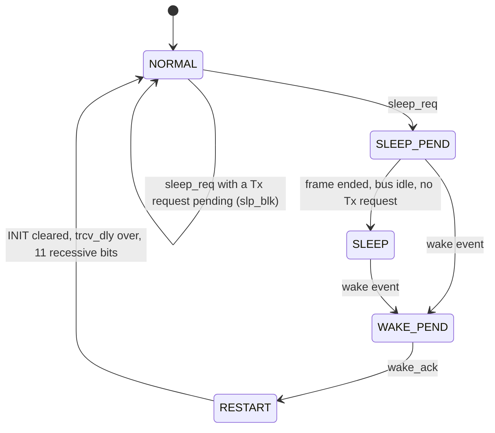

The model checks the sequence and that a wake event during the sleep entry is not lost.

#### 10.15.3 Sleep entry (DEC-045)

1. Software writes `sleep_req`. If the controller is in a time-triggered mode (`tt_mode` 2 or 3) the request is refused (10.13.11).
2. If a Tx buffer has a request bit set the request is **refused**: the flag `slp_blk` of `cfd_wksrc` is set and the controller stays in NORMAL. The user can cancel the pending requests (`cfd_txb_cancel`) and ask again. The author chose refusal because sleeping with pending requests would either lose the messages silently or send them after the wake-up, when they may be stale (confirmed by the user on 2026-11-07, DEC-045).
3. Otherwise the controller finishes the frame that is on the bus (a transmission or a reception), waits for the end of the intermission and the bus idle, sets INIT, drives `o_trcv_en` low (transceiver standby) and shows the state SLEEP in `cfd_sts`; `sleep_req` is cleared by hardware at the wake-up acknowledge.
4. From INIT on, `o_can_tx` is recessive: **a sleeping node never drives the bus**, not even the acknowledge (WF-065).

#### 10.15.4 Clock stop (DEC-015, DEC-047, ASM-009)

The handshake of IF-008 is independent of the sleep. The power controller raises `i_clk_stop_req`; the IP completes the pending transmissions, waits for the bus idle and sets INIT; then it gives **two acknowledges**:

| Acknowledge | Domain | Meaning | Allows to stop |
|---|---|---|---|
| `o_clk_stop_ack` | CLK-BUS | The BUS domain is idle (no RAM access, no APB transfer, no pending crossing) | `i_clk_bus` |
| `o_clkc_stop_ack` (new, user decision 2026-11-07) | CLK-CAN | The CAN domain is idle and **no clock-dependent wake-up source is in use**: `wake_bus` = 0 and `pn_on` = 0, so that the node wakes only by the transceiver pin | `i_clk_can` |

Both acknowledges fall when `i_clk_stop_req` falls; the SoC restarts the clocks before it lowers the request. `o_clkc_stop_ack` is a register output of the CAN domain that **holds its value while the CAN clock is stopped**; the IP does not need the CAN clock to hold it, only to clear it, which happens after the SoC has restarted the clock. If `wake_bus` or the partial networking is used, `o_clkc_stop_ack` stays low and the CAN clock must keep running because the input synchronizer, the bit timing and the filter need it. A SoC that stops the CAN clock watches `i_trcv_wake` itself (the IP cannot raise `o_wake_req` without its clock) and restarts the clocks when it rises (WF-069).

#### 10.15.5 Wake-up sources (DEC-046)

| Source | Condition | Needs | Recorded in `cfd_wksrc` |
|---|---|---|---|
| Transceiver | `i_trcv_wake` high (two-flop synchronizer, CDC-002) | CAN clock | `src_trcv` |
| Bus activity | A dominant level of at least `wup_len` x 8 CAN clock periods when `wake_bus` is set and the partial networking is not used (0 = any dominant sample point) | CAN clock | `src_bus` |
| Wake-up frame | A frame that matches a filter (10.15.6), `PARA_CANFD_PN_EN` = 1 and `pn_on` set | CAN clock | `src_wuf`, `wuf_idx` |

Any source sets `o_wake_req` (a level register output in the CAN domain, REQ-PWR-002) and the wake event of the interrupt set; it stays high until software acknowledges. The frame that woke the node is **not stored**: in the wake-up by activity the node has seen only part of it, and in the wake-up by a frame the filter decides at the end of the CRC and the node has not acknowledged it (ASM-020). The wake detector works only in SLEEP and SLEEP_PEND.

#### 10.15.6 The wake-up frame filter (REQ-PN-001, REQ-PN-003)

**Principle.** The filter is **bit-serial**: it does not store the frame; it compares each destuffed bit with the filters while the frame passes. There are `PARA_CANFD_PN_NUM` filters (1 to 8) working in parallel. Each filter has the identifier (29 bits, `pnf_id`), the format (`pnf_xtd`), the identifier mask (`pnf_idm`, 1 = the bit must match), the DLC and its enable (`pnf_dlc`, `pnf_dlc_en`) and 8 data bytes with a data mask (`pnf_d0`, `pnf_d1`, `pnf_dm0`, `pnf_dm1`).

**Algorithm (the model implements it).** The frame engine in listen mode destuffs the bits and counts them (field counter). For every filter a flag `ok` starts at 1 at the SOF. In the identifier field `ok` falls at the first bit that differs where the mask is 1 (base identifiers are left-aligned in 29 bits, so a base filter looks at the first 11 bits; the format bit IDE must equal `pnf_xtd`). In the control field a recessive FDF bit means an FD frame: **the filter stops until the bus is idle** (the frame is neither a match nor an error, FD passive, ASM-019). With `pnf_dlc_en`, `ok` falls if the DLC differs. In the data field, bit k of the data is compared with the filter data bit k where the data mask is 1; a filter that asks for data bytes (mask bits set above the DLC of the frame) **never matches a shorter frame**. The CRC is computed on the destuffed bits as in any receive. At the CRC delimiter a filter with `ok` = 1, a correct CRC and no stuff error gives the **match**; the index of the first matching filter is reported in `wuf_idx` and the wake-up is raised.

**What does not wake.** A frame with a CRC or stuff error, an FD frame, an extended frame for a base filter (and the reverse), a frame whose fields do not match. In sleep the node does not count errors (`pn_err_ign` of `cfd_pn_cfg` set): the error counters keep their value; a frame error counter with a wake-up threshold, as some selective wake-up transceivers have, is not implemented (the user decided so on 2026-11-07, DEC-048).

**Run-time change.** The data and mask registers may change while the node sleeps or runs (REQ-PN-001); the BUS domain copies a filter to the CAN domain with the handshake of CDC-012, and the CAN domain swaps the new filter in only between frames (at the bus idle), so a frame is never compared with half a filter.

**Area.** One filter holds 29 + 1 + 29 + 4 + 1 + 64 + 64 = 192 flops and a one-bit comparator plus a 64-to-1 selector for the data bits, about 250 gates; eight filters are about 1.5 thousand flops. The option `PARA_CANFD_PN_EN` = 0 removes them; the wake-up by activity and by the transceiver stays.

#### 10.15.7 Restart after the wake-up (DEC-046)

After `o_wake_req` the SoC power controller restarts the BUS clock and the software runs (WF-067). Software writes `wake_ack`; `o_wake_req` falls (the acknowledge crosses by CDC-008). The transceiver needs time to leave standby: `trcv_dly` of `cfd_wake` (units of 64 CAN clock periods) is the time between `o_trcv_en` high and the start of the bus integration; software then clears `init` and the controller waits for 11 consecutive recessive bits (bus integration, 10.6.7) before it takes part in the communication. The configuration, the message RAM and the registers are kept through the sleep (nothing was reset); the first frames on the bus after the wake-up are lost for this node: the application must tolerate that, or the network manager must send a repeated message.

#### 10.15.8 Interaction with the other functions

- **TTCAN** and sleep are exclusive (10.13.11). **Soft reset** is not allowed in sleep. **FD:** the filter is Classic-only (above). **Safety:** the parity of the configuration registers and the lockstep compare keep running if the BUS clock runs; the clock monitor SM-05 is switched off in sleep and re-armed after the restart; a safety fault in sleep is held and reported after the wake-up.
- **Timestamp and timeout counters** of the BUS domain stop with the BUS clock; the timestamp counter of the CAN domain runs in sleep; the first timestamps after the wake-up are therefore not continuous with the timeout counter.
- **Power numbers** (current in sleep with and without the filter) are outside the current RTL/lint scope;

#### 10.15.9 Verification

TEST-060 checks the sleep entry (a frame in progress, a pending Tx request, the time-triggered refusal, a wake event during the entry), the clock stop handshake, the three wake-up sources with the glitch filter `wup_len`, the transceiver delay and the bus integration after the wake-up, and that nothing dominant is driven in sleep (WF-065, WF-067). TEST-061 compares the RTL filter with the model for random filters and frames (base and extended, masks, DLC, data masks, frames shorter than the mask, CRC and stuff errors, FD frames) and checks the swap of a filter between frames (WF-066, WF-068). SVA-026 checks that `o_can_tx` stays recessive from INIT to the end of the bus integration after a wake-up; SVA-027 that `o_wake_req` holds until the acknowledge and that a wake event in SLEEP_PEND is not lost.

## 11. Register and programming model

The register interface exists: an APB4 register block of 102 registers (the repeated wake-up filter registers count once each). The workbook is the single source of truth (REF-005).

### 11.1 CSR specification source

The CSR specification of this IP shall be defined only in the VLSIT CSR Specification Template workbook (REF-005). This document shall not declare or restate the register interface, register map, register fields, offsets, access types, or reset values. The workbook is the single source of truth, so the two documents cannot diverge.

| Item | Specification |
|---|---|
| CSR workbook file | `CAN_FD_Controller_CSR.xlsx` in this folder; its JSON source is `regs_canfd.json` |
| Sheet used for this IP | CSR (the synchronous sheet) |
| Workbook revision / date | Revision 3, 2026-11-08 (timing field allocations/ranges, shared prescaler, bus-off minimum and maximum-count windows; not yet generated into RTL) |
| CSR generator | APB-CSR-Generator, version 2.4 or later of the project (`https://github.com/nguyenquanicd/APB-CSR-Generator`); the exact commit is recorded when the RTL is generated |
| CSR module name | `m_vlsit_csr_canfd` (instance `u_vlsit_csr_canfd` of `m_canfd_top`) |
| Register prefix | `cfd` (matches DEC-005/DEC-020 and the workbook/JSON) |
| Asynchronous | 0: one clock, `i_clk_apb` connected to `i_clk_bus`; the register clock is the BUS clock |
| APB clock and register clock | Both are CLK-BUS (`i_clk_bus`); the values of the CAN domain reach the registers through the status snapshot (CDC-004) and the registers reach the CAN domain through the configuration copy (CDC-003, CDC-012) |
| Source of `i_protect_en` and `i_slverr_en` | Constants of `m_canfd_top`: protection off (0) and error response on (1) (DEC-018) |
| Repeated register groups | The wake-up filter registers `cfd_pnf_id`, `cfd_pnf_idm`, `cfd_pnf_dlc`, `cfd_pnf_d0`, `cfd_pnf_d1`, `cfd_pnf_dm0`, `cfd_pnf_dm1` are PARAMETERIZED banks; the count parameters `PARA_CFD_PNF_ID_COUNT`, `PARA_CFD_PNF_IDM_COUNT`, `PARA_CFD_PNF_DLC_COUNT`, `PARA_CFD_PNF_D0_COUNT`, `PARA_CFD_PNF_D1_COUNT`, `PARA_CFD_PNF_DM0_COUNT` and `PARA_CFD_PNF_DM1_COUNT` of the generated block are all set to `PARA_CANFD_PN_NUM` in `m_canfd_top`; with `PARA_CANFD_PN_EN` 0 they are 1 and the registers have no effect |

Workbook requirements: the register block is generated from the workbook by APB-CSR-Generator and complies with REF-003 as delivered; register and field names are lower-case identifiers that become port names; the register descriptions follow the conventions of the specification skill (rules R-032 to R-040), including the interrupt set `cfd_irq_raw`, `cfd_irq_en`, `cfd_irq_inj` and `cfd_irq_sts` (rule R-040). A register behavior that the CSR template cannot express is recorded in section 20 and not added here: (1) the generator cannot remove the registers of a disabled feature, so they stay in the map without effect and the option flags of `cfd_feat0` and `cfd_feat1` show the absence (REQ-PARAM-001); (2) the write protection by INIT, CCE and the lock is done by `m_canfd_wprot` and the key compare and the parity of the configuration registers by `m_canfd_safe`, outside the generated block (DEC-021).

### 11.2 Software sequences

The register and field names are those of the workbook. The flowchart shows the normal use of the controller; `[M]` steps are mandatory on the path shown, `[O]` steps are optional or conditional on the feature named.

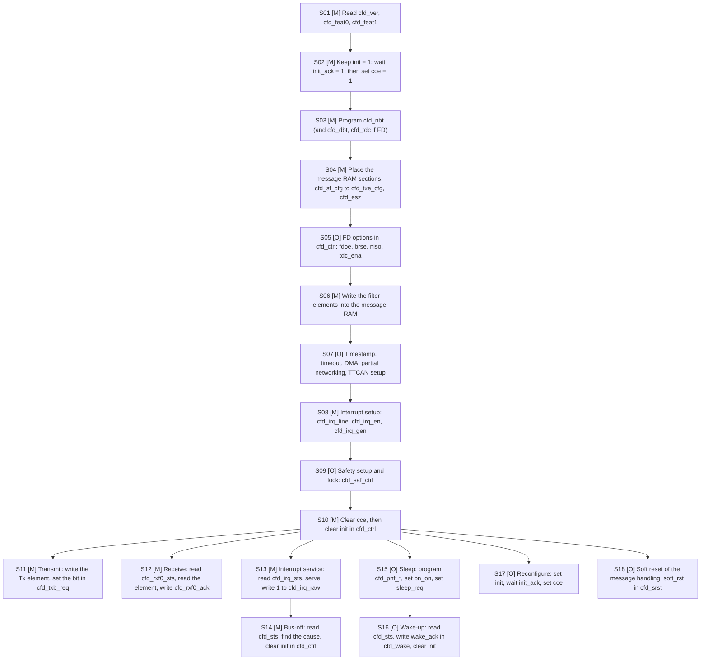

| No. | Step | Option (M/O) | Interface | CSR | Description |
|---|---|---|---|---|---|
| S01 | Read cfd_ver, cfd_feat0, cfd_feat1 | M | APB4 read | cfd_ver.ip_ver; cfd_feat0 flags; cfd_feat1 sizes: read | Find the version, the built options and the sizes so that the driver uses only what exists |
| S02 | Wait for initialization, then open configuration | M | APB4 read and write | Keep `cfd_ctrl.init = 1`; poll `cfd_sts.init_ack = 1`; then write `cfd_ctrl.cce = 1` | The protocol engine is stopped and protected configuration writes are enabled |
| S03 | Program the bit timing | M | APB4 write | cfd_nbt.nbrp, nprop, nphs1, nphs2; cfd_nbt2.nsjw, dsjw; cfd_dbt.dbrp, dprop, dphs1, dphs2; cfd_tdc.tdco, tdcf | Set nominal/data timing and TDC; scalar range clamps set `cfd_sts.cfg_fix`; a bad timing tuple keeps INIT asserted until corrected (DEC-074) |
| S04 | Place the message RAM sections | M | APB4 write | cfd_sf_cfg, cfd_ef_cfg, cfd_rxf0_cfg, cfd_rxf1_cfg, cfd_rxb_cfg, cfd_esz, cfd_txb_cfg, cfd_txe_cfg, cfd_trig_cfg: start and size fields | Give each section its address range; the software ensures that the ranges do not overlap |
| S05 | FD options | O (FD built) | APB4 write | cfd_ctrl.fdoe = 1, brse, niso, tdc_ena, pxd | Select the frame format and the data phase options; all nodes of the network use the same format |
| S06 | Write the filter elements | M | Message RAM write by the CPU or DMA | Element words at the addresses of cfd_sf_cfg.sf_start and cfd_ef_cfg.ef_start; cfd_gfc.anfs, anfe, rrfs, rrfe; cfd_xidam.xidam | Define which identifiers are stored and where |
| S07 | Timestamp, timeout, DMA, partial networking, TTCAN | O (feature built) | APB4 write | cfd_ts_cfg, cfd_tout_cfg, cfd_dma_cfg, cfd_pn_cfg, cfd_pnf_*, cfd_tt_* | Set up the options that the product uses |
| S08 | Interrupt setup | M | APB4 write | cfd_irq_line, cfd_irq_en, cfd_irq_gen.line0_en, line1_en | Choose the events, the line of each and switch the lines on |
| S09 | Safety setup and lock | O (safety built) | APB4 write | cfd_saf_clk, cfd_saf_clk2, cfd_mram_wdt, cfd_saf_ctrl: enables, then lock_en = 1 | Switch on the mechanisms of the safety level and lock the configuration |
| S10 | Start | M | APB4 write | cfd_ctrl.cce = 0, then cfd_ctrl.init = 0 (and cfd_wake.trcv_on = 1 before) | The CAN domain copies the configuration and starts the bus integration (11 recessive bits) |
| S11 | Transmit | M | Message RAM write, then APB4 write | Tx element at the address of cfd_txb_cfg.start; cfd_txb_req.req bit n = 1; completion: cfd_txb_done.done bit n, cfd_irq_raw.tx_done | Send a frame; the hardware picks the buffer with the lowest identifier; software leaves the element untouched while the bit is 1 |
| S12 | Receive | M | APB4 read, message RAM read | cfd_rxf0_sts.fill, gidx; element words; cfd_rxf0_ack.ack_idx then ack_go = 1 | Read a stored message and free its place in the FIFO |
| S13 | Interrupt service | M | APB4 read and write | cfd_irq_sts: read; the cause is served; cfd_irq_raw: write 1 to the served bits | Find the active events and clear them; a new event in the same cycle is kept |
| S14 | Bus-off recovery | M (on bus-off) | APB4 read and write | cfd_sts.bo, cfd_ecnt.tec, cfd_lec.lec: read; cfd_bo_cfg.bo_cnt: set; cfd_ctrl.init = 0 | The hardware has set INIT; software checks the cause and requests restart. Recovery counts 128..255 eleven-recessive-bit occurrences; reset value is 129 (DEC-074). |
| S15 | Sleep | O (partial networking built) | APB4 write | cfd_pnf_* with pnf_on = 1; cfd_pn_cfg.pn_on = 1; cfd_wake.wake_bus; cfd_ctrl.sleep_req = 1 | Prepare the wake-up frame and ask for sleep; the controller finishes the frame and then sleeps |
| S16 | Wake-up | O (follows S15) | APB4 read and write | cfd_sts.wake_pend: read; cfd_wake.wake_ack = 1; cfd_ctrl.init = 0 | Acknowledge the wake-up request and restart the controller |
| S18 | Soft reset of the message handling | O | APB4 write and read | cfd_srst.soft_rst = 1; poll cfd_srst.srst_busy until 0 | Return the Rx and Tx handlers, FIFOs, flags, DMA and the counters of the timestamp to their reset state without disturbing the bus (section 10.10); the configuration registers keep their values |
| S17 | Reconfigure | O | APB4 read and write | cfd_ctrl.init = 1; cfd_sts.init_ack: poll; cfd_ctrl.cce = 1; then continue with S03 or S04 | Change the configuration while the controller is stopped |

The flowchart and the table agree one to one.

#### 11.2.1 Minimal ISO CAN-FD bring-up and frame exchange

This is the smallest useful driver sequence for ISO CAN-FD with one Tx buffer and Rx FIFO 0. It omits TTCAN, DMA, partial networking, safety, Tx-event FIFO and power management. The register names below refer to the CSR workbook; this section does not repeat offsets or replace that source. The timing calculation is a driver contract, not a ready-to-program profile; the SoC clock, transceiver, network bit rates and propagation budget must be validated by the integrator.

For an active timing profile, calculate `tq = m / f_CAN`, `bit_rate = f_CAN / (m * N)` and `sample_point = (1 + tseg1) / N`, where `N = 1 + tseg1 + tseg2` and `tseg1 = PROP_SEG + PHASE_SEG1`. ISO operation uses one common effective prescaler `m` for nominal and data phases (REQ-BTL-002). The workbook encodes most segment and SJW counts as value-minus-one; `cfd_dbt.dprop` is the exception and is programmed as a literal count. Validate all ISO ranges and segment constraints from 10.6.1 before writing the fields.

| Step | Software action | Registers / data | Result and guard |
|---|---|---|---|
| FD-01 | Check build capabilities. Stop with `ENOTSUP` if FD is not built or the payload length exceeds the build maximum. | Read `cfd_ver`, `cfd_feat0.fd_en`, `cfd_feat0.data_max` | Driver uses only implemented features and supported payload size. |
| FD-02 | Hold the protocol engine in INIT, poll until it acknowledges the stop, then open configuration. | `cfd_ctrl.init = 1`; poll `cfd_sts.init_ack = 1`; set `cfd_ctrl.cce = 1` | Protected timing, mode and message-RAM configuration may now be written. |
| FD-03 | Program nominal timing. For BRS, also program data timing with the same effective prescaler. Select ISO format. | `cfd_nbt`, `cfd_nbt2`, and if BRS is used `cfd_dbt`; `cfd_ctrl.niso = 0` | Values satisfy 10.6.1 and the target network bit rates. Do not enable BRS if the data profile is not valid for every communicating node. |
| FD-04 | Choose frame mode. Basic FD without a faster data phase uses nominal timing for the whole frame. Optional BRS enables the programmed data timing; enable TDC only when the measured transmitter loop requires it and its constraints are met. | `cfd_ctrl.fdoe = 1`; `brse = 0` without BRS or `brse = 1` with BRS; optional `tdc_ena`, `cfd_tdc.tdco` | Require `cfd_feat0.fd_en = 1`. TDC use is restricted by REQ-BTL-005. |
| FD-05 | Allocate non-overlapping Message RAM sections for one dedicated Tx buffer and Rx FIFO 0. Set element sizes to cover the largest Tx/Rx payload. | `cfd_txb_cfg`, `cfd_rxf0_cfg`, `cfd_esz`; `cfd_sf_cfg` / `cfd_ef_cfg` if filters are used | Software verifies each complete section fits the external RAM. For bring-up only, empty filter lists plus `cfd_gfc.anfs = 0` and `anfe = 0` route unmatched base and extended frames to FIFO 0; production software should install restrictive filters. |
| FD-06 | Clear stale raw events. If using interrupts, install the handler, route `rx0_new` and `tx_done` to line 0, enable both events, enable per-buffer Tx-done for buffer 0, then enable line 0. | W1C `cfd_irq_raw`; `cfd_irq_line`, `cfd_irq_en`, `cfd_txb_ie.done_ie[0]`, `cfd_irq_gen.line0_en` | Enable the output line only after the handler is ready. Polling may replace interrupt setup. |
| FD-07 | Commit configuration and leave INIT. | Clear `cfd_ctrl.cce`, then clear `cfd_ctrl.init`; poll `cfd_sts.init_ack = 0` and wait for `cfd_sts.act = 1` before issuing traffic | The CAN domain copies the configuration and completes bus integration using the 11-recessive-bit condition (REQ-BTL-010; section 10.6.7). `cfd_sts.act = 1` denotes idle after integration. |
| FD-08 | Build one Tx element, then request it. | Message-RAM Tx header/data; set word 1 `FDF = 1`; set `BRS` per selected mode; write bit 0 of `cfd_txb_req.req` | Do not modify the element while its request is pending. For FD without BRS, clear the per-frame BRS bit. |
| FD-09 | Wait for completion or service the completion interrupt. | Poll `cfd_txb_done.done[0]` or handle `cfd_irq_raw.tx_done` | Read `cfd_sts` and error status if completion does not occur; do not infer success from request-bit clearing alone. |
| FD-10 | Receive from FIFO 0, then release the element. | On `rx0_new` or `cfd_rxf0_sts.fill != 0`, read the element at `start + gidx * element_words`, then write `ack_idx = gidx` and `ack_go = 1` | Read all words before acknowledging. Check `cfd_sts.rfdf`, `rbrs`, and `resi` for the last-frame format snapshot; clear serviced raw IRQ flags by writing 1. |
| FD-11 | Diagnose errors and recover only when appropriate. | Read `cfd_irq_sts`, `cfd_sts`, `cfd_ecnt`, `cfd_lec`; W1C serviced `cfd_irq_raw` bits | For bus-off, inspect the cause and error counters before software restarts recovery by clearing INIT, as specified in S14. |

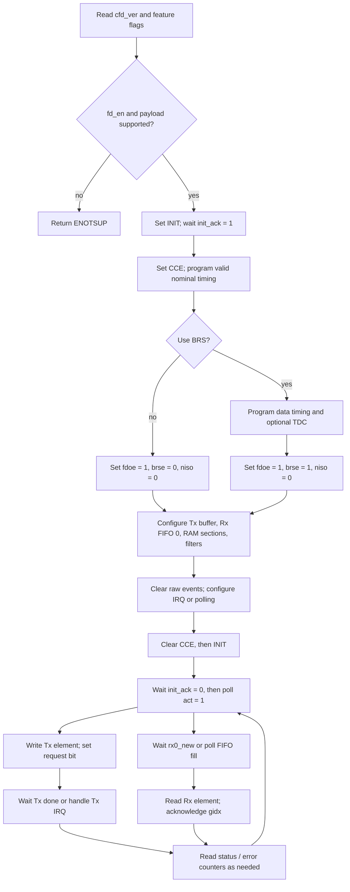

This is an ordered software flow, not a cycle-accurate waveform. Existing APB, configuration-copy, FD bit-rate-switch, frame, Rx-store and interrupt waveforms are WF-012, WF-014, WF-004/005, WF-010/013, and WF-016. They show the implementation contracts at their respective interfaces.

### 11.3 CSR connection to the design

Each row names a workbook register and its fields only as written in the workbook; offsets, widths, types and reset values are in the workbook. For the repeated registers one row stands for the whole bank. A signal from the CAN domain is synchronized by the IP (CDC-003, CDC-004, CDC-007, CDC-008, CDC-012), not by the CSR. In one cycle a software write to an `rwi` field wins over a hardware load of the same field, so the owner block repeats a lost load until it sees the effect; a hardware load to a `w1c` field wins over a software clear, so a new event is kept.

| Workbook register.field | Direction at the CSR | Design signal | Clock domain of the signal | Behavior notes |
|---|---|---|---|---|
| cfd_feat0 (fd_en, niso_en, rtr_en and 27 more fields (all fields of the register)) | status in | Constants from the parameters PARA_CANFD_* (no design logic) | CLK-BUS | Tied inputs of the generated block; read-only |
| cfd_saf_bld.saf_san | status in | build constants of m_canfd_safe | CLK-BUS | Constants; no crossing |
| cfd_feat1 (txbuf_max, rxbuf_max, trig_num and 5 more fields (all fields of the register)) | status in | Constants from the parameters PARA_CANFD_* (no design logic) | CLK-BUS | Tied inputs of the generated block; read-only |
| cfd_ver.ip_ver | status in | Constants from the parameters PARA_CANFD_* (no design logic) | CLK-BUS | Tied inputs of the generated block; read-only |
| cfd_ctrl (init, cce, mon and 16 more fields (all fields of the register)) | control out, command out, hardware clear | m_canfd_pwr and the configuration copy of m_canfd_cdc (CDC-003); init is also set by m_canfd_pwr, m_canfd_eml and m_canfd_safe | CLK-BUS | init and cce are control outputs; init is loaded to 1 by the hardware on bus-off, clock stop and safety stop (software write wins in the same cycle, so the hardware repeats the load while init_ack of cfd_sts stays 0); sleep_req is cleared by hardware at the wake-up acknowledge; the commands cross as levels and are cleared by the done pulses of the consumers (DEC-112); init is `rwi` and is loaded by safety, bus-off and clock stop, each with its own enable (`init_stp_en`, `init_bo_en`, the reaction bits of `cfd_saf_rct`) (DEC-112) |
| cfd_nbt (nbrp, nprop, nphs1, nphs2) | control out | m_canfd_btl through the configuration copy (CDC-003) | CLK-BUS to CLK-CAN | Quasi-static, read by the CAN domain after INIT falls (REQ-CLK-002) |
| cfd_nbt2 (nsjw, dsjw) | control out | m_canfd_btl through the configuration copy (CDC-003) | CLK-BUS to CLK-CAN | Quasi-static, read by the CAN domain after INIT falls (REQ-CLK-002) |
| cfd_dbt (dbrp, dprop, dphs1, dphs2) | control out | m_canfd_btl through the configuration copy (CDC-003) | CLK-BUS to CLK-CAN | Quasi-static, read by the CAN domain after INIT falls (REQ-CLK-002) |
| cfd_tdc.tdco, tdcf, tdcv | control out, status in | tdco and tdcf to m_canfd_tdc (CDC-003); tdcv from m_canfd_tdc (CDC-004) | CLK-BUS to CLK-CAN; status CLK-CAN to CLK-BUS | tdcv is a snapshot of the measured delay |
| cfd_sts (act, init_ack, ep and 11 more fields (all fields of the register)) | status in | m_canfd_bsp, m_canfd_eml, m_canfd_pwr and m_canfd_tdc state through the status snapshot (CDC-004) | CLK-CAN to CLK-BUS | Status in; the snapshot is refreshed continuously and is not coherent with a frame |
| cfd_ecnt.rec, tec, rp | status in | m_canfd_eml through the status snapshot (CDC-004) | CLK-CAN to CLK-BUS | Status in; the fields change with every error |
| cfd_lec.lec, dlec | status in | m_canfd_eml through the status snapshot (CDC-004) | CLK-CAN to CLK-BUS | Status in; the fields change with every error |
| cfd_wake (wake_ack, wake_bus, trcv_on, trcv_auto, wup_len, trcv_dly) | control out, command out, hardware clear | m_canfd_pwr (CDC-008 for the acknowledge and the control bits) | CLK-BUS to CLK-CAN | wake_ack is set by software and cleared by hardware when the CAN domain has dropped o_wake_req |
| cfd_irq_raw (rx0_new, rx0_wm, rx0_ful and 29 more fields (all fields of the register)) | hardware load | m_canfd_irq: every event of the IP drives the load value 1 and the load enable of its field for the cycles of the event | CLK-BUS | Events from the CAN domain arrive by CDC-007; a hardware set in the cycle of a software clear wins, so a new event is kept |
| cfd_irq_en (rx0_new, rx0_wm, rx0_ful and 29 more fields (all fields of the register)) | control out | m_canfd_irq: enable, injection edge detect, line select, line enable | CLK-BUS | Control outputs; the injection field sets the raw flag on its rising edge |
| cfd_irq_inj (rx0_new, rx0_wm, rx0_ful and 29 more fields (all fields of the register)) | control out | m_canfd_irq: enable, injection edge detect, line select, line enable | CLK-BUS | Control outputs; the injection field sets the raw flag on its rising edge |
| cfd_irq_sts (rx0_new, rx0_wm, rx0_ful and 29 more fields (all fields of the register)) | status in | m_canfd_irq: masked status (raw AND enable) | CLK-BUS | Status in; combinational AND of two registered values, registered once before the register input |
| cfd_irq_line (rx0_new, rx0_wm, rx0_ful and 29 more fields (all fields of the register)) | control out | m_canfd_irq: enable, injection edge detect, line select, line enable | CLK-BUS | Control outputs; the injection field sets the raw flag on its rising edge |
| cfd_irq_gen.line0_en, line1_en | control out | m_canfd_irq: enable, injection edge detect, line select, line enable | CLK-BUS | Control outputs; the injection field sets the raw flag on its rising edge |
| cfd_gfc (anfs, anfe, rrfs, rrfe) | control out | m_canfd_flt global filter control | CLK-BUS | Control outputs, quasi-static |
| cfd_xidam.xidam | control out | m_canfd_flt global filter control | CLK-BUS | Control outputs, quasi-static |
| cfd_sf_cfg.sf_start, sf_num | control out | m_canfd_rxh and m_canfd_flt: section addresses, sizes, watermark and FIFO mode | CLK-BUS | Control outputs, quasi-static; the IP does not check overlap (section 6.3) |
| cfd_ef_cfg.ef_start, ef_num | control out | m_canfd_rxh and m_canfd_flt: section addresses, sizes, watermark and FIFO mode | CLK-BUS | Control outputs, quasi-static; the IP does not check overlap (section 6.3) |
| cfd_rxf0_cfg (start, num, wm, ovw) | control out | m_canfd_rxh and m_canfd_flt: section addresses, sizes, watermark and FIFO mode | CLK-BUS | Control outputs, quasi-static; the IP does not check overlap (section 6.3) |
| cfd_rxf1_cfg (start, num, wm, ovw) | control out | m_canfd_rxh and m_canfd_flt: section addresses, sizes, watermark and FIFO mode | CLK-BUS | Control outputs, quasi-static; the IP does not check overlap (section 6.3) |
| cfd_rxb_cfg.start, num | control out | m_canfd_rxh and m_canfd_flt: section addresses, sizes, watermark and FIFO mode | CLK-BUS | Control outputs, quasi-static; the IP does not check overlap (section 6.3) |
| cfd_esz (rxf0_dsz, rxf1_dsz, rxb_dsz, txb_dsz) | control out | m_canfd_rxh and m_canfd_flt: section addresses, sizes, watermark and FIFO mode | CLK-BUS | Control outputs, quasi-static; the IP does not check overlap (section 6.3) |
| cfd_txb_cfg (start, ded_num, fifo_num, qmode) | control out | m_canfd_txh: Tx buffer split, queue mode, Tx event FIFO section | CLK-BUS | Control outputs, quasi-static |
| cfd_txe_cfg (start, num, wm, mm16) | control out | m_canfd_txh: Tx buffer split, queue mode, Tx event FIFO section | CLK-BUS | Control outputs, quasi-static |
| cfd_trig_cfg.start, num | control out | m_canfd_tt through m_canfd_mram (trigger memory section) | CLK-BUS | Control outputs, quasi-static |
| cfd_bo_cfg.bo_cnt | control out | m_canfd_eml bus-off recovery counter (CDC-003) | CLK-BUS to CLK-CAN | Control output, quasi-static |
| cfd_srst.soft_rst, srst_busy | command out, hardware clear, status in | `m_canfd_rst`: `soft_rst` becomes `i_srst_req_bus`, `srst_busy` follows `o_soft_rst_busy_bus`, and `o_soft_rst_done_bus` clears the request after the BUS-handler reset pulse | CLK-BUS | The one-cycle reset pulse waits for the Rx FIFO empty and Tx CDC handshake idle conditions |
| cfd_mram_wdt.limit, wdt_en, dma_lim | control out | m_canfd_mram access watchdog | CLK-BUS | Control outputs |
| cfd_rxf0_sts (gidx, pidx, fill, full, lost) | status in | m_canfd_rxh FIFO indexes and fill level | CLK-BUS | Status in, registered in m_canfd_rxh |
| cfd_rxf0_ack.ack_idx, ack_go | control out, command out, hardware clear | m_canfd_rxh get index update | CLK-BUS | ack_go is set by software and cleared by hardware after the get index moved; ack_idx is a control output |
| cfd_rxf1_sts (gidx, pidx, fill, full, lost) | status in | m_canfd_rxh FIFO indexes and fill level | CLK-BUS | Status in, registered in m_canfd_rxh |
| cfd_rxf1_ack.ack_idx, ack_go | control out, command out, hardware clear | m_canfd_rxh get index update | CLK-BUS | ack_go is set by software and cleared by hardware after the get index moved; ack_idx is a control output |
| cfd_rxb_nd0.newd | hardware load | m_canfd_rxh new-data flags of the dedicated Rx buffers | CLK-BUS | Set by hardware for the cycles after the last word of the element was acknowledged (INV-004); cleared by software; a new message in the same cycle wins |
| cfd_rxb_nd1.newd | hardware load | m_canfd_rxh new-data flags of the dedicated Rx buffers | CLK-BUS | Set by hardware for the cycles after the last word of the element was acknowledged (INV-004); cleared by software; a new message in the same cycle wins |
| cfd_txb_req.req | command out, hardware clear | m_canfd_txh request, cancel and confirm flags | CLK-BUS | Bit set by software (rwi), cleared by hardware when the frame ended or the cancellation is done; a hardware load in the cycle of a software write is lost, so m_canfd_txh repeats the clear until it sees the bit (the bit stays 1 until then) |
| cfd_txb_cancel.creq | command out, hardware clear | m_canfd_txh request, cancel and confirm flags | CLK-BUS | Bit set by software (rwi), cleared by hardware when the frame ended or the cancellation is done; a hardware load in the cycle of a software write is lost, so m_canfd_txh repeats the clear until it sees the bit (the bit stays 1 until then) |
| cfd_txb_done.done | hardware load | m_canfd_txh transmission and cancellation done flags | CLK-BUS | Set by hardware, cleared by software; the status of a frame crosses by CDC-004 |
| cfd_txb_cdone.cdn | hardware load | m_canfd_txh transmission and cancellation done flags | CLK-BUS | Set by hardware, cleared by software; the status of a frame crosses by CDC-004 |
| cfd_txb_ie.done_ie | control out | m_canfd_txh per-buffer interrupt enable | CLK-BUS | Control outputs |
| cfd_txb_cie.canc_ie | control out | m_canfd_txh per-buffer interrupt enable | CLK-BUS | Control outputs |
| cfd_txb_trtx.conf | command out, hardware clear | m_canfd_txh request, cancel and confirm flags | CLK-BUS | Bit set by software (rwi), cleared by hardware when the frame ended or the cancellation is done; a hardware load in the cycle of a software write is lost, so m_canfd_txh repeats the clear until it sees the bit (the bit stays 1 until then) |
| cfd_txb_dreq.data_req | status in | m_canfd_txh trigger-transmit data request | CLK-BUS | Status in |
| cfd_txr_cfg.retry_max | control out | m_canfd_txh retry control | CLK-BUS | Control output |
| cfd_txb_fail.fail | hardware load | m_canfd_txh transmission and cancellation done flags | CLK-BUS | Set by hardware, cleared by software; the status of a frame crosses by CDC-004 |
| cfd_txp_cfg.prio_mode, exp_en | control out | m_canfd_txh retry control | CLK-BUS | Control output |
| cfd_txf_sts (free, gidx, pidx, full) | status in | m_canfd_txh Tx FIFO and Tx event FIFO indexes and fill level | CLK-BUS | Status in |
| cfd_txe_sts (fill, gidx, pidx, full) | status in | m_canfd_txh Tx FIFO and Tx event FIFO indexes and fill level | CLK-BUS | Status in |
| cfd_txe_ack.ack_idx, ack_go | control out, command out, hardware clear | m_canfd_txh Tx event get index update | CLK-BUS | As cfd_rxf0_ack |
| cfd_ts_cfg.ts_sel, ts_pres | control out | m_canfd_ts source select and prescaler (CDC-003) | CLK-BUS to CLK-CAN | Control outputs, quasi-static |
| cfd_ts_cnt.ts_val | status in | m_canfd_ts counters (CDC-004 for the timestamp) | CLK-CAN to CLK-BUS / CLK-BUS | Status in; the value is not coherent with a frame timestamp |
| cfd_tout_cfg.tout_on, tout_sel, tout_per | control out | m_canfd_ts timeout counter control | CLK-BUS | Control outputs |
| cfd_tout_cnt.tout_val | status in | m_canfd_ts counters (CDC-004 for the timestamp) | CLK-CAN to CLK-BUS / CLK-BUS | Status in; the value is not coherent with a frame timestamp |
| cfd_dma_cfg (rx0_dma, rx1_dma, tx_dma and 5 more fields (all fields of the register)) | control out | m_canfd_dma request enables | CLK-BUS | Control outputs |
| cfd_dma_sts (rx0_req, rx1_req, tx_req and 4 more fields (all fields of the register)) | status in | m_canfd_dma request flags | CLK-BUS | Status in |
| cfd_hpm_sts (hp_fidx, hp_fifo, hp_idx, hp_vld) | status in, hardware load | m_canfd_rxh: high priority message info; losses before the filter; filter load | CLK-BUS | hp_vld and ovr are set by hardware and cleared by software (a new event in the same cycle is kept); the other fields are status inputs |
| cfd_rx_sts.ovr, flt_busy, flt_peak | status in, hardware load | m_canfd_rxh: high priority message info; losses before the filter; filter load | CLK-BUS | hp_vld and ovr are set by hardware and cleared by software (a new event in the same cycle is kept); the other fields are status inputs |
| cfd_dom_cfg.dom_lim | control out | m_canfd_bsp stuck-dominant counter (CDC-003) | CLK-BUS to CLK-CAN | Control output, quasi-static; the flag dom_stk is in cfd_sts and the event dom_to is a hardware load of cfd_irq_raw |
| cfd_wksrc (src_bus, src_trcv, src_wuf, wuf_idx, slp_blk) | status in, hardware load | m_canfd_pwr and m_canfd_pn wake-up source flags (hardware load, CDC-007 and CDC-009) | CLK-CAN to CLK-BUS | Set by hardware, cleared by software; wuf_idx is a status input; slp_blk is set by m_canfd_pwr when a sleep request is refused |
| cfd_pn_cfg.pn_on, pn_err_ign | control out | m_canfd_pn global enable and error handling (CDC-003) | CLK-BUS to CLK-CAN | Control outputs, quasi-static |
| cfd_pn_cfg.pnf_upd | command out, hardware clear | valid of the filter bundle of m_canfd_cdc (CDC-012); cleared by hardware when the copy is complete (DEC-110) | CLK-BUS | Software writes the filters, then writes 1; the bundle is stable while the bit is 1 |
| cfd_tt_cfg (tt_mode, tm_en, tm_prio and 4 more fields (all fields of the register)) | control out | m_canfd_tt configuration (CDC-003; appwd_kick by CDC-008) | CLK-BUS to CLK-CAN | Control outputs; appwd_kick is cleared by hardware |
| cfd_tt_ref.ref_id, ref_xtd | control out | m_canfd_tt configuration (CDC-003; appwd_kick by CDC-008) | CLK-BUS to CLK-CAN | Control outputs; appwd_kick is cleared by hardware |
| cfd_tt_turn.numcfg | control out | m_canfd_tt configuration (CDC-003; appwd_kick by CDC-008) | CLK-BUS to CLK-CAN | Control outputs; appwd_kick is cleared by hardware |
| cfd_tt_turd.denom, ldsdl | control out | m_canfd_tt configuration (CDC-003; appwd_kick by CDC-008) | CLK-BUS to CLK-CAN | Control outputs; appwd_kick is cleared by hardware |
| cfd_tt_mtx.ett, rdlc, tew | control out | m_canfd_tt configuration (CDC-003; appwd_kick by CDC-008) | CLK-BUS to CLK-CAN | Control outputs; appwd_kick is cleared by hardware |
| cfd_tt_wd.appwd_lim, kick | control out, command out, hardware clear | m_canfd_tt configuration (CDC-003; appwd_kick by CDC-008) | CLK-BUS to CLK-CAN | Control outputs; appwd_kick is cleared by hardware |
| cfd_tt_sts (sync_st, master_st, cyc_cnt, tt_fail, ttel) | status in | m_canfd_tt status through the snapshot (CDC-004) | CLK-CAN to CLK-BUS | Status in |
| cfd_tt_ctime.cyc_time | status in | m_canfd_tt status through the snapshot (CDC-004) | CLK-CAN to CLK-BUS | Status in |
| cfd_tt_gtime.glob_time | status in | m_canfd_tt status through the snapshot (CDC-004) | CLK-CAN to CLK-BUS | Status in |
| cfd_tt_ltime.loc_time | status in | m_canfd_tt status through the snapshot (CDC-004) | CLK-CAN to CLK-BUS | Status in |
| cfd_tt_swt.swt_time | status in | m_canfd_tt status through the snapshot (CDC-004) | CLK-CAN to CLK-BUS | Status in |
| cfd_tt_tmark.tmark, tm_src | control out | m_canfd_tt time mark compare | CLK-BUS to CLK-CAN | Control outputs |
| cfd_tt_clk (sws, ecs, sgt, qcs, qgtp) | control out, command out, hardware clear, status in | m_canfd_tt configuration (CDC-003; appwd_kick by CDC-008) | CLK-BUS to CLK-CAN | Control outputs; appwd_kick is cleared by hardware |
| cfd_tt_gpre.gt_pre | control out | m_canfd_tt configuration (CDC-003; appwd_kick by CDC-008) | CLK-BUS to CLK-CAN | Control outputs; appwd_kick is cleared by hardware |
| cfd_tt_gap (nig, fgp, tmg, epe, in_gap) | control out, command out, hardware clear, status in | m_canfd_tt configuration (CDC-003; appwd_kick by CDC-008) | CLK-BUS to CLK-CAN | Control outputs; appwd_kick is cleared by hardware |
| cfd_ttb_per.per | control out | m_canfd_tt time mark compare | CLK-BUS to CLK-CAN | Control outputs |
| cfd_ttb_miss.miss | hardware load | m_canfd_tt miss flags accumulated and transferred by CDC-015 | CLK-CAN to CLK-BUS | A new miss in the cycle of a software clear is kept |
| cfd_ttr_miss0.miss | hardware load | m_canfd_tt miss flags accumulated and transferred by CDC-015 | CLK-CAN to CLK-BUS | A new miss in the cycle of a software clear is kept |
| cfd_ttr_miss1.miss | hardware load | m_canfd_tt miss flags accumulated and transferred by CDC-015 | CLK-CAN to CLK-BUS | A new miss in the cycle of a software clear is kept |
| cfd_ttirq_raw (cfe, apw, wtr and 13 more fields (all fields of the register)) | hardware load | m_canfd_irq TT interrupt set; the enabled events set tt_mark and tt_err of cfd_irq_raw | CLK-BUS | Same rules as cfd_irq_*; events from the CAN domain arrive by CDC-007 |
| cfd_ttirq_en (cfe, apw, wtr and 13 more fields (all fields of the register)) | control out | m_canfd_irq TT interrupt set; the enabled events set tt_mark and tt_err of cfd_irq_raw | CLK-BUS | Same rules as cfd_irq_*; events from the CAN domain arrive by CDC-007 |
| cfd_ttirq_inj (cfe, apw, wtr and 13 more fields (all fields of the register)) | control out | m_canfd_irq TT interrupt set; the enabled events set tt_mark and tt_err of cfd_irq_raw | CLK-BUS | Same rules as cfd_irq_*; events from the CAN domain arrive by CDC-007 |
| cfd_ttirq_sts (cfe, apw, wtr and 13 more fields (all fields of the register)) | status in | m_canfd_irq TT interrupt set; the enabled events set tt_mark and tt_err of cfd_irq_raw | CLK-BUS | Same rules as cfd_irq_*; events from the CAN domain arrive by CDC-007 |
| cfd_tirq_raw.tdc_to | hardware load | m_canfd_irq records the TDC timeout event from m_canfd_tdc after CDC-007 | CLK-BUS | Sticky raw event, software clears per its W1C field policy |
| cfd_tirq_en.tdc_to, tdc_to_line | control out | m_canfd_irq interrupt enable and line selection for the TDC timeout event | CLK-BUS | `tdc_to_line=0` routes the enabled event to `o_irq_0`; `1` routes it to `o_irq_1` |
| cfd_tirq_inj.tdc_to | control out | m_canfd_irq software event injection for TDC timeout | CLK-BUS | Uses the common interrupt-injection enable |
| cfd_tirq_sts.tdc_to | status in | m_canfd_irq masked TDC timeout status (`raw AND enable`) | CLK-BUS | Read-only; the enable register's line select routes the masked event to one IRQ output |
| cfd_saf_ctrl (lock_en, par_chk_en, clk_chk_en and 11 more fields (all fields of the register)) | control out | m_canfd_safe enables, key, clock monitor window and fault reactions | CLK-BUS | Control outputs; the key compare is in m_canfd_safe |
| cfd_saf_clk.win_len | control out | m_canfd_safe enables, key, clock monitor window and fault reactions | CLK-BUS | Control outputs; the key compare is in m_canfd_safe |
| cfd_saf_clk2.exp_cnt, tol | control out | m_canfd_safe enables, key, clock monitor window and fault reactions | CLK-BUS | Control outputs; the key compare is in m_canfd_safe |
| cfd_saf_sts (ram_cor, ram_unc, ram_wdt and 11 more fields (all fields of the register)) | hardware load | m_canfd_safe flags (hardware load of each flag for the cycles of the fault) | CLK-BUS | A new fault in the cycle of a software clear is kept |
| cfd_saf_inj (inj_ram_cor, inj_ram_unc, inj_ram_wdt and 11 more fields (all fields of the register)) | control out | m_canfd_safe injection (effective only with i_saf_inj high) | CLK-BUS | Control outputs, edge detect |
| cfd_saf_rct (r_ram_cor, r_ram_unc, r_ram_wdt and 11 more fields (all fields of the register)) | control out | m_canfd_safe enables, key, clock monitor window and fault reactions | CLK-BUS | Control outputs; the key compare is in m_canfd_safe |
| cfd_saf_auto (auto_ram, auto_wdt, auto_reg and 11 more fields (all fields of the register)) | status in | build constants of m_canfd_safe (PARA_CANFD_SAF_AUTO_MASK) | CLK-BUS | Constants; no crossing |
| cfd_saf_adr.err_addr | status in | m_canfd_mram address of the last failing access | CLK-BUS | Status in |
| cfd_pnf_id, cfd_pnf_idm, cfd_pnf_dlc, cfd_pnf_d0, cfd_pnf_d1, cfd_pnf_dm0, cfd_pnf_dm1 (all fields, n copies) | control out | m_canfd_pn wake-up filter n (one entry per filter, count from PARA_CANFD_PN_NUM; CDC-012) | CLK-BUS to CLK-CAN | Control outputs; data and masks may change at run time, the CAN domain takes them after the handshake |

### 11.4 APB access behavior of the CSR

The behavior that the generated module gives (APB-CSR-Generator, version 2.4), with the decisions of section 20.

| Case | Behavior |
|---|---|
| Normal read or write | PREADY after 1 wait state (Asynchronous = 0) |
| Write with PSTRB not all ones | PSLVERR and no change, because `i_slverr_en` is constant 1 (DEC-018) |
| Address not word aligned | PSLVERR, because `i_slverr_en` is constant 1 |
| Aligned address that is not a register | OKAY; read returns 0; write is ignored |
| Non-secure access (PPROT[1] = 1) | Accepted: `i_protect_en` is constant 0 (DEC-018); the integrator can change it by a wrapper parameter |
| Reserved bits | Read as 0; write ignored |
| Protected configuration field written while INIT = 0 or CCE = 0 | Full protected registers ignore the write; in mixed registers protected fields retain their current value while approved control/command fields accept the write. No PSLVERR is generated (REQ-SAFE-003). The same field-level rule applies when the safety lock is enabled and the supplied key is invalid. |
| Mixed control/configuration write | `cfd_ctrl` accepts INIT, CCE and `sleep_req` while the configuration gate is closed, but retains the current values of protected mode fields. `cfd_wake.wake_ack`, TTCAN command fields, and `cfd_saf_ctrl.unlock_key` remain writable so software can acknowledge, issue commands, or unlock. |
| Protected configuration write with INIT = 1, CCE = 1 and lock open | The generated CSR receives the original write data; all protected fields may be updated. |
| Reset | Registers take the reset value of the workbook; asynchronous assert, release synchronous to i_clk_bus |

## 12. Error handling and recovery

| Error ID | Detection condition | Observable response/status | Interrupt | Clear/recovery | Reset behavior |
|---|---|---|---|---|---|
| ERR-001 | Bit error: the transmitted level differs from the sampled level outside the arbitration field and the ACK slot (and, in the data phase, at the secondary sample point) | Active error flag (or passive when error passive); TEC + 8 except for fault-confinement exceptions 1 and 2; last error code BIT | Protocol error flag of the phase | Write 1 to the flag; the frame is repeated | Counters cleared by the reset or by the bus-off recovery |
| ERR-002 | Stuff error: six equal bits in the dynamically stuffed region. A violated fixed stuff bit is a form error (ERR-003); a stuff count mismatch is an FD CRC error (ERR-001), not a stuff error | Error flag; REC + 1 (receiver) or TEC + 8 (transmitter); code STUFF | Protocol error flag | As ERR-001 | As ERR-001 |
| ERR-003 | Form error: a fixed-form bit has the wrong level (delimiters, EOF, res, FDF in a Classic-only node, a fixed stuff bit in the ISO FD CRC field equal to its predecessor) | Error flag; code FORM | Protocol error flag | As ERR-001 | As ERR-001 |
| ERR-004 | Acknowledge error: a transmitter sees no dominant ACK slot | Error flag; TEC + 8 (unchanged for an error-passive transmitter that reads no dominant bit during its passive flag, exception 1 of 10.8.3); code ACK | Protocol error flag | The frame is repeated | As ERR-001 |
| ERR-005 | CRC error: the received CRC differs from the computed one | CC: no ACK, error flag at first EOF bit. ISO FD: no ACK, error flag after three bit-times following CRC delimiter; dominant samples during the interval are ignored. REC + 1; code CRC | Protocol error flag | The frame is dropped | As ERR-001 |
| ERR-006 | Error counters cross thresholds 96, 128 and 256 | Warning flag, error-passive state, bus-off and INIT set | Error warning, error passive, bus-off | Software clears INIT after bus-off, recovery of OP-007 | Counters reset |
| ERR-007 | Rx FIFO full | Blocking: the new message is dropped; overwrite: the oldest is lost; message-lost flag | Rx FIFO full and lost | Software acknowledges messages; flag cleared by writing 1 | Flags cleared |
| ERR-008 | Tx event FIFO full | The event is dropped, the lost flag is set; the frame is still sent | Tx event FIFO full and lost | As ERR-007 | Flags cleared |
| ERR-009 | Message RAM access watchdog expires (safety) | The request is released and the failure flag set; INIT is set when the access was a transmit fetch | Message RAM access failure | Software clears the flag and INIT | Flag cleared |
| ERR-010 | Illegal register access (partial strobe, unaligned address, protected write while INIT = 0 or CCE = 0) | PSLVERR for the first two; the third is ignored without error | None | None | Not applicable |
| ERR-011 | Scalar timing field outside its individual legal range, or an illegal cross-field timing tuple | Scalar field uses its nearest legal effective value and sets `cfg_fix`; an illegal tuple keeps INIT asserted and sets `cfg_fix` until software corrects it. No blanket clamp applies to other configuration fields (DEC-014, DEC-074). | None | Software corrects the timing value/tuple | Reset value |
| ERR-012 | Rx element longer than the element data size | The data is cut; the DLC keeps its value | None | None | Not applicable |
| ERR-013 | Safety fault (RAM uncorrectable, register parity, lockstep mismatch, clock monitor, payload signature) | Safety flag, o_saf_err, interrupt; INIT is set for RAM uncorrectable and lockstep mismatch | Safety interrupt | Software reads the flags, clears them and INIT (section 18) | Flags cleared by the reset |
| ERR-014 | TTCAN severe error S3 or application watchdog | The TT flag is set; the TT entity goes to the failed state, the node stops time-triggered transmission | TT events | Software restart in configuration mode | Flags cleared |
| ERR-015 | Reset release skew above four slower-clock cycles, or either clock stopped during release | Outside the supported reset-release contract; CDC-ready remains low until both clocks run and report ready | No guarantee outside contract | SoC reset controller | Not applicable |

**Precedence of simultaneous errors:** the first error of a frame sets the error flag and the last error code; a second error in the same frame increments the counters per the CAN rules but keeps the first code. A bit error in the error flag itself adds 8 to the transmit counter. A safety error does not change the error counters. A message RAM failure is reported even if the bus error flag is set at the same time; both flags are independent.

## 13. Performance, power, and area

The user confirmed on 2026-11-04 that the targets are TBD, with reference estimates for orientation (DEC-013). The estimates come from public information of other IP vendors and are not a promise of this IP. No timing closure is claimed. The SDC of section 17 is the constraint input of the analysis.

| Metric ID | Metric | Target / limit | Conditions | Measurement method | Hard / goal |
|---|---|---|---|---|---|
| PPA-001 | Maximum frequency of CLK-CAN and CLK-BUS | Not specified in this RTL/lint phase | SoC clock and implementation constraints not supplied | Deferred until synthesis/STA inputs are available | Not a current target |
| PPA-002 | Area | Not specified in this RTL/lint phase | Target library and configuration not selected | Deferred until synthesis inputs are available | Not a current target |
| PPA-003 | Dynamic and leakage power | Not specified in this RTL/lint phase | Activity, target library and corner not supplied | Deferred until synthesis/PPA inputs are available | Not a current target |
| PERF-001 | Loss-free Rx throughput | Not specified in this RTL/lint phase; depends on clock rates, FIFO depth, RAM wait states and arbitration | No system rate or RAM service limit supplied | Deferred measurement | Not a current guarantee |
| PERF-002 | Latency from frame completion to visible Rx put index | Depends on CDC FIFO synchronization, filter walk, message RAM latency and arbitration | No RAM service bound supplied | Deferred measurement | Not a current guarantee |
| PERF-003 | Tx start latency: request set to SOF on an idle bus | Scan 33 BUS clocks at most plus the element words plus 3 CAN clocks plus the wait for the next bit boundary | No RAM wait state | Simulation | Goal |

CFG-MIN is the area minimum for the product that needs only Classic frames; every enabled feature of section 8 adds area, so the integrator takes the smallest configuration that fits the product (section 1.4).

## 14. RTL implementation contract

### 14.1 Required coding baseline

The VLSIT RTL Design Rules v2 in VLSIT_RTL_Design_Rule.md (REF-003) are the mandatory coding authority. The default naming rule applies (section 2.2): module names start with `m_canfd_`, ports start with `i_` or `o_`, parameters start with `PARA_CANFD_`, names of at most 30 characters, abbreviations of NAM-08. One module per file with matching file name; the top is a structural wrapper with named connections only. The register block is generated and delivered as generated (REQ-RTL-001). Every output is a register output and no input reaches an output combinationally (REQ-RTL-002). Testbench, assertions and models stay outside the synthesis file set (REQ-VER-001). The delivery adds a `filelist.f` per configuration.

### 14.2 RTL hierarchy

| Module | Responsibility | Parent / instance | Clock/reset domains | Interface |
|---|---|---|---|---|
| m_canfd_top | Structural top: ports, parameters, interconnect, instances; elaboration checks (REQ-PARAM-002) | Root module | Both domains | All ports of section 6.2 |
| m_canfd_rst | Per-domain reset synchronizers, two-domain readiness handshake and BUS-side software-reset drain/pulse controller | m_canfd_top / u_canfd_rst | Both; soft reset in CLK-BUS | `i_rst_n_can`, `i_rst_n_bus`, `i_srst_req_bus`, FIFO/handshake idle; reset, ready, busy and reset-pulse outputs |
| m_vlsit_csr_canfd | Generated APB register block (APB-CSR-Generator, not hand-written) | m_canfd_top / u_vlsit_csr_canfd | CLK-BUS / RST-BUS | APB, fields of the workbook |
| m_canfd_wprot | Workbook-derived APB field-mask filter for protected configuration and mixed control words | m_canfd_top / u_canfd_wprot | CLK-BUS / RST-BUS | APB request, current mixed-word values, INIT/CCE and safety-key status; filtered APB request and lock-violation event |
| m_canfd_cdc | Clock-domain crossings CDC-003 to CDC-016 with readiness gating; exports FIFO-empty for the soft-reset drain gate | m_canfd_top / u_canfd_cdc | Both | Configuration, status, transient Rx frame FIFO, ordered TTCAN trigger FIFO, Tx frame/result bundles, TTCAN RAM requests/responses, miss masks, events and commands |
| m_canfd_tt_miss | Merge CDC miss masks with the current sticky CSR values; stall miss acceptance during APB access to preserve W1C ordering | m_canfd_top / u_canfd_tt_miss | CLK-BUS / RST-BUS | Current CSR miss status, CDC masks/valid, APB access activity |
| m_canfd_sync_bit | Two-stage level synchronizer implemented with shared `m_vlsit_afifo_sync`; maps `PARA_CANFD_CELL_TYPE=0` to two DFF stages and `=1` to the VLSIT 2-FF cell. Module parameter `PARA_CANFD_SYNC_RST_VAL` defaults to 0; `m_canfd_btl` sets it to 1 because the idle CAN bus is recessive. | m_canfd_cdc, m_canfd_pwr, m_canfd_btl and m_canfd_tt / indexed instances | Destination domain | Bit in, bit out; index starts at 0 per parent; m_canfd_tt synchronizes both asynchronous TTCAN trigger pins under CDC-010 |
| m_vlsit_event_sync | Shared event transfer primitive migrated from the QSPI implementation; pending request/acknowledge toggle per event bit | m_canfd_cdc / `u_vlsit_event_sync_0`, `u_vlsit_event_sync_1`, … | Both | Event vector in, one-cycle pulse vector out; index starts at 0 per parent |
| m_canfd_sync_hsk | Four-phase bundle handshake of a transfer register | m_canfd_cdc / `u_canfd_sync_hsk_0`, `u_canfd_sync_hsk_1`, … | Both | Request, acknowledge, bundle; index starts at 0 per parent |
| m_canfd_btl | Bit timing and synchronization | m_canfd_top / u_canfd_btl | CLK-CAN / RST-CAN | Receive bit, sample point, switch |
| m_canfd_tdc | Transmitter delay compensation | m_canfd_top / u_canfd_tdc | CLK-CAN / RST-CAN | Qualified frame window, BTL tick/sample, Tx history, SSP and timeout events |
| m_canfd_bsp | Frame state machine and field control for Tx/Rx; packs complete Rx records, consumes CDC Tx records and accepts direct TT reference records | m_canfd_top / u_canfd_bsp | CLK-CAN / RST-CAN | State, field counters, shift registers, frame bundles, active frame owner |
| m_canfd_stuf | Dynamic/fixed stuffing, destuffing and ISO FD SBC check | m_canfd_bsp / u_canfd_stuf | CLK-CAN / RST-CAN | BSP region/slot strobes; TX bit/advance; RX destuffed bit/errors; SBC code |
| m_canfd_crc | CRC15, CRC17, CRC21 | m_canfd_bsp / u_canfd_crc | CLK-CAN / RST-CAN | Serial bits |
| m_canfd_eml | TEC/REC counters, warning/passive/bus-off state, recovery counter and first-error-code capture | m_canfd_top / u_canfd_eml | CLK-CAN / RST-CAN | Role-qualified counter events; TEC, REC, status, recovery, LEC/DLEC, `cfg_fix`, optional safety mismatch |
| m_canfd_rxh | Rx handler: read CDC frame FIFO, filter, store, update Message-RAM FIFO indexes and new-data flags | m_canfd_top / u_canfd_rxh | CLK-BUS / RST-BUS | Received frame, RAM requests |
| m_canfd_flt | Filter list evaluation | m_canfd_rxh / u_canfd_flt | CLK-BUS / RST-BUS | Identifier, filter elements |
| m_canfd_txh | Tx handler: scan, fetch, cancel, event | m_canfd_top / u_canfd_txh | CLK-BUS / RST-BUS | Requests, RAM requests, Tx frame |
| m_canfd_mram | Message RAM master port and access watchdog | m_canfd_top / u_canfd_mram | CLK-BUS / RST-BUS | Requests of rxh, txh and tt, RAM pins |
| m_canfd_ts | Timestamp and timeout counters | m_canfd_top / u_canfd_ts | CLK-CAN and CLK-BUS | SOF capture, external vector |
| m_canfd_dma | DMA request logic | m_canfd_top / u_canfd_dma | CLK-BUS / RST-BUS | FIFO status, acknowledges |
| m_canfd_irq | Interrupt flags, line routing, injection | m_canfd_top / u_canfd_irq | CLK-BUS / RST-BUS | Events of all blocks |
| m_canfd_pn | Partial networking wake-up frame filter | m_canfd_top / u_canfd_pn | CLK-CAN / RST-CAN | Frame fields in sleep |
| m_canfd_tt | TTCAN entity (level 1 and 2) | m_canfd_top / u_canfd_tt; direct reference frame/result connection to m_canfd_bsp | CLK-CAN / RST-CAN | Reference frame, trigger cache, schedule and time state |
| m_canfd_pwr | Power state, clock stop, wake-up, bus-pair selection and CAN pin mux, transceiver control | m_canfd_top / u_canfd_pwr | CLK-CAN / RST-CAN | Requests, primary/secondary RX pins and BSP TX bit; selected RX and gated TX pins |
| m_canfd_safe | Safety flags, reactions, injection and sanity checks; conditionally contains the independent, two-cycle-delayed SM-15 copies of `m_canfd_btl`, `m_canfd_tdc`, `m_canfd_bsp` (including its `m_canfd_stuf` and `m_canfd_crc` children) and `m_canfd_eml` | m_canfd_top / u_canfd_safe | Both | Safety events, delayed core inputs, delayed outputs and compare results |

#### 14.2.2 Bit-timing module interface

The following internal port contract defines the boundary between the frame sequencer and bit-timing logic. Timing fields are the CSR values after the configuration snapshot; their stored encodings are described in 10.6.1. The BRS and CRC-delimiter candidate inputs are held through the corresponding sample tick.

| Port | Direction | Width | Meaning |
|---|---|---:|---|
| `i_clk_can`, `i_rst_n_can` | Input | 1 | CAN clock and active-low reset |
| `i_can_rx` | Input | 1 | Asynchronous CAN receive level, dominant 0 and recessive 1 |
| `i_cfg_check` | Input | 1 | One-cycle request from the power controller to validate the programmed timing tuple |
| `i_cfd_nbt_nbrp`, `i_cfd_nbt_nprop` | Input | 9 each | Nominal prescaler and PROP_SEG fields |
| `i_cfd_nbt_nphs1`, `i_cfd_nbt_nphs2` | Input | 7 each | Nominal PHASE_SEG1 and PHASE_SEG2 fields |
| `i_cfd_nbt2_nsjw`, `i_cfd_nbt2_dsjw` | Input | 7 each | Nominal and data-phase SJW fields |
| `i_cfd_dbt_dbrp` | Input | 5 | Data-phase prescaler field |
| `i_cfd_dbt_dprop` | Input | 8 | Data-phase PROP_SEG field |
| `i_cfd_dbt_dphs1`, `i_cfd_dbt_dphs2` | Input | 7 each | Data-phase PHASE_SEG1 and PHASE_SEG2 fields |
| `i_cfd_ctrl_efbi` | Input | 1 | Enables the integration-only two-nominal-tq edge filter |
| `i_bus_integrating` | Input | 1 | Marks bus integration or bus-off recovery, the only periods when EFBI is active |
| `i_hard_sync_en`, `i_hs_edl` | Input | 1 each | Enables hard synchronization in the listed bus states or at FDF-to-res |
| `i_tx_dom`, `i_no_resync` | Input | 1 each | Current transmitted bit is dominant; transmitter resynchronization inhibit |
| `i_rate_data_candidate`, `i_rate_nom_candidate` | Input | 1 each | Marks the BRS or CRC-delimiter bit through its sample tick |
| `o_sample`, `o_sample_val`, `o_tx_point` | Output | 1 each | Registered primary sample strobe/value and next-bit transmit-point strobe |
| `o_rx_sync` | Output | 1 | Two-stage synchronized receive level used by TDC and frame logic |
| `o_data_phase` | Output | 1 | Registered current bit-time selection |
| `o_timing_cfg_valid`, `o_cfg_fix_event` | Output | 1 each | Registered timing-check result and one-cycle correction/error event |

`o_timing_cfg_valid` holds the result of the most recent `i_cfg_check`; `o_cfg_fix_event` is one cycle. A later configuration check replaces the prior validity result. The candidate bit-rate inputs are not pulses: the frame sequencer holds the appropriate input high until the matching `o_sample` event.


#### 14.2.3 Transmitter-delay-compensation module interface

`m_canfd_bsp` qualifies the TDC window. It drives `i_tdc_frame_active` high only for an ISO FD data phase with recessive BRS, `cfd_ctrl.tdc_ena=1`, and `m=1/2`; `i_tdc_measure_start` is a one-cycle pulse at the transmitted FDF-to-`res` transition only for such an eligible Tx frame. The module stores only transmit points presented while `i_tdc_frame_active` is high.

| Port | Direction | Width | Meaning |
|---|---|---:|---|
| `i_clk_can`, `i_rst_n_can` | Input | 1 each | CAN clock and active-low reset |
| `i_sample`, `i_rx_sync` | Input | 1 each | Primary sample strobe and synchronized receive level |
| `i_tx_point`, `i_tx_bit` | Input | 1 each | BTL next-bit strobe and selected Tx bit; a qualified pair is entered into the TDC history at that clock |
| `i_tdc_frame_active` | Input | 1 | BSP-qualified ISO FD data-phase TDC window (DEC-082) |
| `i_tdc_measure_start` | Input | 1 | Eligible-frame pulse at FDF-to-`res`; initializes the delay counter and clears prior-frame Tx history |
| `i_cfd_tdc_tdco`, `i_cfd_tdc_tdcf` | Input | 8, 7 | TDC offset and filter threshold from the CAN-domain configuration snapshot |
| `o_tdc_active` | Output | 1 | Qualifies TDC use and masks primary-sample-point error checks in BSP |
| `o_tdc_bit_err` | Output | 1 | SSP mismatch reported at the following primary sample point |
| `o_tdc_timeout` | Output | 1 | One-cycle no-echo event to CDC-007 |
| `o_tdcv` | Output | 7 | Last valid measured loop delay for the CSR status snapshot |

`o_tdc_active` asserts only after a successful measurement and while `i_tdc_frame_active` is high; on timeout it remains deasserted for the rest of the frame, so BSP uses primary-sample-point error checks. `o_tdcv` retains the last successful measurement and is status only for the timed-out frame. The next eligible frame may use TDC after a new successful measurement. `o_tdc_bit_err` is a one-cycle error pulse aligned to the next primary sample point after an SSP mismatch and is sent to the error-management path as a transmitter bit-error event. The history contains 287 tq.min entries for qualified transmit-point tags and corresponding Tx bits. It shifts on every `i_clk_can` edge; a transmit point enters entry 0 on its own clock. At the SSP, the tap at `tdcv + tdco - 1` is read before the shift. This fixed implementation covers the full adopted field range and is not software-selectable.

The structural top is `m_canfd_top`. State owners: `m_canfd_bsp` (frame state), `m_canfd_btl` (bit time), `m_canfd_eml` (counters), `m_canfd_rxh` and `m_canfd_txh` (message handling), and `m_canfd_pwr` (power state). Protocol adapters: `m_vlsit_csr_canfd` (APB) and `m_canfd_mram` (external Message RAM). Arithmetic: `m_canfd_crc`, `m_canfd_ts`. Safety mechanisms are assigned to `m_canfd_txh` (SM-12), `m_canfd_tt` (SM-13), `m_canfd_dma` (SM-14) and `m_canfd_safe` (SM-16); `m_canfd_safe` conditionally contains the independent two-cycle-delayed SM-15 protocol-core copy described in REQ-SAFE-010 and section 18.3.4. Repeated synchronizer instances use indexed names starting at 0. A disabled option removes its optional state and instances by a generate-if in the relevant parent (REQ-PARAM-001). The hierarchy table maps the approved module and port tables, including shared CDC dependencies; functional RTL generation is authorized. Safety mechanisms are optional and are included only when their parameters enable them.

#### 14.2.1 Functional diagrams and waveform index

The top diagram in Figure 5-1 shows the direct instances. This index adds one functional diagram for every module in the hierarchy table, including CDC helper modules and the `m_canfd_bsp` children. These are HDS design-intent diagrams, not RTL-derived schematics. Waveform IDs point to representative existing traces in section 10.3; they do not imply that every feature of a module has completed RTL verification.

| Module | Functional diagram | Representative waveforms / tests |
|---|---|---|
| `m_canfd_top` | [Top hierarchy](figures/canfd_block_diagram.svg) | WF-012, WF-014, WF-017, WF-026, WF-043, WF-069 |
| `m_canfd_rst` | [Reset coordinator and software-reset handler](figures/module_functional/m_canfd_rst_function.svg) | WF-043, WF-067, WF-069; TEST-029, TEST-041 |
| `m_vlsit_csr_canfd` | [Generated APB CSR](figures/module_functional/m_vlsit_csr_canfd_function.svg) | WF-012, WF-014 |
| `m_canfd_wprot` | [Protected-write filter](figures/module_functional/m_canfd_wprot_function.svg) | WF-012, WF-014 |
| `m_canfd_cdc` | [CDC manager](figures/module_functional/m_canfd_cdc_function.svg) | WF-013, WF-014, WF-043 |
| `m_canfd_sync_bit` | [Level synchronizer](figures/module_functional/m_canfd_sync_bit_function.svg) | WF-029, WF-067, WF-069 |
| `m_vlsit_event_sync` | [Shared event synchronizer](figures/module_functional/m_vlsit_event_sync_function.svg) | WF-016, WF-066 |
| `m_canfd_sync_hsk` | [Bundle handshake](figures/module_functional/m_canfd_sync_hsk_function.svg) | WF-013, WF-014, WF-043 |
| `m_canfd_btl` | [Bit timing and sampling](figures/module_functional/m_canfd_btl_function.svg) | WF-029–WF-039 |
| `m_canfd_tdc` | [Transmitter delay compensation](figures/module_functional/m_canfd_tdc_function.svg) | WF-006, WF-037 |
| `m_canfd_bsp` | [Frame sequencer](figures/module_functional/m_canfd_bsp_function.svg) | WF-001, WF-004, WF-005, WF-007, WF-071 |
| `m_canfd_stuf` | [Stuffing and destuffing](figures/module_functional/m_canfd_stuf_function.svg) | WF-005, WF-019 |
| `m_canfd_crc` | [CRC engine](figures/module_functional/m_canfd_crc_function.svg) | WF-020, WF-071 |
| `m_canfd_eml` | [Error management](figures/module_functional/m_canfd_eml_function.svg) | WF-007–WF-009, WF-042, WF-051 |
| `m_canfd_rxh` | [Receive handler](figures/module_functional/m_canfd_rxh_function.svg) | WF-002, WF-010, WF-024, WF-044–WF-046 |
| `m_canfd_flt` | [Acceptance filter](figures/module_functional/m_canfd_flt_function.svg) | WF-022, WF-044, WF-066 |
| `m_canfd_txh` | [Transmit handler](figures/module_functional/m_canfd_txh_function.svg) | WF-011, WF-023, WF-047–WF-050 |
| `m_canfd_mram` | [Message RAM master](figures/module_functional/m_canfd_mram_function.svg) | WF-010, WF-011, WF-027 |
| `m_canfd_ts` | [Timestamp and timeout](figures/module_functional/m_canfd_ts_function.svg) | WF-028, WF-058 |
| `m_canfd_dma` | [DMA request logic](figures/module_functional/m_canfd_dma_function.svg) | WF-059–WF-064 |
| `m_canfd_irq` | [Interrupt controller](figures/module_functional/m_canfd_irq_function.svg) | WF-016, WF-051, WF-070 |
| `m_canfd_pn` | [Partial-networking filter](figures/module_functional/m_canfd_pn_function.svg) | WF-066, WF-068 |
| `m_canfd_tt` | [TTCAN entity](figures/module_functional/m_canfd_tt_function.svg) | WF-018, WF-053–WF-058 |
| `m_canfd_pwr` | [Power and wake control](figures/module_functional/m_canfd_pwr_function.svg) | WF-017, WF-065, WF-067, WF-069 |
| `m_canfd_safe` | [Safety monitor](figures/module_functional/m_canfd_safe_function.svg) | WF-027, WF-070 |

The following figures are embedded for direct review. Each shows a module's inputs, clock domain, major functional stages and outputs; arrows show functional flow rather than cycle timing. Detailed protocol timing remains in the existing WaveDrom figures in sections 10.3 and 10.6–10.15.

##### m_canfd_rst — reset coordination and BUS-side software reset


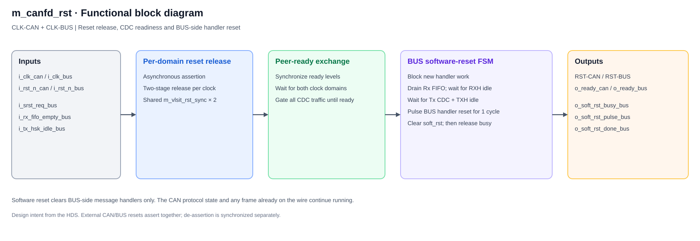

##### m_vlsit_csr_canfd — generated APB register block


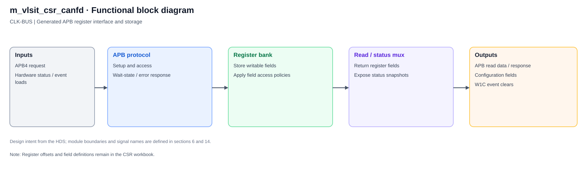

##### m_canfd_wprot — protected APB writes


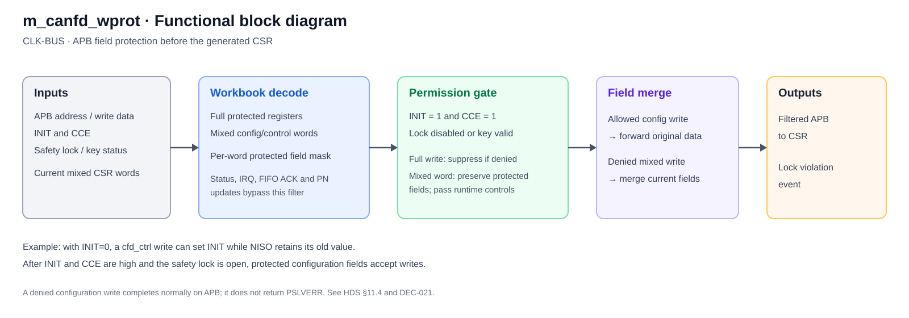

##### m_canfd_cdc — cross-domain transfers


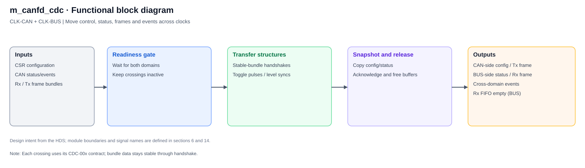

##### m_canfd_sync_bit — level synchronizer


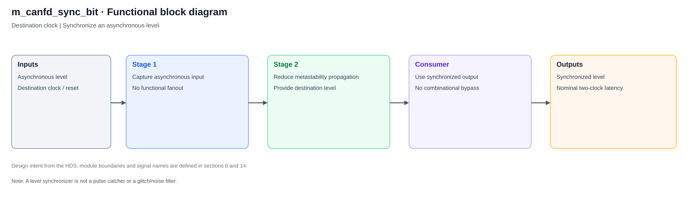

##### m_vlsit_event_sync — pulse synchronizer


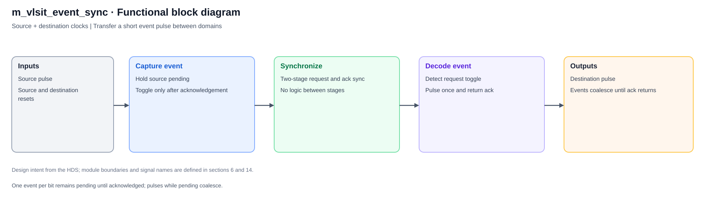

##### m_canfd_sync_hsk — bundle handshake


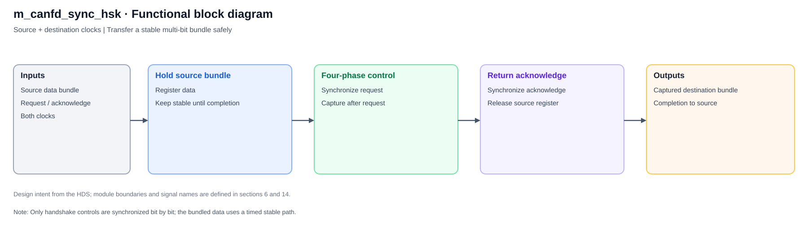

##### m_canfd_btl — bit timing


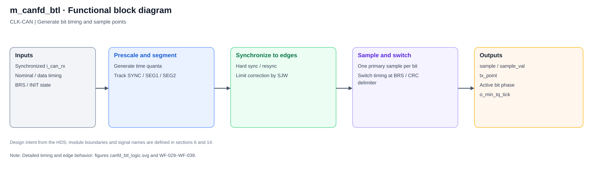

##### m_canfd_tdc — transmitter delay compensation


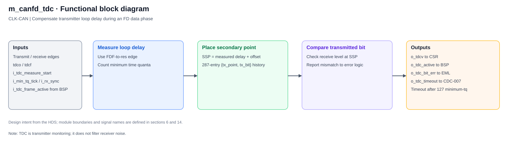

##### m_canfd_bsp — frame sequencer


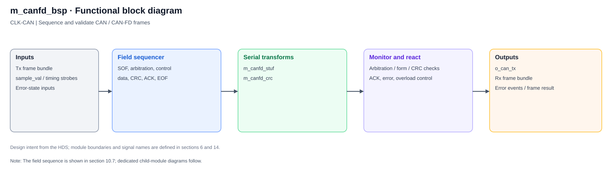

##### m_canfd_stuf — stuffing and destuffing


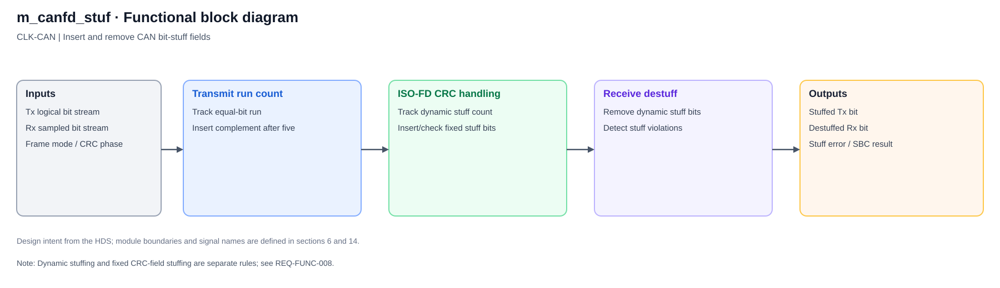

##### m_canfd_crc — CRC engine


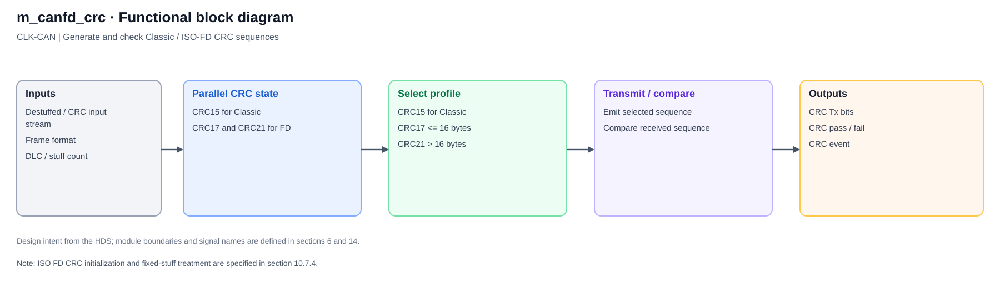

##### m_canfd_eml — error management


##### m_canfd_rxh — receive handler


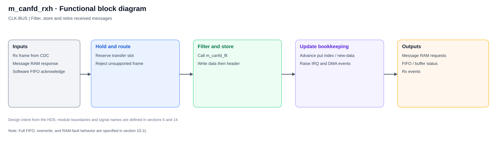

##### m_canfd_flt — acceptance filter


##### m_canfd_txh — transmit handler


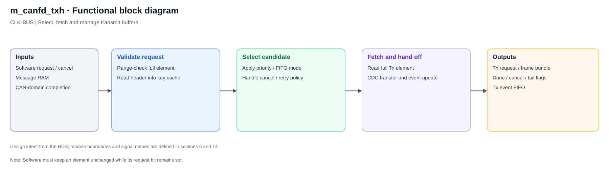

##### m_canfd_mram — message RAM master


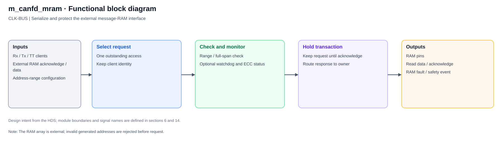

##### m_canfd_ts — timestamp and timeout


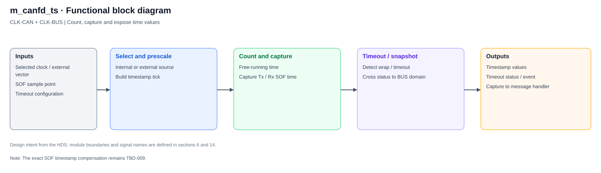

##### m_canfd_dma — DMA request logic


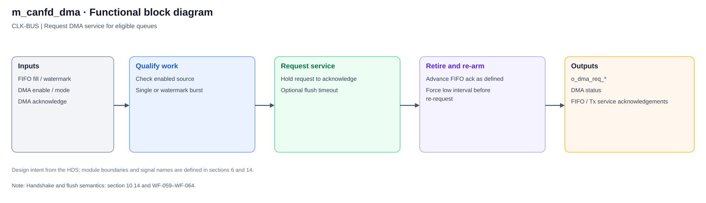

##### m_canfd_irq — interrupt controller


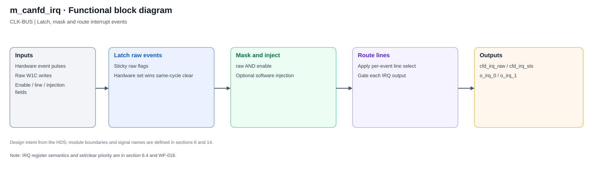

##### m_canfd_pn — partial-networking filter


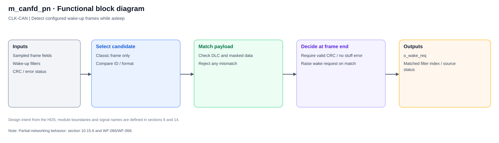

##### m_canfd_tt — TTCAN entity


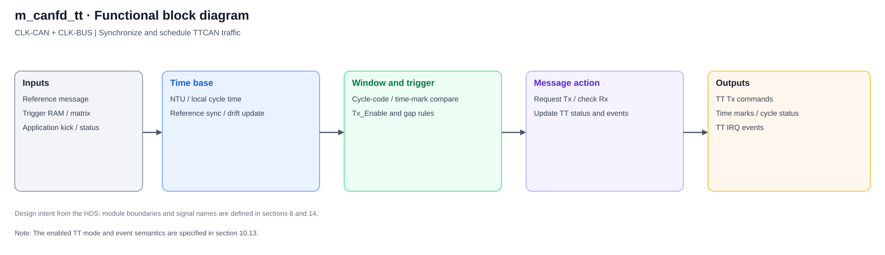

##### m_canfd_pwr — power and wake control


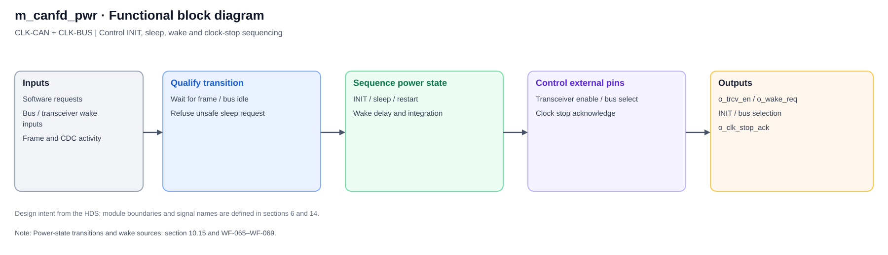

##### m_canfd_safe — safety monitor


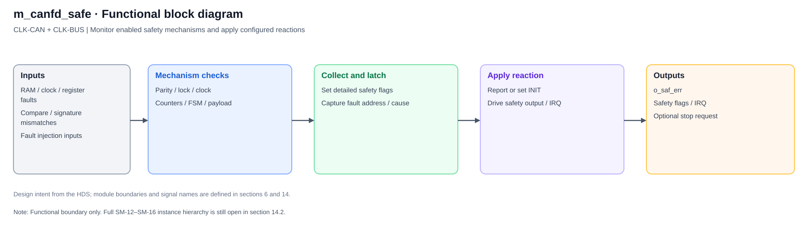

#### 14.2.4 Stuffing/destuffing module interface

The BSP remains the only frame-field sequencer. It marks the current bit position as dynamically
stuffed or as a fixed stuff slot. The stuffer advances only on BTL transmit-point and sample strobes.

| Port | Direction | Width | Meaning |
|---|---|---:|---|
| `i_clk_can`, `i_rst_n_can` | Input | 1 each | CAN clock and active-low reset |
| `i_stuf_clear` | Input | 1 | One-cycle clear before the first bit step of a new or aborted frame |
| `i_dyn_stuf_en` | Input | 1 | Dynamic-stuff region marker for the current TX/RX bit |
| `i_iso_fd` | Input | 1 | Marks an ISO FD frame; held through the frame |
| `i_tx_fixed_slot`, `i_rx_fixed_slot` | Input | 1 each | BSP strobes when the current bit position requires fixed stuffing |
| `i_tx_point`, `i_tx_logical_bit` | Input | 1 each | BTL bit step and next logical bit from BSP |
| `o_tx_bit` | Output | 1 | Actual wire bit to BSP at `i_tx_point` |
| `o_tx_logical_adv` | Output | 1 | Allows BSP to advance; low when a dynamic or fixed bit is inserted |
| `o_tx_dyn_stuff`, `o_tx_fixed_stuff` | Output | 1 each | Stuff event type; dynamic bits can be added to ISO FD CRC input |
| `o_tx_sbc_code` | Output | 4 | Current ISO FD `{Gray[2:0], parity}` code, serialized MSB first |
| `i_rx_sample`, `i_rx_wire_bit` | Input | 1 each | BTL sample strobe and synchronized bus bit |
| `o_rx_bit`, `o_rx_bit_valid` | Output | 1 each | Destuffed logical bit and its validity strobe |
| `o_rx_dyn_stuff` | Output | 1 | Pulse for a valid removed dynamic bit; raw sample remains ISO FD CRC input |
| `o_rx_stuff_err` | Output | 1 | Pulse on an invalid dynamic or fixed stuff bit |
| `i_rx_sbc_valid`, `i_rx_sbc_code` | Input | 1, 4 | BSP presents the complete MSB-first SBC after collecting four bits |
| `o_rx_sbc_err` | Output | 1 | Pulse when received SBC differs from the independent RX count |

`i_stuf_clear` is asserted before the first SOF bit step so SOF is counted as the first dynamic
bit. TX advance and stuff-event outputs are meaningful only when `i_tx_point` is high. RX data-valid,
dynamic-stuff and error outputs are one-cycle events aligned with `i_rx_sample`. TX and RX run
counters and modulo-eight counts are independent. `o_rx_sbc_err` pulses when a valid received SBC
does not match the independently counted RX value. Fixed-slot markers and `i_dyn_stuf_en` are
mutually exclusive.

#### 14.2.5 Frame-sequencer module interface (`m_canfd_bsp`)

The user selected named field ports for CSR controls and status, with only the Tx/Rx frame records
packed as vectors. The user approved the following BSP boundary on 2026-11-08 (DEC-087).

| Parameter | Default | Legal values | Meaning |
|---|---:|---|---|
| `PARA_CANFD_FD_EN` | 1 | 0, 1 | Build Classic-only or Classic/FD frame sequencing |
| `PARA_CANFD_NISO_EN` | 1 | 0, 1 | Build the source-limited non-ISO FD option; requires FD |
| `PARA_CANFD_RTR_EN` | 1 | 0, 1 | Build Classic remote-frame support |
| `PARA_CANFD_DATA_MAX` | 64 | 8, 12, 16, 20, 24, 32, 48, 64 | Maximum payload bytes in Tx/Rx frame records; Classic-only build is limited to 8 |

The module-local frame width is `LPARA_CANFD_FRAME_W = 32 x (4 + PARA_CANFD_DATA_MAX/4)` bits,
as defined by REQ-MSG-021. `m_canfd_bsp` instantiates `m_canfd_stuf` and `m_canfd_crc` as its
frame-processing leaves; the child interfaces are defined in sections 14.2.4 and 10.7.4.

| Port | Direction | Width | Meaning |
|---|---|---:|---|
| `i_clk_can`, `i_rst_n_can` | Input | 1 each | CAN clock and active-low reset |
| `i_cdc_ready_can` | Input | 1 | Both clock domains completed reset-ready handshake |
| `i_cfd_ctrl_init` | Input | 1 | Software INIT level; the frame engine is stopped while high |
| `i_cfd_ctrl_fdoe`, `i_cfd_ctrl_brse`, `i_cfd_ctrl_niso` | Input | 1 each | FD enable, BRS enable and non-ISO selection from the CAN configuration snapshot |
| `i_cfd_ctrl_pxd`, `i_cfd_ctrl_mon`, `i_cfd_ctrl_rest` | Input | 1 each | Protocol-exception disable, bus-monitor mode and restricted-operation mode |
| `i_cfd_ctrl_lbk_int`, `i_cfd_ctrl_lbk_ext`, `i_cfd_ctrl_dar` | Input | 1 each | Internal loopback, external loopback and disable-auto-retransmission controls |
| `i_cfd_ctrl_tdc_ena`, `i_cfd_ctrl_ovl_en` | Input | 1 each | TDC use enable and optional internal-buffer overload request enable |
| `i_cfd_dom_cfg_dom_lim` | Input | 8 | Stuck-dominant threshold from the CAN configuration snapshot |
| `i_tx_permit` | Input | 1 | Power/TTCAN permission for a new Tx start; does not abort a frame already on the bus |
| `i_rx_frame_full_can` | Input | 1 | Rx CDC FIFO full indication, for the optional overload decision |
| `i_err_passive`, `i_bus_off` | Input | 1 each | Error-management state used by the frame engine |
| `i_sample`, `i_sample_val`, `i_rx_sync` | Input | 1 each | BTL primary sample, sampled bus value and synchronized bus level |
| `i_tx_point`, `i_data_phase` | Input | 1 each | BTL transmit-point and current phase |
| `i_timing_cfg_valid`, `i_btl_cfg_fix_event` | Input | 1 each | BTL configuration result and one-cycle correction event |
| `o_cfg_check`, `o_bus_integrating`, `o_hard_sync_en`, `o_hs_edl` | Output | 1 each | BTL configuration-check request and synchronization controls |
| `o_tx_dom`, `o_no_resync`, `o_rate_data_candidate`, `o_rate_nom_candidate` | Output | 1 each | BTL transmit-bit monitor, resynchronization inhibit and rate-switch candidate controls |
| `o_tdc_frame_active`, `o_tdc_measure_start` | Output | 1 each | BSP-qualified TDC frame window and eligible FDF-to-res measurement pulse |
| `i_tdc_active`, `i_tdc_bit_err` | Input | 1 each | TDC comparison-active and delayed transmitter bit-error events |
| `i_tx_timestamp_can` | Input | 32 | SOF timestamp captured by `m_canfd_ts`; stable from the frame's SOF sample until its terminal result |
| `i_rx_timestamp_can` | Input | 32 | Current selected timestamp value from `m_canfd_ts.o_ts_count`; sampled by BSP on the same received-SOF edge and saved in Rx metadata word 2 |
| `i_tx_result_ready_can` | Input | 1 | CDC source endpoint is idle and can capture a new result record |
| `i_tx_frame_valid_can` | Input | 1 | Tx frame bundle valid from CDC |
| `i_tx_frame_can` | Input | `LPARA_CANFD_FRAME_W` | Tx record using the four metadata words and fixed payload offset of REQ-MSG-021 |
| `i_tx_trigger_valid_can`, `i_tx_trigger_buf_can`, `i_tx_trigger_window_seq_can` | Input | 1, 6, 32 | Source tag for an ordinary TTCAN Tx-buffer trigger, transferred atomically with the frame; all zero/invalid for an untriggered frame |
| `i_tt_window_seq_can` | Input | 32 | Current TTCAN Tx-window sequence, used to detect a tagged frame whose window expired before SOF |
| `o_tx_frame_ready_can` | Output | 1 | BSP can accept the Tx frame bundle |
| `i_tt_ref_frame_valid_can`, `i_tt_ref_frame_can` | Input | 1, `LPARA_CANFD_FRAME_W` | Direct reference-frame record from `m_canfd_tt` |
| `o_tt_ref_frame_ready_can` | Output | 1 | BSP can accept the TT frame while the common frame slot is free and `i_tx_permit` is active |
| `o_rx_frame_valid_can` | Output | 1 | One-cycle valid pulse for a completed, accepted Rx frame record; CDC handles a full-FIFO drop |
| `o_rx_frame_can` | Output | `LPARA_CANFD_FRAME_W` | Rx record using the four metadata words and fixed payload offset of REQ-MSG-021 |
| `o_can_tx` | Output | 1 | Logical CAN transmit level; dominant 0 and recessive 1 |
| `o_frame_active`, `o_bus_idle` | Output | 1 each | `o_frame_active` is high outside BTL integration and BSP IDLE; `o_bus_idle` is high only in BSP IDLE. These states drive power and bus-pair sequencing. |
| `o_tx_sof_sample` | Output | 1 | Pulse at the transmitted SOF sample point; drives the timestamp capture input |
| `o_sof_sample_can` | Output | 1 | Pulse at the sampled SOF of a transmitted or received frame; captures TTCAN Sync_Mark |
| `o_tx_result_valid`, `o_tx_result_success`, `o_tx_result_cancel`, `o_tx_result_err`, `o_tx_result_arb_lost` | Output | 1 each | Stable one-hot Tx result qualifiers until the CDC source captures the record; arbitration loss is distinct from protocol error |
| `o_tx_result_timestamp` | Output | 32 | Timestamp captured at this transmission's SOF sample point, held with the result |
| `o_tx_result_trigger_valid`, `o_tx_result_trigger_buf`, `o_tx_result_trigger_started`, `o_tx_result_trigger_expired` | Output | 1, 6, 1, 1 | Trigger identity and outcome; a tag starts only at SOF. If an accepted tagged frame expires before SOF, return a no-start expiry record; if it expires after SOF, keep the started/expired flags with the eventual terminal result |
| `i_tt_ref_result_ready_can` | Input | 1 | TT can accept its held terminal result |
| `o_tt_ref_result_valid`, `o_tt_ref_result_success`, `o_tt_ref_result_cancel`, `o_tt_ref_result_err`, `o_tt_ref_result_arb_lost` | Output | 1 each | TT-owned terminal result; qualifiers are one-hot while valid |
| `o_tt_ref_result_timestamp` | Output | 32 | SOF timestamp held with the TT-owned result |
| `o_evt_rx_err`, `o_evt_rx_dom_after_flag`, `o_evt_tx_err_count` | Output | 1 each | Role-qualified error-counter events for `m_canfd_eml` |
| `o_evt_tx_bit_err_flag`, `o_evt_rx_bit_err_flag`, `o_evt_tx_dom_seq8`, `o_evt_rx_dom_seq8` | Output | 1 each | Error-flag and post-flag dominant-sequence counter events for `m_canfd_eml` |
| `o_evt_tx_success`, `o_evt_rx_success`, `o_evt_idle11` | Output | 1 each | Successful-frame counter events and eleven-recessive-bit recovery event for `m_canfd_eml` |
| `o_err_start`, `o_err_phase_data`, `o_err_code` | Output | 1, 1, 3 | First error of frame, nominal/data phase and first-error code for `m_canfd_eml` |
| `o_sts_act`, `o_sts_init_ack`, `o_sts_rfdf`, `o_sts_rbrs`, `o_sts_resi`, `o_sts_pxe`, `o_sts_dom_stk` | Output | 1 each | Frame-engine status fields for the BUS-domain status snapshot and interrupt logic |
| `o_evt_crc_err`, `o_evt_stuff_err`, `o_evt_form_err`, `o_evt_ack_err`, `o_evt_pxe`, `o_evt_dom_to` | Output | 1 each | Frame/protocol exception and stuck-dominant event pulses for `m_canfd_irq` |
| `o_rx_sof_sample` | Output | 1 | Pulse only for a received SOF sample; drives the Rx timestamp capture |
| `o_rx_frame_start`, `o_rx_frame_abort` | Output | 1 each | Sample-qualified received-frame start and abort events for partial-networking filtering |
| `o_rx_id_bit_valid`, `o_rx_id_bit`, `o_rx_id_bit_idx` | Output | 1, 1, 5 | Destuffed identifier bit and zero-based index; ID-B starts at index 11 |
| `o_rx_ide_valid`, `o_rx_ide`, `o_rx_rtr_valid`, `o_rx_rtr` | Output | 1 each | Sample-qualified IDE and actual RTR bit; SRR is not reported as RTR |
| `o_rx_fdf_valid`, `o_rx_fdf`, `o_rx_dlc_bit_valid`, `o_rx_dlc_bit`, `o_rx_dlc_bit_idx` | Output | 1, 1, 1, 1, 2 | Sample-qualified frame format and DLC bits; DLC is MSB first with zero-based index |
| `o_rx_data_bit_valid`, `o_rx_data_bit`, `o_rx_data_bit_idx` | Output | 1, 1, 6 | Destuffed Classical CAN payload bit, MSB first within each byte; suppressed for FD frames |
| `o_rx_crc_delim`, `o_rx_crc_ok`, `o_rx_stuff_ok` | Output | 1 each | CRC-delimiter sample and accumulated CRC/stuff integrity qualifiers for the wake filter |

The PN observation ports expose receive-role events only. They are aligned to the CAN sample point
and use the same destuffed stream as the frame engine. ID-A indexes are 0–10; ID-B indexes are
11–28. RTR reports RTR1 for a base frame and RTR2 for an extended frame, never SRR. A receive-side
protocol or stuffing error pulses `o_rx_frame_abort`. Rx metadata word 2 holds the timestamp
captured at the received SOF sample through completion of that frame.

The frame bundle layout is defined in section 9. A Tx result refers to the active frame whose bundle
was accepted by the BSP; TXH retains the selected buffer context until it consumes that result.
`i_tx_permit` only gates a new SOF, so a TT-window boundary cannot truncate an in-flight frame.
For a tagged trigger, BSP latches expiry if the CAN-domain permit drops or the current sequence
changes after SOF. A tagged frame accepted but not started before expiry returns a no-start expiry
record; TXH sets the buffer miss bit only if no attempt for that trigger has previously started SOF.
A frame started in-window finishes normally, but its result suppresses retry if the sequence expired.
Within an unexpired merged window, configured retries remain eligible; strict TT triggers do not
retry. Ordinary untagged Tx results retain the existing retry behavior (DEC-091/102/103).

##### 14.2.5.2 Direct TTCAN reference-frame path (DEC-096/098)

`m_canfd_tt` and `m_canfd_bsp` share CLK-CAN. A reference message uses the common packed frame
record and BSP frame engine, but has a dedicated ready/valid input and a direct terminal-result
path. It does not use a TXH buffer, enter the normal Tx-frame CDC, update a TXH completion bit, or
create a Tx-event FIFO entry. BSP retains one owner bit from frame acceptance through its terminal
result. The owner selects which ready input can retire that result: TT results return directly to
TT; TXH results alone enter CDC-013.
If TT and TXH present frames on the same edge, BSP accepts the TT reference frame and deasserts
normal TXH ready; TXH retains its valid/data until a later handshake.

The TT interface is an attempt at the scheduled mark, not a persistent queue. On the trigger edge,
TT asserts `valid` only if `ready` and transmit permission are already available; that edge accepts
the frame. If BSP is busy, TT leaves `valid` low, records the missed reference attempt through the
existing `txu` event, and advances the schedule without replaying the frame later. The dedicated
reference trigger has no Tx-buffer number, so it does not set `cfd_ttb_miss`. A new attempt can occur
only at the next scheduled reference trigger (REQ-TT-021, DEC-098).

| Port | Direction | Width | Meaning / timing |
|---|---|---:|---|
| `i_tt_ref_frame_valid_can`, `i_tt_ref_frame_can` | Input | 1, frame width | One-cycle TT attempt at Tx_Ref_Trigger; no held-valid retry |
| `o_tt_ref_frame_ready_can` | Output | 1 | BSP can accept on the trigger edge while the common frame slot and transmit permission are available |
| `o_tx_frame_ready_can` | Output | 1 | Normal CDC frame acceptance; suppressed when TT presents a reference frame |
| `o_tx_result_valid`, `i_tx_result_ready_can` | Output/input | 1 each | TXH-owned result handshake to CDC-013 |
| `o_tt_ref_result_valid`, `i_tt_ref_result_ready_can` | Output/input | 1 each | TT-owned result handshake in CLK-CAN |
| `o_tt_ref_result_success`, `o_tt_ref_result_cancel`, `o_tt_ref_result_err`, `o_tt_ref_result_arb_lost` | Output | 1 each | Mutually exclusive TT terminal outcome, valid with result-valid |
| `o_tt_ref_result_timestamp` | Output | 32 | SOF timestamp held with the TT result |

Example: if BSP is busy at the trigger mark, frame-valid stays low and `txu` pulses; no frame
appears after BSP becomes idle, and the next attempt waits for the next scheduled trigger (WF-078).
A successful direct reference transmission asserts the TT valid/success pair only; the CDC result
path stays idle and TXH state is unchanged (WF-076). A failed trigger-cache RAM access
invalidates the partial schedule, leaves TT inactive and raises only the existing RAM-fault event;
corrected-ECC data continues through cache loading (DEC-097).

##### 14.2.5.1 Atomic Tx-result CDC interface (`m_canfd_cdc`, CDC-013)

The CDC transfers the SOF timestamp, one terminal qualifier, and trigger ownership/expiry status as
one 45-bit record: `{timestamp[31:0], success, cancel, err, arb_lost, trigger_valid,
trigger_index[5:0], trigger_started, trigger_expired}`. A no-SOF expiry is encoded with valid trigger
ownership, `trigger_started=0`, `trigger_expired=1`, and all four terminal qualifiers low. The CAN
source holds its record until the CDC source endpoint accepts it. The BUS destination holds valid/data
until TXH asserts ready. These are independent source and destination handshakes on one four-phase
CDC channel.

| Port | Direction | Width | Meaning |
|---|---|---:|---|
| `i_tx_result_valid_can`, `o_tx_result_ready_can` | Input/output | 1 each | CAN-side source handshake; ready means the CDC endpoint can capture a result |
| `i_tx_result_timestamp_can` | Input | 32 | SOF timestamp associated with the terminal outcome |
| `i_tx_result_success_can`, `i_tx_result_cancel_can`, `i_tx_result_err_can`, `i_tx_result_arb_lost_can` | Input | 1 each | One-hot terminal qualifier from BSP |
| `o_tx_result_valid_bus`, `i_tx_result_ready_bus` | Output/input | 1 each | BUS-side destination handshake; TXH asserts ready in its result-wait state |
| `o_tx_result_timestamp_bus` | Output | 32 | Timestamp delivered coherently with the outcome |
| `o_tx_result_success_bus`, `o_tx_result_cancel_bus`, `o_tx_result_err_bus`, `o_tx_result_arb_lost_bus` | Output | 1 each | One-hot outcome delivered coherently with timestamp |
| `o_tx_result_trigger_valid_bus`, `o_tx_result_trigger_buf_bus`, `o_tx_res_trig_started_bus`, `o_tx_res_trig_expired_bus` | Output | 1, 6, 1, 1 | Trigger tag and same-window outcome delivered atomically with the terminal result |

The source valid remains asserted until `o_tx_result_ready_can`; after source capture, CDC owns and
holds the record until `i_tx_result_ready_bus`. Example: after arbitration loss, TXH consumes
`arb_lost`; if no late cancel is pending, it reoffers the same frame. A pending cancel instead
clears the request and no retry frame is offered (DEC-091, TEST-071).

#### 14.2.6 Remaining RTL module interface contracts (DEC-089)

The user approved deriving the remaining internal ports from this HDS, the CSR workbook, and the existing RTL leaves before implementing those modules (2026-11-09). The contracts below define internal boundaries; they do not add external pins or change protocol behavior. All child clock/reset pairs are the domain clocks already listed in section 6.2. All inter-module connections in `m_canfd_top` shall be named. Optional functions remain parameter-gated as in section 8.

| Module | Clock/reset | Inputs | Outputs | Contract and concrete example |
|---|---|---|---|---|
| `m_canfd_wprot` | CLK-BUS / RST-BUS | APB4 request; workbook-derived protected-address decode; current `cfd_ctrl`, `cfd_wake`, `cfd_tt_wd`, `cfd_tt_clk`, `cfd_tt_gap`, and `cfd_saf_ctrl` words; INIT, CCE, lock enable and valid key | Filtered APB4 request; one-cycle lock-violation event | Pass reads and unprotected writes. Gate protected configuration fields with INIT+CCE and the optional safety lock. For mixed words, merge current protected field values into write data while passing unprotected control/command fields. Example: with INIT=0, a `cfd_ctrl` write can set INIT while its NISO field is preserved; after INIT and CCE are asserted, NISO can be changed. A `cfd_nbt` write remains ignored until the gate opens. No protection failure changes APB completion timing or returns PSLVERR (11.4, REQ-SAFE-003, DEC-021). |
| `m_canfd_rxh` | CLK-BUS / RST-BUS | Rx frame bundle and FIFO status; Rx filter controls; RAM response; FIFO/ buffer CSR controls; soft reset | Rx-frame pop; RAM client request; FIFO indexes/fill/full/lost; new-data flags; Rx events; `o_idle_bus` | Consume one completed frame in arrival order, apply the selected filter result, write a complete element before advancing its visible index, and drop a rejected RAM range access without a partial write. `o_idle_bus` is high only in IDLE with no pending RAM request or FIFO pop (10.10–10.11, REQ-MSG-001..008, DEC-063/065/086). Example: after the final data-word acknowledge, write metadata, then advance `pidx`; while this sequence runs, `o_idle_bus=0`. |
| `m_canfd_flt` | CLK-BUS / RST-BUS | Identifier, format, remote flag; one standard or extended filter element per evaluation; global filter controls and XIDAM | Element-match, selected action, filter index and high-priority indication | Evaluate one element using the inclusive range, dual-ID or masked-ID rule; disabled/type-3 elements do not match; first matching element wins (10.11.2). Example: a standard mask element matches when `(id & mask) == (id1 & mask)`. |
| `m_canfd_txh` | CLK-BUS / RST-BUS | Tx request/cancel/confirm/periodic vectors; ordered `{window_seq, merged, buffer_index}` descriptor; current synchronized window sequence and permit; RAM response; tagged frame-result bundle from CDC; retry and priority controls; soft reset | Tagged Tx frame bundle to CDC; trigger FIFO ready; RAM client request; request/done/cancel/fail/data-request status and events; sticky Tx-buffer miss-set mask; `o_idle_bus` | Give the trigger-named buffer exclusive candidate priority. Drop a stale descriptor before SOF and set miss; retain a started trigger's owner until its result; suppress retry when its result says the originating window expired. `o_idle_bus` is high only in IDLE with no pending/active TT descriptor; the state excludes RAM requests, an unaccepted frame, and an unconsumed result (10.10, 10.12, REQ-TT-006/009, DEC-103). Example: sequence 4 expires while a tagged frame is active; the terminal error is consumed without resubmitting sequence 4, and `o_idle_bus` rises only after result handling completes. |
| `m_canfd_mram` | CLK-BUS / RST-BUS | Rx, Tx and optional TT client request/address/data; RAM acknowledge/read-data/ECC; watchdog controls | One external Message-RAM request with stable fields through acknowledge; client response/data/error; timeout and range-fault events | Serialize requests with the Rx→Tx→TT round-robin pointer of DEC-090 and preserve client identity through the response. Example: simultaneous Rx/Tx/TT requests after reset grant Rx, then rotate to Tx and TT after each client completion. Validate each full 32-bit word address before truncating to the RAM port width; the owning client validates the complete multiword element span before its first word request (REQ-MSG-001/018, DEC-063). |
| `m_canfd_ts` | CLK-CAN / RST-CAN for timestamp; CLK-BUS / RST-BUS for timeout | Timestamp enable/source/prescaler and external timestamp; Tx/Rx SOF sample pulses; timeout enable/mode/period, selected FIFO/event activity, soft reset | Timestamp count and captured Tx/Rx values; timestamp-wrap event; timeout count and timeout event | Capture the selected timestamp value on the same clock edge as the SOF sample pulse (REQ-TS-001/002, DEC-068). Timeout mode is continuous or restarts from the selected FIFO/event activity (REQ-TS-003). Example: an Rx SOF sample captures the current counter into the frame metadata. |
| `m_canfd_dma` | CLK-BUS / RST-BUS | Per-channel enable, single/burst selection, FIFO fill/free levels and indexes, watermarks, timeout setting, acknowledgements, soft reset | Held Rx0/Rx1/Tx/Tx-event requests; flush flags; request status | Snapshot each channel status when its request rises. After acknowledge, wait for a get-index change or lower fill for Rx/Tx-event; wait for a put-index change or lower free count for Tx. The index condition detects service when simultaneous traffic masks a count change. Re-evaluate the level only after status change and the selected handshake completes (10.14, DEC-041..044). Example: Rx gidx advances while fill stays at 4 because a new frame arrives; the request can re-arm only after observing the gidx advance. |
| `m_canfd_irq` | CLK-BUS / RST-BUS | Synchronized event vector; raw, enable, injection, line-select and line-enable fields from CSR | CSR hardware-set strobes/status; active-high IRQ0/IRQ1 | Hardware event sets a sticky raw bit; injection produces the same set event; masked status is raw AND enable and is routed by line-select (REQ-IF-004, OP-018). Example: enabled raw bit with select=1 asserts IRQ1 only when line1 is enabled. |
| `m_canfd_tt_miss` | CLK-BUS / RST-BUS | CDC-delivered CAN-domain Rx/full-FIFO miss masks; TXH-local no-SOF miss mask; current sticky CSR values; APB activity | Merged hardware-write values and enables for `cfd_ttb_miss` and Rx-miss CSRs | Merge CAN-domain FIFO-overflow misses and BUS-domain TXH no-SOF misses with existing sticky CSR bits, while deferring CDC acceptance during APB W1C so hardware-set wins (CDC-015, DEC-103). Example: a stale trigger descriptor and an Rx miss arriving together set both masks without losing a software clear ordering. |
| `m_canfd_pn` | CLK-CAN / RST-CAN | Destuffed frame bit/field stream; filter bank and mask controls; sleep/error state | Match/wake pulse, selected filter index, partial-networking status/events | The filter examines Classic frame fields serially and decides at CRC delimiter. FD-frame sleep behavior remains subject to ASM-019; do not claim ISO 11898-6 conformance without that source. |
| `m_canfd_tt` | CLK-CAN / RST-CAN | Time-triggered CSR configuration including `ldsdl`, trigger-list RAM response, reference-frame fields/results, BSP ready and SOF sample, TT pins and external-sync commands, CDC-016 FIFO ready | Tx permit/window state and 32-bit window sequence; local/cycle/global time, qgtp/qcs; trigger RAM request; tagged ordinary Tx-trigger descriptors; Tx/Rx miss set masks; CSR clear pulses and TT events/marks | Gate only a new frame start and never truncate an in-flight frame (DEC-087/102). Increment the sequence when a new Tx_Enable window opens; triggers within the same continuous window share it. Each descriptor carries its sequence. A full CDC-016 queue drops the current ordinary trigger and sets its sticky buffer-miss bit. TXH reports no-SOF misses and suppresses retries after expiry through the tagged result path (DEC-103). A reference frame is attempted only at its trigger when BSP is ready; busy-at-trigger is dropped and reports `txu` without late retry (DEC-098). External SGT accepts a coherent `{command, gt_pre}` bundle through CDC-008 (DEC-100). |
| `m_canfd_pwr` | CLK-CAN / RST-CAN | INIT/sleep/wake controls; synchronized bus and transceiver wake; primary/secondary receive pins; BSP transmit bit; BSP frame-active and bus-idle states; PN match; clock-stop request | Power-state Tx permission; selected CAN RX; primary/secondary TX pins; transceiver enable; wake request/ack status; clock-stop acknowledge | Assert power-state Tx permission only in normal state and with INIT low. Select RX from the configured bus pair and route the BSP transmit bit only to that pair; hold the inactive TX pin recessive. `m_canfd_top` combines the power permission with the TTCAN window permission before passing `i_tx_permit` to BSP. Switch only while BSP is idle or in INIT; do not perform automatic failover (REQ-IF-006/007, DEC-013). `PARA_CANFD_RED_EN=0` forces the primary pair and recessive secondary TX. |
| `m_canfd_safe` | Combinational controls in BUS and CAN domains | Packed safety controls/status, local fault pulses, and CAN fault bundle already transferred by CDC-008 | CSR flag-set vector, build/effective-enable masks, write-lock/key validity, local stop requests, IRQ pulse and aggregate safety error | The structural top transfers the stable 14-bit CAN event bundle using `m_canfd_sync_hsk`; this leaf qualifies events and injection. The generated CSR owns sticky status. The key comparator accepts `16'hA5C3`; no ASIL claim (REQ-SAFE-001..012, DEC-066). |
| `m_canfd_top` | Both domains / respective resets | All section 6.2 external pins and section 8 parameters | All section 6.2 outputs | Structural root only: instantiate the listed functions, wire every port by name, connect CSR from the workbook-generated source, carry the Tx-window sequence/trigger tag through CDC-016/006/013, and hold `o_can_tx` recessive until the CAN path is ready. Example: a trigger descriptor's sequence and buffer index reach BSP with its frame and return in the terminal result. |

##### `m_canfd_dma` status-snapshot ports (DEC-041)

The BUS-domain DMA engine snapshots the service indicators at each request assertion. These are
internal inputs from `m_canfd_rxh` and `m_canfd_txh`; no external pins are added.

| Port | Direction | Width | Source / purpose |
|---|---|---:|---|
| `i_rx0_gidx`, `i_rx1_gidx` | Input | 6 each | Rx handler get indexes; a change proves that an acknowledged FIFO entry was released |
| `i_rx0_fill`, `i_rx1_fill` | Input | 7 each | Rx handler fill levels; a decrease is an alternate completion indication |
| `i_txf_pidx` | Input | 5 | Tx handler put index; a change proves a DMA-provided Tx element was allocated |
| `i_txf_free` | Input | 6 | Tx handler free-buffer count; a decrease is an alternate completion indication |
| `i_txe_gidx` | Input | 6 | Tx-event handler get index; a change proves an event was released |
| `i_txe_fill` | Input | 6 | Tx-event FIFO fill level; a decrease is an alternate completion indication |

Rx and Tx-event completion is `gidx_changed || fill_decreased`; Tx completion is
`pidx_changed || free_decreased`. The index path avoids waiting forever when simultaneous traffic
keeps a count unchanged. An index/count change before the acknowledge is retained by comparison
against the request-time snapshot. Acknowledges received while the request is low remain ignored.

`m_canfd_safe` vector positions are fixed for the top-level named connections. Fault, reaction,
injection and status vectors use the flag order below. The run-enable vector has 13 bits in the
order RAM, WDT, REG, LOCK, CLK, CNT, FSM, E2E, TXC, TRG, DMA, DUP and SAN; injection is enabled
by its dedicated pin plus a built injection mechanism. Build and automatic-mask vectors use the
14-bit `cfd_saf_auto` order (RAM at bit 0 through SAN at bit 13).

| Vector | Bit | Field / meaning |
|---|---:|---|
| Flag/status/event | 0 | `ram_cor` |
| Flag/status/event | 1 | `ram_unc` |
| Flag/status/event | 2 | `ram_wdt` |
| Flag/status/event | 3 | `reg_par` |
| Flag/status/event | 4 | `lk_viol` |
| Flag/status/event | 5 | `clk_err` |
| Flag/status/event | 6 | `cnt_cmp` |
| Flag/status/event | 7 | `st_cmp` |
| Flag/status/event | 8 | `e2e_err` |
| Flag/status/event | 9 | `txc_par` |
| Flag/status/event | 10 | `trg_par` |
| Flag/status/event | 11 | `dma_wdt` |
| Flag/status/event | 12 | `dup_cmp` |
| Flag/status/event | 13 | `san_err` |
| Build/automatic mask | 0..13 | `ram`, `wdt`, `reg`, `lock`, `clk`, `cnt`, `fsm`, `e2e`, `txc`, `trg`, `dma`, `inj`, `dup`, `san` |
| Run enable | 0..12 | `ram_chk_en`, `wdt_en`, `par_chk_en`, `lock_en`, `clk_chk_en`, `cnt_chk_en`, `fsm_chk_en`, `e2e_chk_en`, `txc_chk_en`, `trg_chk_en`, `dma_chk_en`, `dup_chk_en`, `san_chk_en` |

`ram_cor` and `ram_unc` share the RAM build and run-enable bits. `i_fault_event_can` contains
one-cycle local detection pulses. The top accumulates them in a stable-data CDC-008 handshake;
`i_fault_event_can_bus` is the accepted destination bundle. This leaf gates both local and
crossed events against the corresponding built/run-time mask before producing the CAN stop
request or CSR set pulse. `i_saf_unlock_key` is compared with the workbook-defined `16'hA5C3`.
BUS-side `o_init_set_bus` also includes sticky CSR flags selected by the programmed reaction bits.
`o_saf_err_bus` is the OR of those sticky flags and new BUS events.

##### `m_canfd_cdc` TTCAN trigger-RAM read ports (CDC-014)

The TT cache reads one trigger word at a time. The request handshake crosses CAN to BUS; the
BUS-side client request then remains asserted through the Message-RAM acknowledge. The CDC
captures the complete Message-RAM response and returns it through a second stable-data handshake.
The TT sequencer must not issue its next trigger read until it accepts the prior response.

| Port | Direction | Width | Meaning / timing |
|---|---|---:|---|
| `i_tt_ram_req_can`, `i_tt_ram_addr_can` | Input | 1, 32 | CAN-domain read request and full word address; address remains stable until `o_tt_ram_req_ready_can` |
| `o_tt_ram_req_ready_can` | Output | 1 | Request handshake complete; it does not indicate that the RAM read has completed |
| `o_tt_ram_req_bus`, `o_tt_ram_addr_bus` | Output | 1, 32 | BUS-domain request and held word address to `m_canfd_mram.i_tt_req/i_tt_addr`; request stays high until the matching RAM acknowledge |
| `i_tt_ram_ack_bus`, `i_tt_ram_rdata_bus` | Input | 1, 32 | Registered response from `m_canfd_mram.o_tt_ack/o_tt_rdata` |
| `i_tt_ram_err_bus`, `i_tt_ram_err_cor_bus`, `i_tt_ram_err_unc_bus` | Input | 1 each | Range/access error, corrected ECC indication and uncorrectable ECC indication from the TT RAM client |
| `o_tt_ram_rsp_valid_can`, `o_tt_ram_rdata_can` | Output | 1, 32 | CAN-domain completed response and data; held until `i_tt_ram_rsp_ready_can` |
| `o_tt_ram_err_can`, `o_tt_ram_err_cor_can`, `o_tt_ram_err_unc_can` | Output | 1 each | Error qualifiers captured atomically with the returned data |
| `i_tt_ram_rsp_ready_can` | Input | 1 | TT has consumed the response; only then may the next response be delivered |

The bus request and response use separate `m_canfd_sync_hsk` instances. Range and ECC error
handling after this response is consumed belongs to `m_canfd_tt`; no multi-bit field is
synchronized bit-by-bit. This contract adds no behavior beyond DEC-095.

##### `m_canfd_cdc` TTCAN miss-mask ports (CDC-015)

`m_canfd_tt` emits one-cycle set masks in CLK-CAN. The CDC source OR-accumulates masks while a
previous bundle is in flight, then transfers `{o_ttr_miss_set_can, o_ttb_miss_set_can}` with a
four-phase `m_canfd_sync_hsk`. This preserves misses to different buffers that occur before the
BUS side accepts the prior bundle; repeated misses to an already-pending bit coalesce because the
CSR fields are sticky bitmaps. The BUS-side `m_canfd_tt_miss` holds destination ready low during
an APB access, then forms each full hardware-load value as the current CSR value OR the incoming
mask. This is required because the generated CSR hardware-update port replaces the full field;
the CDC mask alone would erase older sticky bits. `o_ttb_miss_set_bus` is zero-extended to 32 bits;
`o_ttr_miss_set_bus[31:0]` updates `cfd_ttr_miss0.miss`, and `[63:32]` updates
`cfd_ttr_miss1.miss`. If a miss arrives during a W1C APB write, the CDC holds it until that access
completes; the merge then uses the post-clear CSR value, so the new event wins without restoring
unrelated bits that software cleared.

| Port | Direction | Width | Meaning / timing |
|---|---|---:|---|
| `i_ttb_miss_set_can`, `i_ttr_miss_set_can` | Input | `PARA_CANFD_TXBUF_MAX`, 64 | One-cycle CLK-CAN set masks from TT; CDC accumulates masks until transfer |
| `i_tt_miss_ready_bus`, `o_tt_miss_valid_bus` | Input/output | 1 each | `m_canfd_tt_miss` backpressures an active APB access; the valid bundle remains stable until accepted |
| `o_ttb_miss_set_bus`, `o_ttr_miss_set_bus` | Output | `PARA_CANFD_TXBUF_MAX`, 64 | Stable Tx/Rx miss masks paired with `o_tt_miss_valid_bus` |

##### `m_canfd_cdc` ordinary Tx-trigger FIFO ports (CDC-016)

| Port | Direction | Width | Meaning / timing |
|---|---|---:|---|
| `i_tt_trigger_valid_can`, `i_tt_trigger_buf_can`, `i_tt_trigger_merged_can` | Input | 1, 6, 1 | One-cycle schedule descriptor; index and trigger type are captured together |
| `o_tt_trigger_ready_can` | Output | 1 | High when the CAN-side FIFO can accept a descriptor; low while full or before CDC readiness |
| `o_tt_trigger_valid_bus`, `o_tt_trigger_buf_bus`, `o_tt_trigger_merged_bus` | Output | 1, 6, 1 | Oldest queued descriptor; held by FIFO until BUS consumer accepts it |
| `i_tt_trigger_ready_bus` | Input | 1 | TXH accepts and removes the current descriptor |

The FIFO depth is the next power of two at or above `PARA_CANFD_TRIG_NUM`, with minimum 2.
When full, no write occurs; TT sets `cfd_ttb_miss` for the dropped trigger's buffer. Each admitted
descriptor carries its 32-bit window sequence through the Tx-frame CDC. BSP reports whether that
tagged attempt reached SOF and whether the source window expired before its terminal result. Expiry
blocks a new SOF but does not abort an in-progress frame. If an attempt reaches its terminal result
after expiry, TXH suppresses retry; it sets the miss bit only if no attempt for that descriptor ever
started at SOF. Example: window NTU 20–27, SOF at 26, error result at 31 means the frame attempt
completes, no retry is offered, and no Tx-buffer miss is set (DEC-102/103, WF-079). Leaf RTL now
implements this contract; top-level wiring and end-to-end validation remain pending.

`m_canfd_tt_miss` receives the forwarded APB `PSEL/PENABLE`, the CDC mask bundle, TXH's local
no-SOF miss pulse, and current CSR miss fields. It asserts each field's hardware-load enable only
for a nonzero corresponding mask and supplies the merged full value. CDC acceptance is held while
APB is active. A local Tx-miss pulse arriving during APB access is retained in a BUS-domain bitmap
and merged after the access, so a same-cycle software W1C cannot erase a hardware-set event.

| Port | Direction | Width | Meaning / timing |
|---|---|---:|---|
| `i_clk_bus`, `i_rst_n_bus` | Input | 1 each | BUS clock and active-low asynchronous reset for the retained local-miss bitmap |
| `i_apb_psel`, `i_apb_penable` | Input | 1 each | Forwarded APB activity; any access stalls CDC miss-mask acceptance through the access phase |
| `i_miss_valid_bus`, `i_ttb_miss_set_bus`, `i_ttr_miss_set_bus` | Input | 1, 32, 64 | Captured CDC-015 update and its per-buffer set masks; unused Tx-buffer bits are zero |
| `i_ttb_miss_local_set_bus` | Input | 32 | TXH-local no-SOF miss pulse mask; captured if APB access blocks the CSR update |
| `o_miss_ready_bus` | Output | 1 | Backpressure to CDC-015; low only while `PSEL && PENABLE` |
| `i_cfd_ttb_miss_csr`, `i_cfd_ttr_miss0_csr`, `i_cfd_ttr_miss1_csr` | Input | 32 each | Current generated-CSR status values used as the merge base |
| `o_cfd_ttb_miss_wdata`, `o_cfd_ttb_miss_we`, corresponding `ttr_miss0/1` outputs | Output | 32/1 per field | Full merged value and hardware-load enable to the generated CSR |

##### `m_canfd_cdc` runtime SGT preset ports (CDC-008, DEC-100)

Software writes `cfd_tt_gpre.gt_pre` before setting `cfd_tt_clk.sgt`. The BUS domain captures the
preset on the rising command edge and holds it in the source transfer register. A four-phase
`m_canfd_sync_hsk` transfers the 16-bit value; the CAN-domain `sgt` command is asserted only with
the complete captured payload. `m_canfd_tt` consumes both on the same CAN clock edge. TT clears
the CSR command after applying the new global-time phase; the clear returns to BUS through the
existing CAN-to-BUS event/CSR hardware-update path. The source command level is edge-detected so
it cannot retrigger while the CSR bit is awaiting that clear. The SGT field shall be excluded from
the generic `i_cmd_bus`/`o_cmd_can` pulse vector and connected only through the dedicated SGT
handshake ports; otherwise the controller could apply one request twice or apply it without its
matching preset.

| Port | Direction | Width | Meaning / timing |
|---|---|---:|---|
| `i_tt_sgt_cmd_bus`, `i_tt_gpre_bus` | Input | 1, 16 | BUS-domain SGT request and its preset payload; capture the payload on the command rising edge |
| `o_tt_sgt_cmd_can`, `o_tt_gpre_can` | Output | 1, 16 | CAN-domain valid pulse and matching preset; presented atomically to TT |

##### `m_canfd_tt` matrix and direct reference-frame ports (DEC-096/097/098)

The matrix-count inputs are snapshots from `cfd_tt_cfg.ccm` and `cfd_tt_mtx.ett`.
`ccm` is the last cycle index, so the matrix contains `ccm + 1` basic cycles. Active Tx
triggers accumulate across those basic cycles. At the matrix boundary, TT compares the
accumulated count against `ett`, reports `txu` or `txo`, then clears the accumulator. A
time-master cycle counter wraps from `ccm` to zero; a slave adopts the count in the reference
message. The standard reference identifier is left-aligned in bits `[28:18]`; its priority
occupies identifier bits `[20:18]`. Extended references replace identifier bits `[2:0]` with
`tm_prio`.

| Port | Direction | Width | CSR source / meaning |
|---|---|---:|---|
| `i_matrix_cycles_last` | Input | 6 | `cfd_tt_cfg.ccm`; final basic-cycle index in a matrix |
| `i_expected_tx_triggers` | Input | 8 | `cfd_tt_mtx.ett`; required active Tx-trigger count per complete matrix |
| `i_sof_sample_can` | Input | 1 | BSP pulse at every locally transmitted or received SOF sample point; TT captures the current local macro-time as Sync_Mark |
| `i_ldsdl` | Input | 3 | `cfd_tt_turd.ldsdl`; selects the SDL exponent `ldsdl + 5` used to bound NumAct compensation |
| `i_tt_ecs_cmd_can`, `i_tt_sgt_cmd_can` | Input | 1 each | CDC-delivered runtime `ecs` pulse and SGT valid pulse; supported only when `PARA_CANFD_TT_EXTSYNC_EN` is enabled |
| `i_gt_pre` | Input | 16 | `cfd_tt_gpre.gt_pre` captured atomically with SGT by the CDC-008 bundled-data handshake (DEC-100) |
| `i_tx_trigger_ready_can` | Input | 1 | CDC-016 FIFO has space; low means the current ordinary Tx trigger must be dropped and recorded in `cfd_ttb_miss` |
| `o_tx_trigger_valid_can`, `o_tx_trigger_buf_can`, `o_tx_trigger_merged_can` | Output | 1, 6, 1 | One-cycle ordinary trigger descriptor offered to CDC-016 in schedule order |
| `o_tt_local_time_can`, `o_tt_cycle_time_can`, `o_tt_global_time_can` | Output | 16 each | Local, cycle and global time snapshots for `cfd_tt_ltime.loc_time`, `cfd_tt_ctime.cyc_time`, and `cfd_tt_gtime.glob_time`; global time is valid only in level 2 |
| `o_tt_qgtp_can`, `o_tt_qcs_can` | Output | 1 each | `cfd_tt_clk.qgtp` phase-valid status and `qcs` accepted drift-compensation status |
| `o_tt_ecs_clear_can`, `o_tt_sgt_clear_can` | Output | 1 each | One-cycle hardware-clear requests for the `cfd_tt_clk.ecs` and `sgt` software-command fields after application |

| Port | Direction | Width | Meaning / timing |
|---|---|---:|---|
| `o_tt_ref_frame_valid_can`, `o_tt_ref_frame_can` | Output | 1, frame width | One-cycle attempt at Tx_Ref_Trigger using the fixed four-word metadata layout; valid only when ready/permission is available; no late queue |
| `i_tt_ref_frame_ready_can` | Input | 1 | BSP availability at the trigger mark; low ready means drop and `txu` |
| `i_tt_ref_result_valid_can`, `o_tt_ref_result_ready_can` | Input/output | 1 each | Direct BSP result handshake in CLK-CAN |
| `i_tt_ref_result_success_can`, `i_tt_ref_result_cancel_can`, `i_tt_ref_result_err_can`, `i_tt_ref_result_arb_lost_can` | Input | 1 each | Mutually exclusive terminal result from BSP |
| `o_tt_irq_event_can` | Output | 16 | One-cycle set vector for the 16 `cfd_ttirq_*` events in workbook bit order: `cfe` bit 0 through `sbc` bit 15; `txu` is bit 6 |
| `o_ttb_miss_set_can` | Output | `PARA_CANFD_TXBUF_MAX` | Per-buffer set mask for ordinary Tx trigger misses; not asserted for a missed reference frame |
| `o_ttr_miss_set_can` | Output | 64 | Per-buffer set mask for the two 32-bit periodic-Rx miss registers; only implemented buffer bits may assert |
| `o_tt_ram_req_can`, `i_tt_ram_req_ready_can`, `o_tt_ram_addr_can` | Output/input/output | 1, 1, 32 | One outstanding trigger-word address request through CDC-014 |
| `i_tt_ram_rsp_valid_can`, `o_tt_ram_rsp_ready_can`, `i_tt_ram_rdata_can` | Input/output/input | 1, 1, 32 | Trigger-word response handshake and data |
| `i_tt_ram_err_can`, `i_tt_ram_err_unc_can` | Input | 1 each | Range/access and uncorrectable-ECC errors; either invalidates the whole partial cache; corrected-ECC data is accepted |

The vector ordering above follows all four `cfd_ttirq_*` registers in `regs_canfd.json` and the
CSR workbook. A periodic Rx miss updates only its per-buffer sticky miss register; it is not
encoded as `txu`.

The direct frame path never enters the BUS-domain Tx-result channel. A successful reference
message changes TTCAN reference state only; it cannot set TX-buffer completion or create a Tx event.
If trigger word 3 fails, TT discards the partially loaded list, keeps the schedule inactive and
uses the existing Message-RAM fault indication without setting `tt_fail`, `cfe` or INIT.

##### `m_canfd_pn` detailed port contract

`m_canfd_pn` performs the Classical CAN wake-up comparison in the CAN clock domain. The BSP
supplies one-cycle events at the sample point for destuffed frame bits while the controller is
sleeping. `i_rx_id_bit_idx` counts the identifier from its most-significant bit: 0–10 for a base
identifier and 0–28 for an extended identifier. A base identifier in `pnf_id` and `pnf_idm` is
left-aligned in bits [28:18]. DLC bits arrive MSB first. Data bits arrive MSB first within each
byte; byte 0 occupies bits [7:0] of `{pnf_d1,pnf_d0}` and byte 7 occupies bits [63:56]. A remote
frame carries no data bits; therefore any enabled data-mask bit prevents that remote frame from
matching. The filter-bank handshake accepts a complete synchronized snapshot only while the bus
is idle and no frame is active. An FD FDF bit disqualifies the frame and the filter remains
inactive until the bus returns idle. A valid CRC delimiter produces at most one wake pulse, for
the lowest-numbered enabled filter that matched every selected field. The wake pulse and index are
captured by the power/CDC path; the filter does not store the frame or update error counters.

| Port | Direction | Width | Meaning / timing |
|---|---|---:|---|
| `i_clk_can`, `i_rst_n_can` | Input | 1 each | CAN clock and active-low reset |
| `i_sleep_active`, `i_pn_on`, `i_bus_idle` | Input | 1 each | Sleep qualification, CSR enable and idle boundary |
| `o_pn_active` | Output | 1 | Wake-frame filtering is required to keep CLK-CAN running |
| `i_pnf_cfg_valid`, `o_pnf_cfg_ready` | Input/output | 1 each | Complete synchronized filter-bank snapshot handshake |
| `i_pnf_cfg_on`, `i_pnf_cfg_xtd` | Input | `PARA_CANFD_PN_NUM` each | Per-filter enable and identifier format |
| `i_pnf_cfg_id`, `i_pnf_cfg_idm` | Input | `PARA_CANFD_PN_NUM x 29` each | Identifier values and compare masks |
| `i_pnf_cfg_dlc_en`, `i_pnf_cfg_dlc` | Input | `PARA_CANFD_PN_NUM`, `x 4` | Optional exact DLC match |
| `i_pnf_cfg_d0`, `i_pnf_cfg_d1`, `i_pnf_cfg_dm0`, `i_pnf_cfg_dm1` | Input | `PARA_CANFD_PN_NUM x 32` each | Eight data bytes and bit-level compare masks |
| `i_rx_frame_start`, `i_rx_abort` | Input | 1 each | Sampled SOF and frame-abort events |
| `i_rx_id_bit_valid`, `i_rx_id_bit`, `i_rx_id_bit_idx` | Input | 1, 1, 5 | Destuffed identifier bit and its zero-based index |
| `i_rx_ide_valid`, `i_rx_ide`, `i_rx_rtr_valid`, `i_rx_rtr` | Input | 1 each | Sampled format and remote-frame control bits |
| `i_rx_fdf_valid`, `i_rx_fdf` | Input | 1 each | Sampled FDF; recessive marks an FD frame to ignore |
| `i_rx_dlc_bit_valid`, `i_rx_dlc_bit`, `i_rx_dlc_bit_idx` | Input | 1, 1, 2 | Destuffed DLC bits, MSB first |
| `i_rx_data_bit_valid`, `i_rx_data_bit`, `i_rx_data_bit_idx` | Input | 1, 1, 6 | Destuffed Classical CAN data bit, MSB first in each byte |
| `i_rx_crc_delim`, `i_rx_crc_ok`, `i_rx_stuff_ok` | Input | 1 each | CRC-delimiter decision and frame-integrity qualifiers |
| `o_pn_wake_frame`, `o_pn_wake_idx` | Output | 1, 4 | One-cycle matching-frame wake event and first matching filter index |

`PARA_CANFD_PN_NUM` is 1–8. With `PARA_CANFD_PN_EN=0`, the filter state and comparisons are
elaborated out and outputs remain inactive. The BUS-to-CAN CDC source holds `i_pnf_cfg_valid` and
all filter fields stable until `o_pnf_cfg_ready`; no field is consumed directly from the BUS
domain. Frame filtering is enabled only when `PARA_CANFD_PN_EN`, `i_pn_on`, and `i_sleep_active`
are all high. Example: filter 0 configured for base ID `0x123`, exact DLC 2, and data bytes
`0xA5,0x5A` wakes only after a Classical frame with that ID, DLC and payload passes CRC and
stuff checks; an FD frame never asserts `o_pn_wake_frame`.

**RTL integration status:** `rtl/m_canfd_pn.sv` implements the standalone filter leaf and passes
its rule check and Verilator lint. `rtl/m_canfd_bsp.sv` now emits the sample-aligned receive
observations and SOF timestamp input defined above. The structural top is still pending, so the
filter is not yet connected end to end and IP-level wake-up behavior is not established.

Port-level implementation notes:

1. The top-level external port list and parameter defaults remain exactly those in sections 6.2 and 8. No testbench-only ports are added.
2. `m_canfd_mram` accepts one active request at a time and uses the user-approved arbitration policy in DEC-090.
3. The Rx-miss and application-watchdog semantics in ASM-016/017 are resolved by DEC-093/094. The remaining open assumptions ASM-019/020 affect partial networking, not the TTCAN leaf; features that depend on those assumptions remain gated or wait for their corresponding decision.

##### `m_canfd_txh` detailed port contract

The Tx-handler port contract is grouped below. CSR field names match the generated
`m_vlsit_csr_canfd` ports. The frame record uses `LPARA_CANFD_FRAME_W = 32 x
(4 + PARA_CANFD_DATA_MAX/4)` bits; words 0 and 1 are the Tx headers, words 2 and 3 are zero,
and payload starts at word 4 (REQ-MSG-021).

| Port | Direction | Width | Meaning / timing |
|---|---|---:|---|
| `i_clk_bus`, `i_rst_n_bus` | Input | 1 each | BUS clock and active-low reset |
| `i_cdc_ready_bus`, `i_srst_req_bus` | Input | 1 each | CDC readiness and coordinated soft-reset request |
| `i_cfd_esz_txb_dsz` | Input | 3 | Tx element data-size code; determines the element word count |
| `i_cfd_txb_cfg_qmode`, `i_cfd_txb_cfg_fifo_num`, `i_cfd_txb_cfg_ded_num`, `i_cfd_txb_cfg_start` | Input | 1, 6, 6, 16 | Tx queue/FIFO mode, FIFO buffer count, dedicated buffer count, and word base address |
| `i_cfd_txe_cfg_mm16`, `i_cfd_txe_cfg_wm`, `i_cfd_txe_cfg_num`, `i_cfd_txe_cfg_start` | Input | 1, 6, 6, 16 | Tx-event marker width, watermark, element count, and word base address |
| `i_cfd_txb_req_req`, `i_cfd_txb_cancel_creq`, `i_cfd_txb_trtx_conf` | Input | 32 each | Software request, cancel, and trigger-data-confirm vectors |
| `i_cfd_txb_done_done`, `i_cfd_txb_cdone_cdn`, `i_cfd_txb_fail_fail` | Input | 32 each | Current CSR W1C status values; hardware sets are merged with these values |
| `i_cfd_txb_ie_done_ie`, `i_cfd_txb_cie_canc_ie` | Input | 32 each | Per-buffer completion and cancellation/failure interrupt enables |
| `i_cfd_txr_cfg_retry_max` | Input | 8 | Global retry limit used when element RTL code is zero; zero means unlimited |
| `i_cfd_txp_cfg_exp_en`, `i_cfd_txp_cfg_prio_mode`, `i_cfd_ctrl_dar` | Input | 1 each | Express-buffer enable, priority mode, and global disable-auto-retransmission |
| `i_cfd_ctrl_init`, `i_cfd_ctrl_mon`, `i_cfd_ctrl_rest`, `i_cfd_sts_bus_off`, `i_tx_permit` | Input | 1 each | Start gating; no new frame is offered while any disallowing state is active |
| `i_tx_frame_ready_bus` | Input | 1 | CDC can accept one complete Tx frame record |
| `o_tx_result_ready_bus` | Output | 1 | Tx handler accepts the current result only while it is in its result-wait state |
| `i_tx_result_valid`, `i_tx_result_success`, `i_tx_result_cancel`, `i_tx_result_err`, `i_tx_result_arb_lost` | Input | 1 each | Coherent CDC result; exactly one qualifier is high while valid |
| `i_tx_result_timestamp` | Input | 32 | Timestamp captured at the transmitted frame's SOF sample point |
| `i_cfd_txe_ack_ack_go`, `i_cfd_txe_ack_ack_idx` | Input | 1, 6 | Software acknowledgement command and last consumed event index |
| `i_tx_ram_ack`, `i_tx_ram_rdata`, `i_tx_ram_err` | Input | 1, 32, 1 | Tx-client response from `m_canfd_mram`; valid with acknowledge |
| `o_tx_frame_valid_bus`, `o_tx_frame_bus` | Output | 1, frame width | Stable Tx record until the CDC ready/valid handshake |
| `o_tx_ram_req`, `o_tx_ram_we`, `o_tx_ram_addr`, `o_tx_ram_wdata` | Output | 1, 1, 32, 32 | Single-word Tx client request; address/data/control remain stable through acknowledge |
| `o_req_hw_we`, `o_req_hw_wdata`, `o_cancel_hw_we`, `o_cancel_hw_wdata`, `o_confirm_hw_we`, `o_confirm_hw_wdata` | Output | 1 and 32 each | CSR hardware updates; clear masks are repeated until the corresponding CSR bit reads as zero |
| `o_done_hw_we`, `o_done_hw_wdata`, `o_cdone_hw_we`, `o_cdone_hw_wdata`, `o_fail_hw_we`, `o_fail_hw_wdata` | Output | 1 and 32 each | CSR W1C status set operations; preserve current bits and OR in new events |
| `o_cfd_txb_dreq_data_req` | Output | 32 | Pending trigger-transmit requests that await software data confirmation |
| `o_cfd_txf_sts_full`, `o_cfd_txf_sts_pidx`, `o_cfd_txf_sts_gidx`, `o_cfd_txf_sts_free` | Output | 1, 5, 5, 6 | Tx FIFO status; only configured FIFO buffers contribute to free/full counts |
| `o_cfd_txe_sts_full`, `o_cfd_txe_sts_pidx`, `o_cfd_txe_sts_gidx`, `o_cfd_txe_sts_fill` | Output | 1, 6, 6, 6 | Tx-event FIFO status; updated on event write and valid `ack_go` |
| `o_txe_ack_hw_we`, `o_txe_ack_hw_wdata` | Output | 1 each | Hardware clear of the software `ack_go` command after it is consumed |
| `o_evt_tx_done`, `o_evt_tx_can`, `o_evt_txe_new`, `o_evt_txe_watermark`, `o_evt_txe_full`, `o_evt_txe_lost`, `o_evt_ram_flt` | Output | 1 each | One-cycle BUS-domain events for the interrupt and fault logic |
| `o_tx_fault_addr` | Output | 32 | Full failing word address for a rejected or failed Tx/Tx-event access |

`m_canfd_txh` owns the Tx FIFO and Tx-event FIFO indexes. It asserts `o_tx_result_ready_bus` only
while waiting for a result. On arbitration loss, it consumes the atomic result and then either clears
the request as cancelled or reoffers the same retained frame through the normal Tx frame handshake.
The CAN frame engine cannot retry automatically, so this result-and-reoffer sequence prevents a
retry from racing the BUS-domain late-cancel decision (CDC-013, DEC-091).
Request/cancel/confirm clears use
the generated CSR hardware-update interface and remain asserted until the corresponding
software-visible bit is observed low, so a simultaneous software write cannot permanently
lose a hardware clear. A successful frame sets `done`; an explicit cancellation or exhausted
retry sets `cdone`; retry exhaustion also sets `fail`. A frame error retains the request until
the per-buffer retry limit (or `dar`) terminates it. Tx-event overflow or range failure loses
only the event, not the already successful frame. The frame-result and timestamp inputs are
BUS-domain outputs of the CDC event channel; they must be held as a coherent result record
until consumed by this module.
4. The ports in this section name functional groups; the RTL module headers are the authoritative enumerated signal/width tables and must match these contracts.

##### `m_canfd_rxh` enumerated port contract

`m_canfd_rxh` is a CLK-BUS consumer of the transient Rx frame FIFO. The frame bundle is the four-metadata-word format in REQ-MSG-021. It keeps the FIFO head stable while it filters and stores or drops the frame, then pulses `o_rx_frame_pop` exactly once. CSR configuration is sampled as live inputs; software may change the protected section/filter configuration only in INIT/CCE, so it is stable while the handler operates. The handler owns the external Rx-section indexes and fill levels. Sticky lost/new-data/IRQ state is held by the CSR register block and is set through the hardware-write interface.

Parameters: `PARA_CANFD_DATA_MAX` (8, 12, 16, 20, 24, 32, 48 or 64 bytes; default 64), `PARA_CANFD_RXFIFO_NUM` (1 or 2; default 2), `PARA_CANFD_RXF_MAX` (2–64; default 64), `PARA_CANFD_RXBUF_MAX` (0–64; default 64), `PARA_CANFD_MRAM_AW` (8–14; default 14), `PARA_CANFD_RTR_EN` (0/1; default 1), `PARA_CANFD_TS_EN` (0/1; default 1), and `PARA_CANFD_TS_W` (16/32; default 32).

| Direction | Signal | Width | Meaning |
|---|---|---:|---|
| Input | `i_clk_bus`, `i_rst_n_bus`, `i_cdc_ready_bus`, `i_srst_req_bus` | 1 each | BUS clock, active-low reset, CDC readiness, and coordinated message-handler soft-reset request |
| Input | `i_rx_frame_valid_bus`, `i_rx_frame_word0`, `i_rx_frame_flags_dlc`, `i_rx_frame_timestamp`, `i_rx_frame_payload` | 1, 32, 6, 32, `32 x (PARA_CANFD_DATA_MAX/4)` | Stable head frame fields extracted from bundle words 0, 1 `[21:16]`, 2 and payload words 4 onward; reserved bundle word 3 is omitted at this module boundary |
| Output | `o_rx_frame_pop` | 1 | One-cycle pop after the frame is fully handled or deliberately dropped |
| Input | `i_cfd_gfc_anfs`, `i_cfd_gfc_anfe`, `i_cfd_gfc_rrfs`, `i_cfd_gfc_rrfe`, `i_cfd_xidam_xidam` | 2, 2, 1, 1, 29 | Global unmatched-frame policy, remote-frame reject controls, and extended-ID mask |
| Input | `i_cfd_sf_cfg_sf_start`, `i_cfd_sf_cfg_sf_num`, `i_cfd_ef_cfg_ef_start`, `i_cfd_ef_cfg_ef_num` | 16, 8, 16, 7 | Standard and extended filter-list word addresses/counts |
| Input | `i_cfd_rxf0_cfg_start`, `i_cfd_rxf0_cfg_num`, `i_cfd_rxf0_cfg_wm`, `i_cfd_rxf0_cfg_ovw` | 16, 7, 7, 1 | Rx FIFO 0 section, watermark and blocking/overwrite configuration |
| Input | `i_cfd_rxf1_cfg_start`, `i_cfd_rxf1_cfg_num`, `i_cfd_rxf1_cfg_wm`, `i_cfd_rxf1_cfg_ovw` | 16, 7, 7, 1 | Rx FIFO 1 section, watermark and blocking/overwrite configuration |
| Input | `i_cfd_rxb_cfg_start`, `i_cfd_rxb_cfg_num` | 16, 7 | Dedicated Rx-buffer section start and count |
| Input | `i_cfd_esz_rxf0_dsz`, `i_cfd_esz_rxf1_dsz`, `i_cfd_esz_rxb_dsz` | 3 each | Data-field size codes for the three Rx destinations |
| Input | `i_cfd_rxf0_ack_ack_idx`, `i_cfd_rxf0_ack_ack_go`, `i_cfd_rxf1_ack_ack_idx`, `i_cfd_rxf1_ack_ack_go` | 6, 1, 6, 1 | Software FIFO acknowledge index and command |
| Output | `o_cfd_rxf0_ack_clear`, `o_cfd_rxf1_ack_clear` | 1 each | One-cycle hardware clear of each acknowledge command after it is consumed, including an invalid/out-of-fill index |
| Output | `o_cfd_rxf0_sts_gidx`, `o_cfd_rxf0_sts_pidx`, `o_cfd_rxf0_sts_fill`, `o_cfd_rxf0_sts_full`, `o_cfd_rxf0_sts_lost` | 6, 6, 7, 1, 1 | FIFO 0 software-visible indexes, fill level, full condition, and CSR-owned sticky lost status |
| Output | `o_cfd_rxf1_sts_gidx`, `o_cfd_rxf1_sts_pidx`, `o_cfd_rxf1_sts_fill`, `o_cfd_rxf1_sts_full`, `o_cfd_rxf1_sts_lost` | 6, 6, 7, 1, 1 | FIFO 1 software-visible indexes, fill level, full condition, and CSR-owned sticky lost status; inactive when FIFO 1 is not built |
| Input | `i_cfd_irq_raw_rx0_lst`, `i_cfd_irq_raw_rx1_lst` | 1 each | CSR sticky lost-event state, reflected in the FIFO `lost` status field |
| Output | `o_cfd_irq_rx0_new`, `o_cfd_irq_rx0_wm`, `o_cfd_irq_rx0_ful`, `o_cfd_irq_rx0_lst` | 1 each | One-cycle set events for FIFO 0 new, watermark, full and lost raw interrupt bits |
| Output | `o_cfd_irq_rx1_new`, `o_cfd_irq_rx1_wm`, `o_cfd_irq_rx1_ful`, `o_cfd_irq_rx1_lst` | 1 each | One-cycle set events for FIFO 1; tied inactive when FIFO 1 is not built |
| Output | `o_cfd_rxb_nd0_set`, `o_cfd_rxb_nd1_set` | 32 each | Per-buffer new-data set vectors for CSR W1C fields; only implemented buffer indexes may assert |
| Output | `o_cfd_hpm_sts_hp_vld_set`, `o_cfd_hpm_sts_hp_fifo`, `o_cfd_hpm_sts_hp_idx`, `o_cfd_hpm_sts_hp_fidx` | 1, 1, 6, 7 | High-priority message detail and valid-event set; details are captured only after storage completes |
| Output | `o_cfd_irq_hpm`, `o_cfd_rx_ram_flt_event`, `o_cfd_rx_fault_addr` | 1, 1, 32 | High-priority raw event; locally detected full-element span fault; full word address associated with that fault |
| Output | `o_cfd_rx_sts_flt_busy`, `o_cfd_rx_sts_flt_peak` | 1, 16 | Handler busy status and saturating peak filter/store duration in BUS clocks |
| Output | `o_rx_ram_req`, `o_rx_ram_we`, `o_rx_ram_addr`, `o_rx_ram_wdata` | 1, 1, 32, 32 | Held single-word request to the Rx client of `m_canfd_mram`; client keeps each request stable until acknowledge |
| Input | `i_rx_ram_ack`, `i_rx_ram_rdata`, `i_rx_ram_err` | 1, 32, 1 | Registered client completion, read data and terminal access/ECC error |

`ack_go` is consumed in FIFO-service order before the next frame is selected. Its hardware-clear strobe is asserted only while the handler is idle and selecting that command, so the CSR command clears on the same clock edge that consumes it. The handler computes the inclusive number of entries from current `gidx` through `ack_idx`; it advances `gidx` and reduces fill only when `ack_idx` is within the current fill, otherwise it frees nothing. In blocking mode a full destination drops the new frame. In overwrite mode it writes at `pidx`, advances both indexes and keeps fill unchanged. Data words are written first, followed by timestamp, header word 1 and header word 0; indexes, generation and new-data/high-priority status change only after the final header-word acknowledge. A complete configured element span is checked with widened address arithmetic before the first store request. A locally rejected span causes no RAM request or partial write, sets `ram_flt`, and sets the selected FIFO lost event only when the destination is an Rx FIFO. A terminal RAM error during an Rx FIFO element store also sets that FIFO's lost event because its destination is known; the element is not published and its indexes do not advance. Filter-word range/access failures drop the frame before a destination is known and do not set a FIFO lost event (REQ-MSG-001, REQ-MSG-010..014, DEC-063). `flt_peak` counts the complete BUS-clock interval from frame-handler start through store/drop completion and saturates at `0xFFFF`.

The parameter `PARA_CANFD_DATA_MAX` bounds payload slices in the internal frame bundle. The CSR-selected element size may be larger in a reduced-payload build; the handler still writes the complete configured element with zeroes in payload words outside the received payload or the built payload width. A dedicated-buffer index outside either the configured count or build limit is rejected without a RAM request. A FIFO action targeting an unconfigured FIFO is dropped and reported through that FIFO's lost event. These two disabled-destination cases prevent an invalid configured action from corrupting unrelated Message RAM; they do not claim protocol errors.

##### `m_canfd_mram` enumerated port contract

Parameters: `PARA_CANFD_MRAM_AW` (8–14, default 14), `PARA_CANFD_TT_EN` (0/1, default 0), `PARA_CANFD_SAF_WDT_EN` (0/1, default 0), and `PARA_CANFD_SAF_RAM_EN` (0/1, default 0). The address inputs retain the full 32-bit word address; the external port uses only the configured low address bits after the upper-bit check.

| Direction | Signal | Width | Meaning |
|---|---|---:|---|
| Input | `i_clk_bus`, `i_rst_n_bus` | 1 each | BUS clock and active-low asynchronous reset |
| Input | `i_rx_req`, `i_rx_we`, `i_rx_addr`, `i_rx_wdata` | 1, 1, 32, 32 | Rx client's held single-word request |
| Input | `i_tx_req`, `i_tx_we`, `i_tx_addr`, `i_tx_wdata` | 1, 1, 32, 32 | Tx client's held single-word request |
| Input | `i_tt_req`, `i_tt_we`, `i_tt_addr`, `i_tt_wdata` | 1, 1, 32, 32 | TTCAN client's held single-word request; ignored when `PARA_CANFD_TT_EN=0` |
| Output | `o_rx_ack`, `o_rx_rdata`, `o_rx_err`, `o_rx_err_cor`, `o_rx_err_unc` | 1, 32, 1, 1, 1 | Registered Rx completion, read data and ECC/error result |
| Output | `o_tx_ack`, `o_tx_rdata`, `o_tx_err`, `o_tx_err_cor`, `o_tx_err_unc` | 1, 32, 1, 1, 1 | Registered Tx completion, read data and ECC/error result |
| Output | `o_tt_ack`, `o_tt_rdata`, `o_tt_err`, `o_tt_err_cor`, `o_tt_err_unc` | 1, 32, 1, 1, 1 | Registered TTCAN completion, read data and ECC/error result |
| Output | `o_mram_req`, `o_mram_we`, `o_mram_addr`, `o_mram_wdata`, `o_mram_be` | 1, 1, `PARA_CANFD_MRAM_AW`, 32, 4 | External single-word Message-RAM master port; byte enables are `4'b1111` |
| Input | `i_mram_ack`, `i_mram_rdata`, `i_mram_err_cor`, `i_mram_err_unc` | 1, 32, 1, 1 | External completion, read data and optional ECC status, sampled together |
| Input | `i_wdt_en`, `i_wdt_limit` | 1, 16 | Runtime access-watchdog enable and BUS-clock limit from `cfd_mram_wdt`; zero limit is treated as one when enabled |
| Output | `o_ram_flt_event`, `o_ram_wdt_event`, `o_ecc_cor_event`, `o_ecc_unc_event`, `o_tx_fetch_timeout` | 1 each | One-cycle fault/event pulses for the IRQ/safety/top logic; ECC events are disabled when the corresponding build parameter is 0 |
| Output | `o_fault_addr` | 32 | Full word address associated with the most recent local range rejection or access watchdog timeout |

An address with any set bit above `PARA_CANFD_MRAM_AW-1` is rejected without asserting `o_mram_req`; the selected client receives a registered error acknowledge and `o_ram_flt_event` pulses. A timed-out request is also terminated to its client with an error, pulses both watchdog and raw RAM-fault events, and is followed by the required external-port idle cycle. The watchdog uses BUS clocks, treats a zero limit as one, and is bounded by `PARA_CANFD_SAF_WDT_EN && i_wdt_en`; a timeout of a Tx read/fetch additionally pulses `o_tx_fetch_timeout`. Corrected ECC returns the read data with `err_cor`; uncorrectable ECC returns `err_unc` and `err`. The client owns the full element-span precheck and terminal operation disposition in DEC-063. `i_mram_err_cor/unc` are ignored when `PARA_CANFD_SAF_RAM_EN=0`.

##### `m_canfd_irq` enumerated port contract

Parameters: `PARA_CANFD_EVENT_W` (32 for the delivered CSR map) and `PARA_CANFD_TT_EVENT_W` (16 for the TTCAN event map). Main event and injection bits use the same cause index as the main raw, enable and line-select CSR vectors. TTCAN event bits follow the `cfd_ttirq_*` order in section 11.3. The one-bit TDC timeout path is controlled by `cfd_tirq_en.tdc_to` and routes according to `cfd_tirq_en.tdc_to_line`.

| Direction | Signal | Width | Meaning |
|---|---|---:|---|
| Input | `i_clk_bus`, `i_rst_n_bus`, `i_srst_req_bus` | 1 each | BUS clock, active-low asynchronous reset, and coordinated soft reset |
| Input | `i_event_bus`, `i_event_local_bus`, `i_irq_inj` | `PARA_CANFD_EVENT_W` each | `i_event_bus`: event pulses of the CAN domain after the crossing (CDC-007); `i_event_local_bus`: event pulses that arise in the BUS domain (Rx, Tx, Tx event, RAM fault, timestamp, timeout, safety), same cause index, no crossing (DEC-110); software-injection levels, each recognized on a rising edge |
| Input | `i_irq_raw`, `i_irq_en`, `i_irq_line_sel` | `PARA_CANFD_EVENT_W` each | Current raw CSR bits, per-cause enables, and line routing (`0` to IRQ0, `1` to IRQ1) |
| Input | `i_tt_event_bus`, `i_tt_irq_inj`, `i_tt_irq_raw`, `i_tt_irq_en` | `PARA_CANFD_TT_EVENT_W` each | Synchronized detailed TTCAN events, rising-edge injection, and TTCAN raw and enable CSR vectors |
| Input | `i_tdc_timeout_event_bus`, `i_tdc_irq_inj`, `i_tdc_irq_raw`, `i_tdc_irq_en`, `i_tdc_irq_line` | 1 each | Synchronized TDC timeout, rising-edge injection, raw/en state, and IRQ output selection |
| Input | `i_irq_line0_en`, `i_irq_line1_en` | 1 each | Interrupt output enables for IRQ0 and IRQ1 |
| Output | `o_irq_raw_hw_data`, `o_irq_raw_hw_we` | `PARA_CANFD_EVENT_W` each | Hardware-set interface to raw CSR; event or injection edge sets the selected cause bit |
| Output | `o_irq_sts` | `PARA_CANFD_EVENT_W` | Masked status equal to `i_irq_raw & i_irq_en` |
| Output | `o_tt_irq_raw_hw_data`, `o_tt_irq_raw_hw_we` | `PARA_CANFD_TT_EVENT_W` each | Hardware-set interface for the 16 detailed TTCAN raw causes |
| Output | `o_tt_irq_sts` | `PARA_CANFD_TT_EVENT_W` | Masked TTCAN status equal to `i_tt_irq_raw & i_tt_irq_en` |
| Output | `o_tdc_irq_raw_hw_data`, `o_tdc_irq_raw_hw_we`, `o_tdc_irq_sts` | 1 each | TDC timeout raw-register set interface and masked status |
| Output | `o_irq_0`, `o_irq_1` | 1 each | Active-high OR of enabled status causes routed to the corresponding line |

`i_srst_req_bus` clears only the injection edge history; the CSR block owns sticky raw-bit retention and software clearing. TTCAN event bits 0–9 form the error group and bits 10–15 form the schedule group; enabled events in those groups set main `tt_err` and `tt_mark` causes respectively. Detailed TTCAN raw, enable, injection and masked-status fields remain independently visible in `cfd_ttirq_*`. TDC timeout remains a separate raw/enable/injection/status group and routes directly to the selected IRQ line.

### 14.3 Synthesis assumptions

| Item | Value / source |
|---|---|
| Top / source file list | `m_canfd_top`; `filelist.f` of each configuration listing the RTL of `rtl/` and the generated register block |
| Frontend version and options | Not selected for this RTL/lint deliverable; synthesis is deferred by DEC-070 |
| Parameters/configuration | CFG-FULL, CFG-MIN, CFG-TT, CFG-SAFE (section 8) |
| Libraries/corners | Not selected; synthesis and PPA are deferred by DEC-070 |
| Memory flow | The message RAM is outside the IP (ASM-001). The local CAN-to-BUS frame FIFO uses an inferred dual-clock RTL array; without an approved memory macro mapping, synthesis may implement it as flops. |
| Lint rule configuration | Verilator lint with the rules of the skill vlsit-rtl-generator; no waivers (REF-003) |

## 15. Verification specification

### 15.1 Scope and strategy

The RTL is checked by lint, the rule checker and a Verilator simulation regression in `verification/` (`make`, or `python run_regression.py`). The regression has three levels. Unit tests: bit timing (sample point, configuration ranges), stuffing, TDC, ACK tolerance. Frame co-simulation: `m_canfd_bsp` transmits and receives 96 frames (Classic and FD, base and extended, every FD DLC code, up to 64 data bytes, runs of equal bits) and its bus bits, ACK and received frame are compared with the independent frame encoder `verification/model/can_frame_model.py`, which was written from ISO 11898-1:2024 and not from the RTL (DEC-106). Next levels, not yet done: the whole `m_canfd_top` with two nodes on a shared bus, error injection (TEST-010), arbitration between two transmitters, the ISO 16845-1 style conformance cases, the data phase with the real bit timing (BRS) and TDC, the message RAM and DMA paths, the TTCAN, power and safety functions. No formal, CDC/RDC, synthesis or PPA result is claimed, and the simulation results above are results of the BSP, BTL, STUF, TDC leaves only; the remaining test rows below are stimuli and acceptance criteria for future work. `m_canfd_top` is checked by connection equivalence, elaboration and the rule check only (TEST-086); 525 child inputs have no driver yet (DEC-107). The independent ISO oscillator-tolerance calculator, the edge-filter model correction and WF-039 evidence remain verification backlog (DEC-067). Bosch non-ISO FD and TTCAN remain source-limited.

### 15.2 Requirement-based test plan

| Test ID | Requirements | Scenario / stimulus | Expected result | Test type | Configuration |
|---|---|---|---|---|---|
| TEST-001 | REQ-FUNC-001, REQ-VER-001 | Random Classic frames, 11 and 29 bit, 0 to 8 bytes, transmit and receive; directed receive with DLC codes 9 to 15; start a frame at the third intermission bit (WF-001, WF-002) | Identifier, flags and data equal on both sides; DLC 9 to 15 is received as 8 bytes; third-bit SOF is accepted; no protocol checker failure | Random, scoreboard, directed boundary cases | CFG-FULL |
| TEST-002 | REQ-FUNC-002 | Remote frame transmit and receive with PARA_CANFD_RTR_EN = 1 and 0 | Frame as defined; with the option off the frame is acknowledged and not stored | Directed | CFG-FULL, CFG-MIN |
| TEST-003 | REQ-FUNC-003, REQ-FUNC-006 | FD frames of every DLC code 0 to 15 with and without BRS, ESI both values, plus FD reception with PARA_CANFD_FD_EN = 0 (WF-004, WF-020) | FD-enabled mode: length, CRC17 through 16 bytes, CRC21 above 16 bytes and data match; FD-disabled mode: no FD transmit, received FD is a form error and is not stored | Random, scoreboard | CFG-FULL, CFG-MIN |
| TEST-004 | REQ-FUNC-004, REQ-FUNC-016 | Two nodes start together; the loser retransmits; single-shot drops the frame (WF-003) | Lowest identifier wins; retransmission once; single-shot reports failure | Directed | CFG-FULL |
| TEST-005 | REQ-FUNC-005 | Frames with long equal-bit runs; a stuff error injected by the bus model (WF-019) | Stuff bit inserted after five bits; stuff error detected at the sixth | Directed, random | CFG-FULL |
| TEST-006 | REQ-FUNC-006 to REQ-FUNC-010 | ISO and non-ISO FD frames compared with the reference model: fixed stuff bits, stuff count, CRC initial value (WF-005, WF-020) | Frames bit-equal to the model of each mode; ISO and non-ISO nodes disagree on purpose | Directed, reference model | CFG-FULL |
| TEST-007 | REQ-FUNC-011, REQ-BTL-001, REQ-BTL-002 | Bit rate switching with several nominal and data configurations (WF-004) | Switch after the BRS and CRC delimiter sample point; bit lengths as configured | Directed, assertion | CFG-FULL |
| TEST-008 | REQ-BTL-003, REQ-BTL-004 | Edges shifted early and late by the bus model within SJW; edge filtering on and off (WF-021) | Sample point re-centred, no error; frame received | Directed | CFG-FULL |
| TEST-009 | REQ-BTL-005 | Sweep measured delay through at least 95 tq.min, `tdcf` values below/equal/above `tdco`, offsets 1 and 160, SSP sums 255 and 287 tq, TDC enable/disable, BRS dominant/recessive, and prescaler `m` 1/2; test a line initially dominant, an early dominant pulse, persistent dominant at the TDCF threshold, delay-line taps 1/28/287 tq, and rejection of points outside the qualified data phase (WF-006) | RX must be observed recessive after start before a dominant echo can qualify; an early pulse returning recessive does not complete filtered measurement, while a level held through `tdcv_candidate + tdco >= tdcf` completes at that threshold; delayed tx-point and bit history select the exact bit at SSP; TDC only operates with recessive BRS and `m` 1/2, reports mismatch at the next sample point, and normal sample-point behavior applies when disabled or timed out | Directed sweep | CFG-FULL |
| TEST-010 | REQ-FUNC-012, REQ-FUNC-014, REQ-ERR-001, REQ-ERR-002, REQ-ERR-004 | Every error type injected; counters, states, ESI and error frames checked (WF-007) | Counters and states as in the CAN specification; error flags as defined | Directed, error injection | CFG-FULL |
| TEST-011 | REQ-FUNC-013, REQ-FUNC-014 | Frame without receiver (ACK error); overlapping error flags and delimiter; dominant at final delimiter bit; overload frames; suspend transmission (WF-025) | ACK error and active error frame; delimiter completes after eight consecutive recessive samples; dominant at the final delimiter bit starts reactive overload one bit-time later; at most two LLC-requested overloads | Directed | CFG-FULL |
| TEST-012 | REQ-ERR-003 | Drive TEC above 255, request recovery through software, and exercise `bo_cnt` below 128, 128 and above 128 (WF-008, WF-009) | No recovery before software request or before 128 occurrences; below-minimum values use effective minimum 128; reset value 129 adds one occurrence; both counters clear on recovery | Directed | CFG-FULL |
| TEST-013 | REQ-FUNC-015 | FD frame with recessive `res` with `cfd_ctrl.pxd` = 0 and 1 | pxd=0: counters unchanged, recessive output, hard synchronization and 11-consecutive-recessive-bit bus re-integration; pxd=1: form error | Directed | CFG-FULL |
| TEST-014 | REQ-MSG-003 | Filter lists of every type and every action, standard and extended, with and without the extended mask (WF-022) | Same decision as the reference model for every identifier | Random, exhaustive on small lists | CFG-FULL |
| TEST-015 | REQ-MSG-004, REQ-MSG-005 | Fill both Rx FIFOs in blocking and overwrite mode; dedicated buffers overwritten (WF-024) | Fill level, indexes, lost flag, new-data flags as defined | Directed | CFG-FULL, CFG-MIN |
| TEST-016 | REQ-MSG-006, REQ-PERF-002 | Several Tx buffers pending with different identifiers; FIFO and queue modes (WF-023) | Lowest identifier first; latency within the limit | Directed, random | CFG-FULL |
| TEST-017 | REQ-MSG-007, REQ-MSG-008 | Cancel before and after the transmission start; Tx event elements with timestamp (WF-023) | Cancelled flag or event of the late transmission; event element complete | Directed | CFG-FULL |
| TEST-018 | REQ-MSG-001, REQ-MSG-002, REQ-IF-002, REQ-SAFE-002 | Message RAM model with random acknowledge latency; valid boundary and out-of-range accesses for filter, Tx, Rx FIFO, dedicated Rx and Tx-event elements; non-overlapping legal sections; watchdog expiry (WF-010, WF-011, WF-027) | Valid boundary requests are preserved; an invalid full element span issues no request; Tx is canceled before SOF with cdone/tx_can and no done/fail/TEC change; Rx FIFO drop sets rxN_lst without partial write or put-index advance; dedicated Rx keeps old data; Tx event loss does not undo successful transmission, issue a partial write, advance the FIFO, or set `txe_new`; all address faults set `ram_flt`; watchdog behavior remains distinct | Directed and random, assertions | CFG-FULL |
| TEST-019 | REQ-MSG-010 | Host reads while the IP stores; Tx buffer read at the start of a frame | No torn element; put index after the data | Directed, assertion | CFG-FULL |
| TEST-020 | REQ-TS-001 to REQ-TS-003 | Timestamp capture of received and transmitted frames; external vector; timeout counter modes (WF-028) | Timestamp equals the counter at the SOF sample point; timeout interrupt | Directed | CFG-FULL |
| TEST-021 | REQ-PN-002, REQ-PWR-001, REQ-PWR-002, REQ-PWR-003 | Clock stop request with a pending frame; wake-up by bus; transceiver enable (WF-017) | Acknowledge after idle; wake-up request held until acknowledged | Directed | CFG-FULL |
| TEST-022 | REQ-PN-001 | Wake-up frames that match and that differ in one field; changing the data mask (WF-017) | Wake-up only on a match | Directed | CFG-FULL |
| TEST-023 | REQ-TT-001 to REQ-TT-004, REQ-TT-006 | Level 1 with a time master and two slaves: reference message, trigger list, time marks, Tx_Enable window (WF-018, WF-053) | Messages in the windows of the matrix; configuration errors detected | Directed | CFG-TT |
| TEST-024 | REQ-TT-005, REQ-TT-007, REQ-TT-008 | Local time, cycle time, stop-watch, time mark and the application watchdog (WF-058 for the time base) | Times as in the model; `swe`, `tmi` and `apw` as specified | Directed | CFG-TT |
| TEST-025 | REQ-IF-003 | DMA model with random acknowledge delay (WF-015) | Request held until the acknowledge; falls for one clock; no missed service | Random, assertion | CFG-FULL |
| TEST-026 | REQ-IF-004 | Every interrupt flag: set, mask, line select, inject, clear (WF-016) | Line level as configured | Directed | CFG-FULL |
| TEST-027 | REQ-IF-001, REQ-FUNC-010, REQ-ERR-005, REQ-SAFE-003 | APB reads and writes, reserved offsets, partial writes, protected and mixed registers, lock/key behavior, out-of-range values (WF-012) | Responses as in section 11.4; protected fields retain their value while INIT/CCE or lock conditions deny them; unprotected control/command fields in mixed words still update | Directed, protocol checker | CFG-FULL |
| TEST-028 | REQ-IF-006, REQ-IF-007, REQ-PWR-003 | Secondary bus-pair selection with a bus fault on the active pair; transceiver pins (WF-026) | Switch only in INIT or idle; inactive output recessive; no automatic failover | Directed | CFG-FULL |
| TEST-029 | REQ-CLK-001, REQ-CLK-002, REQ-RESET-001, REQ-RESET-002, REQ-IF-005 | Reset with skew at the four-slower-clock-cycle limit; verify readiness handshake and configuration update across domains (WF-013, WF-014) | No CDC transfer or CAN operation before both ready indications; APB works locally after BUS reset; CAN operation begins only after ready and INIT clear | Directed, CDC/RDC analysis, assertions | CFG-FULL |
| TEST-030 | REQ-PARAM-001, REQ-PARAM-002, REQ-SAFE-004, REQ-VER-002 | Elaboration of every configuration and of every illegal combination | Legal ones build; illegal ones stop with an error; disabled features leave no state | Elaboration | All |
| TEST-031 | REQ-PERF-001, REQ-PERF-002, REQ-FUNC-001 | Back-to-back frames of both formats at the highest rates with the slowest message RAM | No lost message; latency within the limit | Random, measurement | CFG-FULL |
| TEST-032 | REQ-SAFE-001 to REQ-SAFE-012 | Fault injection into every built safety mechanism of section 18 (RAM error, access watchdog, parity, counter and state compare, clock monitor, end-to-end signature, Tx and trigger cache parity, DMA watchdog, duplicate compare) in CFG-SAFE (WF-027, WF-070) | Each fault detected within the diagnostic time; flag, output and reaction as defined | Fault injection | CFG-SAFE |
| TEST-033 | REQ-MSG-009 | Trigger-transmit buffer with and without the data confirmation | Data request raised; no blocking of other buffers | Directed | CFG-FULL |
| TEST-034 | REQ-RTL-001, REQ-RTL-002 | Rule check, lint, hierarchy and output-register inspection | No finding | Inspection | All |
| TEST-035 | REQ-CLK-001, REQ-PD-001 | CDC lint and SDC inspection | Every crossing uses a structure of section 7.2; SDC complete | Inspection | All |
| TEST-036 | REQ-BTL-006, REQ-BTL-007 | The RTL of m_canfd_btl and the reference model get the same random pin stream (jitter, edges at every phase, `brp` 1 to 8, all configurations of 10.6.1) and the same control inputs (WF-029, WF-030) | `sample`, `sample_val`, `tx_point`, `t`, `len1`, `len2` equal in every clock | Random, cycle comparison with the model | CFG-FULL, CFG-MIN |
| TEST-037 | REQ-BTL-009 | Sweep oscillator deviation around ISO 11898-1:2024 §7.3.6 bounds; cover CC/FD formula conditions, legal segment boundaries and edge placement (WF-031, WF-032) | Independent formula oracle and protocol model agree at each boundary; verification backlog DEC-067; not run in RTL/lint pass | Deferred verification | CFG-FULL |
| TEST-038 | REQ-BTL-003, REQ-BTL-004, REQ-BTL-010, REQ-BTL-011 | Directed edge injection for every row of the decision table of 10.6.4: hard synchronization, phase errors at and around SJW, one and multiple edges between sample points, dominant transmit, data-phase no-resync, FDF-to-res hard-sync; for `efbi`, pulse widths below and at/above 2 nominal tq at `brp=1`, `brp=2` and the largest supported prescaler, with varied CAN-clock phase; also inject an eligible glitch during ordinary frame timing (WF-030 to WF-035, WF-038, WF-039) | Synchronization and segment changes follow the table. During integration, `efbi` rejects pulses shorter than 2 nominal tq and accepts a qualifying dominant edge at/above the threshold; during ordinary frames it is inactive, so edge eligibility/SJW rules apply and no general glitch-rejection claim is made | Directed, assertion | CFG-FULL |
| TEST-039 | REQ-BTL-005, REQ-BTL-008 | Bit rate switching with legal nominal/data configurations; BRS and CRC-delimiter lengths; measured delay up to 95 tq.min, `tdcf` through 127, `tdco` through 160, SSP sum through 287 tq, and an injected data-phase mismatch (WF-036, WF-037) | Intermediate bit lengths sum to one nominal plus one data bit; TDC compares the delayed transmitted bit at SSP and reports a real mismatch at the following sample point | Directed, random | CFG-FULL |
| TEST-040 | REQ-ERR-006, REQ-ERR-007 | A directed sequence for every rule 1 to 12 and exceptions 1 and 2 of 10.8.3; include one generic TX error (+8 only), passive ACK with/without dominant during its flag, arbitration stuff exception, flag bit errors, REC values 127/128/255, successful RX recovery, and delimiter sequences (WF-040 to WF-042) | TEC, REC, state, last error code and bus level match the HDS tables; REC saturates at 255 and successful RX above 127 sets 127 | Directed, reference model | All |
| TEST-041 | REQ-RESET-003 | `soft_rst` while a frame is transmitted, while a frame is received, while a completed Rx frame waits in the asynchronous frame FIFO, while a Tx frame waits in its CDC handshake, and in bus-off; with a pending DMA request and a half-written Rx element; with random timing (WF-043) | Handlers at their reset values, configuration unchanged, `o_can_tx` and the counters unchanged during the reset, an in-progress bus frame completes, reset-discarded Rx work is not partially stored, and the first frame after reset is stored | Directed, random | CFG-FULL |
| TEST-042 | REQ-MSG-011, REQ-MSG-012, REQ-MSG-013 | The RTL and the reference model get the same random frames, filter lists (all types and actions; 0, 1, 127, 128 standard and 0, 1, 63, 64 extended elements), FIFO sizes 1 to 64, both modes, remote frames with the global rules, and random message RAM wait states (WF-044 to WF-046) | Action, filter index, element content, indexes, flags and events equal in every case; the generation number changes with each write | Random, model comparison | CFG-FULL, CFG-MIN |
| TEST-043 | REQ-MSG-014 | Worst-case lists with W from 0 to 7 wait states; clocks of the filter walk and the store are counted and compared with `words x (2 + W)`; `flt_peak` is read back | Count within the formula; `flt_peak` equal to the measured peak | Directed | CFG-FULL |
| TEST-044 | REQ-MSG-015, REQ-MSG-017, REQ-MSG-019 | The RTL and the reference model get the same random requests, cancellations, buffer splits (0 to PARA_CANFD_TXBUF_MAX), identifiers, PRIO values, both priority modes, the express function, trigger-transmit confirms and frame results; the Tx event FIFO is made full (WF-049, WF-050) | Buffer chosen, flags and events equal; an unconfirmed buffer is never fetched; a frame is sent with a full event FIFO and the event is lost | Random, model comparison | CFG-FULL, CFG-MIN |
| TEST-045 | REQ-MSG-018 | Errors and lost arbitrations injected on several buffers at the same time with every RTL code, with `retry_max` of 0, 1, 2 and 255 and with `dar` set; attempts of different buffers interleave (WF-048) | Each buffer is cancelled and failed after its own limit; unlimited at 7; the counters survive the interleaving | Directed | All |
| TEST-046 | REQ-MSG-016 | Requests that arrive early, at the freeze point and late, in both commit modes, with RAM wait states 0 to 7 and 32 buffers (WF-047) | The winner as in the table of 10.12.5; the frame starts in time when the budget formula holds | Directed, random | CFG-FULL |
| TEST-047 | REQ-FUNC-017 | Elaboration with each `PARA_CANFD_DATA_MAX`; frames with 0 to 64 data bytes received and sent; a frame longer than the maximum received with a valid and with a wrong CRC; a transmit element with a DLC above the maximum | Stored data cut to the maximum, CRC and acknowledge correct for the whole frame, error frame for a wrong CRC, clamped DLC sent | Directed, random | All |
| TEST-048 | REQ-FUNC-018 | Back-to-back frames with a slow message RAM and a full asynchronous Rx frame FIFO, with `ovl_en` 0 and 1; inject dominant at each reactive-overload trigger point (first two intermission bits, receiver's last EOF bit, final error/overload delimiter bit) (WF-052) | Reactive overload occurs for every required trigger regardless of `ovl_en`; optional receive-buffer-delay overload occurs only when enabled, starts at the first expected intermission bit, and is limited to two in a row | Directed | All |
| TEST-049 | REQ-FUNC-013, REQ-FUNC-019 | A frame sent in normal mode, after a lost arbitration, and in `lbk_int` and `lbk_ext` mode | Not stored after a successful normal-mode transmission; the winner's frame is stored after lost arbitration; loopback transmission completes with TX success and no ACK error, then the sent frame passes filtering and is stored | Directed | All |
| TEST-050 | REQ-ERR-008 | The bus forced dominant for `dom_lim` - 1, `dom_lim` and `dom_lim` + 1 bit times, in the arbitration phase and in the data phase, with `dom_lim` 0, 1, 16, 32, 255 (WF-051) | The flag and the event only above the limit, once; the flag falls at the first recessive sample point; transmit behavior unchanged | Directed | All |
| TEST-051 | REQ-TT-001, REQ-TT-004 | The trigger sequencer of the RTL and the model with random lists (all types and cycle codes, matrix cycles of 1 to 64 basic cycles, 1 to PARA_CANFD_TRIG_NUM triggers) and every configuration error of 10.13.4 (WF-053) | Same triggers active at the same cycle time and count; `cfe` for each illegal list | Random, model comparison | CFG-TT |
| TEST-052 | REQ-TT-006, REQ-TT-009 | Exclusive, arbitrating and merged windows with a disturbed message, a lost arbitration and a busy bus at the Tx_Enable window (WF-054, WF-055) | Start only inside the window; retransmission only inside a merged window; miss flag when not sent | Directed | CFG-TT |
| TEST-053 | REQ-TT-002, REQ-TT-003, REQ-TT-016 | Start-up of a master, a backup master and slaves; the first and second reference message; a master that stops (WF-056); a message before the Watch_Trigger; no message before the Initial_Watch_Trigger | State sequence as in 10.13.6; the backup takes over after `refo`; the fatal error and the bus monitoring mode | Directed | CFG-TT |
| TEST-054 | REQ-TT-005, REQ-TT-012, REQ-TT-013 | NTU generator for the ratios of the Bosch examples; global time and drift compensation with slaves of -500 to +500 ppm, a Disc bit, a deviation above SDL and the external synchronisation (WF-058) | Ticks within one of the exact value; cycle length error below 1 NTU after two cycles; `gte`, `dis`, `qcs`, `qgtp` as specified | Directed, model comparison | CFG-TT with level 2 |
| TEST-055 | REQ-TT-007, REQ-TT-014 | Gap by `nig`, by the event pin, restart by `fgp`, the pin, the time mark and the Tx_Ref_Trigger_Gap; the strictly time-triggered mode ignores Next_is_Gap (WF-057) | No transmission in a gap; the gap ends as in 10.13.7 | Directed | CFG-TT |
| TEST-056 | REQ-TT-008, REQ-TT-011, REQ-TT-015 | Tx triggers fewer and more than `ett`; the application watchdog; a configuration error; a CAN bus-off in a time-triggered mode; every one of the 16 events set, enabled, injected and cleared; the two summary flags | `txu` S1, `txo` S2, S3 with INIT set and the bus monitoring mode, `cel`, `ttel` and the summaries as specified | Directed | CFG-TT |
| TEST-057 | REQ-TT-009, REQ-TT-010 | Periodic buffers sent every cycle by cycle code; event buffers; Rx triggers with arriving and missing messages (WF-053) | Messages in the right cycles; miss flags only for missing messages | Directed | CFG-TT |
| TEST-058 | REQ-IF-008, REQ-IF-010, REQ-IF-011 | The RTL and the model with random arrivals, DMA acknowledge latency of 1 to 20 clocks, watermarks 1 to 64, FIFO sizes 2 to 64, single and burst service, flush timeouts 0 to 65535, both acknowledge types, a soft reset during a service, an acknowledge without a request (WF-059, WF-060, WF-062, WF-063) | Every message served once; the request never rises inside the re-arm window and never falls without an acknowledge; the flush request only after the timeout; the four phases in order; the soft reset clears the state | Random, model comparison | CFG-FULL |
| TEST-059 | REQ-IF-009, REQ-IF-012 | The Tx request with FIFO sizes 1 to 32 and the Tx event request in single and burst service, with flush (WF-061, WF-064) | Requests as in 10.14.1; events served once; the full event FIFO still loses events when the engine is too slow | Directed, random | CFG-FULL |
| TEST-060 | REQ-PWR-004 to REQ-PWR-008, REQ-PWR-001 | Sleep entry with a frame in progress, with a pending Tx request, in a time-triggered mode and with a wake event during the entry; the clock stop handshake of both clocks (WF-069); the three wake-up sources, `wup_len` glitches of 1 to 255 steps; `trcv_dly` 0 to 65535; the bus integration after the wake-up; nothing dominant in sleep (WF-017, WF-065, WF-067) | State sequence as in 10.15.2; refusal flag; source flags; restart timing; `o_can_tx` recessive throughout | Directed | All |
| TEST-061 | REQ-PN-003, REQ-PWR-005 | The RTL filter and the model with random filters (1 to 8) and frames: base and extended, masks, DLC, data masks, frames shorter than the mask, CRC and stuff errors, FD frames, a swap of a filter between frames (WF-066, WF-068) | The same filter index or no wake-up; errors and FD frames ignored without a change of the error counters | Random, model comparison | CFG-FULL |
| TEST-062 | REQ-SAFE-004, REQ-SAFE-007 to REQ-SAFE-012 | Elaboration of every single parameter alone (level 0), of level 1, level 2, level 2 without TT and DMA, and of level 2 with DUP; the masks 0, one bit and all bits of level 2 with `auto_off` 0 and 1; for each, the flags, registers and outputs of a mechanism that is not built stay at their reset value and no clock edge reaches its logic; the single parameter with a missing feature stops the elaboration | Each option builds alone; absent options leave nothing; illegal ones stop | Elaboration, simulation | CFG-SAFE, CFG-SAFE-L1, CFG-SAFE-DUP |
| TEST-063 | REQ-SAFE-006 | Every flag with `r_` plus the flag name = 0 and 1 (the register reset value and the opposite); the stop reaction in the middle of a transmission and of a reception; the clear of the flags and the restart of the controller; a second fault in the cycle of the software clear (WF-070) | Stop: INIT, recessive within one CAN clock, `o_saf_err`; report: the frame ends normally; no flag lost | Directed, assertion | CFG-SAFE |
| TEST-064 | REQ-ERR-001 | Inject a CC CRC error and an ISO FD CRC error; for FD, inject dominant samples between the CRC delimiter and the delayed error flag (WF-071) | CC receiver does not ACK and starts at the first EOF bit; FD receiver does not ACK, starts after three bit-times following CRC delimiter, and ignores dominant samples in the interval | Directed, protocol-checker comparison | CFG-FULL |
| TEST-083 | REQ-FUNC-013, REQ-ERR-007 | ISO FD frame, one transmitter: ACK dominant at the nominal ACK slot; one bit late; two bits long; one bit late and two bits long; no ACK; three dominant bits. Repeat the first, second and third cases with the non-ISO FD format | ISO: the first four cases complete with no error; no ACK gives an acknowledge error; three dominant bits give a form error. Non-ISO: only the on-time case completes; late gives an acknowledge error and two bits give a form error | Directed simulation (`verification/tb/tb_bsp_ack_tolerance.sv`) | CFG-FULL |
| TEST-084 | REQ-BTL-001, REQ-BTL-002, REQ-ERR-005 | Apply `i_cfg_check` to: all field maxima (641 and 385 tq); a nominal total of 117 tq; a data total of 57 tq; a data total above the nominal total; a nominal total of 5 tq; `dprop` code 200; `nbrp` code 40; `nbrp` different from `dbrp`. Then run an ideal bit stream with the 641-tq nominal bit | The first three tuples are valid without `cfg_fix`; the next two are rejected with `cfg_fix`; the clamped scalars are valid with `cfg_fix`; unequal prescalers are rejected. In the 641-tq stream the sample point stays 513 clock periods after each edge | Directed simulation (`verification/tb/tb_btl_range.sv`, `tb_btl_edge.sv`) | CFG-FULL |
| TEST-085 | REQ-FUNC-001, REQ-FUNC-005, REQ-FUNC-007, REQ-FUNC-008, REQ-ERR-001 | `m_canfd_bsp` transmits, and separately receives, 96 frames from `verification/model/can_frame_model.py`: Classic and FD, base and extended, Classic DLC 0 to 8 data and remote, every FD DLC code 0 to 15 (0 to 64 bytes, CRC17 and CRC21), random data, all-zero and all-one patterns for maximum stuffing | Transmit: the bus bits from SOF to the last EOF bit, with the dominant ACK added by the testbench, equal the model bit for bit and the frame succeeds. Receive: the bus bits including the ACK sent by the BSP equal the model, the received identifier, format flags, DLC and data equal the vector, and no error event occurs | Directed co-simulation (`verification/tb/tb_bsp_frame_cosim.sv`, `make`) | CFG-FULL |
| TEST-086 | REQ-CLK-001, REQ-CLK-002, section 14.2.6 | Rework of `m_canfd_top`: run `tools/check_top_equiv.py` on the previous and the new top; elaborate the new top with slang; run `vlsit_rtl_check.py check` on it; list the inputs that no module drives with `tools/propose_connections.py` | The connection sets are equal apart from the 17 listed in `tools/top_tierA_connections.txt`; the top elaborates without error; the rule check prints RESULT: PASS; the open inputs are the ones in `research/top_integration_open_items_2026-11-11.md` (525), and that number goes to 0 only when the designer has decided each family | Static check and elaboration (no simulation of the top yet) | CFG-FULL |
| TEST-065 | REQ-TT-018 | In TTCAN mode 2 and 3: receive FD with SOF in an event-driven window and EOF after its boundary; receive FD with SOF in a strict TT window; transmit FD only in an event-driven window; place a Classic frame and scheduled trigger around each boundary (WF-072) | Event-window FD completes without mid-frame mode change; strict-window FD is a form error and is not stored; FD Tx never starts in a strict TT window; an in-flight frame completes and a missed TT trigger follows the existing miss flag | Directed, verification backlog | CFG-TT, CFG-FULL |
| TEST-066 | REQ-BTL-005 | Start a TDC measurement with no qualifying receive edge through the 127th tq.min; also inject an edge at the 127th boundary, test a successful measurement followed by a timeout, and select each IRQ output | No edge: one timeout event, `tdcv` retains the last valid measurement, the event becomes sticky in `cfd_tirq_raw.tdc_to`, and the current frame uses primary-sample-point error checks; edge at boundary: new measurement is accepted and timeout is suppressed; `tdc_to_line` routes the enabled event to exactly one selected IRQ output | Directed, verification backlog | CFG-FULL |
| TEST-067 | REQ-BTL-005, REQ-BTL-012 | In data phase with `dbrp=1` (m = 2) and with `dbrp=0`, loop delays of 7, 10, 11 and 15 clock periods and `tdco` of 1, 4, 5 and 6: measure the delay, run an undisturbed data stream, then flip the echo bit for three clocks around the SSP (WF-073) | `tdcv` equals the delay in clock periods for both prescalers; the SSP lies `tdcv + tdco` clock periods after each bit start; the undisturbed stream gives no bit error and the flipped echo gives one | Directed simulation (`verification/tb/tb_tdc_unit.sv`) | CFG-FULL |
| TEST-068 | REQ-BTL-005 | Present a Classic frame, an FD frame with dominant BRS, a recessive-BRS FD frame with TDC disabled, and an eligible ISO FD frame (WF-004, WF-006) | BSP asserts `i_tdc_frame_active` only for the eligible ISO FD data phase; TDC produces no SSP activity or timeout for the other cases | Directed, verification backlog | CFG-FULL |
| TEST-069 | REQ-MSG-021 | Transfer Tx and Rx records at the configured maximum payload size; check metadata words, reserved-zero words, fixed payload offset, zero-fill and Message-RAM repacking | Payload bytes are preserved; Tx word 2–3 and Rx word 3 are zero; BUS-only Rx fields are inserted only by `m_canfd_rxh` | Directed, verification backlog | CFG-MIN, CFG-FULL |
| TEST-070 | REQ-MSG-022 | Assert Rx, Tx and TT word requests simultaneously after reset; hold each request through acknowledge; keep Rx continuously pending while Tx and TT also remain pending; repeat with each single client and with only two clients pending (WF-074) | Initial simultaneous grant is Rx; acknowledged words rotate Rx→Tx→TT; a continuously pending client is served within three word grants; a one-BUS-cycle external-port idle bubble separates acknowledged words; only the granted client receives ack/read-data/error | Directed, verification backlog | CFG-MIN, CFG-TT |
| TEST-071 | REQ-MSG-007, REQ-MSG-018 | Cancel after the TX send-commit point. Run (a) a successful attempt with EFC set and (b) arbitration loss with per-buffer error-retry encoding 2; apply cancel before the atomic result is accepted and verify that TXH does not replay. Also test no-cancel arbitration loss, a protocol-error result, and cancel asserted in the same cycle as result-valid | Active attempts are not interrupted. Success completes and writes Tx event type 10. Arbitration loss holds the engine until the coherent result is accepted; with cancel, request clears and `cdone` sets without `fail` or replay; without cancel, TXH resubmits the frame and the error-retry counter is unchanged. A protocol-error result with late cancel clears as cancelled; without cancel, the configured error retry limit applies. | Directed, verification backlog | All |
| TEST-072 | REQ-TT-019 | Successful direct reference transmission and arbitration loss while an ordinary TXH result is absent | BSP returns exactly one TT-owned outcome; the normal TXH/CDC result path remains inactive and TXH status is unchanged | Directed, verification backlog | CFG-TT |
| TEST-073 | REQ-TT-020 | Trigger-cache range and uncorrectable-ECC failures at word 0 and after earlier words; corrected-ECC response at a middle word | Any failed load invalidates the partial cache and keeps TT inactive while reporting RAM fault only; corrected data is accepted and loading continues | Directed, verification backlog | CFG-TT |
| TEST-074 | REQ-TT-021 | Assert a reference trigger while BSP is busy, then make BSP ready before the next scheduled reference trigger | No frame-valid at the busy trigger; one `txu` miss event; no late frame after BSP becomes idle; a frame may be attempted only at the next scheduled trigger | Directed, verification backlog | CFG-TT |
| TEST-075 | REQ-TT-013, CDC-008 | Write `gt_pre=16'h1234`, assert SGT, and change the CSR field to `16'hABCD` before the CAN-side handshake completes | The CAN domain receives exactly `16'h1234` with the SGT command; the later CSR value cannot tear or replace the in-flight payload | Directed, verification backlog | CFG-TT with level 2 |
| TEST-076 | CDC-015 | Clear one TTCAN miss bit by APB W1C while the same bit arrives in a hardware miss mask; repeat with different bits | The same-cycle hardware set wins over W1C; distinct masks merge without losing bits across the handshake | Directed, verification backlog | CFG-TT |
| TEST-077 | CDC-016 | Enqueue descriptors A then B; stall BUS consumption; fill the FIFO and present descriptor C while full | BUS observes A then B in order; C is rejected, FIFO state remains intact and TT sets C's `cfd_ttb_miss` bit | Directed, verification backlog | CFG-TT |
| TEST-078 | REQ-TT-006, REQ-TT-009, CDC-013/016/017 | Start a triggered frame at NTU 26 in sequence 4, in a window open through NTU 27; expire the window while the frame is active; return a terminal error at NTU 31 with `started=1, expired=1` | Active attempt reaches its terminal result; no retry SOF is issued for sequence 4; `cfd_ttb_miss` stays clear because SOF began in-window | Directed, verification backlog | CFG-TT |
| TEST-079 | REQ-TT-006/009, CDC-016/017 | Queue a sequence-4 trigger while BUS is stalled; close sequence 4 and open sequence 5 before TXH consumes it | TXH rejects the stale sequence-4 descriptor, sets only that buffer's sticky miss bit and emits no frame into CDC-006 | Directed, verification backlog | CFG-TT |
| TEST-080 | REQ-TT-006/009, CDC-006/013 | Accept a tagged frame into BSP at the end of its window but do not start SOF before expiry; then open a later window | BSP discards the stale tagged frame and returns `{trigger_valid=1, started=0, expired=1}`; TXH sets the miss and does not launch the old trigger in the later window | Directed, verification backlog | CFG-TT |
| TEST-081 | REQ-TT-006/009, DEC-103 | In a merged window, start one attempt in-window and return an eligible error; let the same-window retry remain queued until the window expires before its SOF | The retry is suppressed; the buffer miss bit remains clear because an attempt for the trigger already started SOF in-window | Directed, verification backlog | CFG-TT |
| TEST-082 | REQ-IF-008/009, DEC-041 | For each DMA channel, snapshot the request-time status, acknowledge, delay the APB effect, and then update status. Include Rx and Tx-event get-index advance with fill held constant by simultaneous arrival; include Tx put-index advance with free count held constant by simultaneous Tx completion. | Request remains low before the status change; it re-arms only after the observed index/count change and four-phase acknowledge-low when enabled; no element is serviced twice. | Directed, verification backlog | CFG-FULL |

The tests cover reset and release, the minimum and maximum parameters, backpressure of the RAM, simultaneous events, ordering, errors, invalid inputs, boundaries and the low-power transitions.

### 15.3 Assertions and coverage

SVA and verification-only logic stay outside the synthesis RTL. Every assertion is disabled during reset (`disable iff (!i_rst_n_...)`) and clocked by the clock of its domain. The functional coverage points and crosses are the COV entries below; the protocol checker is the set of SVA entries. X policy: a payload register without reset is valid only with its valid flag; the checker flags an X on a payload that is read with its valid flag set. The acceptance criteria below describe future regression results; they are not recorded results. No regression has run for this package.

| Property / coverage ID | Intent | Requirements | Checker / source set | Acceptance criterion (planned; not measured) |
|---|---|---|---|---|
| SVA-001 / COV-001 | No six consecutive equal bits on o_can_tx between SOF and the end of the stuffed region; coverage of every frame type (Classic base and extended, remote, FD with and without BRS) | REQ-FUNC-001, REQ-FUNC-005 | Verification (checker on the bus) | No failure; every frame type hit |
| SVA-002 | o_can_tx is recessive in reset and while INIT = 1 | REQ-IF-005 | Verification | No failure |
| SVA-003 | o_mram_req, write flag, address, data and byte enables stable until i_mram_ack; one request at a time; generated address and full configured Tx/Rx/Tx-event element span checked before truncation/first request; rejected accesses issue no request and set `ram_flt`; a Tx fault clears the request and sets `cfd_txb_cdone.cdn` without `tx_done`, `txb_fail` or TEC change; an Rx store fault does not partially write or advance its put index; a Tx-event fault does not partially write, advance its FIFO or set `txe_new` | REQ-MSG-001, REQ-MSG-018, REQ-IF-002 | Verification | No failure |
| SVA-004 | After the reset release no output is X and INIT is 1 | REQ-RESET-001 | Verification | No failure |
| SVA-005 | The Tx handler selects the lowest identifier/extended-identifier arbitration key; equal keys select the lower index, while FIFO mode selects the oldest request | REQ-MSG-006, DEC-069 | Verification backlog | Not run |
| SVA-006 | A configuration register that the CAN domain uses does not change while INIT is 0 | REQ-CLK-002 | Verification | No failure |
| SVA-007 | The fault confinement state is consistent with the error counters (active, passive, bus-off) | REQ-ERR-002 | Verification | No failure |
| SVA-008 | A DMA request stays high until acknowledge, remains low until status proves service effect, and observes the four-phase acknowledge-low requirement when enabled | REQ-IF-003, REQ-IF-008/009 | Verification backlog | Not run |
| SVA-009 | An injected safety fault sets its local flag within one detecting-domain clock and no flag is set without a fault | REQ-SAFE-005 | Verification backlog | Not run |
| COV-002 | Every error type and every fault confinement state transition | REQ-FUNC-014, REQ-ERR-001, REQ-ERR-003 | Verification | All hit |
| COV-003 | Every filter type and action, standard and extended; first-match order; no-match action | REQ-MSG-003 | Verification | All hit |
| COV-004 | Rx FIFO full in blocking and in overwrite mode; message lost; watermark | REQ-MSG-004 | Verification | All hit |
| COV-005 | Data bit-rate ratios; TDC enable/disable, BRS gating, prescaler values 1 and 2, delay measurement through at least 95 tq.min, TDCF filter disabled/enabled and early/qualifying edge cases, `tdco` offsets 1 and 160, SSP sums 255 and 287 tq, prescaler 1 and 2 with the same tq.min results, the no-echo timeout boundary and retained `tdcv`, and the end-of-data-phase arbitration boundary | REQ-FUNC-011, REQ-BTL-005 | Verification | All hit |
| COV-006 | Every TT operation mode, time master change, event trigger | REQ-TT-001, REQ-TT-002 | Verification | All hit |
| COV-007 | Timestamp capture of both directions; every power state transition | REQ-TS-002, REQ-PWR-001 | Verification | All hit |
| SVA-010 | Exactly one `sample` strobe between two `tx_point` strobes, and `sample` only on a tick | REQ-BTL-006, REQ-BTL-007 | Verification | No failure |
| SVA-011 | The sample strobe is `1 + len1` quanta after the start of SYNC_SEG | REQ-BTL-006 | Verification | No failure |
| SVA-012 | `len1` is at most `tseg1` + SJW and `len2` is at least `tseg2` - SJW; the cell is never shorter than `1 + tseg1 + tseg2 - SJW` | REQ-BTL-003 | Verification | No failure |
| SVA-013 | No lengthening of `len1` while `tx_dom`, and no synchronization while `no_resync` | REQ-BTL-003 | Verification | No failure |
| SVA-014 | The BRS bit and the CRC delimiter last together one nominal plus one data bit | REQ-BTL-008 | Verification | No failure |
| SVA-015 | `o_can_tx` is recessive in INIT, bus integration, bus-off, sleep, restricted operation, bus monitoring and the suspend transmission, except the ACK of restricted operation | REQ-ERR-007 | Verification | No failure |
| SVA-016 | Between the start and the end of the soft reset `o_can_tx` and the error counters do not change and the registers of the configuration keep their value | REQ-RESET-003 | Verification | No failure |
| SVA-017 | The put index and the new-data flag change only after the last word of the element was acknowledged; an out-of-range precheck causes no partial write or index/flag update; the generation number changes only for a completed element write | REQ-MSG-001, REQ-MSG-010, REQ-MSG-012 | Verification | No failure |
| SVA-018 | A buffer with a set request is never written by the IP; only a candidate is fetched; a request is cleared only by a result or a cancellation | REQ-MSG-015 | Verification | No failure |
| SVA-019 | In the prefetch mode no frame starts later than the end of the intermission when a frozen candidate exists | REQ-MSG-016 | Verification | No failure |
| SVA-020 | LLC-requested overloads start only at the first expected intermission bit and are limited to two consecutively; required reactive overloads occur independently of `ovl_en` at all three specified trigger classes | REQ-FUNC-018 | Verification | No failure |
| SVA-021 | The dominant counter is cleared by a recessive sample point; `dom_stk` rises exactly when the count exceeds the limit and never when `dom_lim` is 0 | REQ-ERR-008 | Verification | No failure |
| SVA-022 | In a time-triggered mode no frame starts outside the Tx_Enable window of its trigger (the reference message at its Tx_Ref_Trigger excepted) | REQ-TT-006 | Verification | No failure |
| SVA-023 | The cycle time restarts only when a valid reference message is sent or received | REQ-TT-005 | Verification | No failure |
| SVA-024 | Triggers become active in list order and never two at the same cycle time and cycle count | REQ-TT-004 | Verification | No failure |
| SVA-025 | The acknowledge is one clock wide at the IP in pulse mode and follows four phases in level mode; request falls on acknowledge, then stays low until a request-time FIFO index/count status change proves the service effect; level mode also waits for acknowledge low before re-arm | REQ-IF-008..010, DEC-041 | Verification backlog | Not run |
| SVA-026 | `o_can_tx` and `o_can_tx_b` are recessive from INIT until the end of the bus integration after a wake-up | REQ-PWR-007 | Verification | No failure |
| SVA-027 | `o_wake_req` stays high until the acknowledge crosses back; a wake event in the state SLEEP_PEND leads to WAKE_PEND | REQ-PWR-002, REQ-PWR-004 | Verification | No failure |
| SVA-028 | `o_clkc_stop_ack` never rises while `wake_bus` or `pn_on` is set or the CAN domain is busy, and falls after `i_clk_stop_req` falls | REQ-PWR-008 | Verification | No failure |
| SVA-029 | A flag of a mechanism that is not built or not enabled never rises, and `o_saf_err` is low when all flags are low | REQ-SAFE-004, REQ-SAFE-005 | Verification | No failure |
| SVA-030 | After a stop-reaction event reaches the CAN domain, `o_can_tx` and `o_can_tx_b` become recessive within one CLK-CAN edge and INIT is set | REQ-SAFE-006 | Verification backlog | Not run |
| COV-011 | Every trigger type, every cycle code period, every configuration error, every sync state change, merged window with a retransmission, gap start and end by each means, GTE and Disc | REQ-TT-004, REQ-TT-006, REQ-TT-012, REQ-TT-014 | Verification | All hit |
| COV-013 | FD SOF in event-driven and strict TT windows; FD EOF across a window boundary; Classic frame and TT trigger around a boundary | REQ-TT-018 | Verification backlog | Planned |
| COV-012 | Single and burst service of each FIFO, a flush request, a burst request that wins against the timer, both acknowledge types, an acknowledge without a request, a soft reset during a service | REQ-IF-008, REQ-IF-011 | Verification | All hit |
| COV-010 | FIFO and queue modes, each cancel case, every retry limit case, both commit modes with early, freeze and late requests, full Tx event FIFO | REQ-MSG-015, REQ-MSG-016, REQ-MSG-018 | Verification | All hit |
| COV-009 | Every filter type and action in both lists, first match at the first, a middle and the last element, no match with every global rule, overwrite and blocking at full, handoff overrun, high priority message | REQ-MSG-011, REQ-MSG-012, REQ-MSG-013 | Verification | All hit |
| COV-008 | Every synchronization event (hard, resync restart, SEG1 lengthened, SEG2 shortened, ignored by rule 4, ignored by rule 5, ignored by rule 1 and 2) and every counter rule of 10.8.3 | REQ-BTL-003, REQ-ERR-006 | Verification | All hit |

### 15.4 Formal, CDC, and RDC

| Analysis | Scope | Assumptions / constraints | Evaluation method |
|---|---|---|---|
| Formal | Invariants INV-001 to INV-008; the priority scan; the filter first-match; the CRC against the reference polynomial division; deadlock freedom of the RAM request | Inputs constrained to legal protocols; the message RAM acknowledges within a bound | Bounded and unbounded proof with the formal tool of the project (TBD, for example SymbiYosys); a failed proof is a bug |
| CDC | CDC-001 to CDC-012 | The structures of section 7.2 | CDC tool report with no unclassified crossing; the simulation with the metastability model |
| RDC | RDC-001 and the reset sequencing of section 7.3 | Reset release skew up to four slower-clock cycles; two-way readiness handshake | Reset-domain analysis and TEST-029 |

### 15.5 System-level multi-node simulation (proposed scenarios, DEC-115)

**Status: proposal for the designer's approval. No testbench is written yet.** The leaf and top tests of 15.1 to 15.4 check one module or one connection. This section defines the test of the whole IP: three `m_canfd_top` nodes on one simulated CAN bus, driven only through the APB, the message RAM and the CAN pins, as software and a real network would use them. Three tests are planned: **SYS-C** (Classic CAN), **SYS-F** (CAN FD, ISO 11898-1:2024 profile) and **SYS-N** (CAN FD non-ISO, Bosch 2012, `cfd_ctrl.niso` = 1).

#### 15.5.1 Simulation environment

The block diagram is `figures/sys_tb_block_diagram.drawio` (made by `tools/make_sys_tb_diagram.py`).

| Block | Function |
|---|---|
| Node N0, N1, N2 | One `m_canfd_top` each, own CLK_BUS and CLK_CAN, own reset, own message RAM. No node knows the others. |
| APB driver | Task library of the driver flows of section 11 (S01 to S17: read `cfd_ver` and `cfd_feat0`, INIT and CCE, bit timing, filters, Tx and Rx sections, enable, transmit, receive, acknowledge). APB4 with wait states chosen at random per access. |
| Message RAM model | Behavioral RAM of `2^PARA_CANFD_MRAM_AW` words per node on `o_mram_*` and `i_mram_*`: random wait states (0 to 3 clocks), optional correctable and uncorrectable error injection, a dump at the end of a test. The software model reads and writes Tx elements, Rx elements and filter elements through this RAM with the formats of section 9. |
| Clock and reset | CLK_BUS 100 MHz for all nodes. CLK_CAN 40 MHz with an offset per node (N0 +0.3 %, N1 0, N2 -0.3 %) so that resynchronization is exercised; resets released in a different order in each test run. |
| Interrupt and event monitor | Samples `o_irq_0`, `o_irq_1`, `o_wake_req`, `o_clk_stop_ack`, `o_clkc_stop_ack`, `o_trcv_en`, `o_saf_err`; checks each against the register status. |
| Node scoreboard | Keeps the queue of frames that software wrote for transmission and the set of frames that must arrive, reads the Rx FIFO and Tx event FIFO elements from the node RAM and compares them. |
| CAN bus model | Wired AND of the `o_can_tx` pins (dominant 0 wins), a delay per node (0 to 200 ns, set per test, the loop delay is the sum of both directions), the receive pins `i_can_rx` driven from the resulting bus level. |
| Error and ACK injector, scripted frame driver | Forces a bit to the other level at a given bit index of a given frame (stuff, CRC, form, data bit, ACK slot masked to recessive, glitch of one tq), and can drive a complete frame from the golden vector file as a fourth, virtual node (used for the receive-only and the protocol-exception cases). |
| Bit monitor and decoder | Samples the bus at the sample point of each bit in the nominal and the data phase, rebuilds the frame fields (SOF to EOF), records the order of frames and the bit index of every arbitration loss. |
| Reference model | `verification/model/can_frame_model.py`, extended with the three frame profiles, writes the golden wire bits (with stuff bits, CRC, stuff count) per scenario; the checker compares the monitor capture with it. |
| Checker and scoreboard | Frame compare, delivery rules, counters and flags, SVA assertions (15.5.5). Writes the verdict, the log and a coverage summary. |
| Test sequencer | The SystemVerilog program of each test: runs the scenario steps below and gives the injection plan to the bus model. |

#### 15.5.2 Common configuration

| Item | Value |
|---|---|
| Nodes and roles | N0, N1, N2 are equal nodes; each test uses a subset of them per scenario. One virtual scripted node (the injector) is added where a scenario needs a frame that no node can send. |
| Bit rates | Nominal 500 kbit/s (16 tq of 125 ns, sample point 87.5 %). FD data phase 2 Mbit/s (10 tq of 50 ns, sample point 80 %); a second data configuration 5 Mbit/s (8 tq of 25 ns) with the transmitter delay compensation and a bus loop delay of 100 to 160 ns. Exact register values are chosen at implementation and recorded in the test log. |
| Message RAM sections | Standard filters 16 elements, extended filters 8, Rx FIFO 0 of 16 elements with watermark 8, Rx FIFO 1 of 8, dedicated Rx buffers 4, Tx dedicated buffers 8 plus a Tx FIFO of 8, Tx event FIFO of 16; element data size 64 bytes in the FD tests and 8 bytes in the Classic test. |
| Filters | N1 accepts all identifiers into FIFO 0; N2 uses one range, one dual and one mask filter and rejects the rest (`anfs` = reject); N0 accepts all in FIFO 1. The scenario text says where a node has a different filter. |
| Parameters | CFG-FULL of the delivered top (`PARA_CANFD_FD_EN` = 1, `NISO_EN` = 1, `RTR_EN` = 1, `TDC_EN` = 1, `TXEVT_EN` = 1, `TS_EN` = 1, DMA, PN, TT and safety options off unless a scenario names them). |
| Seeds | Every random choice (wait states, frame content, start offsets) comes from one seed per run; the regression runs three seeds per test. |

#### 15.5.3 Common flow of every test

1. Reset and release, `cfd_ver`, `cfd_feat0` and `cfd_feat1` read and compared with the parameters.
2. INIT = 1 and `init_ack` = 1, CCE = 1, bit timing, filters, RAM sections and interrupts programmed, CCE = 0.
3. INIT cleared on all nodes; the bus integration (11 recessive bits) is checked before the first request.
4. The scenario steps of the test run in the order of the tables; after each step the checker compares frames, elements, flags, counters and interrupts, then the sequencer clears the status.
5. End of test: a final read of every counter, FIFO and flag; no frame pending anywhere; the verdict is `PASS` only when every check passed and every scenario ran. A watchdog of ten times the expected frame time ends a step that does not finish.

#### 15.5.4 Scenario tables

Each row lists the steps of the scenario and the expected result. Requirement IDs are the ones of section 3; the unit tests that already cover the leaf are TEST-001 to TEST-086 of 15.2 (the table of the requirement IDs is section 19).

**SYS-C: Classic CAN (`fdoe` = 0 on all nodes)**

| ID | Scenario and stimulus | Expected result | Requirements |
|---|---|---|---|
| SYS-C-01 | Bring-up as 15.5.3, bus integration, `cfd_sts.act` idle | `init_ack` follows INIT; no frame and no error; `act` = idle on all nodes | REQ-FUNC-001, REQ-BTL-010 |
| SYS-C-02 | N0 sends one base-identifier data frame for every DLC 0 to 8 (random data), N1 and N2 receive | Wire bits equal the golden frame; Rx FIFO elements of N1 and N2 equal the frame (identifier, DLC, data, generation, timestamp); N0 `txb_done` and Tx event (type "sent", marker, timestamp) | REQ-FUNC-001, REQ-MSG-002, REQ-MSG-004, REQ-TS-002 |
| SYS-C-03 | Extended-identifier data frames (29 bit) from N1; remote frame (RTR) from N2 for several DLC | Frames equal the model; remote frame stored without data; acknowledged by every receiver | REQ-FUNC-001, REQ-FUNC-002 |
| SYS-C-04 | **Arbitration, two nodes:** N0 (id 0x123) and N1 (id 0x124) request in the same bus clock while the bus is idle | Both start at the same SOF; N0 wins; N1 loses at the last identifier bit, becomes a receiver and stores the N0 frame; no error frame; TEC unchanged | REQ-FUNC-004 |
| SYS-C-05 | **Loss and automatic retransmission:** continue SYS-C-04 without any new request | N1 retransmits by itself after the intermission and succeeds; the order on the bus is N0, N1; N1 Tx event after the second attempt; both frames in the Rx FIFO of N2 in that order | REQ-FUNC-004, REQ-FUNC-016 |
| SYS-C-06 | **Arbitration, three nodes:** N0 0x100, N1 0x0FF, N2 0x101 request together; then the same with the lowest identifier moving between the nodes | Order 0x0FF, 0x100, 0x101 each time; every loser re-enters arbitration at the next idle without a software action | REQ-FUNC-004 |
| SYS-C-07 | **Priority rules:** same base identifier, standard against extended frame; data frame against remote frame with the same identifier; loss at every identifier bit position 0 to 10 and at the RTR and IDE bit (one pair per position) | Standard frame beats extended, data frame beats remote frame; the bit monitor records the loss position equal to the expected position | REQ-FUNC-004 |
| SYS-C-08 | **Tx buffer priority and cancel:** N0 fills eight dedicated buffers with random identifiers and requests all, one request is cancelled before it starts, one after it started; the Tx FIFO mode with eight frames | Frames leave in identifier order (lowest first, FIFO order in FIFO mode); `txb_cdone` for the cancelled buffer; a frame already started is sent and reported "sent in spite of the cancellation" | REQ-FUNC-016, REQ-MSG-006, REQ-MSG-007, REQ-MSG-008 |
| SYS-C-09 | **Errors and retransmission:** the injector forces in turn a stuff error, a bit error in the data field, a CRC error and a form error (delimiter) in a frame of N0 | Error frame (6 dominant bits, delimiter) on the bus; TEC +8 for the transmitter, REC +1 for the receivers; automatic retransmission succeeds once the injection ends; TEC -1 after the success; `lec` shows the error type | REQ-FUNC-005, REQ-FUNC-014, REQ-ERR-001, REQ-ERR-002 |
| SYS-C-10 | **ACK error:** N0 is the only active node (N1 and N2 in INIT) and sends a frame; then N1 returns | ACK error, error frame, retransmission continues while alone; on the return of N1 the frame is acknowledged and sent once | REQ-ERR-001, REQ-FUNC-013, REQ-FUNC-016 |
| SYS-C-11 | **Single shot:** `dar` = 1 on N0, the injector destroys the frame once | No retransmission; `txb_fail` set; Tx event reports the failure; the next frame is sent normally | REQ-FUNC-016 |
| SYS-C-12 | **Error states:** 16 forced errors on N0 then more up to bus-off (32 consecutive transmit errors, TEC 256) | Warning at TEC 96, passive at 128 (the other nodes stay active), bus-off at 256 with INIT set by hardware (`init_bo_en`); `irq` flags `err_wrn`, `err_psv`, `bus_off` rise at the transitions; the transmitter stops driving the bus | REQ-ERR-002, REQ-ERR-003 |
| SYS-C-13 | **Bus-off recovery:** software clears INIT on N0 after SYS-C-12 | Recovery starts only after the clear; the node returns after 129 occurrences of 11 recessive bits; counters are zero; N0 sends and receives again | REQ-ERR-003 |
| SYS-C-14 | **Rx filtering:** frames with identifiers that match the range, dual and mask filters, do not match, and match two filters | Accepted frames in the FIFO named by the filter, filter index and ANMF as defined; rejected frames are acknowledged and not stored; a frame that matches two filters uses the first | REQ-MSG-003, REQ-MSG-011 |
| SYS-C-15 | **Rx FIFO states:** N1 receives 16 frames with the acknowledge withheld, then more; overwrite mode off and on | Watermark flag at 8, full at 16, new frames lost with `lost` set (overwrite off) or oldest replaced (on); interrupts at each step; get index and acknowledge as defined | REQ-MSG-004, REQ-MSG-012, REQ-IF-004 |
| SYS-C-16 | **Interrupts:** enable, line select, W1C of each cause that the scenarios above produce; injection register where built | `o_irq_0` and `o_irq_1` follow raw, enable and line select; each flag clears on W1C; injected cause behaves like a real one | REQ-IF-004 |
| SYS-C-17 | **Timestamps:** time stamp counter prescaler set; frames at known spacing | Rx and Tx timestamps are monotonic and spaced by the bit times; wrap flag at the wrap | REQ-TS-001, REQ-TS-002 |
| SYS-C-18 | **Modes:** internal loopback on N0, bus monitoring on N2, restricted mode on N1 (one case each) | Loopback: N0 receives its own frame and the pins stay recessive; monitor: N2 receives and never drives the bus or the ACK slot; restricted: N1 receives and acknowledges nothing | REQ-FUNC-019, REQ-IF-005 |
| SYS-C-19 | **Power:** sleep request on N2 with and without a pending Tx, wake-up by a dominant bus level of `wup_len`, wake acknowledge; `i_clk_stop_req` with the node idle | Sleep refused with `slp_blk` while a Tx is pending; wake request and `wake_pend` after the bus event; restart after the acknowledge; clock stop sets INIT and raises `o_clk_stop_ack` | REQ-PWR-001 to REQ-PWR-008, REQ-IF-007 |
| SYS-C-20 | **Reset and protection:** software reset during traffic; write to a protected register with INIT = 0 and with CCE = 0; safety lock if built | Message side restarts without a bus error; protected writes are ignored; lock violation flag where the lock is built | REQ-RESET-003, REQ-SAFE-003 |

**SYS-F: CAN FD, ISO 11898-1:2024 (`fdoe` = 1, `niso` = 0)**

| ID | Scenario and stimulus | Expected result | Requirements |
|---|---|---|---|
| SYS-F-01 | Bring-up as SYS-C-01 with the FD configuration and TDC enabled | As SYS-C-01; `cfd_feat0.fd_en` and `data_max` as built | REQ-FUNC-003, REQ-FUNC-010 |
| SYS-F-02 | FD frames of every DLC code 0 to 15 (data length 0 to 64 bytes), `brse` on and off, base and extended identifiers, N0 to N1 and N2 | Wire bits equal the ISO model (fixed stuff bits, stuff count, CRC 17 and 21); Rx elements equal; `FDF`, `BRS`, `DLC` as sent; the Tx event holds the original DLC | REQ-FUNC-003, REQ-FUNC-006 to REQ-FUNC-009 |
| SYS-F-03 | Bit rate switch at 2 Mbit/s and 5 Mbit/s, loop delay 100 to 160 ns, TDC on, `tdco` and `tdcf` set | Switch after the BRS bit and back after the CRC delimiter; bit lengths as programmed; no error; `tdcv` in the expected range | REQ-FUNC-011, REQ-BTL-001, REQ-BTL-002, REQ-BTL-005 |
| SYS-F-04 | **Arbitration FD against FD:** N0, N1, N2 request FD frames with different identifiers together | Lowest identifier wins; the losers become receivers of an FD frame with BRS and receive it complete; each retransmits by itself in order | REQ-FUNC-004 |
| SYS-F-05 | **Mixed arbitration:** a Classic frame and an FD frame with the same identifier; then different identifiers in both orders | The Classic frame wins at the FDF bit when the identifiers are equal, otherwise the lowest identifier wins; the losing FD node receives the Classic frame and sends later | REQ-FUNC-004, REQ-FUNC-003 |
| SYS-F-06 | **Loss and retry in the FD frame:** a node loses with an FD frame prepared, wins at the next attempt | Retransmission as FD (same DLC, BRS, data); Tx event after the success | REQ-FUNC-016 |
| SYS-F-07 | **Errors in the FD frame:** forced stuff error in the arbitration phase, fixed-stuff violation, bit error and CRC error in the data phase, stuff-count mismatch (SBC) | Error frame sent at the nominal rate after a data-phase error; form error for a fixed-stuff violation, FCRC error for the SBC mismatch; counters as in SYS-C-09; retransmission succeeds | REQ-FUNC-005, REQ-FUNC-007, REQ-FUNC-008, REQ-ERR-001 |
| SYS-F-08 | **ESI:** N0 driven to error passive (as SYS-C-12) then sends an FD frame | ESI is sent recessive by the error-passive node and stored as received | REQ-FUNC-012 |
| SYS-F-09 | **ACK tolerance of the ISO profile:** the injector drives the ACK slot dominant for one and for two bit times (ISO tolerance) and for three | One and two bit times are accepted; three are an error; the transmitter accepts a recessive second CRC delimiter bit | REQ-FUNC-013, REQ-ERR-007 |
| SYS-F-10 | **FD disabled node:** N2 has `fdoe` = 0, N0 sends an FD frame, then N2 is put in INIT and later enabled | N2 reports a form error and destroys the frame by an error frame, N0 retransmits and the TEC of N0 rises; after N2 is enabled the frame is delivered to all | REQ-FUNC-003 |
| SYS-F-11 | **Protocol exception:** the scripted node sends an FD frame with a recessive reserved bit; `pxd` = 0 on N1 and `pxd` = 1 on N2 | N1 enters protocol exception without an error, counters unchanged, waits for the bus idle and returns; N2 counts a form error | REQ-FUNC-015 |
| SYS-F-12 | **Tx queue and cancel with FD elements:** as SYS-C-08 with 64-byte elements and mixed Classic and FD buffers | Order by identifier; element sizes respected; cancelled buffer reported | REQ-FUNC-016, REQ-MSG-006, REQ-MSG-007 |
| SYS-F-13 | **Rx filtering and FIFOs with FD elements:** FIFO 0 and FIFO 1 with 64-byte elements, a dedicated Rx buffer, watermark and overwrite | Elements equal the frames with the configured data size; a frame longer than the element is stored cut to it with the DLC kept | REQ-MSG-002 to REQ-MSG-005, REQ-MSG-012, REQ-FUNC-017 |
| SYS-F-14 | **Bus-off and recovery in FD mode:** errors in the data phase up to bus-off, then recovery | As SYS-C-12 and SYS-C-13 | REQ-ERR-003 |
| SYS-F-15 | **Interrupts, timestamps, modes, power, reset:** the cases SYS-C-16 to SYS-C-20 repeated with FD frames in the traffic | As the Classic cases | as SYS-C-16 to SYS-C-20 |
| SYS-F-16 | **Clock tolerance and edge shift:** CLK_CAN offsets of +-0.5 % and an edge shifted by the bus model within SJW in the data phase | No error; sample point re-centred | REQ-BTL-003, REQ-BTL-009 |

**SYS-N: CAN FD non-ISO, Bosch 2012 (`niso` = 1 on the nodes of the scenario)**

The Bosch specification (REF-002) is not available (ASM in the HDS); the expected wire bits come from the model of the non-ISO profile (no stuff count field, no fixed stuff bits, CRC initial value 0). The expected results are model-based, not conformance results.

| ID | Scenario and stimulus | Expected result | Requirements |
|---|---|---|---|
| SYS-N-01 | Bring-up with `niso` = 1 on N0, N1 and N2 | As SYS-C-01 | REQ-FUNC-010 |
| SYS-N-02 | Non-ISO FD frames of every DLC code, `brse` on and off, N0 to N1 and N2 | Wire bits equal the non-ISO model; elements equal | REQ-FUNC-006 to REQ-FUNC-010 |
| SYS-N-03 | **Arbitration:** three nodes request non-ISO FD frames together; a Classic frame against an FD frame with the same identifier | Same rules as SYS-F-04 and SYS-F-05 | REQ-FUNC-004 |
| SYS-N-04 | **Loss and retransmission** as SYS-C-05 with non-ISO FD frames | Retransmission by itself, order on the bus as expected | REQ-FUNC-016 |
| SYS-N-05 | **Errors:** bit error, CRC error and stuff error injected in the arbitration and the data phase | Error frame, counters and retransmission as SYS-F-07 apart from the ISO-only errors (no SBC error, no fixed-stuff form error) | REQ-ERR-001, REQ-ERR-002 |
| SYS-N-06 | **Interoperability:** N0 and N1 non-ISO, N2 ISO (`niso` = 0); N0 sends an FD frame | N2 reports a CRC error and sends an error frame (the frames differ); N0 retransmits; after N2 is set to non-ISO the frame is delivered to all | REQ-FUNC-010 |
| SYS-N-07 | **Strict ACK slot:** the injector drives the ACK slot dominant for two bit times | The ISO tolerance does not apply: an ACK or form error as for the unmodified rule of the Bosch profile | REQ-FUNC-013 |
| SYS-N-08 | **Single shot, Tx queue, cancel** as SYS-C-08 and SYS-C-11 with non-ISO frames | As the Classic cases | REQ-FUNC-016 |
| SYS-N-09 | **Error states, bus-off and recovery** as SYS-C-12 and SYS-C-13 | As the Classic cases | REQ-ERR-002, REQ-ERR-003 |
| SYS-N-10 | **Rx filtering, FIFO states, interrupts, timestamps** with non-ISO frames in the traffic | As SYS-C-14 to SYS-C-17 | REQ-MSG-003 to REQ-MSG-005, REQ-TS-002 |

#### 15.5.5 Checks, assertions and coverage

| Check | Rule |
|---|---|
| Frame on the wire | Every frame that the bit monitor decodes equals the golden bits of the reference model; a frame with an injected fault is compared up to the fault and must be followed by an error frame of 6 dominant bits and an 8-bit delimiter. |
| Delivery | Every accepted frame is in each accepting node exactly once and in no other node; the Tx node has no copy unless loopback is on; elements carry the identifier, flags, DLC, data, generation and a monotonic timestamp. |
| Order | The sequence of frames on the bus equals the order that arbitration, the retransmission rule and the Tx priority give. |
| Counters and flags | TEC, REC, error state, `lec`, `dlec`, `txb_done`, `txb_fail`, FIFO status and interrupt flags are compared with the values that the scenario gives, after every step. |
| Assertions (SVA) in the bus model | SOF only after the intermission of 3 bits; no frame starts while a node drives an error flag; error flag 6 bits and delimiter 8 bits; a node in INIT, sleep or bus-off does not drive the bus; ACK slot dominant only by a receiver that accepted the frame. |
| X check | No X or Z on `o_can_tx`, `o_irq_*` and the APB read data after the reset release. |
| Functional coverage | Identifier length, DLC code, loss position per bit, error type per phase, TEC state, FIFO state, filter type, FDF and BRS combination, node pair, clock offset, injected wait-state class; the coverage summary is part of the evidence. |

**Pass criteria:** every scenario of the test ran, every check passed, no assertion failed or stayed untriggered where the scenario is meant to trigger it, the coverage goals above are met by the union of the three tests, and the log names the seed.

#### 15.5.6 Evidence, effort and plan

- **Evidence:** per test an FST waveform of the bus and the three nodes (APB, `o_can_tx`, interrupts), the decoded bus log, the dumps of the three message RAMs, the coverage summary and the verdict; kept in `verification/sys/results/` and listed in the report of the run (R-033, R-088 to R-091).
- **Run time:** the longest case is the bus-off recovery (129 x 11 bits at 500 kbit/s is 2.8 ms of simulated time, about 113 000 CAN clocks); the budget is ten minutes per test and seed with Verilator, to be measured on the first build.
- **Files after approval:** `verification/sys/can_node.sv` (DUT, APB driver, RAM model, clocks), `can_bus_model.sv`, `sys_checker.sv`, `sys_pkg.sv` (driver flows), `test_classic.sv`, `test_fd.sv`, `test_noniso.sv`, the model extension for the golden bits, and the entries `sys_classic`, `sys_fd`, `sys_noniso` in `run_regression.py` (three seeds each).
- **Order of work:** (1) node and bus model with SYS-C-01 and SYS-C-02, (2) arbitration, retransmission and errors (SYS-C-04 to SYS-C-13), (3) filters, FIFOs, modes and power, (4) FD tests, (5) non-ISO tests, (6) coverage and the evidence report.

#### 15.5.7 Assumptions and points to confirm

| ID | Point | Proposed answer |
|---|---|---|
| SYS-Q-01 | Bit rates and clocks of 15.5.2 (500 kbit/s, 2 and 5 Mbit/s, 40 MHz CAN clock, 100 MHz bus clock) | Accepted as written unless the designer names others |
| SYS-Q-02 | Scope of SYS-C-19 and SYS-C-20 (power, reset, protection) in these three tests or in a separate test | Kept here as one case each; a separate power test later if the designer prefers |
| SYS-Q-03 | Non-ISO expected values come from the model because REF-002 is not available | Labeled model-based in the report |
| SYS-Q-04 | The scripted virtual node of the bus model (frames from the golden vectors) | Accepted: needed for SYS-F-11 and for receive-only cases |
| SYS-Q-05 | Seeds per test | Three |
| SYS-Q-06 | Message RAM with error injection (ECC) in these tests | Only the wait states; ECC cases stay in TEST-020 to TEST-024 of 15.2 |

## 16. DFT and testability

**Not required (confirmed by user, 2026-11-04):** DFT is not required for this IP (DEC-012); none of the topics scan architecture, scan and test clocks, test-mode entry, MBIST or LBIST, test access, clock-gating test enable, ATPG constraints and DFT insertion is specified. The SoC DFT methodology may add scan later; the design avoids latches, gated clocks and combinational loops, so a later insertion needs no change.

The IP has no test port (section 6.2). The loopback mode of section 10.1 is a functional self-test of the protocol path, not a DFT feature.

## 17. Physical design and timing integration

### 17.1 Timing constraints and budgets

No SDC file is present in the reviewed package. `constraints/m_canfd_top.sdc` is a planned deliverable, not a delivered artifact. The clock periods, input/output delays and uncertainty in the tables below are draft reference values only; they are not approved performance targets or signoff constraints. Generate and validate the SDC after RTL ports, hierarchy and timing targets are frozen; the SoC integrator must then replace system-dependent delays and add the corner list. Close TBD-006 before making PPA or timing-closure claims.

#### 17.1.1 Clock and analysis scenarios

| Clock ID | Port / source object | Primary/generated and master | Period, waveform, phase / ratio | Latency / uncertainty / transition | Clock group / mode | Constraint source |
|---|---|---|---|---|---|---|
| CLK-CAN | i_clk_can | Primary | 12.5 ns (80 MHz), 50 % duty, no phase relation to CLK-BUS | Ideal latency before CTS; setup 0.25 ns, hold 0.05 ns, transition 0.15 ns | Asynchronous to CLK-BUS; no clock group (the crossings are bounded by EXC-001 to EXC-003); all modes | Planned SDC; not generated |
| CLK-BUS | i_clk_bus | Primary | 10 ns (100 MHz), 50 % duty | As CLK-CAN | As CLK-CAN | Planned SDC; not generated |

Analysis views: the SoC supplies the corners (setup and hold at the slow and the fast PVT and RC corner); the modes are the functional mode only (no test mode, section 16). No case analysis is used.

#### 17.1.2 Interface timing budgets

| Interface / port group | Direction | Reference clock | External min / max delay | Input transition / output load | IP timing budget | Mode / condition | Constraint source |
|---|---|---|---|---|---|---|---|
| APB, message RAM, DMA, clock stop (IF-001, IF-002, IF-003, IF-008) | Input | CLK-BUS | 1.0 ns / 5.0 ns | To be set by the SoC | Half of the period | All | Planned SDC; not generated |
| APB read data, RAM requests, DMA requests, interrupts, acknowledge, safety (outputs of the same interfaces) | Output | CLK-BUS | 0.0 ns / 5.0 ns | To be set by the SoC | Half of the period (register outputs) | All | Planned SDC; not generated |
| i_ts_ext | Input | CLK-CAN | 1.0 ns / 6.0 ns | To be set by the SoC | About half of the period | Option | Planned SDC; not generated |
| o_can_tx, o_can_tx_b, o_trcv_en, o_wake_req, o_clkc_stop_ack, TT marks | Output | CLK-CAN | 0.0 ns / 6.0 ns | Transceiver input load | Register output; the pin delay of the SoC pad is added by the integrator | All | Planned SDC; not generated |
| i_can_rx, i_can_rx_b, i_trcv_wake, TT triggers, i_saf_inj | Input | None (asynchronous) | Not constrained; false path to the first synchronizer flop | To be set by the SoC | Not applicable | All | Planned SDC; not generated |

The SoC sets max transition, max capacitance, max fanout and the driving cell for the ports; the IP only states that no port has a combinational path to another port (REQ-RTL-002), so these limits apply to the pad.

#### 17.1.3 Timing exception inventory

| Exception ID | Type / SDC command | From | Through | To | Value and setup/hold/min/max meaning | Mode / condition | Technical rationale |
|---|---|---|---|---|---|---|---|
| EXC-001 | set_max_delay -datapath_only | Clocks CLK_CAN and CLK_BUS | None | First flop of each synchronizer instance (for example `u_canfd_sync_bit_0`, `u_vlsit_event_sync_0`); repeated instances use zero-based suffixes | 10 ns, setup bound only; no hold check on the data path | All | The control signal of a crossing may change at any time, but must reach the first flop before its own metastability window closes; the second flop is analyzed by the CDC tool (CDC-001 to CDC-012) |
| EXC-002 | set_max_delay -datapath_only | Configuration register flops of `u_vlsit_csr_canfd` | None | Bundle capture flops of the configuration copy | 25 ns (two destination periods) | All | The register changes only in INIT; the copy is taken after the INIT level crossed two flops; the bound limits the skew between the bits of the bundle (REQ-CLK-002) |
| EXC-003 | set_max_delay -datapath_only | Source flops of the transfer registers and of the status snapshot | None | Bundle capture flops in the destination | One destination period (12.5 ns or 10 ns) | All | The bundle is stable before the request is synchronized and until the acknowledge returns (four-phase handshake); the bound keeps the bits of the bundle close together |
| EXC-004 | set_false_path | Input ports of the asynchronous pins | None | First flop of the synchronizer | Removes the arrival-time check of the asynchronous pin | All | The pin has no timing relation to the clock; the crossing is a two-flop synchronizer proven by CDC (CDC-001, CDC-002, CDC-010, CDC-011) |
| EXC-005 | set_false_path | i_rst_n_can and i_rst_n_bus | None | The reset synchronizer flops of `u_canfd_rst` | Removes the arrival check of the asynchronous reset assertion | All | The assertion is asynchronous by design; the release is synchronized (RST-CAN, RST-BUS); RDC analysis covers it |

No `set_multicycle_path`, `set_clock_groups`, `set_case_analysis` or `set_disable_timing` is used. Clock groups are avoided on purpose: in common STA tools an asynchronous clock group acts as a false path that has priority over `set_max_delay`, so the bundles would stay unconstrained. If a tool of the SoC needs clock groups, the integrator shall replace EXC-001 to EXC-003 by an equivalent bound (TBD-006). The reference SDC:

~~~tcl
# SDC of m_canfd_top (reference constraints, informative values until TBD-006 is closed)
# Two asynchronous clocks. The crossings are not in a clock group: the control paths and the
# bundles are bounded by set_max_delay -datapath_only so that the CDC structure stays timed.
create_clock -name CLK_CAN -period 12.500 -waveform {0 6.250} [get_ports i_clk_can]
create_clock -name CLK_BUS -period 10.000 -waveform {0 5.000} [get_ports i_clk_bus]
set_clock_uncertainty -setup 0.250 [get_clocks {CLK_CAN CLK_BUS}]
set_clock_uncertainty -hold 0.050 [get_clocks {CLK_CAN CLK_BUS}]
set_clock_transition 0.150 [get_clocks {CLK_CAN CLK_BUS}]

# APB, message RAM and DMA pins: synchronous to CLK_BUS, half of the period for the external part
set_input_delay -clock CLK_BUS -max 5.000 [get_ports {i_apb_* i_mram_* i_dma_ack_* i_clk_stop_req}]
set_input_delay -clock CLK_BUS -min 1.000 [get_ports {i_apb_* i_mram_* i_dma_ack_* i_clk_stop_req}]
set_output_delay -clock CLK_BUS -max 5.000 [get_ports {o_apb_* o_mram_* o_dma_req_* o_irq_* o_clk_stop_ack o_saf_err}]
set_output_delay -clock CLK_BUS -min 0.000 [get_ports {o_apb_* o_mram_* o_dma_req_* o_irq_* o_clk_stop_ack o_saf_err}]
# CAN domain pins
set_input_delay -clock CLK_CAN -max 6.000 [get_ports {i_ts_ext}]
set_input_delay -clock CLK_CAN -min 1.000 [get_ports {i_ts_ext}]
set_output_delay -clock CLK_CAN -max 6.000 [get_ports {o_can_tx o_can_tx_b o_trcv_en o_wake_req o_clkc_stop_ack o_tt_time_mark o_tt_sync_mark}]
set_output_delay -clock CLK_CAN -min 0.000 [get_ports {o_can_tx o_can_tx_b o_trcv_en o_wake_req o_clkc_stop_ack o_tt_time_mark o_tt_sync_mark}]
# Asynchronous inputs: only the first synchronizer flop is the endpoint
set_false_path -from [get_ports {i_can_rx i_can_rx_b i_trcv_wake i_tt_evt_trig i_tt_swatch_trig i_saf_inj}] \
  -to [get_pins -hierarchical {*u_canfd_sync_bit_*/*d_meta*/D}]
set_false_path -from [get_ports {i_rst_n_can i_rst_n_bus}] -to [get_pins -hierarchical {*u_canfd_rst/*/D}]

# EXC-001 control paths of the synchronizers (first stage of the destination)
set_max_delay -datapath_only 10.000 -from [get_clocks CLK_CAN] -to [get_pins -hierarchical {*u_canfd_sync_bit_*/*d_meta*/D}]
set_max_delay -datapath_only 10.000 -from [get_clocks CLK_BUS] -to [get_pins -hierarchical {*u_canfd_sync_bit_*/*d_meta*/D}]
# EXC-002 configuration copy (BUS to CAN, quasi-static): two destination periods
set_max_delay -datapath_only 25.000 -from [get_pins -hierarchical {u_vlsit_csr_canfd/*}] -to [get_pins -hierarchical {u_canfd_cdc/u_canfd_sync_hsk_0/*bundle*/D}]
# EXC-003 bundles of the transfer registers and the status snapshot: one destination period
set_max_delay -datapath_only 12.500 -from [get_pins -hierarchical {u_canfd_cdc/u_canfd_sync_hsk_1/*src*/Q}] -to [get_pins -hierarchical {u_canfd_cdc/u_canfd_sync_hsk_1/*bundle*/D}]
set_max_delay -datapath_only 12.500 -from [get_pins -hierarchical {u_canfd_cdc/u_canfd_sync_hsk_2/*src*/Q}] -to [get_pins -hierarchical {u_canfd_cdc/u_canfd_sync_hsk_2/*bundle*/D}]
set_max_delay -datapath_only 10.000 -from [get_pins -hierarchical {u_canfd_cdc/u_canfd_sync_hsk_3/*src*/Q}] -to [get_pins -hierarchical {u_canfd_cdc/u_canfd_sync_hsk_3/*bundle*/D}]
~~~

### 17.2 Physical assumptions

| Topic | Requirement / assumption |
|---|---|
| Hard/memory macros and views | None inside the IP; the message RAM macro is the integrator's |
| Floorplan, placement region, pin placement | The two domains should be placed close within each domain; the crossing flops of one synchronizer are placed next to each other (guidance) |
| Utilization/congestion target | TBD-006 |
| Power intent, clock/reset trees | One clock tree per domain by the SoC; no gating in the IP; a reset tree per domain |
| High-fanout controls, physical-only cells | INIT and the configuration copy are quasi-static and may be buffered freely |
| ECO/spare cells | Not specified (SoC) |
| Extraction and timing-analysis corners | Set by the SoC; the safety configuration shall be closed in the corners of the safety product |
| Delivery form: RTL/netlist/hardened layout | Soft RTL with SDC; the SoC requirements are the clock and reset trees and the corners; the rest are implementation guidance |

## 18. Security, safety, and reliability

Optional safety mechanisms and local fault reactions are specified for integration into a system safety concept. The system owner defines safety goals, diagnostic time and FTTI. This IP makes no ASIL target, compliance or certification claim. Safety mechanism parameters and reset behavior are defined in section 8 and 18.3.1. No quantitative safety coverage is claimed.

### 18.1 Topic summary

| Topic | Requirement / rationale | Verification method / expected behavior |
|---|---|---|
| Security boundary and threat assumptions | N/A: the IP handles no secret; the CAN bus is an open broadcast bus. The decision is the author's and not yet confirmed (ASM-010) | None |
| Access control / privilege | Required: configuration only in INIT with CCE; PSLVERR for non-secure access when the integrator enables the protection (section 11.4); with SAF_LOCK_EN a key | TEST-008, TEST-032 |
| Secure clearing / zeroization | N/A: the IP holds no secret; the message RAM is the integrator's | None |
| Information leakage / side channels | N/A: no secret data | None |
| ECC/parity and fault detection | Optional, one parameter per mechanism: SM-01 to SM-08 and SM-12 to SM-16 (18.3) | TEST-032, TEST-062, SVA-009, SVA-029 |
| Safety goal / integrity level | System safety goals and integrity level are defined by the integrator; this IP makes no ASIL claim | No IP certification claim |
| Diagnostics, fail-safe state, recovery | Required: the fail-safe state is INIT with o_can_tx recessive and o_saf_err set; per fault the reaction is chosen in `cfd_saf_rct` (18.3.2); recovery by software after clearing the flags (OP-014) | TEST-032, TEST-063, WF-027, WF-070 |

### 18.2 Assumed safety goals

| Goal ID | Safety goal at the controller boundary (assumed) | Violation | Fail-safe state | Integrity level |
|---|---|---|---|---|
| SG-01 | A message that the controller transmits shall not have identifier, length or data changed relative to the Tx element written by the software, without detection | Wrong message on the bus | INIT, o_can_tx recessive | Integrator-defined; no IP ASIL claim |
| SG-02 | A message that the controller delivers to the software shall be the message received from the bus, or be reported lost or erroneous | Corrupted or phantom message stored | Flag; INIT when uncorrectable | Integrator-defined; no IP ASIL claim |
| SG-03 | The controller shall not transmit when it is not allowed to (restricted mode, INIT, bus-off, outside a TT window) and shall not disturb the bus with a frame sent at a wrong time or without error handling (babbling) | Bus blocked | INIT, o_can_tx recessive | Integrator-defined; no IP ASIL claim |
| SG-04 | The system integrator defines how loss of controller function is detected within system diagnostic-time and FTTI targets; the IP provides local fault flags and reactions with the one-detecting-domain-clock bound in REQ-SAFE-005 | Silent loss of communication | Flag and configured reaction | Integrator-defined; no IP ASIL claim |

### 18.3 Safety mechanisms and their options

The mechanisms are independent options: each one has its own build parameter, its own run-time enable bit, its own flag and its own reaction bit. The software view is in section 11 (`cfd_feat0`, `cfd_feat1`, `cfd_saf_ctrl`, `cfd_saf_sts`, `cfd_saf_inj`, `cfd_saf_rct`, `cfd_mram_wdt`). The executable form of the option rules is `model/can_safety_model.py` (self test: 37 checks PASS).

| Mechanism | Function | Build parameter | Run-time enable | Flag | Level 1 | Level 2 | Needs | Requirement |
|---|---|---|---|---|---|---|---|---|
| SM-01 | Evaluation of the message RAM error inputs (corrected: flag; uncorrectable: flag and stop); the address of the access is kept in `cfd_saf_adr` | SAF_RAM_EN | `ram_chk_en` | `ram_cor`, `ram_unc` | yes | yes | RAM with ECC (integrator) | REQ-SAFE-001 |
| SM-02 | Access watchdog of the message RAM master | SAF_WDT_EN | `wdt_en`, `limit` of `cfd_mram_wdt` | `ram_wdt` | yes | yes | None | REQ-SAFE-002 |
| SM-03 | Parity bit on every configuration register, checked on every use | SAF_REG_EN | `par_chk_en` | `reg_par` | yes | yes | None | REQ-SAFE-003 |
| SM-04 | Key-protected configuration write and INIT/CCE gating | SAF_LOCK_EN | `lock_en`, `unlock_key` | `lk_viol` | yes | yes | None | REQ-SAFE-003 |
| SM-05 | Clock monitor: each domain counts the other's clock edges in a window; an error when the count leaves its band | SAF_CLK_EN | `clk_chk_en`, `cfd_saf_clk`, `cfd_saf_clk2` | `clk_err` | no | yes | None | REQ-SAFE-004 |
| SM-06 | Compare of bit-timing and error-counter state with mirror registers; current EML mirrors share primary next-state logic and do not detect its common logic faults | SAF_CNT_EN | `cnt_chk_en` | `cnt_cmp` | no | no safety credit until independent update logic is assessed | None | REQ-SAFE-007 |
| SM-07 | Compare of the frame state of m_canfd_bsp with a duplicate state register | SAF_FSM_EN | `fsm_chk_en` | `st_cmp` | no | yes | None | REQ-SAFE-007 |
| SM-08 | End-to-end signature of the payload over the internal path (both sides of each transfer register and of the RAM write and read); not the AUTOSAR E2E of the application | SAF_E2E_EN | `e2e_chk_en` | `e2e_err` | no | yes | None | REQ-SAFE-004 |
| SM-09 | Inherent protocol checks: bit monitoring, stuff rule, CRC, ACK, error counters, bus-off (always present) | None | None | None | always | always | None | REQ-FUNC-005, REQ-ERR-001 |
| SM-10 | Latched flags and the output `o_saf_err` until software clears them | Built with any mechanism | None | all | with any | with any | None | REQ-SAFE-005 |
| SM-11 | Fault injection by the input `i_saf_inj` and `cfd_saf_inj`: forces each built flag to test the diagnostics and the reaction | SAF_INJ_EN | `i_saf_inj` high | all built | yes | yes | None | REQ-SAFE-005 |
| SM-12 | Parity bit on every entry of the Tx key cache, checked at every scan; a failing entry does not take part in the arbitration | SAF_TXC_EN | `txc_chk_en` | `txc_par` | no | yes | None | REQ-SAFE-008 |
| SM-13 | Parity bit on every word of the TTCAN trigger cache, checked when the trigger is read | SAF_TRG_EN | `trg_chk_en` | `trg_par` | no | yes if TT | PARA_CANFD_TT_EN | REQ-SAFE-008 |
| SM-14 | Watchdog on the DMA requests: a request that stays high without an acknowledge longer than `dma_lim` x 256 BUS clocks is reported (the request is kept) | SAF_DMA_EN | `dma_chk_en`, `dma_lim` | `dma_wdt` | no | yes if DMA | PARA_CANFD_DMA_EN | REQ-SAFE-009 |
| SM-15 | Full duplication of the CAN protocol core (bit timing, frame engine, stuffing, CRC, error management) with a time shift of two CAN clocks between the copies and a compare of the outputs every CAN clock | SAF_DUP_EN | `dup_chk_en` | `dup_cmp` | no | no (outside the presets) | None | REQ-SAFE-010 |
| SM-16 | Lightweight sanity checks (no duplicate state): the trigger read of the time-triggered unit is not earlier than the previous one of the cycle and its index is in range; the DMA handshake has no acknowledge without a request and no request that falls without acknowledge or flush; the number of APB write transfers equals the number of write strobes at the register block | SAF_SAN_EN | `san_chk_en` | `san_err` | no | yes | None (each check exists only with its feature) | REQ-SAFE-012 |

#### 18.3.1 Parameter resolution (REQ-SAFE-004, DEC-049, DEC-051)

1. **Built** = (the single parameter is 1) OR (the mechanism is in the preset of `PARA_CANFD_SAF_LEVEL`). Level 0 has no preset, level 1 and level 2 are in the table above.
2. A mechanism that is not built is not elaborated: no flop, no compare, no clock gate; its flag, enable bit and reaction bit read as 0 and its feature flag in `cfd_feat0` or `cfd_feat1` reads 0, so the driver can find out what the silicon contains.
3. A **preset** leaves out a mechanism whose feature is missing (SM-13 without TT, SM-14 without DMA) without an error, because the level is a convenience. An **explicit single parameter** 1 with a missing feature is an illegal combination and stops the elaboration (section 8).
4. SM-10 (latched flags and output) is built when at least one mechanism is built; with level 0 and no single parameter the module m_canfd_safe does not exist and `o_saf_err` is tied to 0.
5. The parameters change the hardware, the enable bits change only the run time behavior; the two are independent: a built mechanism can be off (enable bit 0 and no automatic enable) and a flag of a mechanism that is off never rises (SVA-029); the automatic enable at reset is chosen per mechanism by PARA_CANFD_SAF_AUTO_MASK (18.3.3).

#### 18.3.2 Fault reaction (REQ-SAFE-006, DEC-050)

Every flag has a reaction bit in `cfd_saf_rct`: **1 = stop**, **0 = report only**. A stop sets INIT, drives `o_can_tx` and `o_can_tx_b` recessive within one CAN clock after the flag has crossed into the CAN domain (the crossing is the handshake of CDC-008; the bound is one CAN clock after the crossing, not after the fault, the integrator, sets the flag and `o_saf_err`; the controller then waits for software, which clears the flags and the INIT bit (OP-014). A report sets the flag, `o_saf_err` and the safety interrupt and does nothing else. The reset values are:

| Flag | Reset reaction | Reason |
|---|---|---|
| `ram_cor` | report | The RAM corrected the error: the data is right; software counts the events |
| `ram_unc`, `ram_wdt` | stop | Data or access is lost (SG-01, SG-02, SG-04) |
| `reg_par`, `clk_err`, `cnt_cmp`, `st_cmp`, `e2e_err`, `dup_cmp`, `san_err` | stop | The protocol engine or its data cannot be trusted |
| `txc_par`, `trg_par` | stop | A wrong key or trigger can send a wrong message at a wrong time (SG-01, SG-03) |
| `lk_viol` | report | A refused write has no effect; software decides |
| `dma_wdt` | report | The CAN function works; the service of the DMA is lost, the application decides |

Writing `cfd_saf_rct` is possible only in INIT with CCE (REQ-SAFE-003) so that a fault cannot switch off a reaction while the node runs; WF-070 shows both reactions. A second fault in the cycle of the software clear keeps its flag (REQ-SAFE-005).

#### 18.3.3 Enable at reset (DEC-052, DEC-054)

The build chooses, **per mechanism**, whether the run-time enable starts at 1 or at 0: the parameter `PARA_CANFD_SAF_AUTO_MASK` has one bit per mechanism (bit 0 to 13 in the order RAM, WDT, REG, LOCK, CLK, CNT, FSM, E2E, TXC, TRG, DMA, INJ, DUP, SAN). With the mask 0 (the default) the software enables each mechanism after the configuration. With a bit set the mechanism protects from the reset release on, with no software: the protection does not depend on a driver that may have failed to start. The register `cfd_saf_auto` shows the mask to the driver, and `auto_off` of `cfd_saf_ctrl` (written in INIT with CCE, so protected by REQ-SAFE-003) switches all automatic enables off if the system needs a quiet start. The effective enable is `enable bit OR (mask bit AND NOT auto_off)`, so the two ways never fight. The register reset values cannot depend on a parameter in the generated block, which is why the mask acts in m_canfd_safe and not in the register reset (REQ-SAFE-011).

**Choose the mask carefully (ASM-023).** An automatic mechanism can flag a fault that is only a start-up condition: SM-01 and SM-02 while the message RAM is not initialized or not ready, SM-05 while the clocks settle, SM-14 before the DMA engine is programmed. SM-03 (register parity), SM-06, SM-07 and SM-15 (compare) need no software state and are candidates for the mask; SM-06 currently shares its next-state logic and has no independent logic-fault coverage credit. The integrator chooses the mask.

#### 18.3.4 Duplicated core with a time shift (SM-15, DEC-055, ASM-024)

The second copy of the core receives its inputs through two register stages and the outputs of the main core pass through two register stages before the compare. At any clock the two copies therefore hold the state of different moments: a glitch on the clock, the supply or the reset that hits both copies in the same clock puts them in different states and the compare sees it, which a copy in lockstep would not. The conditions: (1) the core must be a deterministic function of its inputs, so the asynchronous input `i_can_rx` is synchronized **outside** the duplicated part (CDC-002) and the same synchronized value enters both copies, otherwise a metastable sample would split them; (2) the configuration copied into the CAN domain (CDC-012) enters the duplicate through the same delay; (3) the compare is masked for three CAN clocks after the reset release and after every clear of INIT, because the duplicate needs the same input history; (4) a fault in the delay registers or the compare gives a mismatch and is therefore detected (safe); a fault in the shared input stage and in the synchronizer is **not** seen by SM-15 and stays with SM-05 and SM-09. The area of the delay registers is assumed to be about 600 flops on top of the 3.5 thousand flops of the copy (ASM-024). The model `model/can_safety_model.py` does not simulate the time shift, only the cost.

#### 18.3.5 Use sequence

1. Read `cfd_feat0`, `cfd_feat1` and `cfd_saf_auto` to learn which mechanisms are built and which already run from the reset.
2. In INIT with CCE: program `cfd_saf_clk`, `cfd_saf_clk2`, `cfd_mram_wdt` (`limit`, `wdt_en`, `dma_lim`), the reactions in `cfd_saf_rct`, then the enable bits of `cfd_saf_ctrl` (a bit of a mechanism that is not built is read-only 0; `auto_off` = 1 first when the automatic enables must not run any longer), and last `lock_en`.
3. Run. A fault gives flag, `o_saf_err`, interrupt and the programmed reaction.
4. **Periodic diagnostic test** (SM-11, with `i_saf_inj` high): the software forces each flag in `cfd_saf_inj`, checks the flag, the output and the reaction, and clears it; this finds a latent fault of the mechanism itself (FM-15). The test interval belongs to the integrator's safety concept (DEC-066).

### 18.4 Failure modes and coverage (qualitative design review; no diagnostic-coverage claim)

| Failure mode | Element | Fault | Goal | Mechanism | Coverage claim |
|---|---|---|---|---|---|
| FM-01 | m_vlsit_csr_canfd, config registers | A bit of a configuration register flips, or a write goes to a wrong register | SG-01 SG-02 | SM-03, SM-04, SM-16 (write count) | Not assessed; no coverage claim |
| FM-02 | m_canfd_btl | A bit-time counter or the sample point is wrong | SG-02 SG-03 | SM-06, SM-15, SM-09, SM-05 | Not assessed; no coverage claim |
| FM-03 | m_canfd_bsp | The frame state is wrong | SG-01 SG-03 | SM-07, SM-15, SM-09 | Not assessed; no coverage claim |
| FM-04 | m_canfd_stuf, m_canfd_crc | Stuff or CRC logic wrong | SG-01 SG-02 | SM-09 (receivers of other nodes also check), SM-08, SM-15 | Not assessed; no coverage claim |
| FM-05 | m_canfd_eml | Error counter or confinement state wrong | SG-03 | SM-06, SM-15 | Not assessed; no coverage claim |
| FM-06 | m_canfd_cdc, transfer registers | Data corrupted or stale in a crossing | SG-01 SG-02 | SM-08 | Not assessed; no coverage claim |
| FM-07 | m_canfd_rxh, m_canfd_flt | A frame stored wrongly or filtered wrongly | SG-02 | SM-08, SM-01; software filter check (assumed) | Not assessed; no coverage claim |
| FM-08 | m_canfd_txh | Wrong buffer or priority | SG-01 | SM-08, SM-12, application E2E (assumed) | Not assessed; no coverage claim |
| FM-09 | m_canfd_mram | Access lost or address wrong | SG-01 SG-02 SG-04 | SM-02, SM-01 | Not assessed; no coverage claim |
| FM-10 | Message RAM (external) | A bit of a stored element flips | SG-01 SG-02 | SM-01 and the ECC of the integrator | Not assessed; no coverage claim |
| FM-11 | Clock and reset | A clock stops or drifts; one reset releases late | SG-04 | SM-05, RDC-001 | Not assessed; no coverage claim |
| FM-12 | m_canfd_irq | A flag or an interrupt is lost or false | SG-04 | SM-11 test, software timeout (assumed) | Not assessed; no coverage claim |
| FM-13 | m_canfd_ts | Timestamp wrong | Not in a goal (the timestamp is not safety-critical here) | None | Not assessed; no coverage claim |
| FM-14 | m_canfd_tt | Time mark wrong | SG-03 | SM-06 (counters), SM-13, SM-16 (order check), TT application watchdog (REQ-TT-008) | Not assessed; no coverage claim |
| FM-15 | m_canfd_safe | A mechanism itself fails (latent fault) | All | SM-11 periodic test | Not assessed; no coverage claim |
| FM-16 | m_canfd_txh, key cache | A key bit flips: a wrong buffer wins or a valid one is lost | SG-01 SG-03 | SM-12 | Not assessed; no coverage claim |
| FM-17 | m_canfd_tt, trigger cache | A trigger word flips: a message at a wrong time | SG-03 | SM-13 | Not assessed; no coverage claim |
| FM-18 | m_canfd_dma | A request stays high or is lost | SG-04 | SM-14 (stuck request), SM-16 (handshake check), software timeout (assumed) | Not assessed; no coverage claim |
| FM-19 | m_canfd_pwr, m_canfd_pn | A false or missed wake-up, a false match of the wake-up filter | Not in a goal (DEC-058): a sleeping node drives nothing (REQ-PWR-007), a lost wake-up is a lost communication seen by the network management timeout of the application | None in the IP; application timeout (assumed) | Not assessed; no coverage claim |

### 18.5 Hardware metrics, FMEDA and dependent failures

| Item | Statement |
|---|---|
| Metrics of the target | This IP claims no safety metrics. Any ASIL-specific metrics and evidence are system-level work for the integrator. |
| FMEDA | A system FMEDA requires target-library failure rates, diagnostic-coverage evidence and system assumptions; it is outside the current RTL/lint pass. |
| Formula check (ASM-021) | `model/can_safety_model.py fmeda` applies the formulas to **assumed** inputs (16 200 flops in 13 blocks, of which the 1 900 flops of power and partial networking are left out as not safety-related, DEC-058; one relative failure rate per flop, generic coverage classes low 60 %, medium 90 %, high 99 %, independence of the mechanisms, injection test coverage 90 %). It checks the formulas and option logic only. The generic SM-06 coverage assumption is not supported by the current shared next-state implementation; do not claim it in a design FMEDA without independent logic review. The same formulas are in the worksheet `safety/CAN_FD_FMEDA_Worksheet.xlsx` (live Excel formulas, blue cells are the assumed inputs; written by `model/can_safety_fmeda_xlsx.py`); the integrator replaces the inputs with evidence from the target design. |
| Diagnostic time and fault tolerant time | Defined by the integrator; local detection and reaction are bounded by REQ-SAFE-005. |
| Dependent failures DFA-001 | SM-06 mirrors share the primary next-state logic as well as clock and reset, so common logic faults can affect both states; do not credit independent logic-fault coverage. SM-06/SM-07 also share clock and reset with the main logic. A common-cause clock fault is covered only by SM-05. Reset-fault coverage is limited to coordinated assertion, the four-cycle release-skew contract and readiness gating; the SoC reset monitor remains an integration assumption, and the reset behavior requires RDC verification (RDC-001/TEST-029). The duplicate core of SM-15 runs two CAN clocks behind the main core (18.3.4), so a common glitch is seen; the shared input stage and synchronizer stay outside its coverage. |
| Dependent failures DFA-002 | The message RAM, its ECC and the arbiter are outside the IP: a common-cause fault of the RAM and of its ECC is the integrator's analysis (ASM-001). |
| Dependent failures DFA-003 | Software and the IP share the bus: the end-to-end protection of the application (the AUTOSAR E2E library) is assumed for the content of the message (ASM-011). |
| Independence | No spatial or temporal diversity inside the IP; the two copies are logically identical. A diverse implementation is not specified. |
| Verification of the safety mechanisms | Fault injection of each mechanism (SM-11) with the verification environment: TEST-032, TEST-062, TEST-063, SVA-009, SVA-029, SVA-030, WF-027, WF-070; the injection of the faults of FM-01 to FM-19 is a test of each mechanism. |
| Reliability of the bus | The error counters, bus-off and the recovery rule of OP-007 are the CAN fault confinement; no extra bus guardian is included. |

#### 18.5.1 What the formula check shows (assumed inputs, not a result)

| Configuration | Single-point metric | Latent-fault metric | Flops added by mechanisms | Area relative to no safety |
|---|---|---|---|---|
| Level 0 (no mechanism, SM-09 only) | 66.7 % | 100 % (nothing to be latent) | 0 | 1.00 |
| Level 1 | 80.3 % | 99.8 % | 280 | 1.02 |
| Level 2 (with SM-16) | 99.4 % | 98.9 % | 1 700 | 1.10 |
| Level 2 + SAF_DUP_EN | 99.5 % | 97.1 % | 5 800 | 1.36 |

These formula lessons are illustrative only and must be recalculated from a reviewed FMEDA: (1) the reported single-point metric and the effect of SM-16 depend on assumed coverage inputs; they prove nothing about silicon. (2) The prior SM-15-versus-SM-06/SM-07 area comparison assumes coverage for SM-06; the current shared next-state implementation does not justify that assumption, so the comparison is not design evidence until SM-06 is independently reviewed or excluded. (3) The injection test (SM-11) tests mechanisms but does not establish their diagnostic coverage; its interval and acceptance criteria belong to the integrator (DEC-056, DEC-066).

### 18.6 Safety manual items for the integrator

- The integrator defines system safety goals, diagnostic time, FTTI and periodic injection-test interval. The IP only specifies local fault detection/reaction timing in REQ-SAFE-005 and makes no ASIL claim.
- The message RAM ECC and its error inputs (`i_mram_err_cor`, `i_mram_err_unc`) are the integrator's; SM-01 only evaluates them (DFA-002).
- The reaction to `o_saf_err` and to the interrupt (reset, degrade, bus-off by software) is the integrator's safety concept; the IP gives the safe state INIT with a recessive output.
- The reset monitor and the clock source diversity for DFA-001 are assumed to exist in the SoC.
- The application protects the content of the safety messages (ASM-011); SM-08 protects only the internal path.

## 19. Requirement-to-verification traceability

| Requirement ID | RTL module/location | Test/property | Verification method / analysis | Configuration |
|---|---|---|---|---|
| REQ-FUNC-001 | m_canfd_bsp | TEST-001, TEST-031; SVA-001; COV-001 | Simulation, protocol checker | All |
| REQ-FUNC-002 | m_canfd_bsp, m_canfd_rxh | TEST-002; COV-001 | Simulation | CFG-FULL, CFG-MIN |
| REQ-FUNC-003 | m_canfd_bsp | TEST-003; COV-001 | Simulation, protocol checker | CFG-FULL, CFG-MIN |
| REQ-FUNC-004 | m_canfd_bsp, m_canfd_txh | TEST-004; COV-001 | Simulation | All |
| REQ-FUNC-005 | m_canfd_stuf | TEST-005; SVA-001 | Simulation, assertion SVA-001 | All |
| REQ-FUNC-006 | m_canfd_crc | TEST-003, TEST-006 | Simulation vs reference model | All |
| REQ-FUNC-007 | m_canfd_stuf | TEST-006 | Simulation, reference model | CFG-FULL |
| REQ-FUNC-008 | m_canfd_stuf, m_canfd_bsp | TEST-006 | Simulation, reference model | CFG-FULL |
| REQ-FUNC-009 | m_canfd_crc | TEST-006 | Simulation, reference model | CFG-FULL |
| REQ-FUNC-010 | m_canfd_bsp, m_vlsit_csr_canfd | TEST-006; TEST-027 | Simulation | CFG-FULL |
| REQ-FUNC-011 | m_canfd_btl, m_canfd_bsp | TEST-007; COV-005 | Simulation, assertion | CFG-FULL |
| REQ-FUNC-012 | m_canfd_bsp | TEST-010 | Simulation | CFG-FULL |
| REQ-FUNC-013 | m_canfd_bsp, m_canfd_eml | TEST-011 | Simulation | All |
| REQ-FUNC-014 | m_canfd_bsp, m_canfd_eml | TEST-010, TEST-011, TEST-048; COV-002 | Simulation, protocol checker | All |
| REQ-FUNC-015 | m_canfd_bsp | TEST-013 | Simulation | CFG-FULL |
| REQ-FUNC-016 | m_canfd_txh | TEST-004 | Simulation | All |
| REQ-FUNC-017 | m_canfd_bsp, m_canfd_cdc, m_canfd_crc | TEST-047 | Elaboration of every value, simulation | All |
| REQ-FUNC-018 | m_canfd_bsp | TEST-048; SVA-020 | Simulation, assertion | All |
| REQ-FUNC-019 | m_canfd_bsp, m_canfd_rxh | TEST-049 | Simulation | All |
| REQ-BTL-001 | m_canfd_btl | TEST-007 | Simulation | All |
| REQ-BTL-002 | m_canfd_btl | TEST-007 | Simulation | CFG-FULL |
| REQ-BTL-003 | m_canfd_btl | TEST-008 | Simulation, directed edge injection | All |
| REQ-BTL-004 | m_canfd_btl | TEST-008, TEST-038 | Simulation across prescaler values | All |
| REQ-BTL-005 | m_canfd_tdc | TEST-009; COV-005 | Simulation with transceiver delay model | CFG-FULL |
| REQ-BTL-006 | m_canfd_btl | TEST-036; SVA-010, SVA-011 | Cycle comparison with the reference model | All |
| REQ-BTL-007 | m_canfd_btl, m_canfd_cdc | TEST-036, TEST-035; SVA-010 | Simulation, CDC analysis | All |
| REQ-BTL-008 | m_canfd_btl, m_canfd_bsp | TEST-039; SVA-014 | Simulation, assertion | CFG-FULL |
| REQ-BTL-009 | m_canfd_btl | TEST-037 | Simulation against an independent ISO formula oracle and protocol model | All |
| REQ-BTL-010 | m_canfd_btl, m_canfd_bsp | TEST-038 | Simulation | All |
| REQ-BTL-011 | m_canfd_btl; system transceiver and board | System timing-budget review and physical-layer qualification | Integration analysis; outside RTL simulation | All |
| REQ-BTL-012 | m_canfd_btl, m_canfd_tdc | TEST-067; COV-005 | Tick cadence and TDC timebase alignment, including synchronization at terminal count | CFG-FULL |
| REQ-ERR-001 | m_canfd_bsp, m_canfd_eml | TEST-010, TEST-064; COV-002 | Simulation, error injection, protocol checker | All |
| REQ-ERR-002 | m_canfd_eml | TEST-010; SVA-007 | Simulation, assertion SVA-007 | All |
| REQ-ERR-003 | m_canfd_eml | TEST-012; COV-002 | Simulation, assertion and CSR range check | All |
| REQ-ERR-004 | m_canfd_eml, m_vlsit_csr_canfd | TEST-010 | Simulation | All |
| REQ-ERR-005 | m_vlsit_csr_canfd | TEST-027 | Simulation, register test | All |
| REQ-ERR-006 | m_canfd_eml | TEST-040; COV-002, COV-008 | Directed test of every counter rule | All |
| REQ-ERR-007 | m_canfd_bsp, m_canfd_eml | TEST-040; SVA-015 | Simulation, assertion | All |
| REQ-ERR-008 | m_canfd_bsp, m_canfd_irq | TEST-050; SVA-021 | Simulation, assertion | All |
| REQ-MSG-001 | m_canfd_mram | TEST-018; SVA-003 | Simulation, assertion SVA-003 | All |
| REQ-MSG-002 | m_canfd_rxh, m_canfd_txh | TEST-018 | Simulation, inspection | All |
| REQ-MSG-003 | m_canfd_flt | TEST-014; COV-003 | Simulation vs reference model | All |
| REQ-MSG-004 | m_canfd_rxh | TEST-015; COV-004 | Simulation | CFG-FULL, CFG-MIN |
| REQ-MSG-005 | m_canfd_rxh | TEST-015 | Simulation | CFG-FULL |
| REQ-MSG-006 | m_canfd_txh | TEST-016; SVA-005 | Simulation, assertion SVA-005 | All |
| REQ-MSG-007 | A Tx buffer request shall be cancellable. A cancellation before `m_canfd_txh` commits the frame to its CDC output (`o_tx_frame_valid_bus` is asserted) shall clear the request and report cancellation. Once valid is asserted, the frame record shall remain stable until `i_tx_frame_ready_bus`; cancellation from that commit point onward is late and shall not interrupt an active attempt. On success, the buffer completes normally and, when EFC is set, the Tx event shall use event type 10. On a protocol-error result, a pending late cancel clears the request as cancelled; without cancel, the configured error-retry policy applies. On arbitration loss, BSP reports a dedicated result and waits; TXH cancels the request if late cancellation is pending, otherwise it resubmits the same frame. No arbitration retry starts before TXH makes this decision (DEC-091). | Section 10.12.9; DEC-091; Bosch M_CAN white paper WP001 section 5; AUTOSAR SRS CAN | All | TEST-017, TEST-071 |
| REQ-MSG-008 | m_canfd_txh | TEST-017 | Simulation | CFG-FULL |
| REQ-MSG-009 | m_canfd_txh | TEST-033 | Simulation | CFG-FULL |
| REQ-MSG-010 | m_canfd_rxh, m_canfd_txh, m_canfd_mram | TEST-019 | Simulation, assertion | All |
| REQ-MSG-011 | m_canfd_flt, m_canfd_rxh | TEST-042 | Cycle and result comparison with the reference model | All |
| REQ-MSG-012 | m_canfd_rxh | TEST-042; SVA-017; COV-009 | Simulation, assertion | All |
| REQ-MSG-013 | m_canfd_rxh, m_canfd_cdc, m_canfd_irq | TEST-042, TEST-043; COV-009 | Simulation | All |
| REQ-MSG-014 | m_canfd_rxh, m_canfd_flt, m_canfd_mram | TEST-043 | Counting against the formula | All |
| REQ-MSG-015 | m_canfd_txh | TEST-044; SVA-018 | Cycle and result comparison with the reference model | All |
| REQ-MSG-016 | m_canfd_txh, m_canfd_cdc | TEST-046; SVA-019 | Simulation, budget check | CFG-FULL |
| REQ-MSG-017 | m_canfd_txh | TEST-044 | Simulation | CFG-FULL |
| REQ-MSG-018 | Every Tx buffer shall have its own retransmission limit from the RTL field of its element (0 global `retry_max` of `cfd_txr_cfg`, 1 none, 2 to 6 one, two, three, seven, fifteen, 7 unlimited) and its own error-retry counter that keeps its value while other buffers are sent; when protocol-error attempts exceed the limit the request shall be cleared and the buffer reported in `cfd_txb_cdone.cdn` and `cfd_txb_fail.fail`; `dar` of `cfd_ctrl` shall have priority. Arbitration loss is not a protocol error and does not consume this error-retry counter: BSP returns an arbitration-loss result, and TXH either cancels the request or resubmits it before another attempt can start. A late cancellation after CDC-output commit overrides retries: on error, clear the request as cancelled, set `cfd_txb_cdone.cdn`, do not set `cfd_txb_fail.fail`, and do not retry (DEC-091). A Message RAM range fault before SOF also clears the request and sets the selected `cfd_txb_cdone.cdn` bit, but shall not set `cfd_txb_fail.fail` or change TEC because no CAN transmission attempt occurred; the matching `cfd_irq_raw.tx_can` event is raised only when `cfd_txb_cie.canc_ie` enables it (DEC-063). | Sections 10.12.6 and 10.12.9; DEC-029; DEC-063; DEC-091 | All | TEST-045, TEST-071 |
| REQ-MSG-019 | m_canfd_txh | TEST-044; COV-010 | Simulation | PARA_CANFD_TRTX_EN = 1 |
| REQ-MSG-020 | m_canfd_top, m_canfd_txh, m_canfd_rxh | TEST-030 | Elaboration of every limit | All |
| REQ-MSG-021 | m_canfd_bsp, m_canfd_cdc, m_canfd_rxh, m_canfd_txh | TEST-069 | Inspection of field packing and repacking | All |
| REQ-MSG-022 | m_canfd_mram | TEST-070; WF-074 | Arbitration sequence inspection and directed simulation | CFG-MIN, CFG-TT |
| REQ-TS-001 | m_canfd_ts | TEST-020 | Simulation | CFG-FULL |
| REQ-TS-002 | m_canfd_ts | TEST-020; COV-007 | Simulation | CFG-FULL |
| REQ-TS-003 | m_canfd_ts | TEST-020 | Simulation | CFG-FULL |
| REQ-TT-001 | m_canfd_tt | TEST-051, TEST-054; COV-006 | Simulation | CFG-TT |
| REQ-TT-002 | m_canfd_tt | TEST-053; COV-006 | Simulation | CFG-TT |
| REQ-TT-003 | m_canfd_tt | TEST-053 | Simulation | CFG-TT |
| REQ-TT-004 | m_canfd_tt | TEST-051; SVA-024 | Simulation | CFG-TT |
| REQ-TT-005 | m_canfd_tt | TEST-054; SVA-023 | Simulation | CFG-TT |
| REQ-TT-006 | m_canfd_tt, m_canfd_txh, m_canfd_cdc, m_canfd_bsp | TEST-052, TEST-078, TEST-079–081; SVA-022; WF-079 | Leaf RTL implemented; top integration and simulation deferred by DEC-067 | CFG-TT |
| REQ-TT-007 | m_canfd_tt | TEST-055 | Simulation | CFG-TT |
| REQ-TT-008 | m_canfd_tt | TEST-056 | Simulation | CFG-TT |
| REQ-TT-009 | m_canfd_tt, m_canfd_txh, m_canfd_cdc, m_canfd_bsp, m_canfd_tt_miss | TEST-057, TEST-052, TEST-078–081; WF-079 | Leaf RTL implemented; top integration and simulation deferred by DEC-067 | CFG-TT |
| REQ-TT-010 | m_canfd_tt | TEST-057 | Simulation | CFG-TT |
| REQ-TT-011 | m_canfd_tt | TEST-056 | Simulation | CFG-TT |
| REQ-TT-012 | m_canfd_tt | TEST-054 | Simulation | CFG-TT |
| REQ-TT-013 | m_canfd_tt, m_canfd_cdc | TEST-054, TEST-075 | RTL integration pending; simulation deferred by DEC-067 | CFG-TT |
| REQ-TT-014 | m_canfd_tt | TEST-055 | Simulation | CFG-TT |
| REQ-TT-015 | m_canfd_tt | TEST-056 | Simulation | CFG-TT |
| REQ-TT-016 | m_canfd_tt | TEST-053 | Simulation | CFG-TT |
| REQ-TT-017 | m_canfd_tt | TEST-053, TEST-054 | Simulation, reference model | CFG-TT |
| REQ-TT-018 | m_canfd_tt, m_canfd_bsp, m_canfd_txh | TEST-065, WF-072; COV-013 | RTL/lint now; simulation deferred by DEC-067 | CFG-TT with FD |
| REQ-TT-019 | m_canfd_tt, m_canfd_bsp | TEST-072, WF-076 | TT/BSP leaf behavior implemented; top integration pending; simulation deferred by DEC-067 | CFG-TT |
| REQ-TT-020 | m_canfd_tt, m_canfd_cdc, m_canfd_mram | TEST-073, WF-077 | TT/CDC leaf behavior implemented; top integration pending; simulation deferred by DEC-067 | CFG-TT |
| REQ-TT-021 | m_canfd_tt, m_canfd_bsp | TEST-074, WF-078 | TT/BSP leaf behavior implemented; top integration pending; simulation deferred by DEC-067 | CFG-TT |
| REQ-PN-001 | m_canfd_pn | TEST-022 | Simulation | CFG-FULL |
| REQ-PN-002 | m_canfd_pwr | TEST-021 | Simulation | All |
| REQ-PN-003 | m_canfd_pn | TEST-061 | Simulation against the reference model | CFG-FULL |
| REQ-PWR-001 | m_canfd_pwr | TEST-021; COV-007 | Simulation | All |
| REQ-PWR-002 | m_canfd_pwr | TEST-021 | Simulation, CDC analysis | All |
| REQ-PWR-003 | m_canfd_pwr | TEST-021, TEST-028 | Simulation | All |
| REQ-PWR-004 | m_canfd_pwr | TEST-060; SVA-027 | Simulation, assertion | All |
| REQ-PWR-005 | m_canfd_pwr, m_canfd_pn | TEST-060, TEST-061 | Simulation | All |
| REQ-PWR-006 | m_canfd_pwr | TEST-060 | Simulation | All |
| REQ-PWR-007 | m_canfd_pwr | TEST-060; SVA-026 | Simulation, assertion | All |
| REQ-PWR-008 | m_canfd_pwr | TEST-060; SVA-028 | Simulation, assertion | All |
| REQ-IF-001 | m_vlsit_csr_canfd | TEST-027 | Simulation, protocol checker | All |
| REQ-IF-002 | m_canfd_mram | TEST-018; SVA-003 | Simulation, assertion SVA-003 | All |
| REQ-IF-003 | m_canfd_dma | TEST-025; SVA-008 | Simulation, assertion SVA-008 | CFG-FULL |
| REQ-IF-004 | m_canfd_irq | TEST-026 | Simulation | All |
| REQ-IF-005 | m_canfd_bsp | TEST-029; SVA-002 | Simulation, assertion SVA-002 | All |
| REQ-IF-006 | m_canfd_pwr | TEST-028 | Simulation | CFG-FULL |
| REQ-IF-007 | m_canfd_pwr | TEST-028 | Inspection, simulation | All |
| REQ-IF-008 | m_canfd_dma, m_canfd_rxh | TEST-058; SVA-025 | Simulation against the reference model | CFG-FULL |
| REQ-IF-009 | m_canfd_dma, m_canfd_txh | TEST-058 | Simulation | CFG-FULL |
| REQ-IF-010 | m_canfd_dma | TEST-058; SVA-025 | Simulation, assertion | CFG-FULL |
| REQ-IF-011 | m_canfd_dma | TEST-058; COV-012 | Simulation against the reference model | CFG-FULL |
| REQ-IF-012 | m_canfd_dma, m_canfd_txh | TEST-059 | Simulation | CFG-FULL |
| REQ-CLK-001 | m_canfd_top | TEST-029, TEST-035 | Inspection, CDC lint | All |
| REQ-CLK-002 | m_canfd_cdc | TEST-029; SVA-006 | CDC lint, simulation, assertion SVA-006 | All |
| REQ-RESET-001 | m_canfd_rst, m_canfd_top | TEST-029; SVA-004 | Reset test, assertion SVA-004 | All |
| REQ-RESET-002 | m_canfd_rst | TEST-029 | Simulation, CDC analysis | All |
| REQ-RESET-003 | m_canfd_rst, m_canfd_rxh, m_canfd_txh, m_canfd_cdc | TEST-041; SVA-016 | Simulation with a frame on the bus during the reset | All |
| REQ-PARAM-001 | m_canfd_top | TEST-030 | Elaboration check, synthesis report | All |
| REQ-PARAM-002 | m_canfd_top | TEST-030 | Elaboration check | All |
| REQ-PERF-001 | m_canfd_rxh, m_canfd_mram | TEST-031 | Simulation, assertion | All |
| REQ-PERF-002 | m_canfd_txh | TEST-016, TEST-031 | Simulation | All |
| REQ-SAFE-001 | m_canfd_safe | TEST-032; SVA-009 | Fault injection simulation | CFG-SAFE |
| REQ-SAFE-002 | m_canfd_mram | TEST-018, TEST-032 | Simulation | CFG-SAFE |
| REQ-SAFE-003 | m_vlsit_csr_canfd, m_canfd_safe | TEST-027, TEST-032 | Simulation | All |
| REQ-SAFE-004 | m_canfd_top | TEST-030, TEST-032 | Elaboration check, inspection | CFG-SAFE |
| REQ-SAFE-005 | m_canfd_safe | TEST-032; SVA-009 | Fault injection simulation | CFG-SAFE |
| REQ-SAFE-006 | m_canfd_safe | TEST-063; SVA-030 | Simulation, assertion | CFG-SAFE |
| REQ-SAFE-007 | m_canfd_safe, m_canfd_btl, m_canfd_bsp, m_canfd_eml | TEST-062; TEST-032 | Fault injection simulation | CFG-SAFE |
| REQ-SAFE-008 | m_canfd_txh, m_canfd_tt, m_canfd_safe | TEST-062; TEST-032 | Fault injection simulation | CFG-SAFE with TT |
| REQ-SAFE-009 | m_canfd_dma, m_canfd_safe | TEST-062; TEST-032 | Simulation | CFG-SAFE with DMA |
| REQ-SAFE-010 | m_canfd_safe, duplicated core | TEST-062; TEST-032 | Fault injection simulation | CFG-SAFE with DUP |
| REQ-SAFE-011 | m_canfd_safe | TEST-062; SVA-029 | Simulation, assertion | CFG-SAFE |
| REQ-SAFE-012 | m_canfd_safe, m_canfd_tt, m_canfd_dma, m_vlsit_csr_canfd | TEST-062; TEST-032 | Fault injection simulation | CFG-SAFE |
| REQ-RTL-001 | All modules | TEST-034 | Rule checker, lint, inspection | All |
| REQ-RTL-002 | All modules | TEST-034 | Inspection, structural path analysis | All |
| REQ-VER-001 | verification | TEST-001 | Inspection, regression | All |
| REQ-VER-002 | verification | TEST-030 | Regression | All |
| REQ-PD-001 | m_canfd_cdc | TEST-035 | SDC and CDC check | All |

## 20. Assumptions, dependencies, and decisions

Decisions marked "user" were given in the answers of 2026-11-04. The decisions marked "Proposed" are the author's proposals that the user has not yet confirmed.

| ID | Type | Assumption / dependency / unresolved decision | Technical impact / version / configuration | Resolution / status |
|---|---|---|---|---|
| DEC-001 | Decision | Messages are stored in a message RAM outside the IP, reached through a generic master interface; the registers use APB4 (user, 2026-11-04) | Section 6, 10.5, MEM-001; the RAM and the ECC are the integrator's (ASM-001) | Decided |
| DEC-002 | Decision | Two clock domains: CAN clock and BUS clock (user, 2026-11-04) | Section 7, CDC list | Decided |
| DEC-003 | Decision | Scope: Classic CAN, FD (ISO and non-ISO), TTCAN, partial networking, DMA, safety, with the maximum compatibility to AUTOSAR (user, 2026-11-04) | Sections 1 and 4 | Decided |
| DEC-004 | Decision | ISO protocol behavior shall be sourced from REF-007; implementation-derived values shall not be presented as normative. Any unresolved product mapping or CSR incompatibility remains an explicit open decision. | REF-007; section 20 | Decided |
| DEC-005 | Decision | Top module m_canfd_top; the prefix of the parameters is PARA_CANFD_; the prefix of the registers is cfd (changed from canfd by the user on 2026-11-05 so that the generated port names stay within 30 characters) | Naming | Decided |
| DEC-006 | Decision | DMA interface is a request and acknowledge handshake (user, 2026-11-04) | IF-003, REQ-IF-003 | Decided |
| DEC-007 | Decision | The AUTOSAR hardware objects (BasicCAN, FullCAN, multiplexed transmit) are mapped by the message RAM flags and the filter actions (user, 2026-11-04) | Section 1.4, REQ-MSG-005, REQ-MSG-006 | Decided |
| DEC-008 | Decision | `cfd_ctrl.pxd=0` enables the standard protocol-exception response; `cfd_ctrl.pxd=1` treats recessive `res` as a form error. The enabled response preserves the counters, transmits recessive bits, enables hard synchronization and uses the standard bus re-integration condition of 11 consecutive recessive bits. | REQ-FUNC-015; REF-005 `cfd_ctrl.pxd`; REF-007 §§6.6.11.3, 6.6.17.2, 6.6.7.5 | Resolved from the CSR definition and ISO 11898-1:2024 |
| DEC-009 | Decision | TTCAN works on Classic frames only; FD frames are sent and received only in the event-driven mode (user, 2026-11-04) | REQ-TT-001 | Decided |
| DEC-010 | Decision | Every feature is an elaboration parameter so that the area follows the product (user, 2026-11-04) | Section 8 | Decided |
| DEC-011 | Decision | The configuration crosses the domains only while INIT = 1 (the INIT-gated copy) (user, 2026-11-04) | CDC-003, REQ-CLK-002 | Decided |
| DEC-012 | Decision | DFT is not required (user, 2026-11-04) | Section 16 | Decided |
| DEC-013 | Decision | The PPA targets are TBD, with reference estimates (user, 2026-11-04) | Section 13, TBD-006 | Decided |
| DEC-014 | Decision | The former blanket clamp proposal is not a global rule. The user approved scalar timing-field clamps and rejection of illegal cross-field timing tuples; every other configuration field follows its own explicit register requirement. | Sections 9 and 10.6.1; REQ-ERR-005; DEC-074 | Partially resolved; no unstated behavior inferred |
| DEC-015 | Decision | Clock stop affects the BUS clock; the CAN clock must run with partial networking; the wake-up request is driven from the CAN domain | Section 7.4, IF-008, ASM-009 | Open — user approval required |
| DEC-016 | Decision | Optional safety-mechanism architecture uses level presets and per-mechanism parameters; system goals belong to the integrator and this IP makes no ASIL or certification claim (updated by user answer 2026-11-08) | Section 18, section 8 | Decided |
| DEC-017 | Decision | Verification with a SystemVerilog testbench run by Verilator (user, 2026-11-04) | Section 15 | Decided |
| DEC-018 | Decision | The inputs i_protect_en and i_slverr_en of the register block are constants inside the top (protection off, error response on) so the IP has no extra pins; the integrator changes them by a parameter of the wrapper if needed (author proposal) | Section 11.4 | Open — user approval required |
| DEC-020 | Decision | The generated hardware ports of the register block exceeded 30 characters (68 ports, rule NAM-07 of REF-003); the user chose a shorter prefix on 2026-11-05: register prefix `cfd` and shorter event and field names; `vlsit_csr_tool.py validate` now reports 0 warnings | Section 11.1 | Resolved by the user, 2026-11-05 |
| DEC-021 | Decision | `m_canfd_wprot` derives protected configuration addresses and fields from the CSR workbook. Writes require INIT=1 and CCE=1; when the safety lock is enabled they also require a valid key. Full protected registers are suppressed when the gate is closed. In mixed words, the filter preserves current protected-field values while allowing approved runtime control/command fields through: `cfd_ctrl` INIT/CCE/`sleep_req`, `cfd_wake.wake_ack`, TTCAN runtime command fields, and `cfd_saf_ctrl.unlock_key`. PN configuration updates and status/IRQ/FIFO acknowledgements remain outside the gate. A denied configuration-field write does not cause PSLVERR. `m_canfd_safe` separately checks configuration parity from the same bus write data. (User approval 2026-11-10.) | Sections 11.1, 11.4, 14.2.6; REQ-SAFE-003; CSR workbook | Confirmed by the designer 2026-11-10 |
| DEC-022 | Decision | A software reset of the message handling side that does not disturb the bus, resetting only the functional logic and keeping the configuration (user answers 2026-11-05) | Section 10.10, `cfd_srst` | Decided |
| DEC-023 | Decision | The bit timing registers hold PROP_SEG, PHASE_SEG1, PHASE_SEG2 and SJW separately (user answer 2026-11-05). Adopt the ISO 11898-1:2024 Table 13 ranges and §7.3.3 constraints for the ISO profile; do not clamp PHASE_SEG2 to PHASE_SEG1 (DEC-061). | Section 10.6.1; REF-007 §7.3.3, Table 13; DEC-074 | Decided |
| DEC-024 | Decision | Overwrite-mode guard: a 2-bit generation number in header word 1 of every Rx element, incremented at every write; software reads word 1 before and after the data (author proposal 2026-11-05; the alternative of a read lock was not chosen) | Section 10.11.5, section 9 | Confirmed by the user, 2026-11-05 |
| DEC-025 | Decision | The high priority filter action produces the event `hpm` and the status register `cfd_hpm_sts`; a frame lost in the handoff sets the sticky `ovr` of `cfd_rx_sts` (author proposal 2026-11-05) | Section 10.11.4, 10.11.6 | Confirmed by the user, 2026-11-05 |
| DEC-026 | Decision | The acceptance filter runs after the frame has ended (not during the reception); the budget of 10.11.3 applies (user answer 2026-11-05) | Section 10.11 | Decided |
| DEC-027 | Decision | The Tx commit mode is a parameter: PARA_CANFD_TX_PREFETCH 1 prefetch, 0 re-scan (user answer 2026-11-06) | Section 10.12.5, section 8 | Decided |
| DEC-028 | Decision | A full Tx event FIFO does not stop a frame: the frame is sent, the event is lost and `txe_lst` is set (user answer 2026-11-06) | Section 10.12.4 | Decided |
| DEC-029 | Decision | The retransmission limit is set per buffer in the Tx element (field RTL, user answer 2026-11-06); the global default is `cfd_txr_cfg.retry_max`; each buffer has its own counter; the cause is shown by `cfd_txb_fail` | Section 10.12.6 | Decided; the code table is the author's detail |
| DEC-030 | Decision | Only a valid buffer is sent: a buffer is a candidate only when its request is set, its header is cached and, for trigger transmit, the data is confirmed; a late confirm only makes the buffer a candidate later (user answer 2026-11-06; closes TBD-005) | Section 10.12.7 | Decided |
| DEC-031 | Decision | The Tx priority is configurable: by identifier, by a fixed PRIO field set by software, and an express buffer 0 that is always first by default (user answer 2026-11-06) | Section 10.12.3, 10.12.4 | Decided; the PRIO width of 5 bits and the express take-over until INT 1 are the author's detail (ASM-014) |
| DEC-032 | Decision | The numbers of Tx buffers, Rx buffers, Rx FIFO elements and Tx event elements are parameters (user answer 2026-11-06) | Section 8, section 10.12.1 | Decided |
| DEC-033 | Decision | The parameter PARA_CANFD_DATA_MAX limits the payload width of the frame registers (user answer 2026-11-06); the CRC21 unit stays with FD so that longer frames can still be checked | Section 10.7.6, section 8 | Decided; the CRC21 rule is the author's detail |
| DEC-034 | Decision | Software chooses by `ovl_en` whether an overload frame is requested when the asynchronous Rx frame FIFO is full (user answer 2026-11-06); default off | Section 10.7.7 | Decided |
| DEC-035 | Decision | No self-reception except in the loopback modes (user answer 2026-11-06) | Section 10.7.8 | Decided |
| DEC-036 | Decision | A stuck-dominant counter gives a flag and an interrupt only, with no change to transmit behavior; the limit is `cfd_dom_cfg.dom_lim` (user answer 2026-11-06) | Section 10.8.6 | Decided |
| DEC-037 | Decision | The scope of TTCAN level 2 is chosen by parameters: PARA_CANFD_TT_L2_EN (global time, drift compensation) and PARA_CANFD_TT_EXTSYNC_EN (external clock synchronisation) (user answer 2026-11-06) | Section 10.13.1, section 8 | Decided |
| DEC-038 | Decision | Periodic (exclusive), event (arbitrating) and merged arbitrating windows are all supported (user answer 2026-11-06) | Section 10.13.3, 10.13.5 | Decided |
| DEC-039 | Decision | The trigger list is kept in a cache of flops in the CAN domain, loaded when the TT configuration mode is left, with a parity bit per word (user answer 2026-11-06) | Section 10.13.4, MEM-005 | Decided |
| DEC-040 | Decision | The 16 TT events have a register set of their own (`cfd_ttirq_*`); `tt_mark` and `tt_err` of the main set are summaries (user answer 2026-11-06) | Section 10.13.10 | Decided |
| DEC-041 | Decision | After a DMA acknowledge, hold the request low until the BUS-domain status proves the acknowledged service took effect. Snapshot status when the request rises. Rx0/Rx1/Tx-event completion is a changed get index or a lower fill count; Tx completion is a changed Tx put index or a lower free-buffer count. A get-index/put-index change detects a dequeue/allocation even when simultaneous traffic keeps the fill/free count unchanged. | Sections 10.14.3, 14.2.6; WF-080; TEST-082 | Confirmed by the designer 2026-11-10 |
| DEC-042 | Decision | Software chooses single or burst service per FIFO; in the burst service a small counter with a configurable time raises the request for the messages that remain below the watermark (user answer 2026-11-07) | Section 10.14.4, `cfd_dma_cfg` | Decided; the unit of 64 BUS clocks and the 16-bit width are the author's detail |
| DEC-043 | Decision | The pulse acknowledge stays; a parameter PARA_CANFD_DMA_HS adds a four-phase level option (user answer 2026-11-07) | Section 10.14.3, section 8 | Decided |
| DEC-044 | Decision | The Tx event FIFO has a DMA request of its own, o_dma_req_txe and i_dma_ack_txe (user answer 2026-11-07) | Section 10.14.1, section 6.2 | Decided |
| DEC-045 | Decision | A sleep request is refused (flag `slp_blk`) while a Tx request is pending or a time-triggered mode is active; software cancels the requests and asks again (user answer 2026-11-07) | Section 10.15.3 | Decided |
| DEC-046 | Decision | The wake-up by bus activity has a glitch filter `wup_len`, the restart has a transceiver start-up delay `trcv_dly`, and the wake-up sources are recorded in `cfd_wksrc` (author proposal 2026-11-07) | Section 10.15.5, 10.15.7 | Open — user approval required |
| DEC-047 | Decision | The CAN clock has its own clock stop acknowledge `o_clkc_stop_ack`, high only when no clock-dependent wake-up source is in use (user answer 2026-11-07) | Section 10.15.4 | Decided; the exact condition is the author's detail |
| DEC-048 | Decision | The wake-up filter ignores frame errors silently and has no frame error counter (user answer 2026-11-07; closes TBD-021) | Section 10.15.6 | Decided |
| DEC-049 | Decision | The safety options are 13 single parameters PARA_CANFD_SAF_xx_EN (xx = the mechanism name) (RAM, WDT, REG, LOCK, CLK, CNT, FSM, E2E, TXC, TRG, DMA, INJ, DUP); the level 0, 1, 2 is only a preset that is OR-ed with them (user request 2026-11-07; the split of the mechanisms is the author's proposal) | Section 18.3.1 | Decided (confirmed by the user 2026-11-07) |
| DEC-050 | Decision | The reaction to every fault is chosen by a bit in `cfd_saf_rct`: stop (INIT and recessive) or report only; the reset value is stop except for `ram_cor`, `lk_viol` and `dma_wdt` (author proposal, confirmed by the user 2026-11-07) | Section 18.3.2 | Decided |
| DEC-051 | Decision | A level preset silently leaves out a mechanism whose feature is not built (TRG without TT, DMA without DMA); an explicit single parameter 1 with a missing feature stops the elaboration (author proposal 2026-11-07) | Section 18.3.1 | Decided (confirmed by the user 2026-11-07) |
| DEC-052 | Decision | A built mechanism has a run-time enable bit and a flag; the flags of a disabled mechanism never rise; the reset value of each enable is chosen at build time by PARA_CANFD_SAF_AUTO_MASK (user answer 2026-11-07: a build parameter per safety feature; closes TBD-023) | Section 18.3.3 | Decided |
| DEC-053 | Decision | The full duplication SM-15 is outside the presets: it costs about a third of the area and, once SM-06 and SM-07 exist, adds little coverage under the assumed numbers; the integrator chooses it when the FMEDA needs a lockstep core (author proposal 2026-11-07) | Section 18.3, 18.5 | Decided (confirmed by the user 2026-11-07) |
| DEC-054 | Decision | PARA_CANFD_SAF_AUTO_MASK has one bit per mechanism; the effective enable is the enable bit OR (mask bit AND NOT `auto_off`); `cfd_saf_auto` shows the mask; a mask bit of a mechanism that is not built stops the elaboration (the one-mask form, `auto_off`, `cfd_saf_auto` and the illegal case are the author's detail of the user answer 2026-11-07) | Section 18.3.3 | Decided (confirmed by the user 2026-11-07) |
| DEC-055 | Decision | The duplicate core of SM-15 runs two CAN clocks behind the main core, with the compare masked for three clocks after reset and INIT (user answer 2026-11-07; closes TBD-025) | Section 18.3.4 | Decided |
| DEC-056 | Decision | There is no hardware self-test (no BIST, no start-up test of the compare logic); the periodic test of the mechanisms is the software injection of SM-11 (user answer 2026-11-07; closes TBD-024) | Section 18.5 | Decided |
| DEC-057 | Decision | A lightweight mechanism SM-16 (parameter PARA_CANFD_SAF_SAN_EN, flag `san_err`, in level 2) covers the time-triggered, DMA and register blocks with simple order, handshake and count checks and no duplicate state (user answer 2026-11-07: a light safety mechanism is wanted; the choice of the three checks is the author's) | Section 18.3 | Decided (confirmed by the user 2026-11-07) |
| DEC-058 | Decision | The power and partial networking blocks are not safety-related and are left out of the FMEDA formula check (user answer 2026-11-07: the simplest way) | Section 18.4, 18.5 | Decided |
| DEC-059 | Decision | Both domain resets assert together; local release is synchronized independently; a two-way ready handshake blocks all CDC traffic and CAN operation until both domains are ready; up to four slower-clock cycles of release skew is supported. BUS-local APB accesses may complete after BUS reset, but CAN-side effects wait until CDC-ready (user answer 2026-11-07) | Sections 7.2–7.3, REQ-RESET-002 | Decided |
| DEC-060 | Decision | Reject a message RAM access that falls outside the configured word-address range before asserting `o_mram_req`; raise the existing `ram_flt` raw interrupt event in `cfd_irq_raw` and add no new CSR | REQ-MSG-001; user answer 2026-11-07 | Decided |
| DEC-061 | Decision | Do not add an IP-specific `PHASE_SEG2 >= PHASE_SEG1` clamp. Enforce the ISO constraints `PHASE_SEG2 >= max(SJW, IPT)` and `SJW <= min(PHASE_SEG1, PHASE_SEG2)` instead. | REQ-BTL-001; REF-007 §7.3.3 | Decided |
| DEC-062 | Decision | Replace the `pexc` raw interrupt bit with `dom_to` in the 32-bit interrupt map; keep protocol-exception status readable as `pxe` in `cfd_sts`; do not add or expand the interrupt CSR map | REQ-ERR-008, section 6.4, section 10.8.6, ASM-015 | Decided by the user, 2026-11-07 |
| DEC-063 | Decision | Before the first request for a multiword Tx, Rx or Tx-event element, check the full configured element span using widened address arithmetic. Reject out-of-range accesses without `o_mram_req` and set `cfd_irq_raw.ram_flt`. A Tx fault before SOF clears the request and invalidates its key-cache entry, sets the selected `cfd_txb_cdone.cdn` bit, and raises `cfd_irq_raw.tx_can` only when the buffer's `cfd_txb_cie.canc_ie` bit is set; `cfd_txb_done.done`, `cfd_txb_fail.fail` and TEC are unchanged. An Rx FIFO store fault drops the frame without partial writes or put-index advance and sets the selected `cfd_irq_raw.rxN_lst`; a dedicated Rx buffer keeps its old contents and does not set new-data. A filter access fault drops the frame with `ram_flt`; no FIFO loss event is set before a destination is known. A Tx event write fault after a successful transmission preserves Tx completion, does not issue a partial event write, advance the event FIFO, or set `txe_new`, and sets `txe_lst` for the lost event. No new CSR is added (user approved 2026-11-07) | REQ-MSG-001, REQ-MSG-018, REQ-PERF-002, section 10.11.6, section 10.12.2, section 10.12.5, TEST-018, SVA-003, SVA-017 | Decided |
| DEC-064 | Decision | Use the Bosch TTCAN manual and AUTOSAR secondary sources as the basis of the optional TTCAN-like product profile; explicitly make no ISO 11898-4 conformance claim (user decision) | Sections 2.1, 2.3, 10.13; REQ-TT-003, REQ-TT-011 | Decided |
| DEC-065 | Decision | Replace fixed Rx frame holding registers with an inferred dual-clock FIFO, Gray-pointer CDC, depth parameter `PARA_CANFD_RXHOLD_DEPTH` default 2 and power-of-two depth >= 2. If full when a frame completes, drop that frame before filtering and set sticky `ovr`; no loss-free sustained-throughput or minimum clock-ratio guarantee (user answer 2026-11-08) | CDC-005, REQ-MSG-013, REQ-PERF-001, sections 5.1, 7.2, 10.4, 10.11 | Decided |
| DEC-066 | Decision | A local fault flag/reaction asserts no later than the next active clock edge in the detecting domain. System-level diagnostic time and FTTI belong to the integrator; no ASIL or certification claim is made (user answer 2026-11-08) | REQ-SAFE-005, REQ-SAFE-006, section 18 | Decided |
| DEC-067 | Decision | Defer the independent ISO oscillator-tolerance oracle, edge-filter model correction, multi-prescaler checks and WF-039 verification to the verification backlog. This pass is RTL/lint only and makes no simulation or protocol-conformance claim (user answer 2026-11-08) | TBD-030, TBD-031, WF-039, section 15 | Decided |
| DEC-068 | Decision | Capture Tx/Rx timestamp at the SOF bit sample point; transfer the Rx timestamp with the completed frame (user decision) | REQ-TS-002, OP-012, WF-028 | Decided |
| DEC-069 | Decision | Tx arbitration uses the lowest identifier/extended-identifier key; ties select the lower buffer index, while FIFO mode selects the oldest request (user decision) | REQ-MSG-006, REQ-MSG-015, section 10.4 | Decided |
| DEC-070 | Decision | Generate RTL and run lint only in this pass; defer synthesis and all PPA/timing claims until the SoC supplies frontend, library, corner, clock and constraint inputs (user decision) | Sections 13, 14.3, 17 | Decided |
| DEC-071 | Decision | Parameterized register groups reserve a non-overlapping CSR address window through their configured maximum count; changing the elaboration count never compacts later registers. Each interrupt set has four registers—raw, enable, injection and masked status—with identical event fields and bit positions. Injection is a software write-one pulse that sets the corresponding raw event; raw events use their defined clear policy, and masked status is `raw AND enable` (user decision 2026-11-08). The workbook contains these sets and maximum-count windows for its parameterized PN banks. | CSR workbook, `PARA_CANFD_PN_NUM`; microspec R-040 | Decided |
| DEC-072 | Decision | In the TTCAN-like product profile, FD frames are eligible only in event-driven windows; Classic frames may use the strict TT schedule. FD eligibility is sampled at SOF and held through EOF; an FD SOF in a strict TT window is a form error and is not stored. Frames already on the bus complete across a window boundary; no ISO 11898-4 conformance is claimed (user decision 2026-11-08). | REQ-TT-001, REQ-TT-018, WF-072; DEC-064 | Decided |
| DEC-073 | Decision | Keep external 32-bit Message RAM as software-visible storage for Rx and Tx elements. Software reads Rx payload/header words from the external RAM address space and writes Tx words there; CSR provides FIFO indexes, fill/status/control and interrupt events, with no CSR payload data window. Software acknowledges Rx entries by writing the selected last-consumed get index and its control bit. The inferred asynchronous frame FIFO is only a transient CAN-to-BUS clock-crossing queue. Its full condition raises `cfd_rx_sts.ovr`; message-RAM Rx FIFO full/watermark/lost/new conditions use their own status and interrupt events. (User decisions 2026-11-08.) | Sections 6.2, 9, 10.11, 10.12, 11.1, CDC-005; user clarification 2026-11-08 | Decided |
| DEC-074 | Decision | Timing CSR map and error handling: common nominal/data prescaler `m=1..32`; updated `cfd_nbt`, `cfd_nbt2`, `cfd_dbt`, `cfd_tdc` bit allocations/ranges; scalar out-of-range timing values clamp and set `cfg_fix`; illegal cross-field timing tuples keep INIT asserted and set `cfg_fix`; `bo_cnt` is 128..255 with reset 129 and lower values clamped to 128. (User decision 2026-11-08.) | CSR workbook, sections 9 and 10.6.1; REQ-BTL-001 to REQ-BTL-005; REQ-ERR-003, REQ-ERR-005 | Decided; RTL validation remains pending |
| DEC-075 | Decision | Reuse shared CDC library modules: `m_canfd_rst` instantiates two `m_vlsit_rst_sync` modules at depth 2; `m_canfd_sync_bit` wraps `m_vlsit_afifo_sync`; and CDC-005 reuses `m_vlsit_afifo_top` with `PARA_AFIFO_CELL_TYPE=1`, fixed independently of `PARA_CANFD_CELL_TYPE`. That FIFO uses two DFF stages in its wrapper and never bypasses synchronization. `PARA_CANFD_CELL_TYPE` remains for bit/event synchronization only: 0 selects two discrete DFF stages; 1 selects a VLSIT 2-FF synchronizer cell. (User choices 2026-11-08.) | CDC-001, CDC-005, CDC-007, CDC-008; sections 7.2 and 14.2 | Decided |
| DEC-076 | Decision | Promote the QSPI request/acknowledge event synchronizer into common RTL as `m_vlsit_event_sync`; use it for CAN CDC-007/008 and retain `m_qspi_event_sync` only as a compatibility wrapper. Each event bit has one pending notification; events arriving while it is pending coalesce, while an event coincident with acknowledgment is captured as the next request. (User choice 2026-11-08.) | CDC-007, CDC-008; WF-016, WF-066; `common_rtl/000_Common/rtl_lib/m_vlsit_event_sync.sv` | Decided; shared module and QSPI wrapper update pending |
| DEC-077 | Decision | A TDC measurement with no qualifying receive edge times out after 127 tq.min. The attempt keeps the last valid `tdcv` and raises one timeout event; a qualifying edge sampled on the 127th tq.min boundary wins and suppresses timeout. (User decision 2026-11-08.) | REQ-BTL-005; TEST-066; `cfd_tirq_raw.tdc_to` | Decided; active-frame behavior is specified by DEC-079 |
| DEC-078 | Decision | Preserve the full 32-bit `cfd_irq_*` event map and create an independent four-register TDC timeout set at `0x260`–`0x26C`: raw, enable, injection and masked status, with `tdc_to` at bit 0. The enable register uses bit 1 as `tdc_to_line`: 0 selects `o_irq_0`, 1 selects `o_irq_1`. Use the common event-set semantics in DEC-071. (User decision 2026-11-08.) | CSR workbook; REQ-BTL-005; CDC-007 | Decided |
| DEC-079 | Decision | If a TDC measurement times out during a frame, stop secondary-sample-point comparisons for the remainder of that frame and use primary-sample-point bit-error checks. Keep the last valid `tdcv` for status; do not use it to position the current frame's SSP. (User decision 2026-11-08.) | REQ-BTL-005; TEST-066 | Decided |
| DEC-080 | Decision | Name the dedicated TDC timeout interrupt registers `cfd_tirq_raw`, `cfd_tirq_en`, `cfd_tirq_inj`, and `cfd_tirq_sts` so generated CSR RTL port names stay within the 30-character RTL name limit. Keep offsets `0x260`–`0x26C`, fields, line selection, interrupt behavior, and all other semantics from DEC-078 unchanged. (User decision 2026-11-08.) | DEC-078; CSR workbook; NAM-07 | Decided |
| DEC-081 | Superseded | The BTL exported `o_min_tq_tick`, a tick per time quantum of the active prescaler, as the TDC time base. Replaced by DEC-104: the quantum of ISO 11898-1 is tq.min, one clock period. | DEC-104 |
| DEC-082 | Decision | Keep TDC frame qualification in `m_canfd_bsp`. It asserts `i_tdc_frame_active` only for an eligible ISO FD data phase with recessive BRS, `tdc_ena=1`, and `m=1/2`. `m_canfd_tdc` consumes that qualified window, BTL timing/sample inputs, Tx bit history input, and `tdco`/`tdcf`; it reports active, delayed bit-error, timeout, and last-valid `tdcv` outputs. This keeps protocol/frame qualification with the frame sequencer instead of duplicating it in TDC. (User decision 2026-11-08.) | REQ-BTL-005; TEST-068; sections 10.6.9 and 14.2.3 | Decided |
| DEC-083 | Decision | For the product TDCF filter, complete measurement at the first tq.min where candidate SSP reaches/exceeds `tdcf` while synchronized RX is dominant. An earlier dominant pulse that returns recessive before the threshold does not qualify; a dominant level that persists through the threshold qualifies there, without a new falling edge. This interpretation matches the measurement-stop condition in REF-009 §3.1.4.2 and is not claimed as an ISO-mandated implementation. | REQ-BTL-005; TEST-009; section 10.6.9; REF-009 §3.1.4.2 | Decided |
| DEC-084 | Decision | Implement TDC comparison history as a fixed 287-entry tq.min shift history for `{qualified tx_point, tx_bit}`. `qualified tx_point` is `i_tx_point && i_tdc_frame_active`. Shift on every `i_clk_can` edge (DEC-104); a transmit point enters entry 0 on its own clock. Clear history on `i_tdc_measure_start`. At the SSP, select pre-edge entry `tdcv + tdco - 1`; compare its Tx bit with synchronized RX. The structure is fixed in RTL, not CSR-selectable; the software fields still control TDC enable, `tdco`, `tdcf` and read-only `tdcv`. (User decision 2026-11-08.) | REQ-BTL-005; TEST-009; sections 10.6.9 and 14.2.3 | Decided |
| DEC-085 | Decision | Arm each TDC delay measurement only after synchronized RX has been observed recessive at or after `i_tdc_measure_start`. A later dominant level can then qualify as the echo; a line already dominant at the start cannot produce a false short measurement. The receive-level qualification must still satisfy TDCF and the 127-tq.min timeout rules. | REQ-BTL-005; TEST-009; TEST-066; section 10.6.9 | Decided |
| DEC-086 | Decision | Keep four 32-bit metadata words in the internal CAN/BUS frame bundle for both directions. Rx word 0 is the received header; word 1 has frame flags/DLC with BUS-only filter result and generation fields cleared; word 2 is the SOF timestamp; word 3 is zero. Tx words 0–1 mirror the Tx element headers and words 2–3 are zero. Payload always begins at word 4; Tx data is repacked from Message-RAM word 2, and Rx data is stored to Message-RAM starting at element word 3 after the Rx handler fills its metadata. (User decision 2026-11-08.) | REQ-MSG-021; sections 9, 10.7.6; CDC-005/006 | Decided |
| DEC-087 | Decision | Use named field-level CSR, BTL, TDC, EML, status and event ports at `m_canfd_bsp`; pack only Tx/Rx frame records using REQ-MSG-021. `i_tx_permit` gates a new SOF only and never truncates an in-flight frame. Each held Tx result has exactly one success, cancel, protocol-error or arbitration-loss qualifier and carries its SOF timestamp; `m_canfd_txh` retains the active buffer context until it consumes the result. (User approval 2026-11-08; arbitration-loss behavior refined by DEC-091.) | Section 14.2.5; REQ-MSG-021; DEC-072/091 | Decided |
| DEC-088 | Decision | For the 2026-11-09 RTL review, update the HDS/review and fix confirmed BSP/EML issues R1/R2/R3/R5/R7/R8. Preserve Classic-only, ISO FD and selectable Bosch non-ISO FD profiles; CAN XL remains excluded. Defer R4, the TDC prescaler gate and R14 until top-level integration; defer R6 until waveform confirmation. This pass is rule-check and lint only; it does not claim simulation or protocol conformance. | `research/rtl_review_2026-11-09.md`; REQ-FUNC-001, REQ-FUNC-013/014/019, REQ-ERR-006 | User approved 2026-11-09 |
| DEC-089 | Decision | Derive the missing internal RTL port contracts from the approved HDS, CSR workbook and existing RTL leaves, record them in section 14.2.6 before implementing each module, and preserve all specified external ports and behavior. No extra behavior is authorized by this interface derivation. | Section 14.2.6; sections 6.2, 8, 11; REQ-IF-001..012; REQ-MSG-001..021 | Confirmed by the designer 2026-11-09 |
| DEC-090 | Decision | `m_canfd_mram` serves Rx (client 0), Tx (client 1) and optional TTCAN (client 2) word requests with round-robin arbitration. Reset starts the search at Rx; after each client completion, the next search begins at the following client and wraps TT→Rx. Client request fields stay stable until the registered client acknowledge. The external request remains stable through RAM acknowledge; after an external completion or watchdog termination, the shared port is low for at least one BUS cycle. A local range rejection does not assert the external request. Only the selected client receives the completion and ECC result. (User approved Rx-first and WF-074 on 2026-11-09; completion behavior records the implementation contract.) | REQ-MSG-022; section 10.5; WF-074; TEST-070 | Confirmed by the designer 2026-11-09 |
| DEC-091 | Decision | A cancellation at or after the Tx send-commit point (`o_tx_frame_valid_bus` asserted) cannot withdraw the frame; valid and data remain stable until CDC accepts the record. An active bus attempt completes. Success completes the buffer normally and, when EFC is set, records Tx-event type 10. A protocol-error result with late cancel clears the request as cancelled and suppresses error retry; without late cancel, the configured retry policy applies. On arbitration loss, BSP clears its Tx-valid state and returns a coherent arbitration-loss result through CDC-013; it never retries autonomously. TXH waits for the result, then cancels the request if late cancellation is pending or resends its retained frame through the normal CDC handshake. No retry attempt can start before TXH makes this decision. Arbitration loss does not consume the protocol-error retry counter. This adds CDC decision latency on each lost arbitration but makes cancellation deterministic. The current bus frame is never interrupted, and the current attempt updates CAN fault-confinement state according to its actual outcome. (Designer approval 2026-11-09; retry-decision handshake approved 2026-11-09.) | Section 10.12.9; REQ-MSG-007/018; TEST-071; WF-075; CDC-013 | Confirmed by the designer 2026-11-09 |
| DEC-092 | Decision | After arbitration loss, do not restart Tx automatically in BSP. BSP clears its local Tx-valid state and holds a 36-bit `{SOF timestamp, one-hot outcome}` record through CDC-013; TXH consumes `arb_lost` and either clears the request as cancelled or resubmits the same retained frame through the normal Tx CDC channel. No attempt starts before that BUS-domain decision. Arbitration loss does not increment the protocol-error retry counter. This is the user-selected wait-for-TXH-decision policy; it adds CDC round-trip latency per arbitration loss in exchange for a strict late-cancel guarantee. | REQ-MSG-007/018; CDC-013; TEST-071; WF-075; sections 10.12.9, 14.2.5, 14.2.5.1, and 14.2.6 | Confirmed by the designer 2026-11-09 |
| DEC-093 | Decision | TTCAN periodic Rx misses remain represented by the existing two 32-bit per-buffer sticky bitmaps `cfd_ttr_miss0/1`; a bit means one or more misses occurred since software cleared it. Repeated misses coalesce and are not counted. Hardware set wins over a simultaneous software W1C clear. Do not add per-buffer miss counters or CSR space. | REQ-TT-010; sections 10.13.5 and 11.3 | Confirmed by the designer 2026-11-10 |
| DEC-094 | Decision | `cfd_tt_wd.appwd_lim` is an 8-bit count of 256 NTU units; zero disables the application watchdog. Expiration occurs after `appwd_lim × 256` NTU without a software kick and raises the existing fatal `apw` event. This preserves the CSR field and the long timeout range. | REQ-TT-008; sections 10.13.10 and 11.3 | Confirmed by the designer 2026-11-10 |
| DEC-095 | Decision | Load the TTCAN trigger cache one 32-bit Message-RAM word at a time while leaving TT configuration mode. A single outstanding TT read request crosses CLK-CAN→CLK-BUS by a stable-data handshake; its read data and range/ECC result return by a second handshake. `m_canfd_tt` advances the cache index only after a successful response. This avoids a wide snapshot and does not add a CSR. | REQ-TT-004; CDC-014; sections 7.2, 10.13.4, and 14.2.6 | Confirmed by the designer 2026-11-10 |
| DEC-096 | Decision | Generate the time-master reference-message frame in `m_canfd_tt` and connect it directly to the dedicated frame input of `m_canfd_bsp` in CLK-CAN. Bypass `m_canfd_txh` and the normal BUS-to-CAN Tx-frame CDC. BSP retains frame ownership and routes TT-owned terminal results directly to TT; TXH-owned results alone use CDC-013. | REQ-TT-003/019; sections 10.13.5 and 14.2.5.2; WF-076; TEST-072 | Confirmed by the designer 2026-11-10 |
| DEC-097 | Decision | On a TTCAN trigger-cache range or uncorrectable-ECC read error, invalidate the partial cache, keep TT scheduling inactive and report the existing Message-RAM fault. Do not set `tt_fail`, `cfe` or INIT. Corrected-ECC response data is accepted and cache loading continues. | REQ-TT-020; sections 10.13.5 and 14.2.6; WF-077; TEST-073 | Confirmed by the designer 2026-11-10 |
| DEC-098 | Decision | At a time-master Tx_Ref_Trigger, make one direct reference-frame attempt only if BSP is ready and transmit permission is available on that mark. If BSP is busy or permission is unavailable, drop the frame, raise the existing `txu` miss event, do not queue or transmit it late, and wait until the next scheduled reference trigger. Do not set `cfd_ttb_miss`, which identifies a Tx-buffer number and cannot identify this reference trigger. | REQ-TT-021; sections 10.13.5, 14.2.5.2 and 14.2.6; WF-078; TEST-074 | Confirmed by the designer 2026-11-10 |
| DEC-099 | Decision | For valid level-2 reference messages, compute signed modulo-16-bit `error = target_offset - offset`, then `step = arithmetic_shift_right(error, 1) + error[0]`; add the step modulo 2^16. Thus odd half-steps round toward positive infinity (+5→+3, -5→-2). Directly align on the first valid reference and on a Disc reference. This is fixed RTL behavior and has no CSR control. | REQ-TT-012; section 10.13.8; WF-058 | Confirmed by the designer 2026-11-10 |
| DEC-100 | Decision | Capture the 16-bit `cfd_tt_gpre.gt_pre` value on the BUS-domain rising edge of `cfd_tt_clk.sgt`, hold it stable through a four-phase bundled-data handshake, and assert the CAN-domain SGT valid pulse only with that complete payload. `m_canfd_tt` applies the payload on that valid pulse; its hardware clear returns to BUS through the existing event/CSR path. Exclude SGT from the generic pulse-command vector and do not sample the BUS payload directly in CLK-CAN. | REQ-TT-013; CDC-008; sections 10.13.8, 14.2.6 | Confirmed by the designer 2026-11-10 |
| DEC-101 | Decision | Transfer ordinary TTCAN Tx-trigger descriptors in FIFO order from CLK-CAN to CLK-BUS. FIFO depth is the next power of two at or above `PARA_CANFD_TRIG_NUM`, minimum 2. Each descriptor includes a 32-bit Tx-window sequence. If full, drop the current trigger and set its buffer bit in sticky `cfd_ttb_miss`. | REQ-TT-006/009; CDC-016/017; sections 10.13.5, 14.2.6 | Confirmed by the designer 2026-11-10 |
| DEC-102 | Decision | A scheduled Tx trigger is served when an associated attempt's SOF starts before the Tx_Enable window expires. Window expiry blocks new SOFs only. An in-progress attempt runs to its terminal CAN result after expiry. That expired trigger does not retry the attempt, regardless of whether the terminal result is a protocol error or arbitration loss; retries for a merged window are allowed only when their SOF starts before that same window closes. If no attempt for the trigger has started SOF before expiry, set the buffer's sticky `cfd_ttb_miss` bit; do not set miss when any attempt started in-window. Example: window NTU 20–27, SOF at 26, terminal error at 31 → complete the attempt, no retry, no miss. | REQ-TT-006/009; CDC-016/017; sections 10.13.5, 14.2.6; WF-079; TEST-078 | Confirmed by the designer 2026-11-10 |
| DEC-103 | Decision | Preserve the approved ordered trigger FIFO. Each descriptor carries `{window_seq[31:0], merged, buffer_index[5:0]}`; each ordinary Tx frame carries `{tag_valid, buffer_index[5:0], window_seq[31:0]}`. Increment the sequence when a new Tx_Enable window opens; descriptors in the same continuous window share it. CDC transfers the current sequence coherently to BUS. BSP tags terminal results with trigger identity, SOF-started and window-expired. A tagged frame that expires before SOF is discarded and reported as no-start; TXH sets its sticky miss only if no attempt for that trigger has previously started SOF. A frame that started in-window runs to terminal result; if expired, TXH does not retry it. A non-merged strict TT trigger is not retried; a merged-window trigger may retry only while the same sequence remains open. Untagged software Tx retains its existing retry behavior. | REQ-TT-006/009; CDC-006/013/016/017; sections 14.2.5/14.2.6; TEST-079–081; WF-079 | Confirmed by the designer 2026-11-10 |
| DEC-104 | Decision | Question: in which unit does the TDC count? Option A: quanta of the active prescaler (the time-quantum tick of the BTL); Option B: tq.min, one `i_clk_can` period. Answer: B (review 2026-11-11), because ISO 11898-1 §7.3.2 defines tq.min as one node clock period and §7.3.4 gives the SSP offset (1 to 160), the delay (at least 95) and the measurement in tq.min. With A and m = 2 the offset doubled and `tdcv` read half the delay in clock periods (found by simulation: delay 10 read 6, and an echo flipped at the true SSP was not detected). The BTL no longer exports a tick; the register meaning of `tdco`, `tdcf` and `tdcv` is clock periods. Example: m = 2, delay 10 clock periods, `tdco` = 5: `tdcv` = 10, SSP 15 clock periods after the bit start. | Review finding F5; REQ-BTL-012; TEST-067; WF-073 |
| DEC-019 | Decision | The waveform plan has 28 waveforms (the first 18 agreed, 10 added by the author inside the user's answer) (user, 2026-11-04) | Section 10.3 | Decided |
| ASM-001 | Assumption | The integrator provides the message RAM with ECC, the arbiter that shares it with the CPU, and the wait states; the RAM accepts one request at a time | IF-002, FM-10, DFA-002 | Open, integration |
| ASM-002 | Assumption | The CAN clock comes from a low-jitter source with an accuracy that suits the bit rate (no oscillator tolerance number is claimed, ISO-035) | Bit timing, TEST-002 | Open, integration |
| ASM-003 | Assumption | A reset in the middle of a frame abandons the frame without error signaling; the bus sees an error frame of the other nodes | Section 7.3 | Accepted |
| ASM-004 | Assumption | The external timestamp vector is synchronous to the CAN clock and changes by one count at most per clock (a Gray code or a counter of the same clock) | IF-009 | Open, integration |
| ASM-005 | Assumption | The applications of section 1.4 are those proposed by the author from the research files and confirmed by the user on 2026-11-04 | Section 1.4 | Confirmed by the user, 2026-11-04 |
| ASM-006 | Assumption | ISO 11898-1:2024 was supplied and reviewed for Classical CAN and ISO FD. Bosch CAN FD 1.0 (2012) remains unavailable for the optional non-ISO profile; ISO 11898-4 remains unavailable for TTCAN. | REF-002, REF-007, REF-008 | Updated |
| ASM-007 | Assumption | The numbers of ISO 26262 in section 18 are from general knowledge; the safety manager checks them | Section 18 | Open |
| ASM-008 | Assumption | The input i_saf_inj is static during operation and changes only in INIT | CDC-011 | Open, integration |
| ASM-009 | Assumption | A SoC that stops the CAN clock without partial networking observes the transceiver wake-up itself, because the IP cannot raise o_wake_req without the CAN clock | Section 7.4, DEC-015 | Open, integration |
| ASM-010 | Assumption | No security function is required; this is the author's decision, not asked of the user | Section 18.1 | Open, to be confirmed |
| ASM-011 | Assumption | The application protects the content of the safety messages with an end-to-end profile (for example AUTOSAR E2E) in addition to the IP mechanisms | DFA-003 | Open, integration |
| ASM-012 | Assumption | The soft reset resets only the functional logic of the message handling side and keeps the configuration (confirmed by the user, 2026-11-05); the handling of a frame that is in the transfer register during the reset (dropped) is the author's proposal | DEC-022, REQ-RESET-003 | Scope confirmed by the user, 2026-11-05; frame handling proposed |
| ASM-013 | Assumption | The code table of RTL (limits 0, 1, 2, 3, 7, 15, unlimited) and the 4-bit counter per buffer are the author's detail of the per-buffer limit | DEC-029 | Open, to be confirmed |
| ASM-014 | Assumption | The PRIO field has 5 bits (32 levels); the express buffer can take over a frozen choice until the start of the first intermission bit if its fetch fits (author's detail) | DEC-031 | Open, to be confirmed |
| ASM-015 | Assumption | `pexc` is replaced by `dom_to`; protocol-exception status remains visible in `pxe`; no second interrupt register set is added | DEC-062 | Confirmed by the user, 2026-11-07 |
| ASM-016 | Assumption | Rx periodic misses are reported by the existing sticky per-buffer bitmaps; repeated events coalesce and no per-message count is retained | REQ-TT-009/010 | Resolved by DEC-093, 2026-11-10 |
| ASM-017 | Assumption | `appwd_lim` is an 8-bit count in units of 256 NTU; zero disables the watchdog | REQ-TT-008 | Resolved by DEC-094, 2026-11-10 |
| ASM-018 | Assumption | The DMA engine runs on the BUS clock (or synchronizes the acknowledge itself), reads and writes the message RAM directly and writes the IP registers through APB; one owner per FIFO; the DMA engine of the SoC follows the request and acknowledge rules of 10.14.3 | IF-003, section 10.14 | Open, integration |
| ASM-019 | Assumption | In sleep the wake-up filter treats Classic frames only, ignores FD frames without an error (FD passive) and does not count errors (`pn_err_ign`); this is the author's reading of the selective wake-up of ISO 11898-6 (the text was not available) | REQ-PN-003 | Open, to be confirmed |
| ASM-020 | Assumption | The frame that wakes the node is not stored; the first frames after the wake-up are lost for this node | Section 10.15.5, 10.15.7 | Open, to be confirmed |
| ASM-021 | Assumption | Every number of the FMEDA formula check (flops per block, failure rate per flop, share of faults that violate a goal, diagnostic coverage of each mechanism, coverage of the injection test) is the author's placeholder; `model/can_safety_model.py` proves only that the formulas behave, not a metric of the IP | Section 18.5; TBD-010 | Open until the RTL and a synthesis netlist exist |
| ASM-022 | Assumption | The power and partial networking blocks are not safety-related: a sleeping or restarting node drives nothing, and a missed or false wake-up is a loss of communication that the network management timeout of the application detects (user answer 2026-11-07, DEC-058); the integrator may overrule this | Section 18.5; FM-19 | Decided; to be confirmed by the integrator |
| ASM-023 | Assumption | The integrator chooses PARA_CANFD_SAF_AUTO_MASK so that no automatic mechanism flags a start-up condition (RAM not initialized, clock not settled, DMA not programmed); the IP does not mask start-up flags except the three-clock mask of SM-15 | Section 18.3.3 | Open, integration |
| ASM-024 | Assumption | The delay registers of the time-shifted duplicate cost about 600 flops and the copy about 3.5 thousand flops; the core is deterministic apart from the synchronized `i_can_rx` | Section 18.3.4 | Open, until the RTL exists |
| ASM-025 | Assumption | The coverage of SM-16 is assumed 80 % on the blocks m_canfd_tt, m_canfd_dma and m_vlsit_csr_canfd at a cost of about 60 flops; the real value comes from the FMEDA | Section 18.5; TBD-010 | Open |
| DEP-001 | Dependency | CAN transceiver of ISO 11898-2 with CAN FD (and optionally signal improvement, CiA 601-4) | IF-004, IF-006; the data bit rate depends on its loop delay | Open, integration |
| DEP-002 | Dependency | Message RAM macro and arbiter | IF-002 | Open, integration |
| DEP-003 | Dependency | DMA engine that follows the request and acknowledge rules | IF-003 | Open, integration |
| DEP-004 | Dependency | Licence and patent position of the CAN and CAN FD protocol (Bosch patent US 10334089, expiry estimate 2035-10-22, not a legal statement, `research/iso_canfd_findings.md`, ISO-041); the product owner shall obtain legal advice | Use of the IP in a product | Open, legal |
| DEP-005 | Dependency | Shared common RTL: `m_vlsit_rst_sync`, `m_vlsit_afifo_sync`, `m_vlsit_afifo_top`, `m_vlsit_event_sync`, and their VLSIT cell wrappers | Sections 7.2, 14.2; filelist | Available |
| DEP-006 | Dependency | APB-CSR-Generator for the register block (version of the project) | Section 11 | Available |
| DEP-007 | Dependency | Verilator and a SystemVerilog simulator for the verification | Section 15 | Available (installed, see the project memory) |
| TBD-001 | Decision | ISO CRC initialization is specified by REF-007 and recorded in REQ-FUNC-009; the separate Bosch non-ISO initialization remains source-unverified. | REQ-FUNC-009 | ISO behavior resolved from primary source; independent vectors remain a verification task |
| TBD-002 | Decision | ISO FD stuff-count Gray/parity encoding is specified by REF-007 and recorded in REQ-FUNC-008. | REQ-FUNC-008 | Resolved from primary source; independent vectors remain a verification task |
| TBD-003 | Decision | ISO FD dynamic stuff-count scope and CRC input treatment are specified by REF-007 and recorded in REQ-FUNC-006 to REQ-FUNC-008. | REQ-FUNC-006 to REQ-FUNC-009 | Resolved from primary source; independent vectors remain a verification task |
| TBD-014 | Decision | Historical independent-core review: the core was read but not simulated. ISO CRC and stuff-count requirements are now sourced directly from REF-007; an independent frame-level comparison remains a verification task. | TEST-006, TEST-064 | Source read; simulation open |
| TBD-015 | Decision | Adopted TTCAN reference-message layout from secondary sources as a product choice: byte 0 contains Next_is_Gap, reserved and Cycle_Count; level 2 byte 1 contains NTU_Res and Disc_Bit, bytes 2 and 3 contain Master_Ref_Mark low/high. It is not verified against ISO 11898-4. | REQ-TT-003, REQ-TT-017 | Resolved as a product profile by DEC-064; no ISO claim |
| TBD-016 | Decision | Adopt the selected TTCAN product severity mapping: S1 `txu`/`gte`, S2 `txo`, S3 `cfe`/`apw`/`wtr`/CAN bus-off; S3 stops transmission, sets INIT and is not recovered automatically. It is based on secondary sources and is not an ISO 11898-4 conformance claim. | REQ-TT-011 | Resolved as a product profile by DEC-064; no ISO claim |
| TBD-017 | Decision | FD from another node is accepted only when its SOF occurs in an event-driven window; the decision is latched through EOF. An FD SOF in a strict TT window is a form error and is not stored (DEC-072). | REQ-TT-018, WF-072 | Resolved by the user, 2026-11-08; TTCAN-like product profile only |
| TBD-018 | Decision | A fill level below the watermark is not served by the DMA (10.14.4); whether to add a time limit after which the DMA request rises for the remaining messages (flush), or a request for every message | REQ-IF-008, section 10.14.4 | Resolved by DEC-042 (burst with a flush timeout, single or burst by software), 2026-11-07 |
| TBD-019 | Decision | The handshake style of the DMA interface (pulse acknowledge as in DEC-006, a 4-phase handshake, or the single and burst requests of common SoC DMA engines) and whether it is selectable by a parameter | IF-003 | Resolved by DEC-043 (pulse acknowledge plus a four-phase option by PARA_CANFD_DMA_HS), 2026-11-07 |
| TBD-020 | Decision | Whether the Tx event FIFO gets a DMA request of its own (events read by the DMA engine) | IF-003, section 10.12.9 | Resolved by DEC-044 (o_dma_req_txe and i_dma_ack_txe), 2026-11-07 |
| TBD-021 | Decision | Whether the wake-up filter needs a frame error counter with a threshold that wakes the node (as some selective wake-up transceivers have) and what it counts | Section 10.15.6 | Resolved by DEC-048 (no frame error counter, errors ignored), 2026-11-07 |
| TBD-022 | Decision | Whether the IP needs a clock stop handshake of its own for the CAN clock (so that a SoC can stop the CAN clock in sleep without partial networking and know that the IP is idle) | Section 10.15.4 | Resolved by DEC-047 (o_clkc_stop_ack), 2026-11-07 |
| TBD-023 | Decision | Whether the enable bits of the mechanisms reset to 1 for a level (so that a built mechanism works from the reset without software) or to 0 as now | Section 18.3.3; DEC-052 | Resolved by DEC-052 and DEC-054 (build mask per mechanism), 2026-11-07 |
| TBD-024 | Decision | Whether the IP shall have a hardware self-test (logic or memory BIST, start-up test of the compare logic) in addition to the software injection of SM-11 | Section 18.5 | Resolved by DEC-056 (software injection only), 2026-11-07 |
| TBD-025 | Decision | Whether the duplicate core of SM-15 shall run with a time shift (for example two clocks) or an inverted copy to reduce common-cause faults (DFA-001) | Section 18.3 | Resolved by DEC-055 (two CAN clock shift), 2026-11-07 |
| TBD-026 | Decision | ISO 11898-1:2024 §7.3.3 defines the required ranges and constraints in section 10.6.1. There is no `PHASE_SEG2 >= PHASE_SEG1` requirement; the specified PHASE_SEG2/SJW/IPT limits remain mandatory. | REQ-BTL-001 to REQ-BTL-003, section 10.6.1 | Protocol decision resolved from REF-007; RTL/lint alignment is tracked in TBD-029 |
| TBD-028 | Decision | Whether CDC request/event handshakes are gated until both reset domains report ready, including behavior under reset-release skew and stopped clocks | DEC-059, REQ-RESET-002, CDC-001 to CDC-012 | Resolved by DEC-059: two-way readiness handshake, four-cycle release-skew support, 2026-11-07 |
| TBD-004 | Decision | ISO 11898-4 is unavailable. The user accepts the Bosch TTCAN manual and AUTOSAR secondary sources for a product-specific TTCAN-like profile, with no ISO 11898-4 conformance claim (DEC-064). | Section 10.13, REQ-TT-003, REQ-TT-011 | Resolved as a source limitation; product behavior still follows the accepted profile |
| TBD-005 | Decision | Exact semantics of trigger transmit: only a valid (confirmed) buffer is sent, an unconfirmed buffer is no candidate and does not block the others, no timeout (user answer 2026-11-06) | REQ-MSG-009, REQ-MSG-019, OP-016 | Resolved by the user, 2026-11-06 |
| TBD-006 | Deferred physical-design input | Frequency targets, area, power, library, corner and utilization | Sections 13, 14.3 and 17 | Deferred by DEC-070; no synthesis/PPA claim in this pass |
| TBD-007 | Decision | No minimum BUS/CAN frequency ratio or loss-free throughput is specified. A parameterized inferred dual-clock Rx frame FIFO absorbs finite bursts; when full, a completed frame is dropped before filtering and `ovr` is set. | REQ-MSG-013, REQ-PERF-001, CDC-005, section 10.11.3 | Resolved by DEC-065; no throughput guarantee |
| TBD-008 | Decision | Message RAM out-of-range completion policy is defined by DEC-063: full multiword element range check; Tx cancel-before-start; Rx FIFO drop/lost event; dedicated Rx preserve-old-data; filter drop; Tx-event loss does not undo a successful transmission. | DEC-063 | Resolved by the user, 2026-11-07 |
| TBD-009 | Decision | Timestamp capture occurs at the SOF bit sample point; the captured value is transferred with the frame. | REQ-TS-002, OP-012, WF-028 | Resolved by DEC-068 |
| TBD-010 | Decision | Local fault flags and local reactions assert within one active clock edge in the detecting domain; system-level diagnostic time and FTTI are defined by the integrator. The IP makes no ASIL or certification claim. | REQ-SAFE-005, REQ-SAFE-006, section 18 | Resolved by DEC-066 |
| TBD-011 | Decision | Protocol-exception detection, the `cfd_ctrl.pxd` mode mapping and the 11-recessive-bit bus re-integration condition are specified by REF-007 and REF-005. No additional product choice remains open. | DEC-008, REQ-FUNC-015 | Resolved from REF-005 and REF-007 |
| TBD-012 | Decision | With TDC on at 5 Mbit/s and a bus delay of 40 ns per direction or more, the receiving nodes reported a form error after ESI and DLC and the frame was destroyed. Found by tracing the BTL of N1 and of N0 across the BRS switch; the causes and the fixes are in DEC-119. The first diagnosis (own receive path of the transmitter only) was incomplete: it was one of three causes, and hidden by the first one. | DEC-118, DEC-119, REQ-BTL-001, REQ-BTL-005 | Resolved by DEC-119 |
| TBD-013 | Decision | The first recessive-to-dominant edge after the sample point of the CRC delimiter did not synchronize a TDC transmitter when the delimiter sample read dominant (late echo of the last CRC bit, loop delay longer than the primary sample point): 4 of 7 frames of N0 in `tb_sys_fd5` at 80 ns per direction. ISO 11898-1:2024 7.3.5.1 b) requires this synchronization. Fixed as proposed, see DEC-120. | DEC-119, DEC-120, REF-007 7.3.5.1 | Resolved by DEC-120 |
| TBD-012 | Implementation alignment | Workbook field `cfd_bo_cfg.bo_cnt` now documents effective values 128..255, reset value 129, and clamp-to-128 behavior below the minimum. Generated register integration must expose `cfg_fix` when the effective value is clamped. | REQ-ERR-003, OP-007, WF-009; REF-005 `cfd_bo_cfg.bo_cnt`; REF-007 §8.1.4.4; DEC-074 | Resolved at specification/workbook level; RTL validation pending |
| TBD-013 | Decision | REF-007 §6.6.21.3.2 defines all reactive-overload trigger conditions and distinguishes them from optional LLC-requested overloads. These are recorded in REQ-FUNC-018 and section 10.8.2. | REQ-FUNC-018, section 10.8.2 | Resolved from REF-007 |
| TBD-029 | Implementation alignment | The CSR workbook now has the accepted timing field allocations, ranges and common-prescaler representation. The generated CSR ports and controller timing-validation logic must be checked against the workbook and REQ-BTL-001 to REQ-BTL-005 before RTL release. | REQ-BTL-001, REQ-BTL-002, REQ-BTL-005, section 10.6.1, `CAN_FD_Controller_CSR.xlsx`; DEC-074 | Resolved at specification/workbook level; RTL validation pending |
| TBD-030 | Verification backlog | Independent ISO 11898-1:2024 oscillator-tolerance formula calculator and boundary sweep remain unimplemented. No oscillator-tolerance conformance claim is made in this RTL/lint pass. | REQ-BTL-009, TEST-037, section 10.6.10 | Deferred by the user under DEC-067 |
| TBD-031 | Verification backlog | Correct the edge-filter model to count nominal time quanta and add multi-prescaler directed checks before using WF-039 as evidence. No edge-filter verification claim is made in this RTL/lint pass. | REQ-BTL-004, TEST-038, WF-039 | Deferred by the user under DEC-067 |
| TBD-032 | Implementation alignment | The `m_canfd_bsp` named-field port table, new-start-only `i_tx_permit` behavior and mutually exclusive terminal Tx result qualifiers are approved in DEC-087. RTL must match section 14.2.5. | Section 14.2.5; DEC-087; REQ-MSG-021 | Resolved by user, 2026-11-08 |
| TBD-033 | Implementation alignment | Carry the sequence-tagged trigger owner through CDC-016 and CDC-006; return start/expiry status through CDC-013. TXH sets `cfd_ttb_miss` only when no attempt started SOF and suppresses retry after tagged-window expiry. | REQ-TT-006/009; DEC-102/103; CDC-006/013/016/017 | Leaf RTL and lint implemented; structural-top wiring and full design lint pending |

## 21. Glossary

| Term / acronym | Definition |
|---|---|
| ACK | Acknowledge slot: a receiver that has seen a valid frame sends a dominant bit |
| AMBA APB | Advanced Peripheral Bus of Arm; APB4 adds strobes and protection |
| ASIL | Automotive Safety Integrity Level of ISO 26262, from A to D (D is the highest) |
| AUTOSAR | Automotive Open System Architecture, the software standard of ECUs |
| BRS | Bit Rate Switch bit: the data phase uses the faster bit time |
| BUS clock | The clock of the register, RAM, DMA and interrupt side (CLK-BUS) |
| CAN | Controller Area Network, a differential bus with arbitration by identifier |
| CAN clock | The clock of the bit timing and the protocol engine (CLK-CAN) |
| CAN FD | CAN with Flexible Data rate: a faster data phase and up to 64 data bytes |
| CCE | Configuration Change Enable: together with INIT it opens the protected registers |
| CDC / RDC | Clock Domain Crossing / Reset Domain Crossing |
| CRC | Cyclic Redundancy Check; CRC15 (Classic), CRC17 and CRC21 (FD) |
| DLC | Data Length Code of 4 bits; in FD frames codes 9 to 15 mean 12 to 64 bytes |
| DMA | Direct Memory Access: an engine that moves data without the CPU |
| E2E | End-to-end protection of data (a signature or counter checked at the receiver) |
| ECC | Error-Correcting Code of a memory |
| ECU | Electronic Control Unit |
| ESI | Error State Indicator bit: the sender is error passive |
| FDF | FD Format bit (EDL): recessive in an FD frame |
| FIFO | First-in first-out queue |
| FMEDA | Failure Modes, Effects and Diagnostic Analysis |
| INIT | The state in which the protocol engine is stopped and the configuration can change |
| ISO 11898-1 | The CAN data link layer standard, including the ISO CAN FD format |
| ISO 26262 | The functional safety standard for road vehicles |
| Message RAM | The memory outside the IP that holds filters, messages and events |
| Non-ISO | The CAN FD format of the Bosch specification 1.0 of 2012 |
| NTU | Network Time Unit of TTCAN |
| PMHF | Probabilistic Metric for random Hardware Failures |
| Protocol exception | A receiver state that tolerates frames of a future format |
| SEooC | Safety Element out of Context |
| SJW | Resynchronization Jump Width |
| SOF | Start Of Frame |
| SPFM / LFM | Single-Point Fault Metric / Latent Fault Metric |
| SSP | Secondary Sample Point of the transmitter delay compensation |
| TDC | Transmitter Delay Compensation |
| TEC / REC | Transmit / Receive Error Counter |
| TTCAN | Time-Triggered CAN (ISO 11898-4) |
| Time quantum (tq) | The unit of the bit time, a multiple of the CAN clock period |
| Timestamp | A time value captured at the SOF sample point of a frame |

## 22. References used to shape this template

The numbered normative references are in section 2.1. The structure follows the VLSIT ASIC IP design specification template. The content comes from the research files of this folder: `research/iso_canfd_findings.md` (ISO CAN FD findings with their confidence levels) and `research/commercial_canfd_ip_features.md` (Bosch M_CAN, Gaisler GRCANFD, CTU CAN FD, AUTOSAR requirements, Bosch TTCAN, CAST public page, drone use cases). The structure of the timing and the physical sections follows the public descriptions of the Arm Technical Reference Manual layout (developer.arm.com, document DDI 0571) and of the Synopsys DesignWare databook layout (synopsys.com, DW_axi directory), and the STA glossary of Synopsys for false and multicycle paths.

WF-080 illustrates the status-confirmed DMA re-arm ordering; its cycle spacing is not a latency guarantee.
